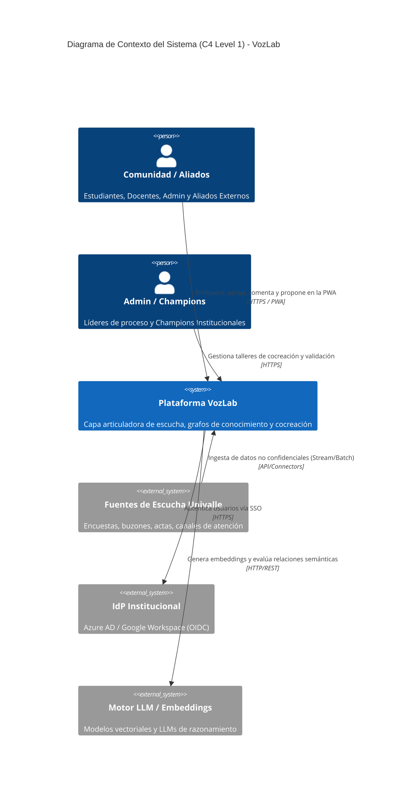
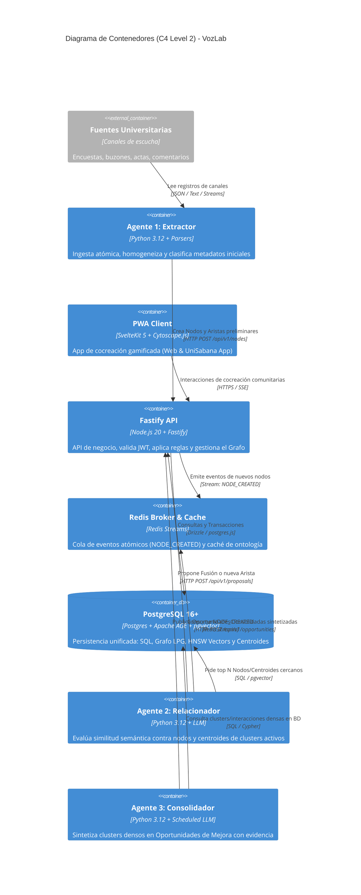
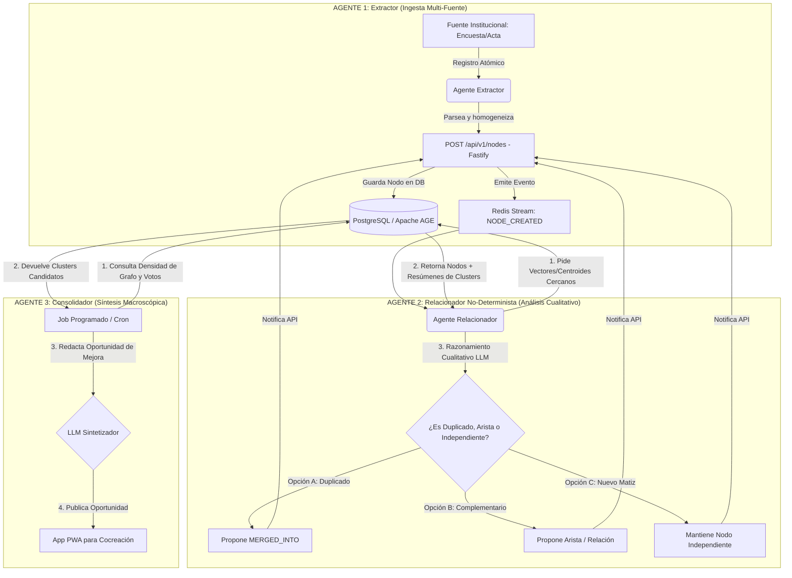

---
title: Visión General de la Arquitectura y Estructura del Monorepo
version: 1.3.0
status: APPROVED
target_component: System Core
owner: Architecture Team (VozLab)
---

# 00. VISIÓN GENERAL DE LA ARQUITECTURA (VOZLAB)

## 1. Misión de la Plataforma y Topología Global

**VozLab** es una infraestructura B2B/Institucional diseñada para articular los diversos mecanismos de escucha, participación y atención que hoy operan de forma independiente en la Universidad[cite: 10]. 

La plataforma combina **Cómputo Determinista en Base de Datos (PostgreSQL + Apache AGE + pgvector)** con un **Trío de Agentes de IA Especializados** que aportan razonamiento semántico no-determinista[cite: 10], transformando la información dispersa en **Oportunidades de Mejora Consolidadas** para la cocreación comunitaria[cite: 10].



---

## 2. Estructura del Monorepo (`pnpm` + Turborepo)

```
vozlab/
├── .dev-state/                      <-- Estado de desarrollo para Agentes Locales
│   ├── roadmap.json
│   ├── current_task.json
│   └── changelog_dev.md
├── apps/
│   ├── web/                         <-- PWA Frontend (SvelteKit 5 + Cytoscape.js)
│   ├── api/                         <-- Backend Principal (Fastify + TypeScript + Drizzle)
│   ├── worker-extractor/            <-- AGENTE 1: Ingesta y Estructuración (Python 3.12)
│   ├── worker-relacionador/         <-- AGENTE 2: Evaluador de Relaciones y Clusters (Python 3.12)
│   └── worker-consolidador/         <-- AGENTE 3: Consolidador de Oportunidades (Python 3.12)
├── packages/
│   ├── shared-types/                <-- Esquemas Zod y Contratos DTO compartidos (Web/API)
│   ├── database/                    <-- Esquemas Drizzle, Apache AGE (Cypher) y Migraciones
│   └── ts-config/                   <-- Configuraciones base de TypeScript
├── docker-compose.yml               <-- Entorno local (PostgreSQL+AGE+pgvector, Redis)
├── pnpm-workspace.yaml              <-- Definición de Workspaces pnpm
└── turbo.json                       <-- Pipeline de compilación Turborepo

```

---

## 3. Diagrama de Contenedores (C4 Level 2)



---

## 4. Flujo Detallado de los 3 Agentes de IA



---

## 5. Responsabilidades y Cargas de los Agentes

| Agente | Trigger / Frecuencia | Input Entregado por la BD | Tarea No-Determinista del LLM | Salida |
| --- | --- | --- | --- | --- |
| **Agente 1: Extractor** | En vivo por canal | Texto crudo de la fuente | Homogeneizar formato y extraer la idea central con metadatos ontológicos. | Nodo borrador vía API. |
| **Agente 2: Relacionador** | Evento `NODE_CREATED` | Nodo nuevo + Top 5 Nodos cercanos + Centroides de Clusters Activos | Determinar si el nodo trae un matiz suficiente para ser independiente o si debe fusionarse/relacionarse. | Propuesta de edición/arista. |
| **Agente 3: Consolidador** | Programado (Cron / Batch) | Grupos de nodos y conversaciones con alta interacción comunitaria | Redactar la **Oportunidad de Mejora Consolidada** sintetizando toda la evidencia agregada. | Oportunidad en PWA. |

---

## 6. Casos de Borde Globales y Aprendizaje Continuo

> [!NOTE]
> **Aprendizaje Semi-Supervisado:** Cuando la comunidad vota, comenta o el autor aprueba/rechaza una sugerencia del Agente 2, esta interacción se retroalimenta al sistema para ajustar los umbrales del Agente Relacionador.
> 
> 

1. **Aislación del Grafo por Workspace:** Las sugerencias de relación del Agente 2 ocurren estrictamente dentro del mismo `workspace_id`.
2. **Fallos de Conectividad con el LLM:** Si Ollama/LLM no responde durante la evaluación del Agente 2, la tarea no se pierde; queda retenida en Redis Streams para re-evaluación automática.
