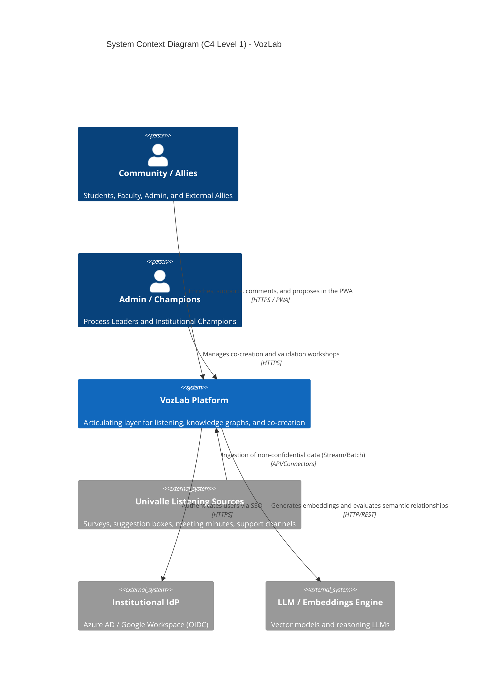
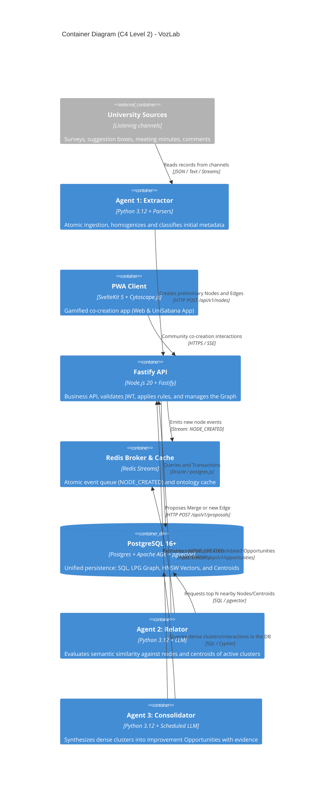
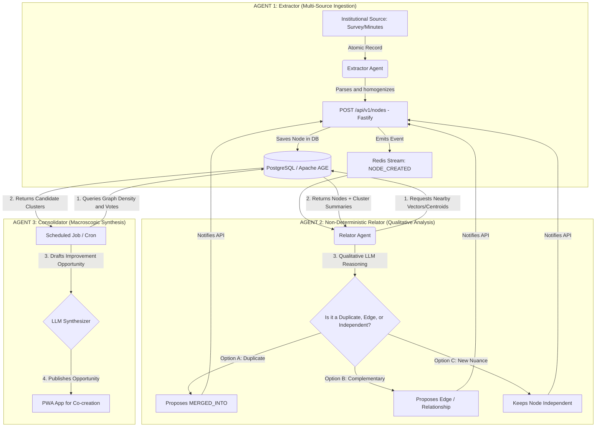

---
title: Architecture Overview and Monorepo Structure
version: 1.3.0
status: APPROVED
target_component: System Core
owner: Architecture Team (VozLab)
---

# 00. ARCHITECTURE OVERVIEW (VOZLAB)

## 1. Platform Mission and Global Topology

**VozLab** is a B2B/Institutional infrastructure designed to articulate the various listening, participation, and support mechanisms that today operate independently at the University[cite: 10]. 

The platform combines **Deterministic Computing at the Database Level (PostgreSQL + Apache AGE + pgvector)** with a **Trio of Specialized AI Agents** that provide non-deterministic semantic reasoning[cite: 10], transforming scattered information into **Consolidated Improvement Opportunities** for community co-creation[cite: 10].



---

## 2. Monorepo Structure (`pnpm` + Turborepo)

```
vozlab/
├── .dev-state/                      <-- Development state for Local Agents
│   ├── roadmap.json
│   ├── current_task.json
│   └── changelog_dev.md
├── apps/
│   ├── web/                         <-- PWA Frontend (SvelteKit 5 + Cytoscape.js)
│   ├── api/                         <-- Main Backend (Fastify + TypeScript + Drizzle)
│   ├── worker-extractor/            <-- AGENT 1: Ingestion and Structuring (Python 3.12)
│   ├── worker-relacionador/         <-- AGENT 2: Relationship and Cluster Evaluator (Python 3.12)
│   └── worker-consolidador/         <-- AGENT 3: Opportunity Consolidator (Python 3.12)
├── packages/
│   ├── shared-types/                <-- Shared Zod Schemas and DTO Contracts (Web/API)
│   ├── database/                    <-- Drizzle Schemas, Apache AGE (Cypher), and Migrations
│   └── ts-config/                   <-- Base TypeScript Configurations
├── docker-compose.yml               <-- Local environment (PostgreSQL+AGE+pgvector, Redis)
├── pnpm-workspace.yaml              <-- pnpm Workspaces definition
└── turbo.json                       <-- Turborepo build pipeline

```

---

## 3. Container Diagram (C4 Level 2)



---

## 4. Detailed Flow of the 3 AI Agents



---

## 5. Agent Responsibilities and Loads

| Agent | Trigger / Frequency | Input Delivered by the DB | Non-Deterministic LLM Task | Output |
| --- | --- | --- | --- | --- |
| **Agent 1: Extractor** | Live per channel | Raw text from the source | Homogenize the format and extract the central idea with ontological metadata. | Draft node via API. |
| **Agent 2: Relator** | `NODE_CREATED` event | New node + Top 5 nearby Nodes + Centroids of Active Clusters | Determine whether the node brings enough nuance to be independent or whether it must be merged/related. | Edit/edge proposal. |
| **Agent 3: Consolidator** | Scheduled (Cron / Batch) | Groups of nodes and conversations with high community interaction | Draft the **Consolidated Improvement Opportunity** synthesizing all the aggregated evidence. | Opportunity in PWA. |

---

## 6. Global Edge Cases and Continuous Learning

> [!NOTE]
> **Semi-Supervised Learning:** When the community votes, comments, or the author approves/rejects a suggestion from Agent 2, this interaction is fed back into the system to adjust the Relator Agent's thresholds.
> 
> 

1. **Graph Isolation per Workspace:** Agent 2's relationship suggestions occur strictly within the same `workspace_id`.
2. **LLM Connectivity Failures:** If Ollama/LLM does not respond during Agent 2's evaluation, the task is not lost; it remains retained in Redis Streams for automatic re-evaluation.
3. **Data-Source → Workspace Mapping:** The API owns the registry of institutional sources (`meta.data_sources`). Workers never choose a workspace; they query the API to resolve the `source_id` to its target workspace and authorization context.
