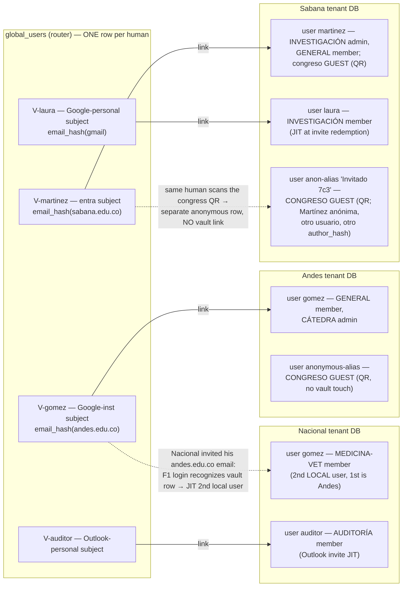
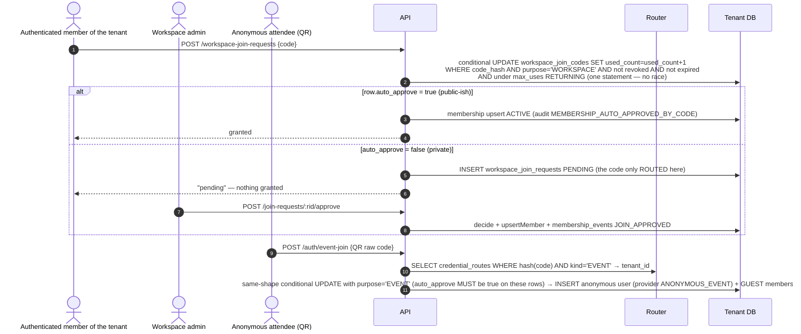
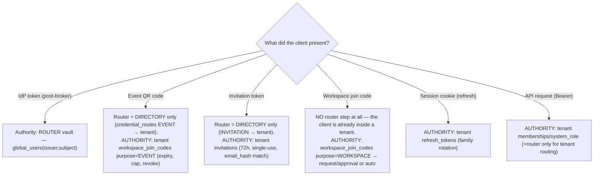

# Database audit — router DB + tenant `auth` schema: flows, columns, health

- Status: OPEN (findings accepted 2026-10-30; remediation merged into
  [plans/identity-consolidation/v1.md](../plans/identity-consolidation/v1.md)
  per ruling D-1)
- Date: 2026-10-30
- Method: schema read (`router.schema.ts`, `tenant.auth.schema.ts`) + live SQL
  inventory of both databases (`vozlab_router`, `vozlab_tenant_dev.auth`) +
  two independent call-chain maps (every table/column traced up to the HTTP
  route / use case / CLI that touches it). Claims marked **verified** were
  re-checked directly; everything else cites the traced chain with file:line.
- Vocabulary: post-ADR-0044 (`global_user_*`). Migrations are single baselines.
- Relationship to other records: this audit **confirms and extends**
  [db-identity-normalization.md](db-identity-normalization.md)
  (DEC-3/4/5 = Plan 2 `identity-consolidation`). Findings P2, P3, P6, P7.6,
  P8.6, P9 are **new** — not scheduled anywhere yet.

---

## 1. The system seen from the databases

```
 Browser (SvelteKit :5173 / prod Caddy)
    │ 1. GET /auth/login ──► Zitadel broker :8081 (IdP federation, the ONLY
    │                          issuer the API trusts — realm = tenant)
    │ 2. GET /auth/callback (code exchange)
    │ 3. POST /auth/select-tenant | switch-tenant | event-join | refresh | logout
    ▼
 Fastify API :3000 (hexagonal; composition root server.ts)
    ├── ROUTER pool ──────────► vozlab_router      (identity vault + pre-tenant routing)
    ├── tenant pools (per tid) ► vozlab_tenant_dev  (auth, meta, public, social schemas)
    └── Redis (OIDC state, jti blacklist, streams)
 Python workers ──agent JWT──► API routes only (never touch a DB directly);
    their requests read tenants + tenant_connections via TenantGuard/PoolManager.
 CLI scripts (packages/database/scripts): seed-dev, mint-dev-token, event-code,
    grant-tenant-admin, revoke-sessions, reconcile-router-tenants, grant-mcp-reader.
```

**Two physical DBs** (ADR-0002 + the ADR-0028 global-index amendment):

| vozlab_router (public) | vozlab_tenant_dev (auth.*) |
|---|---|
| tenants | workspaces |
| tenant_connections | users |
| tenant_identity_providers | workspace_memberships |
| global_users | workspace_join_requests |
| global_user_tenants | workspace_join_codes |
| global_user_events | invitations |
| event_codes | external_identities |
| global_invitations | refresh_tokens |
| | membership_events |

Dev topology note: the seed intentionally registers **4 tenants that share one
physical tenant DB** ("others share for dev", seed-dev.ts:379) — the
google/entra/personal tenants exist to exercise the broker's multi-issuer
login. This is a documented dev convenience, not a defect; in prod each
`tenant_connections` row points at a real separate DB.

## 2. Flows, in request order, with the exact tables/columns each touches

Flow IDs are reused later. Direction is browser→API unless noted.

### F1 — Institutional OIDC login (the main door)
`GET /auth/login` → `StartOidcLoginUseCase` (writes **nothing** in SQL — the
state + optional invitation token live in Redis) → Zitadel → `GET /auth/callback`
→ `CompleteOidcLoginUseCase`, which in order:

1. router `global_users` upsert by `(issuer, subject)` — sets/refreshes
   `email, email_verified, full_name, picture(=null hardcoded), last_login_at,
   last_seen_at` (RouterDatabaseClient:136-149).
2. tenant `auth.users` + `auth.external_identities` JIT via
   `findOrCreateByExternalIdentity` — reads `external_identities(issuer,subject)`
   as **the** identity key (DrizzleUserRepository:233-242); on insert writes
   `email, handle(derived), full_name, provider, provider_user_id(=subject),
   author_hash(random), global_user_id, system_role='USER'` (:295-305) + the
   `external_identities` row (:316-321). Email-based account linking attempt
   reads `users.email` and can throw `ERR_ACCOUNT_LINK_CONFLICT` (:279).
3. router `global_user_tenants` link (`linkGlobalUserTenant`, status ACTIVE).
4. If the OIDC state carried an invitation token → **F3 redemption** (tenant
   `invitations` / router `global_invitations`, whichever registry has the hash).
5. tenant `auth.refresh_tokens` insert (new family) → HttpOnly cookie.
6. router `global_user_events` append `OIDC_LOGIN`.
7. One tenant → 302 to web with cookie. Many tenants → 302 `/select-tenant?gid=<globalUserId>`
   (**the `?gid=` carry-forward**, AuthController:116).

### F1b — Tenant selection / switching
`POST /auth/select-tenant|switch-tenant` → `SelectTenantUseCase`: reads router
`global_users(issuer,subject,email,email_verified,full_name)` + ACTIVE
`global_user_tenants`; **copies the router PII into the tenant JIT user**
(:57-74); creates a refresh family in the new tenant; appends `TENANT_SELECTED`.

### F2 — Anonymous event join (QR scan, no IdP, public route)
`POST /auth/event-join` → `JoinEventUseCase`: router `event_codes.consume`
(**atomic guarded** UPDATE `WHERE revoked IS NULL AND expires>now AND
(used<max OR max IS NULL) RETURNING`, RouterDatabaseClient:279-293) → resolves
`(tenant_id, workspace_id)` → tenant `workspaces.findById` (kind must be EVENT)
→ tenant `auth.users` insert (`provider='ANONYMOUS_EVENT'`, email NULL,
`anonymous_alias`, random `author_hash`) — **verified**: `is_anonymous` is NOT
set (DrizzleUserRepository:346-357) → `workspace_memberships` insert role
**GUEST** → `refresh_tokens` insert. No audit event at all (neither
`membership_events` nor `global_user_events`). Codes are minted **CLI-only**
(`db:event-code`); `IEventCodeRepository.create` has no API caller.

### F3 — Invitation accept
Admin (authenticated, tenant scope) creates: `POST /workspaces/:id/invitations`
→ tenant `auth.invitations` insert — **email stored in CLEARTEXT plus a
`sha256(email)` `email_hash`, both** (CreateInvitationUseCase:66-88; `created_by`
= actor UUID). Browser: link `/login?invitation=<token>` → folds into F1;
`CompleteOidcLogin` (:209-226) finds by `token_hash`, checks PENDING/expiry/uses,
**compares cleartext `invitations.email` against the IdP-verified email**, then
atomic accept (`UPDATE … WHERE status='PENDING' RETURNING`) + membership ACTIVE
+ `membership_events` INVITED/audit. A **global** invitation instead lives in
router `global_invitations` and redeems in `RedeemGlobalInvitationUseCase`
before any tenant DB is touched (that's why the router copy exists: the invite
targets a person, not yet a member).

### F4 — Join by rotating code (authenticated)
`POST /workspace-join-requests {code}` → `RequestWorkspaceAccessUseCase`:
hash the code → read tenant `workspace_join_codes.code_hash`, then
**application-level checks after a plain read** (revoked/expired/maxUses in
:52-56, not in SQL); `auto_approve=true` → membership insert + `incrementUse`
(**verified** unconditional `used_count+1 WHERE id=…`, no capacity predicate,
DrizzleWorkspaceJoinCodeRepository:113-119) — overbooking race under
concurrency; `auto_approve=false` → falls through to **F5**.

### F5 — Join request + human approval
Same route without auto-approve: `workspace_join_requests` insert PENDING →
`POST /workspaces/:id/join-requests/:rid/approve|reject` →
`ApproveJoinRequestUseCase` decides (writes `status, decided_by, decided_at`) +
`upsertMember` ACTIVE + `membership_events` JOIN_APPROVED/JOIN_REJECTED.

### F6 — Admin direct add
`POST /workspaces/:id/members` → `AddWorkspaceMemberUseCase`: lookup by
`users.handle` or by router link (`global_user_tenants.tenant_user_id`),
membership upsert, `membership_events` ADDED/REACTIVATED. The DTO accepts an
`email` but never uses it (dead input field).

### F7 — Refresh / logout / session revocation
`POST /auth/refresh` (cookie): atomic rotate on `refresh_tokens` (theft =
presenting a revoked hash → whole `family_id` revoked,
DrizzleRefreshTokenRepository:66-104) + compares `users.sessions_valid_after`.
`POST /auth/logout`: Redis jti blacklist + family revoke. **Verified**: no
per-request guard reads `sessions_valid_after` — AuthGuard is JWT + Redis
blacklist only, so a revoked user's access token lives out its ≤15 min TTL
(documented trade-off, revoke-sessions.ts:5-6).

### F8 — CLI / seed writes (no request direction)
`db:seed:dev` writes router `tenants, tenant_connections` and tenant
`workspaces(+join_code,+auto_approve_join_code), users(+provider_user_id,
**no external_identities, no global_user_id**), workspace_join_codes,
memberships, invitations(email+hash, created_by=authorHash)`.
`db:mint-dev-token` reads router tenants, mints JWT offline.
`db:grant-tenant-admin` writes `users.system_role` **by cleartext email
lookup**. `db:revoke-sessions` writes `sessions_valid_after` + revokes
families. `db:reconcile-router-tenants` is the **only** writer of
`global_user_tenants.status ∈ {SUSENDED, LEFT}` and the only reader of
`users.global_user_id`.

### F9 — Read surface that leaves the DB (who sees what)
`GET /auth/me` projects **tenant** `auth.users` (email, fullName, handle,
alias, role) + `listWorkspaces` — the router vault's PII is never sent to the
browser directly. Admin lists show invitation `email` cleartext
(adminDtos:116-128) and workspace `join_code` cleartext (reveal; see P8.2).

## 3. Per-table verdict

Legend: **live** = written+read by a wired flow · **semi** = wired but one end
missing or degenerate · **dead** = no reader/no writer/no caller in code.

### Router (vozlab_router)

| table | verdict | notes |
|---|---|---|
| tenants | live | only writer = seed; API reads by id/oidc_tenant_id; `findTenantBySlug` uncalled; `provisioned` read only by the CLI |
| tenant_connections | live | pool routing on every tenant request; **password plaintext** (no crypto code exists) |
| tenant_identity_providers | **semi-dead** | 3 wired routes + repo, **zero rows, zero UI callers**; `findByIssuer` uncalled. Designed for broker config the broker (Zitadel) already owns — orphan abstraction (P7.4) |
| global_users | live | sole writer F1/F1b `findOrCreate`; `updateProfile` uncalled; `picture` always NULL (claim hardcoded null, P9.2); `email` plaintext by decision — Plan 2 hashes it |
| global_user_tenants | live | picker + `?gid` + `/auth/me` reverse lookup; `status` SUSPENDED/LEFT written only by reconcile CLI; `first_seen_at` dead |
| global_user_events | live-write / **dead-read** | 3 actions only (OIDC_LOGIN, TENANT_SELECTED, GLOBAL_INVITATION_REDEEMED); no SELECT anywhere — pure append-only vault trail (acceptable, but the schema comment should say so); `metadata` currently carries no email (verified live rows) |
| event_codes | live | redemption atomic and guarded (the good example); creation CLI-only; `revoked_at` never writable (no CLI flag, no route — half-implemented revocation); `created_by_hash` written by CLI, read by nobody; `label` discarded by the use case |
| global_invitations | live both ends | `POST /invitations/global` (web admin) + redeem in callback; 0 rows = flow never exercised in dev; `status` has no REVOKED/EXPIRED writer |

### Tenant auth (vozlab_tenant_dev)

| table | verdict | notes |
|---|---|---|
| workspaces | live | except `join_code` (static, **cleartext**, only display+rotate — **not redeemable by any live route**; the redemption fallback behind `RequestWorkspaceAccessUseCase:92` is unreachable in prod wiring) and `auto_approve_join_code` (read only into an admin DTO — **no use case branches on it**; enforcement is `workspace_join_codes.auto_approve`). Both die in Plan 2 DEC-5 ✔ this audit confirms |
| users | live | see column table below |
| workspace_memberships | live | `status='INVITED'` in the comment is never written; `listWorkspaces` (P3) ignores status; suspend/reactivate/remove wired |
| workspace_join_requests | live | F4→F5; pending-unique partial index works |
| workspace_join_codes | live | redemption race (P4); `created_by` = UUID while invitations' `created_by` = authorHash — divergent creator semantics (P8.4) |
| invitations | live | `email` cleartext **and** `email_hash`; the hash is **read by no logic** (matching uses cleartext, P1.2); accept atomic; EXPIRED only via `POST /admin/cleanup` sweep; seed diverges on `created_by` |
| external_identities | live but **never backfilled** | sole identity key of the live JIT path (F1 step 2); seed writes zero rows → seeded users exist only via `users.provider_user_id`, which the live path never reads (P5) |
| refresh_tokens | live | atomic rotation + family theft revocation, correctly implemented |
| membership_events | live-write / **dead-read** | 11 direct writer classes + the audit sink; dev has 0 rows because admin flows were never exercised there; action values ⊄ the schema comment set (P8.5) |

### users columns (the densest table)

| column | verdict |
|---|---|
| email | live lookup key (linking, invitation match, admin search, grant CLI) — **cleartext PII**, Plan 2 hashes (DEC-3) |
| handle | live (derived at login, findByHandle for F6) |
| full_name | live (admin lists) |
| provider | live |
| provider_user_id | **semi-dead**: write-only on the live path; read only by `findOrCreateOidcUser`, itself dead (zero src callers). Plan 2 drops it (DEC-4) ✔ |
| author_hash | live (JWT claim, ADR-0013) |
| anonymous_alias | live (F2) |
| is_anonymous | **dead-broken**: never set true by any writer; sole reader `removeInactiveGuests` can therefore never match — guest cleanup silently does nothing (P2) |
| system_role | live (guards) |
| sessions_valid_after | semi (CLI writer, refresh-only reader — accepted trade-off, P7.6) |
| global_user_id | semi (JIT writer, only reconcile reads) |

## 4. Why `external_identities` lives in the tenant DB (the direct question)

It answers *"which local user row is this (issuer, subject) inside THIS
tenant?"* — it is the tenant's own JIT index, deliberately per-tenant because
the same person gets a **different local `user_id` (and a different
`author_hash`) in every institution** (ADR-0028 §2: the pair is for login and
linking only, never for authorization or authorship — ADR-0013 keeps authorship
institutional). The router's `global_users` stores the *same* `(issuer, subject)`
pair for a different question — *"have we ever seen this person anywhere?"* —
and links outward via `global_user_tenants.tenant_user_id`. So today the pair
is stored **three times** (router `global_users`, tenant
`external_identities`, legacy `users.provider_user_id`). Two of those are
load-bearing by design (tenant-local index ↔ global vault, joined by
`global_user_id`, no cross-DB FK); the third is the legacy one Plan 2 already
sentences. Moving `external_identities` to the router would break the
per-tenant isolation invariant (the tenant DB must be self-sufficient for
login when the router is unreachable) — **correct placement as-is**; the real
defect is that the seed never populates it (P5).

## 5. Findings register (severity-ranked)

**P1 — Cleartext email confirmed, in 4 places.** (Critical, planned)
`auth.users.email`, `auth.invitations.email` (live rows hold real addresses:
2 seeded + admin-created ones are cleartext), `global_users.email` (3 live
integration-test rows), `global_invitations.email` (NOT NULL by schema).
`invitations.email_hash` exists but is unread; matching is on cleartext.
→ Already DEC-3/Plan 2 (HMAC + `EMAIL_PEPPER` everywhere). Additions from this
audit: the invitation-match and account-link logic must be re-expressed on the
hash (not just the column swap), and `db:grant-tenant-admin`'s email lookup
must move to hash or handle.

**P2 — Guest cleanup is permanently dead.** (High, **unscheduled**)
`is_anonymous` never written; `removeInactiveGuests` filters `is_anonymous=TRUE`
→ GUEST event users accumulate forever (F2 creates them without any expiry).
Fix options: (a) set `is_anonymous=TRUE` in `createAnonymousUser` and keep the
column; (b) drop the redundant column and filter `provider='ANONYMOUS_EVENT'`,
which is already written. (b) is the smaller truth: `provider` already encodes
it — one mechanism, one column.

**P3 — `/auth/me` workspace list ignores membership status.** (High, unscheduled)
**Verified**: `listWorkspaces` (DrizzleUserRepository:371-390) joins
memberships with **no `status='ACTIVE'` filter** — a REMOVED/SUSPENDED member
still sees the workspace and its role in the picker, and the stale role keeps
flowing to the UI. One-line predicate + test.

**P4 — Join-code redemption race.** (Medium, scheduled in Plan 2)
`findByCodeHash` → app-side checks → unconditional `incrementUse`: concurrent
redemptions can overbook `max_uses` after the membership was already granted.
Plan 2 mandates the conditional `UPDATE … RETURNING` (the `event_codes.consume`
implementation is the proven template — reuse it).

**P5 — Seed produces a state the live code cannot reach.** (Medium, feeds the
reset/seed decision, §6)
Seeded users: `provider_user_id` set but **no `external_identities` row**,
`global_user_id` NULL. The live login key is `external_identities(issuer,subject)`
→ when a seeded email (e.g. the dev-maintainer subject) ever logs in via F1,
`findOrCreateByExternalIdentity` misses and creates a **second** user row with
the same email — divergent `author_hash`, divergent memberships. Also
`workspaces.join_code` plaintext static seeds vs the hashed rotating
`workspace_join_codes`; `invitations.created_by` authorHash vs API's UUID.

**P6 — Integration tests pollute the dev router.** (Medium, unscheduled)
**Verified**: the afterEach in `auth.integration.test.ts` cleans
`event_codes` + tenant rows but **not** `global_users / global_user_tenants /
global_user_events` — the 3 `it-login|reuse|unknown-*` rows in the vault are
test residue, not app data. Local==CI parity (the new invariant) means CI
passes only because its router starts fresh; locally the residue accumulates
and can flip a future "existing identity" test. Fix: extend afterEach to delete
the `it-*` vault rows (bounded by the issuer the mock uses), or run tests
against a dedicated `vozlab_router_test` DB.

**P7 — Dead / semi-dead surface** (cleanup candidates)
1. `tenant_identity_providers`: 0 rows, no UI caller, `findByIssuer` uncalled.
   The broker (Zitadel) already owns federation config. Delete vs wire — decision (see §7).
2. `workspaces.join_code` + `auto_approve_join_code`: confirmed dead weight (DEC-5 already sentences both).
3. `invitations.email_hash` unread today — becomes the *primary* column under DEC-3 (not dead, inverted).
4. `global_users.picture` always NULL (claim hardcoded) + `updateProfile` uncalled: either populate the claim (avatars work in the broker) or drop the column — cosmetic wire gap.
5. `event_codes.revoked_at` guarded-on-read but **never writable** (no CLI flag, no route): revocation is half-implemented — either finish it (tiny CLI flag) or drop the column until needed.
6. `users.sessions_valid_after`: refresh-only enforcement (≤15-min exposure window) — documented and accepted; no change.
7. `DirectIdentityAddUseCase` — **verified** not imported anywhere: delete.
   `findOrCreateOidcUser` (the legacy `(provider,provider_user_id)` matcher) — dead code that outlives DEC-4; delete together with the column.
8. `tenants.description/provisioned/updated_at`, `global_user_tenants.first_seen_at`,
   `event_codes.created_by_hash` (unread), `label` (discarded), `*_codes.created_at`-style
   dead timestamps: keep `created_at` (cheap), but the never-read creator columns go with DEC's thin-registry work.

**P8 — Duplicate semantics / contract lies** (the "things in common" the audit hunts)
1. **Two invitation systems** (tenant `invitations` + router `global_invitations`): both fully wired, different moments of the funnel (pre-tenant vs in-tenant). Legitimate duplication — but nothing in the docs says which to create from where; the admin UI uses `POST /invitations/global`. Keep both; one doc table (this §2 already is it).
2. **Two join-code mechanisms**: static cleartext `workspaces.join_code` (display+rotation only) vs hashed rotating `workspace_join_codes` (the redeemable one). DEC-5 collapses them; the admin UI must become reveal-on-rotation as planned.
3. **Two `auto_approve` flags**: `workspaces.auto_approve_join_code` (read by nothing) vs `workspace_join_codes.auto_approve` (enforced). The workspace-level one dies (DEC-5).
4. **`created_by` polymorphism**: invitations.created_by=UUID(API)/authorHash(seed); join_codes.created_by=UUID; event_codes.created_by_hash=pseudonym. Three meanings of "who". Consolidation: **`created_by_hash varchar(64)` (pseudonym) everywhere** — this generalizes Plan 2's DEC for `workspace_join_codes` to `invitations` too.
5. **Schema comments that lie**: `membership_events` action list ≠ code reality (ACCEPTED never written, 12+ unlisted actions); `workspace_memberships` comment `INVITED` never written; `users.provider` comment omits nothing but `is_anonymous` comment implies a writer that doesn't exist. The truth pass must fix comments as part of the same fold where possible.
6. **`AddWorkspaceMember` DTO accepts `email` it never uses** — remove the input (wire hygiene).

**P9 — Wire vocabulary** (carried forward)
`?gid=` in the browser redirect (AuthController:116) and `GlobalUserId` naming
across HTTP were frozen by DEC-8 in Plan 1; they belong to a wire-hygiene
sliver in Plan 2 territory.

## 6. Current data + should we reset from zero?

Live state today (post Plan-1 reset, fresh baseline + seed):

| DB | data |
|---|---|
| router | 4 dev tenants (1 physical DB by design); **3 `global_users` = test residue (P6)**, 2 links, 2 OIDC_LOGIN events; 1 `event_codes` row = the T4 smoke code (expires tomorrow, never consumed); `global_invitations` 0; `tenant_identity_providers` 0 |
| tenant auth | 5 seeded users (2 SYSTEM_AGENT), 4 workspaces, 8 memberships (multi-role rows exercised in general), 2 invitations (1 PENDING, 1 EXPIRED — the cleanup test fixture), 4 join codes; join_requests/external_identities/refresh_tokens/membership_events = 0 |

**Recommendation: do NOT reset the volume again now.** The volume was
surgically reset in Plan 1 (2026-10-30, commit ba3514b) and already carries
exactly the fresh baseline + idempotent seed. A second reset before Plan 2
recreates the *same* P5 seed defect — pointless. The correct sequence:

1. **Plan 2 executes its DDL** (drops `join_code`, `auto_approve_join_code`,
   `provider_user_id`, `users.email`; adds `purpose`, `event_code_routes`,
   peppered hashes, `created_by_hash`) as folds **against the current volume** —
   dev data survives because the changes are additive + drops of columns whose
   data is disposable.
2. **Fix the seed** in the same plan so a fresh volume = the target state
   (backfill `external_identities`; stop writing dropped columns; align
   `created_by_hash`; the seeded users either get synthetic global links or
   are explicitly marked dev-synthetic — see decision D-3 below).
3. Only after that, one final reset proves "reset from zero == seed == CI ==
   local integration green" as the standing invariant. Test residue (P6) is
   fixed with teardown, not with resets.

## 7. Open decisions for the plan (clarification protocol)

- **D-1**: Scope merger. Fold P2/P3/P4-verify/P6/P7/P8 fixes into
  `identity-consolidation v1` (one DB-shaped plan) vs a separate preceding
  `db-auth-hardening` plan. Merger pros: one seed rewrite, one fold series, one
  truth pass; cons: a bigger plan.
- **D-2**: `tenant_identity_providers` (P7.1): delete the table+port+3 routes
  (YAGNI — Zitadel owns federation) vs keep and wire an admin UI later.
- **D-3**: Seeded dev users identity state (P5): (a) seed also writes
  `external_identities` + synthetic `global_users` links so seeded users match
  the login path exactly; (b) leave them synthetic-local, accept they can never
  log in via the real broker (current de-facto, but document + guard the
  duplicate-row trap). (a) is coherent with "local==CI" parity.
- **D-4**: `is_anonymous` (P2): drop column + filter by `provider` (recommended,
  one mechanism) vs write the flag and keep it (a second discriminator that can
  drift again).
- **D-5**: `event_codes.revoked_at` half-life (P7.5): finish (CLI `--revoke`)
  vs drop until the QR-management route exists.

## 8. Architecture map — diagrams (target = post identity-consolidation v1 + DEC-9)

### 8.1 Blocks: clients, broker, API, router, tenants

```mermaid
flowchart TB
  subgraph Clients["Clients"]
    W["VozLab Web PWA"]
    QR["QR scan (mobile browser, anon)"]
    WRK["Python workers (agent JWT)"]
  end
  subgraph Z["Zitadel broker — ONE issuer; the API never trusts any other IdP directly"]
    direction LR
    subgraph MI["Microsoft institucional (Entra)"]
      SAB_P["sabana.edu.co"]
    end
    subgraph GI["Google institucional (Workspace)"]
      AND_P["andes.edu.co"]; UIS_P["uis.edu.co"]; NAL_P["nacional.edu.co"]
    end
    subgraph PS["Personal"]
      GP["Google personal"]; OP["Outlook personal"]
    end
    ZU["Zitadel user = the person<br/>(stable subject; linked social+inst IdPs<br/>are the broker's job, one row per human)"]
    MI --> ZU; GI --> ZU; PS --> ZU
  end
  A["VozLab API (Fastify) — resource server:<br/>validates only the broker's VozLab token"]
  subgraph R["vozlab_router — L0 routing + L1 global identity ONLY"]
    R1["global_users — vault (issuer, subject, email_hash, profile)"]
    R2["global_user_tenants — person↔tenant links"]
    R3["tenants + tenant_connections — where is each tenant's DB"]
    R4["credential_routes (NEW, DEC-9) — hash→tenant directory<br/>kind = EVENT | INVITATION. Routing, never authority"]
    R5["global_user_events — append-only trail"]
    R6["RETIRED: global_invitations, event_codes,<br/>tenant_identity_providers"]
  end
  subgraph T["Tenant DBs — physical isolation (one per university)"]
    subgraph TS["Sabana DB"]
      TSW["workspaces: general · investigación-clínica ·<br>evento-congreso (EVENT)"]
      TSD["users · external_identities · memberships ·<br>workspace_join_codes (purpose WORKSPACE|EVENT) ·<br>invitations (authority) · refresh_tokens · membership_events"]
    end
    subgraph TA["Andes DB"] TAD["…same shape, own users & workspaces…"] end
    subgraph TN["Nacional / UIS DBs"] TND["…same shape…"] end
  end
  W -->|"login / API calls (Bearer + X-Workspace-ID)"| A
  QR -->|"POST /auth/event-join"| A
  WRK -->|"agent JWT → node routes"| A
  A <-->|"OIDC code exchange"| Z
  A --> R
  A -->|"ConnectionPoolManager per tid"| T
  R4 -.->|"which tenant owns this credential?"| T
  R2 -.->|"tenant_user_id (no cross-DB FK)"| T
```

### 8.2 Layer ownership: who answers which question

| Layer | Question it owns | Owner DB | Tables (post-plan) |
|---|---|---|---|
| L0 routing | "what tenant does this presented code/token belong to? which DB do I open for this tenant?" | router | `tenants`, `tenant_connections`, `credential_routes` |
| L1 global identity | "have we ever seen this human, what is their verified profile?" | router | `global_users` (peppered `email_hash`), `global_user_tenants`, `global_user_events` |
| L2 institutional identity | "who am I INSIDE this institution?" | tenant | `users` (handle, author_hash), `external_identities` |
| L3 membership & credentials | "what may I do here, and how do I get in?" | tenant | `workspaces`, `workspace_memberships`, `workspace_join_codes(+purpose)`, `workspace_join_requests`, `invitations`, `refresh_tokens`, `membership_events` |
| L-external | "who is this person, with what IdPs?" | Zitadel | (out of VozLab SQL entirely) |

Router holds **no credential semantics, no PII beyond the hashed vault, no
workspace/role knowledge**. Every authority that grants access lives in the
tenant that enforces it.

### 8.3 Personas — one vault row per human, many local identities



| Case | Person | Identity source | Path in | What the DBs show |
|---|---|---|---|---|
| C1 | Dra. Martínez (Prof. Sabana) | Entra institucional | F1 login → auto tenant (1 link) | vault row; `global_user_tenants` 1 row; memberships: ADMIN investigación, MEMBER general; QR congress → **GUEST** + `author_hash` own pseudonym |
| C2 | Prof. Gómez (Prof. Andes) | Google institucional | F1 → andes picker | vault row; andes memberships; **co-teaches at Nacional**: Nacional admin invites `l.gomez@andes.edu.co` → he logs in (vault already known — no new vault row), Nacional JIT creates a **separate** `auth.users` row with its own `author_hash`, linked by the same `global_user_id` |
| C3 | Ing. Laura Pérez (external collaborator) | Google personal (gmail) | invited by Sabana → F1 → redemption JIT | zero tenants at first; invite redemption creates vault row + tenant user + link; she also scans an Andes event QR → anonymous user (no vault touch, purpose=EVENT) |
| C4 | Auditor (Outlook personal) | invited by Nacional | same as C3 | shows external invites need no institution account |
| C5 | Student at UIS wanting the Nacional research group | Google institucional | workspace code → PENDING → approval | `workspace_join_requests` + admin approve creates membership; code only routes, never grants |

Key property: **authorship is per-institution** (ADR-0013): the same human has
different `author_hash` values per tenant DB; cross-tenant linkage exists
only in `global_user_tenants` and is used for routing/login, never for
permissions.

### 8.4 F1 institutional login — atomic decisions

```mermaid
sequenceDiagram
  autonumber
  actor U as Person
  participant W as Web PWA
  participant A as API
  participant Z as Zitadel
  participant R as Router
  participant T as Tenant DB
  U->>W: "Log in" (+ optional ?invitation=TOK folded into state)
  W->>A: GET /auth/login?redirect
  A->>A: Redis state (nonce, returnPath, TOK?) — zero SQL
  A-->>W: 302 → Zitadel
  U->>Z: authenticates at any federated IdP
  Z-->>A: GET /auth/callback (code)
  A->>Z: code→tokens (server side) — verified email + name + picture
  A->>R: UPSERT global_users by (issuer,subject): email_hash=HMAC(pepper,email), profile, last_login
  opt state carried TOK (DEC-9 target)
    A->>R: SELECT credential_routes WHERE hash(TOK) → tenant_id (route only, no authority)
    A->>T: JIT user (if absent) + atomic invitation accept + membership + link
  end
  A->>R: SELECT global_user_tenants (status=ACTIVE) → tenant list
  alt exactly 1 tenant
    A->>T: (JIT if needed) + refresh family insert
    A-->>W: 302 app, HttpOnly cookie
  else N tenants
    A-->>W: 302 /select-tenant?guid=…
    U->>W: picks tenant (may pick "other…" = no tenant yet)
    W->>A: POST /auth/select-tenant
    A->>T: JIT (profile copied as HASHED-never: only name/handle; email does not travel) + link + family
    A->>R: append TENANT_SELECTED
  end
```

### 8.5 Invitations — the two directions, ONE mechanism (DEC-9)

```mermaid
sequenceDiagram
  autonumber
  actor Ad as Admin (any tenant)
  actor G as Invitee (same-org OR total outsider)
  participant A as API
  participant T as Tenant DB (authority)
  participant R as Router (directory only)
  Ad->>A: POST /workspaces/:id/invitations {email, role}
  A->>T: TX: revoke prior PENDING same email+ws → INSERT invitations:<br>email_hash=HMAC(pepper,email), token_hash=SHA256(opaque), role,<br>expires=72h, max_uses=1, created_by_hash | membership_events INVITED
  A->>R: INSERT credential_routes(token_hash, 'INVITATION', tenant_id)
  A-->>Ad: raw token ONE time → the admin delivers the link (email itself is out-of-band: VozLab never sends mail)
  G->>A: /login?invitation=TOK → F1 with state (same-org: institutional IdP; outsider: personal Google/Outlook)
  A->>R: callback: vault UPSERT (new humans are born here) → route: hash(TOK) → tenant_id
  A->>T: invitations.findByTokenHash → guards (PENDING, expiry, uses) + hashEmail(verified email)=email_hash
  A->>T: atomic UPDATE … WHERE status='PENDING' RETURNING → membership (role from invite) → JIT user if absent → TX commit
  A->>R: global_user_tenants link + GLOBAL_INVITATION… trail
  A-->>G: session cookie
  Note over T: Revocation/expiry/cleanup run ONLY on the tenant row (72h TTL,<br>single-use, re-send invalidates). Directory rows are inert if the authority revokes.
```

### 8.6 Join paths — workspace codes and event QRs (mirrors, one table)



### 8.7 Decision map: "presented a credential — where is the authority?"



## 9. Alternatives reviewed for responsibility split (the "are we sure?" check)

### 9.1 Where should an EXTERNAL invitation live? (user's question 2)

| Option | Shape | Pros | Cons | Verdict |
|---|---|---|---|---|
| **A — today: full row in router `global_invitations`** | router stores token_hash + plaintext email + tenant + **workspace + role + expiry** | redeem without touching a tenant DB first | router crosses its own L0/L1 boundary (knows workspaces and roles — L3 data); PII in the vault table; **two parallel invitation systems** with different guards (global = caller-set expiry + unlimited uses default vs tenant = 72h single-use); creator/status semantics diverge; admin UI must choose "which invitation am I making"; out-of-scope item in v1 exists *because* of this split (no REVOKED/EXPIRED writers) | ❌ |
| **B — DEC-9 proposal: tenant authority + router directory** (the exact DEC-3 pattern applied to invitations) | `invitations` (tenant) holds everything; router gets one generic `credential_routes(credential_hash UNIQUE, kind 'EVENT'\|'INVITATION', tenant_id, created_at)` | one mechanism for **all** pre-tenant credentials; authority + enforcement in the tenant that creates the membership (no cross-DB consistency question: the redemption TX is single-DB); external invitee's JIT already happens in the same callback flow, so zero new machinery; stricter semantics (72h/single-use/revoke-resend) apply to ALL invitations; workspace assignment is naturally delegated to the tenant row (which also holds the role and emits `membership_events` INVITED) | one more step in redemption (route → tenant) — already the shape of event-join since DEC-3; directory can drift (stale route = harmless 404, documented invariant) | ✅ **recommended** |
| C — no directory: tenant slug inside the invitation link | link `/invite/{tenantSlug}/{token}` | no router table | breaks ADR-0019 opacity for invitations (tenant enumeration in URLs/emails), duplicates what the code hash already avoids | ❌ |

Answers to the sub-questions: *can workspace assignment be delegated to the
tenant table?* **Yes — and it should**: the tenant row already carries
`workspace_id, role, email_hash, token_hash, status, expiry, used_count`. The
router needs nothing of that to do its L0 job (token→which tenant). *Is it a
bad idea?* The opposite — today's non-delegation is the anomaly. *How is the
token managed?* Exactly as tenant invitations do today: random 32 bytes, raw
shown once, SHA-256 stored (opaque, high-entropy — DEC-4), re-send rotates.
*Worth it vs. added complexity?* Fewer moving parts than today (one table, one
use-case pair, one admin route replaces two systems). Cost: retire
`global_invitations` + `Create/RedeemGlobalInvitationUseCase` +
`POST /invitations/global`; web admin already points at the workspace
invitation route.

### 9.2 Are admin invitations ephemeral? (question 3) — and are they enough?

**Verified in code**: tenant invitations are 72 h TTL, `max_uses = 1`,
re-send atomically revokes the previous PENDING for the same email+workspace,
raw token exists only in the create response, cleanup job flips EXPIRED, admin
can REVOKED. That is the correct ephemeral profile — and under DEC-9 it becomes
the **only** profile (the lax global twin with caller-set expiry and unlimited
default uses disappears).

### 9.3 Is data-access atomicity/responsibility clean? (question 1)

After Plan-2 + DEC-9, per §8.2: every write touches ONE physical DB per
transaction; the only cross-DB sequences are (a) vault upsert → tenant JIT
(login — order enforced, router-first is idempotent) and (b) mint = tenant
authority first → route second, revoke = route first → authority second. The
audit's P7.7 deletions remove the last ports that reached across layers.
Remaining accepted non-atomicities: post-commit event publishing (by design,
AGENTS), and the directory's "stale route harmless / missing route re-push"
invariant — routing is never authority, so no consistency window can grant
access.

### 9.4 Other splits re-examined while we were at it (kept as-is, with reasons)

- `external_identities` per tenant (not router): broker subject is stable and
  the tenant index answers the *tenant-local* question; moving it would break
  tenant self-sufficiency (login when the router is down still JITs/links
  inside the tenant). §4.
- `tenants` + `tenant_connections` in router: correct (config, L0).
- `global_user_events` write-only trail: correct; add a reader only with an
  admin UI story (tracked, not scheduled).
- Zitadel as sole issuer (one vault subject per person regardless of IdP): the
  multi-persona cases C2–C4 depend on it; broker-side IdP linking is Zitadel's
  job — recorded here so nobody re-implements it in SQL.


## 10. Evidence index

- Live inventory queries: this session (2026-10-30), both DBs, `pg_dump`s of
  the same era in `local-backups/` (gitignored).
- Router call-chain map: explore trace 2026-10-30 (all router tables/columns →
  RouterDatabaseClient ports → use cases → routes; Q1-Q8).
- Tenant auth call-chain map: explore trace 2026-10-30 (F1-F8 chains, 10 answers).
- Direct verification this session (marked **verified**): `incrementUse`
  unguarded; `createAnonymousUser` omits `is_anonymous`; `listWorkspaces`
  status-less join; `DirectIdentityAddUseCase` unimported; ADR-0028 §2 (the
  external_identities placement); seed 4-tenant/1-DB sharing block.
- Cross-references: [db-identity-normalization.md](db-identity-normalization.md)
  DEC-1..8; [ADR-0044](../decisions/ADR-0044-identity-vocabulary-coherence-and-migration-baseline.md);
  [ADR-0028](../decisions/ADR-0028-multi-institution-identity-global-index-and-broker.md);
  [ADR-0019](../decisions/ADR-0019-global-event-codes.md);
  [ADR-0002](../decisions/ADR-0002-two-physical-databases.md).
