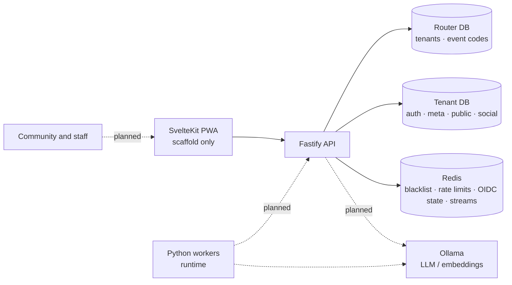

# Architecture

VozLab is currently a **modular monolith**: one Fastify process exposes the REST API and owns all tenant resolution, authorization, graph mutations and event publication. Phase 2 has a shared Python runtime with the embedder, the Relator and the Extractor implemented; the Consolidator is a scaffold. Phase 3 has started: the SvelteKit 5 PWA builds and serves SSR, with the scaffold (3.1), the state layer plus HTTP client (3.2), the route groups with the session guard (3.3), the Cytoscape canvas (3.4), the governance UI (3.5), the offline shell with its accessibility pass (3.6) and the Playwright suite (3.7) done — Phase 3 is complete.

## Context and containers



| Container | Technology | State |
| --- | --- | --- |
| API | Node.js + Fastify 4 + TypeScript, run with `tsx` | Implemented |
| Router DB | PostgreSQL 18.6, one global database | Implemented |
| Tenant DB | PostgreSQL 18.6 + pgvector; one physical DB per institution | Implemented |
| Broker/cache | Redis 7 (Streams, fixed-window counters, token blacklist, OIDC state) | Implemented |
| PWA | SvelteKit 5 + Tailwind 4 + Cytoscape.js | Scaffold only (3.1): builds, serves SSR, manifest and service worker generated |
| Workers | Python 3.12 + uv; shared `vozlab_worker` runtime (ADR-0021) | Embedder, Relator and Extractor implemented; the Consolidator is a scaffold |
| AI workers | Consolidador | Empty scaffold |
| LLM | Ollama (`nomic-embed-text`, 768 dims) | Used by the embedder |

## Request path

```text
HTTP
  -> CorrelationGuard (onRequest; reqId / x-correlation-id)
  public auth (login/callback/refresh/event-join): rateLimit (per IP)
  protected resource:
    -> authGuard
    -> tenantGuard
    -> tenantWorkspaceGuard
    -> rateLimit
  -> controller (Zod validation, DTO mapping)
  -> use case (application rules)
  -> UnitOfWork / repository (tid-scoped)
  -> Drizzle ORM
  -> tenant PostgreSQL
```

1. **CorrelationGuard** is registered globally. It accepts an incoming `x-correlation-id` or generates a UUID, binds it to `AsyncLocalStorage`, and returns it on the response.
2. **Public auth routes** (`/auth/login`, `/auth/callback`, `/auth/refresh`, `/auth/event-join`) are rate-limited per IP and then handled by the controller; they have no bearer token or workspace header. `/auth/logout` requires only `authGuard`; `/auth/me` requires `authGuard -> tenantGuard`.
3. **authGuard** verifies the HS256 Bearer JWT with `JWT_SECRET`, checks `jti` against the Redis blacklist, requires a `sub` and a valid 64-hex `authorHash`, and attaches the identity. An allow-listed `type` claim marks a system agent.
4. **tenantGuard** resolves the `tid` claim through `public.tenants` in the router DB and attaches the internal `tid` and slug. It is shared by resource routes and `/auth/me`.
5. **tenantWorkspaceGuard** requires `X-Workspace-ID` (UUID) and verifies workspace membership in the tenant DB (skipped for agents). It attaches `workspaceId`.
6. **rateLimit** enforces two Redis fixed-window buckets: per actor (`authorHash`, or IP) and a coarse per-workspace ceiling.
7. **Controller** validates body/query with Zod, extracts the request context, calls one use case, and maps `DomainError`/`InfrastructureError` to HTTP via `errorResponse.ts`.
8. **Use case** owns authorization and state transitions. Multi-table mutations run inside `UnitOfWork.runInTransaction(tid, cb)`; repositories receive the same `tx`.
9. **Repository** obtains the tenant's cached Drizzle pool, scopes every query by `tid` (and by workspace where the port is workspace-scoped), filters soft-deleted rows, and uses keyset pagination.
10. **Events** are published after commit, best-effort. A broker failure is logged and never rolls back persisted data.

Health routes are public: `/health` and `/health/live` return liveness; `/health/ready` probes the router DB and Redis (`200` ready / `503` degraded). It does not probe tenant databases.

## Two-database topology

| Store | Dev database | Tables / schemas | Purpose |
| --- | --- | --- | --- |
| Router (global) | `vozlab_router` | `public.tenants`, `public.tenant_connections`, `public.event_codes` | OIDC tenant id → internal `tid` → physical connection; global event-code registry |
| Tenant (per institution) | `vozlab_tenant_dev` | `auth`: workspaces, users, memberships, refresh tokens · `meta`: ontology · `public`: nodes, edges, proposals, interactions · `social`: threads, posts | Graph, governance and identity data |

The router DB never holds tenant content, and the tenant DB never holds routing data. `event_codes` is the documented exception: a QR is scanned before the tenant is known, so the code registry is global and carries only routing metadata ([ADR-0019](decisions/ADR-0019-global-event-codes.md)). There are no cross-database joins or foreign keys: the router is queried once per request to resolve the tenant, then all work happens in the tenant DB.

## Tenant connection pools

`ConnectionPoolManager` caches one `pg.Pool` + Drizzle client per internal `tid`:

- Resolves host/port/database/user/password from `tenant_connections` on first use.
- `max: DATABASE_POOL_MAX` (default 10), idle timeout 30 s, connect timeout 10 s.
- Evicts pools idle for 30 min; the sweep runs every 5 min; all pools close on shutdown.
- Contract: `getTenantDatabaseConfig` returns `null` only when the tenant has no connection row (→ `403 ERR_TENANT_NOT_PROVISIONED`); driver/connection failures throw `InfrastructureError` (→ `503 ERR_DATABASE_CONNECTION_FAILED`).

## Redis and streams

Redis serves four independent concerns: the JWT blacklist (`vozlab:blacklist:<jti>`), rate-limit counters (`vozlab:ratelimit:<tid>:<workspace>:<method>[:<actor>]`), single-use OIDC state (`vozlab:oidc:state:<state>`, 10 min), and event streams. Every logical event maps to `stream:<event-lowercase>`:

| Event | Stream |
| --- | --- |
| `NODE_CREATED` | `stream:node_created` |
| `PROPOSAL_CREATED`, `PROPOSAL_APPROVED`, `PROPOSAL_REJECTED`, `PROPOSAL_AUTO_APPLIED` | `stream:proposal_created`, `stream:proposal_approved`, `stream:proposal_rejected`, `stream:proposal_auto_applied` |
| `NODE_MERGED` | `stream:node_merged` |
| `EDGE_CREATED`, `EDGE_UPDATED`, `EDGE_DELETED` | `stream:edge_created`, `stream:edge_updated`, `stream:edge_deleted` |
| Ontology, discussion, interaction and deletion events | `stream:<event-lowercase>` |

`NODE_CREATED` carries `reqId`, `nodeId`, `workspaceId`, `typeKey` and `title`. Two workers consume it, each with its own consumer group so both see every event:

| Group | Worker | What it does |
| --- | --- | --- |
| `embedder` | `apps/worker-embedder` | Reads the node through the API, calls Ollama and stores the 768-dimensional vector through the agent-only `PUT /api/v1/nodes/:id/embedding` (ADR-0020). |
| `relator` | `apps/worker-relacionador` | Reads the top-5 neighbours through `GET /api/v1/nodes/:id/neighbors` (ADR-0022), asks the local LLM for a verdict and creates a `PENDING` edge (ADR-0023). A `MERGE` verdict is submitted as a merge proposal (ADR-0026). |

`NODE_MERGED` is published after the transaction that applied an approved merge
proposal commits. It carries `reqId`, `mergedNodeId` (the duplicate),
`survivingNodeId` (the node that keeps living) and `workspaceId`.

The shared Python runtime (ADR-0021) implements groups, `XAUTOCLAIM`, bounded attempts and a dead-letter stream (`stream:node_created:dead`). Publication is fire-and-forget: if Redis is disconnected, the event is dropped with a warning (there is no outbox or retry).

## Runtime and deployment facts

| Service | Image / runtime | Port | Notes |
| --- | --- | --- | --- |
| API | `tsx` on Node 22 | 3000 | `HOST`, `PORT` from env; graceful `SIGTERM`/`SIGINT` |
| Embedder worker | Python 3.12 (`vozlab-worker-embedder`) | — | Compose profile `workers`; consumes `stream:node_created` (group `embedder`) |
| Relator worker | Python 3.12 (`vozlab-worker-relacionador`) | — | Compose profile `workers`; consumes `stream:node_created` (group `relator`) |
| Extractor worker | Python 3.12 (`vozlab-worker-extractor`) | — | Compose profile `workers`; consumes `stream:source_raw` (group `extractor`) |
| PostgreSQL | `vozlab/postgres:18-age-pgvector` (PG 18.6, AGE 1.8, pgvector) | 5432 | Built from `docker/postgres/Dockerfile`; init scripts only on a fresh volume |
| Redis | `redis:7-alpine` | 6379 | No auth locally; password optional |
| Ollama | `ollama/ollama:latest` | 11434 | Not called by the API today |

Environment is validated by Zod at startup (`shared/config/env.ts`); missing or invalid values call `process.exit(1)`. The API loads the repo-root `.env` via `tsx --env-file-if-exists`; process env wins. `ROUTER_DB_*`, `REDIS_HOST`, `JWT_SECRET` (≥ 32 chars), all `OIDC_*` values and `WEB_ORIGIN` are required. CI (`.github/workflows/ci.yml`) runs the TypeScript gate (`build type-check test`), coverage with thresholds, lint (errors fail), an integration job against provisioned Postgres/Redis services, the Python gate and the worker/api/web image builds. The API sits behind a same-host reverse proxy in production (`trustProxy` = loopback+RFC1918 CIDRs, `infrastructure/http/proxyTrust.ts`; [ADR-0043](decisions/ADR-0043-production-topology-caddy-t2.md)).

## Channels and guarantees

| Channel | Used for | Guarantee | Where it breaks |
| --- | --- | --- | --- |
| HTTPS JSON (Bearer access token, `X-Workspace-ID`) | All product reads and writes. | Synchronous; the response reflects the commit. | A missing or wrong workspace header returns 400 or 403; a cross-workspace object returns 404. |
| HttpOnly refresh cookie (`/api/v1/auth`) | Session restore and rotation. | Rotation with reuse detection revokes the family. | If the cookie is not sent (wrong path, third-party blocking), the user is signed out. |
| Redis Streams (`stream:<event>`) | Asynchronous work for workers. | At-least-once delivery to each consumer group, with `XAUTOCLAIM` recovery and a dead-letter stream. | Publication is fire-and-forget after commit: if Redis is down when the event is published, it is lost (F-12 — no outbox yet). |
| Ollama HTTP | Embeddings and chat. | None beyond retries. | An unavailable model leaves entries pending; the work is delayed, not lost, while Redis holds it. |
| OIDC | Institutional sign-in. | Authorisation code with PKCE, state and nonce single-use in Redis. | IdP outage returns 503; the API never accepts an IdP token as a graph credential. |

**Not present:** server-sent events, WebSockets, webhooks in or out, email, object storage, and any outbox.

## Failure modes and their effects

| Component down | Effect on users | Effect on data | Detection today |
| --- | --- | --- | --- |
| Router DB | Every protected request returns 503 at tenant resolution. Readiness reports `degraded`. | None. | `/health/ready`. |
| Tenant DB (one institution) | That institution's requests return 503 when the pool is used. Readiness stays `ready` because it does not probe tenants. | None. | Logs only (F-13). |
| Redis | Access tokens are treated as valid (blacklist fails open). Rate limits fail open. OIDC login returns 503. Events are dropped. | Missed embeddings and evaluations for events published during the outage. | Readiness reports `degraded`; logs. |
| Ollama | Nothing user-facing. | Embeddings and verdicts are delayed. Entries wait in pending state. | Logs only. |
| IdP | New sign-ins fail with 503. Existing sessions continue until the refresh token expires. | None. | Logs. |
| An embedder bug | Nothing user-facing. | Nodes without vectors; the Relator waits on them. | Stream pending counts (manual). |
| The API process | Full outage until restart. Graceful shutdown drains requests. | None; writes are synchronous. | Process supervisor (not defined). |

## What is not built

- PWA: Phase 3 is complete. The event QR **scanner** is not built — the join page takes the code as text — and the ontology's proposed properties are not published, so only the active ones reach the dynamic form.
- SSE, GraphQL.
- Python Consolidator handler. The embedder, the Relator and the Extractor are implemented; `apps/worker-consolidador` does not exist yet.
- An ingestion producer: nothing publishes `stream:source_raw` yet, so the Extractor has no input (the gateway is an open option in the spec).
- Management of the source registry: `meta.data_sources` exists and the resolution route reads it, but there is no route to create or deactivate a source ([ADR-0025](decisions/ADR-0025-source-resolution-route.md)).
- Apache AGE mirroring/Cypher adapter. The read path is a bounded SQL recursive CTE over `public.edges`.
- The T2 production deployment (Caddy + `docker-compose.prod.yml`) is instrumented ([ADR-0043](decisions/ADR-0043-production-topology-caddy-t2.md), runbook `ops/production-deployment.md`) but **no real host exists yet** — pending the final hostname, staging CSP tuning and a first go-live. The `deploy.yml`/`e2e.yml` workflows are valid YAML now (heredoc artifacts removed 2026-10-29) but have never run: the repo has no git remote configured.

## Decisions and further reading

The architecture decisions are recorded in the [ADR set](decisions/) (`docs/decisions/ADR-*.md`): Bearer access JWT with an `HttpOnly` refresh credential, OIDC + JIT accounts, physical database per tenant, the global event-code exception, bounded SQL CTE over Apache AGE for reads, synchronous vote scoring, soft-delete policy, opaque pseudonyms, the API-owned source registry, the dedicated embedding pipeline (ADR-0020) and the shared Python worker runtime (ADR-0021). The manual Composition Root is a convention, described in [conventions.md](conventions.md). Implementation details are in [auth-and-tenancy.md](auth-and-tenancy.md), [domain-model.md](domain-model.md), [api-reference.md](api-reference.md) and [runbook-ops.md](ops/runbook-ops.md).
