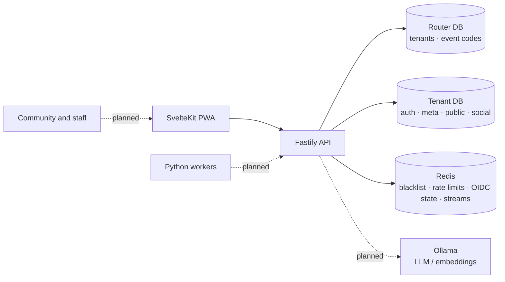

# Architecture

VozLab is currently a **modular monolith**: one Fastify process exposes the REST API and owns all tenant resolution, authorization, graph mutations and event publication. The PWA and the three Python workers are specified but not built.

## Context and containers



| Container | Technology | State |
| --- | --- | --- |
| API | Node.js + Fastify 4 + TypeScript, run with `tsx` | Implemented |
| Router DB | PostgreSQL 18.6, one global database | Implemented |
| Tenant DB | PostgreSQL 18.6 + pgvector; one physical DB per institution | Implemented |
| Broker/cache | Redis 7 (Streams, fixed-window counters, token blacklist, OIDC state) | Implemented |
| PWA | SvelteKit 5 + Cytoscape.js | Empty scaffold |
| Workers | Python 3.12 (Extractor, Relacionador, Consolidador) | Empty scaffolds |
| LLM | Ollama (`nomic-embed-text`, 768 dims) | Container only; unused |

## Request path

```text
HTTP
  -> CorrelationGuard (onRequest; reqId / x-correlation-id)
  public auth (login/callback/refresh/event-join): rateLimit (per IP)
  protected resource:
    -> authGuard
    -> tenantGuard
    -> tenantWorkspaceGuard
    -> rateLimit
  -> controller (Zod validation, DTO mapping)
  -> use case (application rules)
  -> UnitOfWork / repository (tid-scoped)
  -> Drizzle ORM
  -> tenant PostgreSQL
```

1. **CorrelationGuard** is registered globally. It accepts an incoming `x-correlation-id` or generates a UUID, binds it to `AsyncLocalStorage`, and returns it on the response.
2. **Public auth routes** (`/auth/login`, `/auth/callback`, `/auth/refresh`, `/auth/event-join`) are rate-limited per IP and then handled by the controller; they have no bearer token or workspace header. `/auth/logout` requires only `authGuard`; `/auth/me` requires `authGuard -> tenantGuard`.
3. **authGuard** verifies the HS256 Bearer JWT with `JWT_SECRET`, checks `jti` against the Redis blacklist, requires a `sub` and a valid 64-hex `authorHash`, and attaches the identity. An allow-listed `type` claim marks a system agent.
4. **tenantGuard** resolves the `tid` claim through `public.tenants` in the router DB and attaches the internal `tid` and slug. It is shared by resource routes and `/auth/me`.
5. **tenantWorkspaceGuard** requires `X-Workspace-ID` (UUID) and verifies workspace membership in the tenant DB (skipped for agents). It attaches `workspaceId`.
6. **rateLimit** enforces two Redis fixed-window buckets: per actor (`authorHash`, or IP) and a coarse per-workspace ceiling.
7. **Controller** validates body/query with Zod, extracts the request context, calls one use case, and maps `DomainError`/`InfrastructureError` to HTTP via `errorResponse.ts`.
8. **Use case** owns authorization and state transitions. Multi-table mutations run inside `UnitOfWork.runInTransaction(tid, cb)`; repositories receive the same `tx`.
9. **Repository** obtains the tenant's cached Drizzle pool, scopes every query by `tid` (and by workspace where the port is workspace-scoped), filters soft-deleted rows, and uses keyset pagination.
10. **Events** are published after commit, best-effort. A broker failure is logged and never rolls back persisted data.

Health routes are public: `/health` and `/health/live` return liveness; `/health/ready` probes the router DB and Redis (`200` ready / `503` degraded). It does not probe tenant databases.

## Two-database topology

| Store | Dev database | Tables / schemas | Purpose |
| --- | --- | --- | --- |
| Router (global) | `vozlab_router` | `public.tenants`, `public.tenant_connections`, `public.event_codes` | OIDC tenant id → internal `tid` → physical connection; global event-code registry |
| Tenant (per institution) | `vozlab_tenant_dev` | `auth`: workspaces, users, memberships, refresh tokens · `meta`: ontology · `public`: nodes, edges, proposals, interactions · `social`: threads, posts | Graph, governance and identity data |

The router DB never holds tenant content, and the tenant DB never holds routing data. `event_codes` is the documented exception: a QR is scanned before the tenant is known, so the code registry is global and carries only routing metadata ([ADR-0019](decisions/ADR-0019-global-event-codes.md)). There are no cross-database joins or foreign keys: the router is queried once per request to resolve the tenant, then all work happens in the tenant DB.

## Tenant connection pools

`ConnectionPoolManager` caches one `pg.Pool` + Drizzle client per internal `tid`:

- Resolves host/port/database/user/password from `tenant_connections` on first use.
- `max: DATABASE_POOL_MAX` (default 10), idle timeout 30 s, connect timeout 10 s.
- Evicts pools idle for 30 min; the sweep runs every 5 min; all pools close on shutdown.
- Contract: `getTenantDatabaseConfig` returns `null` only when the tenant has no connection row (→ `403 ERR_TENANT_NOT_PROVISIONED`); driver/connection failures throw `InfrastructureError` (→ `503 ERR_DATABASE_CONNECTION_FAILED`).

## Redis and streams

Redis serves four independent concerns: the JWT blacklist (`vozlab:blacklist:<jti>`), rate-limit counters (`vozlab:ratelimit:<tid>:<workspace>:<method>[:<actor>]`), single-use OIDC state (`vozlab:oidc:state:<state>`, 10 min), and event streams. Every logical event maps to `stream:<event-lowercase>`:

| Event | Stream |
| --- | --- |
| `NODE_CREATED` | `stream:node_created` |
| `PROPOSAL_CREATED`, `PROPOSAL_APPROVED`, `PROPOSAL_REJECTED`, `PROPOSAL_AUTO_APPLIED` | `stream:proposal_created`, `stream:proposal_approved`, `stream:proposal_rejected`, `stream:proposal_auto_applied` |
| `EDGE_CREATED`, `EDGE_UPDATED`, `EDGE_DELETED` | `stream:edge_created`, `stream:edge_updated`, `stream:edge_deleted` |
| Ontology, discussion, interaction and deletion events | `stream:<event-lowercase>` |

`NODE_CREATED` carries `reqId`, `nodeId`, `workspaceId`, `typeKey` and `title`. It is intended to trigger embedding computation and the Relacionador, but **no consumer exists** and nothing writes `nodes.embedding`. Publication is fire-and-forget: if Redis is disconnected, the event is dropped with a warning (there is no outbox or retry).

## Runtime and deployment facts

| Service | Image / runtime | Port | Notes |
| --- | --- | --- | --- |
| API | `tsx` on Node 22 | 3000 | `HOST`, `PORT` from env; graceful `SIGTERM`/`SIGINT` |
| PostgreSQL | `vozlab/postgres:18-age-pgvector` (PG 18.6, AGE 1.8, pgvector) | 5432 | Built from `docker/postgres/Dockerfile`; init scripts only on a fresh volume |
| Redis | `redis:7-alpine` | 6379 | No auth locally; password optional |
| Ollama | `ollama/ollama:latest` | 11434 | Not called by the API today |

Environment is validated by Zod at startup (`shared/config/env.ts`); missing or invalid values call `process.exit(1)`. The API loads the repo-root `.env` via `tsx --env-file-if-exists`; process env wins. `ROUTER_DB_*`, `REDIS_HOST`, `JWT_SECRET` (≥ 32 chars), all `OIDC_*` values and `WEB_ORIGIN` are required. CI (`.github/workflows/ci.yml`) runs `pnpm install --frozen-lockfile` and `pnpm turbo run build type-check test`; it does not run lint or provision Postgres/Redis.

## What is not built

- PWA OIDC login screen, session restore UI and event QR scanner (the API half of FR-01/02/03 exists).
- A local IdP in Compose; `db:mint-token` remains the no-IdP development path.
- SvelteKit PWA, SSE, GraphQL.
- Python Extractor/Relacionador/Consolidador and any Redis consumer groups.
- Embedding computation; `NODE_CREATED` has no consumer.
- Apache AGE mirroring/Cypher adapter. The read path is a bounded SQL recursive CTE over `public.edges`.
- Data-source registry (`meta.data_sources`) and ingestion resolution route (Phase 2).
- Metrics, tracing, dashboards and load tests.
- Production deployment manifests (no API/worker Dockerfiles; compose is local-only).

## Decisions and further reading

The architecture decisions are recorded in the [ADR set](decisions/) (`docs/decisions/ADR-*.md`): Bearer access JWT with an `HttpOnly` refresh credential, OIDC + JIT accounts, physical database per tenant, the global event-code exception, bounded SQL CTE over Apache AGE for reads, synchronous vote scoring, soft-delete policy, opaque pseudonyms, and the API-owned source registry. The manual Composition Root is a convention, described in [conventions.md](conventions.md). Implementation details are in [auth-and-tenancy.md](auth-and-tenancy.md), [domain-model.md](domain-model.md), [api-reference.md](api-reference.md) and [runbook-ops.md](runbook-ops.md).
