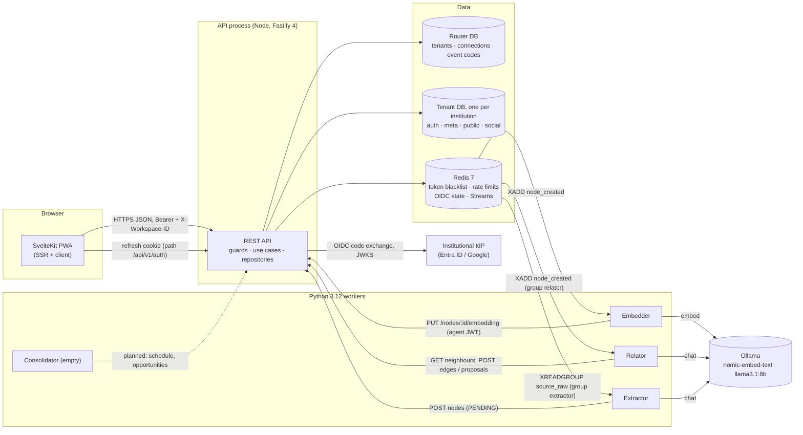
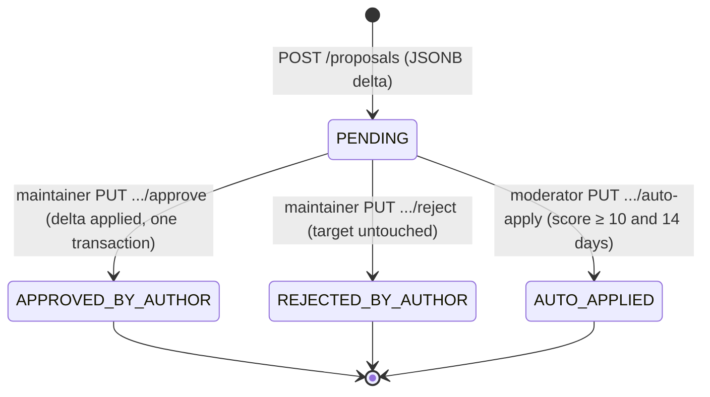
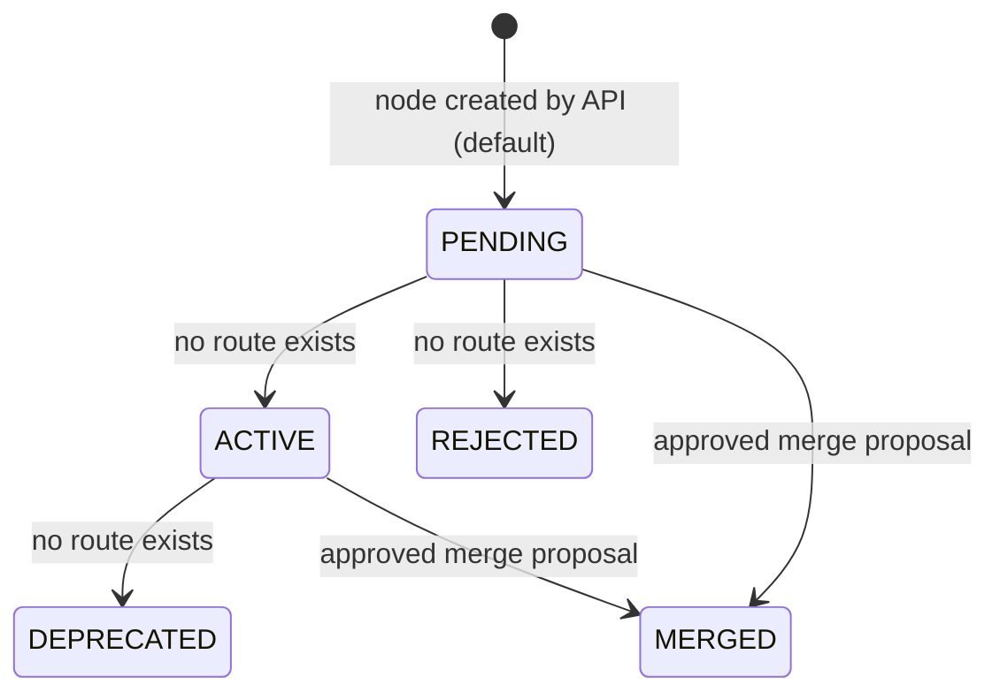
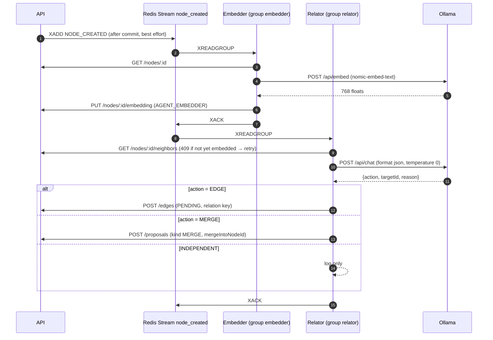
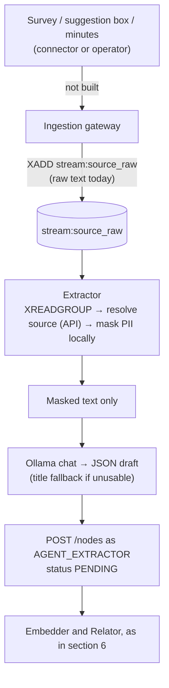

# 04 — How it works

This file describes the system in motion: who talks to whom, over which channel, what each step guarantees,
and what happens when a part fails. It is the file to read before changing any flow.

## 1. Components and channels



| Channel | Used for | Guarantee | Where it breaks |
| --- | --- | --- | --- |
| HTTPS JSON (Bearer access token, `X-Workspace-ID`) | All product reads and writes. | Synchronous; the response reflects the commit. | A missing or wrong workspace header returns 400 or 403; a cross-workspace object returns 404. |
| HttpOnly refresh cookie (`/api/v1/auth`) | Session restore and rotation. | Rotation with reuse detection revokes the family. | If the cookie is not sent (wrong path, third-party blocking), the user is signed out. |
| Redis Streams (`stream:<event>`) | Asynchronous work for workers. | At-least-once delivery to each consumer group, with `XAUTOCLAIM` recovery and a dead-letter stream. | Publication is fire-and-forget: if Redis is down when the event is published, it is lost (F-12). |
| Ollama HTTP | Embeddings and chat. | None beyond retries. | An unavailable model leaves entries pending; the work is delayed, not lost, while Redis holds it. |
| OIDC | Institutional sign-in. | Authorisation code with PKCE, state and nonce single-use in Redis. | IdP outage returns 503; the API never accepts an IdP token as a graph credential. |

**Not present:** server-sent events, WebSockets, webhooks in or out, email, object storage, and any outbox.

## 2. The request path

Every protected request passes the same chain before a handler runs. The order is part of the security model.

```text
HTTP
 → CorrelationGuard         (x-correlation-id or UUID; bound in AsyncLocalStorage)
 → authGuard                (HS256 signature, expiry, jti blacklist, sub, 64-hex authorHash, agent type)
 → tenantGuard              (tid → router → internal tenant UUID; unknown → 403)
 → tenantWorkspaceGuard     (X-Workspace-ID UUID; membership in the tenant DB; agents skip membership)
 → rateLimit                (Redis: per actor and per workspace fixed windows; fails open)
 → controller               (Zod validation; DTO mapping)
 → use case                 (authorisation and state rules)
 → UnitOfWork / repository  (every query scoped by tid and workspace; soft-delete filter)
 → Drizzle → tenant PostgreSQL
 → event publication        (after commit, best effort, never rolls back)
```

Public routes (login, callback, refresh, event-join) skip the chain and are rate-limited per IP. That
rate limit is wrong behind a load balancer until `trustProxy` is set (F-05).

## 3. Sign-in and sessions

```mermaid
sequenceDiagram
  autonumber
  participant B as Browser (PWA)
  participant A as API
  participant R as Redis
  participant I as Institutional IdP
  B->>A: GET /auth/login?redirect=/x
  A->>R: store state, nonce, PKCE verifier (10 min, single use)
  A-->>B: 302 to IdP authorise endpoint
  B->>I: sign in
  I-->>B: 302 to /auth/callback?code&state
  B->>A: GET /auth/callback
  A->>R: GETDEL state (replay-proof)
  A->>I: token exchange (code + verifier)
  A->>A: verify ID token (JWKS, iss, aud, exp, nonce, email_verified)
  A->>A: resolve tid or hd to tenant; JIT upsert user (random authorHash, no membership)
  A-->>B: 302 to WEB_ORIGIN + Set-Cookie vozlab_refresh (HttpOnly)
  B->>A: POST /auth/refresh (cookie)
  A->>A: rotate refresh row; new 15-minute access token
  A-->>B: 200 { accessToken }   (held in memory only)
```

Consequences a product owner should know:

- **A new institutional user can sign in and still see nothing.** Workspace routes return 403 until someone
  creates a membership, and nothing in the product can do that (F-02).
- **Logout does not revoke access tokens immediately if Redis is down.** The blacklist fails open. The
  15-minute lifetime bounds the exposure. Accept and monitor (`09`, S-04).
- **The access token lives in memory.** A page reload restores it through the refresh cookie. This is the
  correct trade for XSS, and it is why the dev sign-in path exists only in development builds.

## 4. Write paths

### 4.1 Creating a node (human)

1. The PWA builds the form from the **active** datatype properties of the **active** class.
2. `POST /api/v1/nodes` validates `typeKey` against an active class; attributes are stored as JSONB and
   validated only by the client (FR-06 partial).
3. The node is inserted as **`PENDING`** (the domain default). Nothing in the product moves it on (F-01).
4. After commit, `NODE_CREATED` is published (`reqId`, `nodeId`, `workspaceId`, `typeKey`, `title`).

### 4.2 Proposing a change (human)



The rule that makes this work is that **only the target's maintainer** (the `authorHash` stored on the node,
edge or class) may approve or reject. That rule is correct for human-authored content and becomes a
governance dead end for agent-authored content (section 6).

### 4.3 Votes

`POST /interactions` writes an immutable row and updates the target's counters in the same transaction.
One vote per user per target; the same vote type is idempotent and a different one returns 409.

## 5. The lifecycle as implemented (and where it stops)

These are the states the code can reach through HTTP, compared with the states the domain defines.
[repo] `domain-model.md` §5; `changeStatus` call sites; route registration.



| Object | Default on creation | Reachable transitions through the API | Missing transitions |
| --- | --- | --- | --- |
| Node | `PENDING` | `PENDING → MERGED` (via an approved merge proposal) | `PENDING → ACTIVE`, `PENDING → REJECTED`, `ACTIVE → DEPRECATED` |
| Edge | `PENDING` (both human and Relator) | None; PATCH edits relation and attributes only | `PENDING → ACTIVE`, `PENDING → REJECTED` |
| Edit proposal | `PENDING` | Approve, reject, auto-apply | none |
| Ontology class | `PROPOSED` | `PROPOSED → ACTIVE` | `PROPOSED → REJECTED` (domain only) |
| Ontology property | `PROPOSED` | None | Activation for both property kinds (F-16) |
| Discussion thread | `OPEN` | `OPEN → CLOSED` | none |

**Consequence:** every node and edge created through the API stays `PENDING` for life. The PWA draws
non-`ACTIVE` statuses with a border. Every user-created item therefore looks unfinished, and the demo looks
finished only because its seed writes `ACTIVE` directly. This is the single most important product gap in
the repository (F-01).

## 6. The async pipeline



Failure behaviour, as implemented:

- A `409 ERR_NODE_NOT_EMBEDDED` leaves the Relator's entry pending; it is retried when the embedder catches up.
- A model answer that names a target outside the top-five neighbours is rejected as a model failure (ADR-0023).
- A permanently failing entry moves to the dead-letter stream after bounded attempts.
- A Redis outage during publication drops the event with an error log (F-12). Nothing repairs it later.
- Streams are never trimmed. They grow without bound and hold personal data if the Extractor is fed raw records
  (F-03). There is no replay tool.

## 7. The ingestion path (planned, partly built)



Two design questions are open here and must be answered before the gateway is built (`06` §5, `09` S-03):

1. Should PII be masked **before** the record enters Redis, so that the stream never holds personal data?
2. What is the retention period of `stream:source_raw`, and who may read it?

## 8. The frontend

| Concern | How it is done | Where to look |
| --- | --- | --- |
| Routes | Two groups: `(auth)` for login and join; `(app)` for the workspace with a four-state guard (restoring, ready, no membership, failed). | `apps/web/src/routes` |
| State | Svelte 5 runes classes provided through the context API, never a module singleton (SSR isolation). | `apps/web/src/lib/state` |
| Workspace | Per tab in `sessionStorage`; never a path segment; never `localStorage`. | `workspace.svelte.ts` |
| Access token | In memory only. Restored through `/auth/refresh`. Refresh is serialised across tabs with Web Locks so rotation cannot log out two tabs. | `session.svelte.ts`, `refresh-lock.ts` |
| Language | Cookie `vozlab_locale`; a server hook rewrites `<html lang>` before the first byte. Switching does not reload. | `hooks.server.ts`, `i18n/` |
| Panels | Cookie `vozlab_panels`, read by the server so the first paint is already folded. | `hooks.server.ts` |
| Graph | SVG painter as the only engine; a d3-force "living" layout; zoom and pan through d3-zoom; cards measured with canvas text metrics. | `lib/graph/svg`, `lib/graph/explore` |
| Offline | Online-first. The shell is cached for a fast open; writes are refused before they leave the tab when offline. Data is not cached. | `lib/pwa`, `static/offline.html` |
| Accessibility | WCAG 2.2 AA pass in Phase 3.6; text alternatives (list view) for the canvas; focus traps and `inert` on modals. | `lib/a11y`, roadmap 3.6 and 3.14 |

The PWA depends on `@vozlab/shared-types` for every DTO. A type change in the API therefore breaks the
build of the web app, which is the intended safety net.

## 9. Failure modes and their effects

| Component down | Effect on users | Effect on data | Detection today |
| --- | --- | --- | --- |
| Router DB | Every protected request returns 503 at tenant resolution. Readiness reports `degraded`. | None. | `/health/ready`. |
| Tenant DB (one institution) | That institution's requests return 503 when the pool is used. Readiness stays `ready` because it does not probe tenants. | None. | Logs only (F-13). |
| Redis | Access tokens are treated as valid (blacklist fails open). Rate limits fail open. OIDC login returns 503. Events are dropped. | Missed embeddings and evaluations for events published during the outage. | Readiness reports `degraded`; logs. |
| Ollama | Nothing user-facing. | Embeddings and verdicts are delayed. Entries wait in pending state. | Logs only. |
| IdP | New sign-ins fail with 503. Existing sessions continue until the refresh token expires. | None. | Logs. |
| An embedder bug | Nothing user-facing. | Nodes without vectors; the Relator waits on them. | Stream pending counts (manual). |
| The API process | Full outage until restart. Graceful shutdown drains requests. | None; writes are synchronous. | Process supervisor (not defined). |

## 10. Who owns what

There is one human owner of the code today. The table describes responsibilities, which is what must be
assigned when the team grows. [repo][juicio]

| Responsibility | Owned by (today) | Written down in |
| --- | --- | --- |
| Domain rules and governance | Author, with the Architect and QA agents as reviewers | ADRs; `domain-model.md` |
| API contracts | Shared types package | `packages/shared-types`; `api-reference.md` |
| Tenancy and databases | Author | ADR-0002; `runbook-dev.md`; no ops runbook for recovery |
| Identity | Author | ADR-0018; `auth-and-tenancy.md` |
| AI pipeline | Author | `spec/*.md`; worker READMEs |
| Web experience | Author, with the frontend agent | `spec/web-pwa.md`; `design-system.md` |
| Security review | QA-security agent (read-only) | `owasp-security-review` skill; no record of a human review |
| Deployment and on-call | **Nobody** (no deployment exists) | Nothing |

## 11. How a change travels today

1. A task is taken from `ROADMAP.md` (`/next-task` command).
2. The change is made in one component at a time (AGENTS.md rule).
3. `pnpm turbo run build type-check test` and `uv run pytest` must pass.
4. The roadmap item is ticked with a one-line result and the status matrix is updated.
5. Commits go straight to `main`; CI runs on push and pull request.

There is no pull request review by a second person, no branch protection that the repository evidences, and
no release or tag. Section 14 of `14-process-communication-quality.md` gives a minimal process that keeps the
agent workflow and adds the missing human gate.
