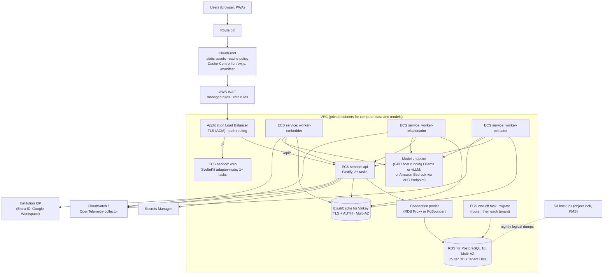

# 11 — AWS, scalability and hosting

Your requirement is a deployment on AWS that scales, and that can also run entirely locally, at no extra cost, for a
demonstration. This file gives the target architecture, compares the service choices, sets out the scaling model
and the capacity arithmetic, lists what must be fixed before any deployment, and proposes a plan.

## 1. The judgment

- **The architecture can run on AWS without redesign.** The API and workers are stateless or consumer-based, the web
  app is a standard Node server, the data layer is PostgreSQL, and the one stateful dependency that is not a database
  (Redis) has a managed, Redis-compatible equivalent.
- **Use ECS, not App Runner or Kubernetes.** App Runner stopped accepting new customers on 30 April 2026 [web].
  Kubernetes is more than this team needs. ECS on Fargate, or ECS Express Mode where it fits, covers the six services.
- **Start with RDS for PostgreSQL, Multi-AZ, behind a connection pooler.** Move to Aurora when replicas or faster
  failover become the constraint, not before.
- **Decide the model hosting by data residency, not by convenience.** Local models on a GPU you control, or a managed
  model service under a data processing agreement. The code is already shaped for local models.
- **The blockers are small in code and large in consequence.** Section 3 lists about a dozen. Most are days of work.
  The large ones are the tenant migration runner, the credential model and the identity issuer.
- **Plan for about eight to ten engineering weeks** from the current state to a supervised pilot in AWS, including the
  blockers, environments, observability, backups and a restore drill. [juicio]

## 2. The target architecture for a pilot

The reference shows one ALB with path routing, so the browser sees one origin. That keeps the refresh cookie scoped
to `/api/v1/auth`, avoids CORS complexity, and lets the `Secure` attribute of the cookie work over HTTPS. [repo]
`auth-and-tenancy.md` §11

## 3. Blockers before any cloud deployment

| # | Blocker | Why it blocks | Reference | Effort |
| --- | --- | --- | --- | --- |
| 1 | **Set `trustProxy` correctly** | Without it, per-IP limits are shared by all clients behind the ALB. | F-05, S-01 | XS |
| 2 | **Produce API and web images** | Only worker images exist. The API and web app have no Dockerfile. | ROADMAP 4.6 | S |
| 3 | **Fix the signing and worker-credential model** | A worker can mint any identity in any tenant with the shared secret. | S-04 | M–L |
| 4 | **Store tenant database credentials safely** | Plain text in the router table. | S-03 | M |
| 5 | **Build the tenant migration runner and provisioning command** | Without them, a second institution is manual work and a risk. | F-11, `05` §5–6 | M (1–2 weeks) |
| 6 | **Resolve the identity issuer design** | One issuer only; blocks a second institution on another provider. | F-17, `08` §4 | S–M |
| 7 | **Readiness probes that reflect reality** | Current readiness ignores tenant databases and Ollama. Load balancers need an honest signal. | F-13 | S |
| 8 | **Metrics, traces and log shipping** | Without them, the first incident is diagnosed by guessing. | F-13, `04` §9 | M |
| 9 | **Backups and a restore drill** | Nothing is backed up. | `05` §8 | S (plus a drill) |
| 10 | **Cookies and TLS** | `Secure` cookies need HTTPS end to end; HSTS at the edge. | S-06 | XS |
| 11 | **Security headers** | CSP and related headers are absent. | S-06 | S |
| 12 | **Service worker caching** | `/sw.js` and `/manifest.webmanifest` must be served with `no-cache`, or updates never reach users (runbook). | `runbook-ops.md` | XS |
| 13 | **Redis TLS and AUTH; PostgreSQL TLS** | Required for managed services and for the data-in-transit rule. | S-17 | XS |
| 14 | **Secrets out of the environment files** | Secrets Manager with task-role access; no `.env` in images. | `.env.example` | S |
| 15 | **Graceful shutdown window** | ECS sends SIGTERM and then kills. The API drains requests; the grace period must exceed the slowest request. | `runbook-ops.md` | XS |
| 16 | **Stream trimming** | Redis streams are never trimmed and would grow without bound in a managed instance. | S-10, F-03 | XS |

Blockers 2, 5 and 9 are the critical path. Blockers 1, 10, 12 and 13 are one-day items each and should be done first.

## 4. Service choices, with the alternatives

### 4.1 Compute

| Option | Fit | Cost of operation | Verdict |
| --- | --- | --- | --- |
| **ECS on Fargate** | Long-running services, consumer loops, a one-off migration task, no servers to patch. | Low to moderate. You define task definitions, services and scaling. | **Recommended.** |
| **ECS Express Mode** | The managed path AWS now recommends for simple container services after App Runner's closure [web]. It provisions the load balancer and the service with fewer parameters. | Lower than Fargate for simple services; less control. | **Use for `web` if its defaults fit**; check that it supports the path routing in section 2. Verify it on a test service first. |
| **App Runner** | Was the simplest option. | — | **Not available to new customers** since 30 April 2026 [web]. Do not plan on it. |
| **EKS** | Full Kubernetes; a large ecosystem. | High: cluster upgrades, add-ons, networking, RBAC, a platform team. | Not justified for six services and one engineer. Revisit if the platform grows into many services. |
| **EC2 with Docker** | Full control; cheapest raw compute. | High: patching, scaling, deployments by hand. | Only for the GPU host, where it is the simplest option. |
| **AWS Lambda** | Event-driven short jobs. | Low, but a poor fit for long-lived stream consumers and for pooled database connections. | Use only for scheduled admin tasks if at all. |

### 4.2 Database

| Option | Strengths | Weaknesses | Verdict |
| --- | --- | --- | --- |
| **RDS for PostgreSQL 18, Multi-AZ** | Simpler, predictable cost, supports pgvector [verify version], enough for a pilot and for many small databases. | Failover is slower than Aurora's; storage scales by configuration; replicas are standard replicas. | **Recommended for the pilot.** |
| **Aurora PostgreSQL** | Faster failover; storage grows automatically; cheap read replicas; a shared storage layer suits many small databases. | Higher cost for small instances; more concepts to operate; verify pgvector version parity with RDS. | **Move to it** when read scaling or failover time becomes the constraint. |
| **Self-managed PostgreSQL on EC2** | Full control, lowest licence cost. | You become the DBA: backups, patching, failover. | Not for an institutional platform. |
| **Amazon RDS Custom or Aurora Serverless v2** | Specialised cases. | Complexity; the extension and tuning constraints must be checked. | Not needed now. |

Two constraints apply to either service. First, **Apache AGE is not available on RDS** (issue #998) and must not be in
the image (`05` §13). Second, **pgvector** must be the version that supports iterative scans (0.8.0 or later) (F-04).
Check both with `SELECT * FROM pg_available_extensions` on the actual instance.

### 4.3 Connection pooling (mandatory before the second institution)

| Option | Strengths | Weaknesses |
| --- | --- | --- |
| **Amazon RDS Proxy** | Managed; IAM authentication; failover handling; no servers. | Cost per vCPU-hour of the database; one proxy per database endpoint, so many tenant databases need a deliberate layout [verify]. |
| **PgBouncer on ECS** | Cheap; transaction pooling; flexible. | Operated by you; needs health checks and a rollout plan; prepared-statement and session-state rules must be checked. |

**Recommendation:** PgBouncer in transaction mode for the pilot if cost is tight; RDS Proxy if the team wants fewer
moving parts. Either way, run the integration suite through the pooler before relying on it.

### 4.4 Cache and streams

| Option | Strengths | Weaknesses | Verdict |
| --- | --- | --- | --- |
| **ElastiCache for Valkey** | Redis-compatible, BSD-3 licence, Streams and consumer groups supported, lower price than Redis on ElastiCache per AWS [web]. | Requires the same Redis semantics in code (already the case). | **Recommended.** |
| **ElastiCache for Redis OSS** | Familiar. | ElastiCache supports Redis only up to 7.2 [web]; licence history is complicated. | Only if Valkey is blocked. |
| **MemoryDB** | Durable Redis-compatible store; survives failures without losing acknowledged writes. | Cost; latency profile; overkill until stream durability matters more than cost. | Consider later if event loss becomes a real problem (F-12). An outbox is the first step. |
| **SQS, EventBridge, Kinesis, MSK** | Managed, durable, scalable. | Different semantics: the pending-entry recovery (`XAUTOCLAIM`), consumer groups with per-group fan-out and the dead-letter design would be re-implemented on top of them. | Only if the stream model is revisited as a platform decision. |

### 4.5 Models: where the AI runs

| Option | Data leaves premises? | Operational load | Cost shape | Latency under load | Verdict |
| --- | --- | --- | --- | --- | --- |
| **Ollama on a GPU host you control (private subnet)** | No | You patch, monitor and secure it. No authentication by default; keep it private. | Fixed (an always-on GPU instance dominates the bill) | Good with a GPU; poor on CPU | **Default if residency requires it.** |
| **vLLM (or llama.cpp server) on a GPU host** | No | As above, plus tuning | Fixed | Better throughput through batching | Choose when concurrency is the constraint. |
| **Amazon Bedrock (text and embeddings) through a VPC endpoint** | Yes, to the chosen AWS region, under the AWS data terms and your data processing agreement | Low | Variable, per token | Managed | **Default if the institution accepts regional processing.** Embedding model examples in `06` §4.1. |
| **Other managed model APIs** | Yes | Low | Variable | Managed | Not evaluated; the same residency test applies. |

The worker code talks to Ollama's HTTP API. Moving to Bedrock or vLLM means an adapter, not a rewrite. Keep that
seam: it is the only place where a provider-specific behaviour (for example, an embedding dimension) could leak.

GPU sizing (assumption, to be measured): one current-generation GPU with about 24 GB of memory is typically enough for
an 8 to 9 billion parameter model quantised and an embedding model together. The evaluation in `06` §7 decides the
final size.

### 4.6 Edge, identity, secrets, observability, delivery

| Concern | Recommendation | Alternatives and notes |
| --- | --- | --- |
| DNS and TLS | Route 53 and ACM | Any registrar; ACM certificates for CloudFront must be in `us-east-1`. |
| CDN and WAF | CloudFront with AWS WAF managed rules and a rate rule | Cloudflare is an alternative; keep the origin private. |
| Load balancer | ALB with path routing (`/api/*` to the API) | NLB is unnecessary for HTTP. |
| Identity | Keep the API as resource server; identity provider per institution | Cognito only if it is needed as a broker; not needed now (`08` §6). |
| Secrets | Secrets Manager with task-role access; KMS keys per environment | SSM Parameter Store for non-secret configuration. |
| Observability | OpenTelemetry SDK in the API and workers; an OpenTelemetry collector (ADOT); CloudWatch for logs, metrics and traces | Grafana Cloud or self-hosted Grafana stack; the choice depends on cost and skill. [juicio] |
| Infrastructure as code | OpenTofu or Terraform, or AWS CDK in TypeScript | CDK aligns with the team's language; OpenTofu is portable. Choose one and keep the state in S3 with locking. |
| CI/CD | GitHub Actions with OpenID Connect to an AWS role (no stored keys); images to ECR by digest; migrations as a one-off task before rollout; environment protection rules for production | GitLab or Jenkins are not needed. |
| Accounts | AWS Organizations with separate accounts for development, staging and production | A single account is acceptable only for a demonstration. |
| Networking | VPC with public subnets for the ALB and NAT, private subnets for compute, data and models; VPC endpoints for S3, ECR, Secrets Manager, CloudWatch and Bedrock | Endpoints remove NAT data charges for AWS-internal traffic. |
| Region | Chosen by residency (`15` D-04). São Paulo (sa-east-1) is listed among Titan V2's regions [web]; verify each service and model in the chosen region. | — |

## 5. Scaling model: what scales, what does not, and what to do

| Component | How it scales | Limit | Lever |
| --- | --- | --- | --- |
| API | Horizontally; stateless between requests | Database connections per replica (section 6); the rate-limit and blacklist calls to Redis | More tasks, pooler, cache of tenant resolution (the router lookup is per request) |
| Web (SSR) | Horizontally | Node process per task; CPU on rendering | More tasks; CloudFront for static assets |
| Workers | Horizontally per consumer group; Redis distributes entries | The model endpoint, not the worker | Scale the GPU, not the workers, once the model is the bottleneck |
| PostgreSQL | Vertically first; read replicas for read-heavy paths | Writes on one primary; hot counters serialise on rows (ADR-0005) | Larger instance; replicas for subgraph and window reads (accepting replication lag); tenant placement across instances |
| Tenant placement | Move tenants between instances through `tenant_connections` | Migration effort per tenant | A free sharding lever that exists in the router design |
| Vector search | HNSW in memory per index | Memory and build time | Larger memory; iterative scans; partitioning only if one workspace dominates |
| Valkey | Vertically; cluster mode if sharded | Memory for streams and counters | Trimming (S-10); larger node |
| Model endpoint | GPU concurrency | Tokens per second | More GPUs; batching; a smaller or faster model |

**Concurrency hot spots.** Votes on one popular node serialise on that node's counter row (ADR-0005). At pilot scale this
is invisible. Measure it before a large event, and consider per-target batching only if the measurement says so.

## 6. Capacity arithmetic

### 6.1 Database connections

Each API task keeps one pool of up to ten connections per **active** tenant (`DATABASE_POOL_MAX`), and a router pool of up to
twenty. Workers hold no tenant connections. Worst-case tenant connections = active tenants × API tasks × 10. The full table is
in `05` §7. Example: 20 active tenants and 4 API tasks give 800 possible connections. A pooler turns that into a small, bounded
number of server connections.

### 6.2 Vector memory (approximate, judgment)

| Nodes | Dimensions | Raw vectors (float32) | With HNSW overhead (roughly 1.3 to 2 times the raw size) |
| --- | --- | --- | --- |
| 100 000 | 768 | ~0.3 GB | ~0.4 to 0.6 GB |
| 1 000 000 | 768 | ~3 GB | ~4 to 6 GB |
| 1 000 000 | 1 024 | ~4 GB | ~5 to 8 GB |

These figures fit a memory-optimised instance for the database, and show why the instance class matters more than the
query plan once the graph reaches a million nodes. Confirm with a build on a copy of a real-sized tenant.

### 6.3 Redis (streams)

Each stream entry carries a small set of fields; a `NODE_CREATED` event is a few hundred bytes [juicio; measure]. Without
trimming, a busy institution grows its streams indefinitely. Trimming to a window that covers the longest expected worker
outage is the rule. Measure the average entry size on the staging stream before choosing the instance.

### 6.4 Model throughput

See `06` §9. A workshop that creates 500 nodes in an hour needs about 500 chat calls and 500 embeddings in that hour. The
arithmetic favours a GPU; the pipeline's asynchrony makes the delay acceptable if it is communicated.

## 7. Indicative cost tiers (order of magnitude; validate with the AWS Pricing Calculator)

These are not quotes. They show the shape of the bill and which items dominate, using public list prices as remembered
[juicio] and not verified in this review.

| Tier | Scope | Main line items | Order of magnitude per month |
| --- | --- | --- | --- |
| **0. Demonstration** | One laptop | None (electricity and the existing hardware) | Zero |
| **1. Pilot** | One institution; up to about 1 000 active users; up to about 50 000 nodes | Fargate (about 6 small tasks), RDS Multi-AZ small or medium, ElastiCache small with a replica, ALB, NAT (one or two), CloudFront, WAF, logs | A few hundred US dollars without a GPU |
| **1 + GPU** | As Tier 1, with a 24/7 GPU host | A single GPU instance dominates | Several hundred to about a thousand US dollars more, depending on instance class and hours |
| **1 + Bedrock** | As Tier 1, models through Bedrock | Per-token charges, modest for a pilot | Usually below the GPU line at pilot volumes [juicio] |
| **2. Growth** | 5 to 20 institutions; up to about 20 000 active users | Larger database, a replica, pooler, more tasks, two GPUs or a larger model budget | A low single-digit thousands of US dollars per month |

**Cost drivers to watch:** NAT gateway data charges (use endpoints); Multi-AZ doubles database instance cost; a 24/7 GPU is
usually the largest single line; logs and traces volume; WAF request charges at scale. Set an AWS Budgets alarm from the
first day.

**Free-tier caution:** the AWS free tier covers only a small part of this architecture, and it changes over time. Do not
assume zero cost for an always-on pilot. For the demonstration, the laptop is the zero-cost tier.

## 8. Local operation, and how local differs from AWS

The laptop is a complete, zero-cost environment for demonstrations, and it is the right place to rehearse. Section 9 of
`12` describes it in detail. The differences that matter:

| Concern | Local (compose) | AWS | Parity action |
| --- | --- | --- | --- |
| Database | Container with AGE and pgvector | RDS PostgreSQL with pgvector | Remove AGE locally (`05` §13) |
| Cache and streams | Redis 7 | ElastiCache for Valkey with TLS and AUTH | Use Valkey locally too; require TLS in production configuration |
| Models | Ollama container, unauthenticated | GPU host or Bedrock | Same HTTP contract; pin digests |
| Identity | None (development token) | Institutional IdP | Keycloak with a realm in Compose (`08` §6) |
| Edge | None | ALB, CloudFront, WAF, TLS | Not reproduced locally; test headers and cookies in staging |
| Secrets | `.env` file | Secrets Manager | Same variable names; the loader is the only difference |
| Object storage | None | S3 for backups | Backups tested through a local S3-compatible service or a staging bucket |
| Cookies | Not `Secure` over HTTP | `Secure` over HTTPS | Test the cookie policy in staging |

**What does not need an AWS emulator:** the application, its database, its cache, its models and its identity flow all run
locally without AWS. An emulator is useful only to test infrastructure code (for example, the Terraform or CDK output). See
`12` §4 for the current emulator options after LocalStack's change.

## 9. Environments and promotion

| Environment | Purpose | Data | Access |
| --- | --- | --- | --- |
| Local | Development and demonstration | Seed | Developer |
| Staging | Integration, E2E, load tests, restore drills | Synthetic and seeded only | Engineering |
| Pilot production | The first institution | Real, under the agreed legal basis | Named operators; audit on |

Promotion: the same image digest moves from staging to production. Migrations run first as a one-off task, and only
then the services roll out. Production deployments require an approval in the pipeline.

## 10. Plan to a supervised pilot (judgment)

| Stage | Duration (one engineer) | Content | Exit |
| --- | --- | --- | --- |
| 0. Blockers | 2 to 3 weeks | Section 3, items 1–16 | All blockers closed or explicitly accepted |
| 1. Staging on AWS | 2 weeks | IaC, ECS services, RDS, ElastiCache, ALB, CloudFront, WAF, secrets, CI/CD with OIDC, observability | Smoke test and E2E pass in staging; a deployment from main works |
| 2. Pilot readiness | 2 weeks | Tenant provisioning and migration runner exercised; backup and restore drill; load test against the NFR targets; runbooks; on-call basics | Restore measured; load report written; runbooks reviewed by a second person |
| 3. Supervised pilot | 4 to 6 weeks | One institution, named users, weekly review | Decision on growth, using the measures in `07` §10 and `15` |

Total: about eight to ten weeks, most of it in stages 0 and 2. The fastest route is to finish stage 0 before anything else,
because it removes the risks that would otherwise be discovered in the pilot.

## 11. Risks of the AWS move, and mitigations

| Risk | Likelihood | Impact | Mitigation |
| --- | --- | --- | --- |
| Connection exhaustion when a second institution joins | High without a pooler | Outage for all institutions | Pooler before onboarding (section 4.3); connection metrics; per-tenant pool limits |
| Model costs or latency surprise | Medium | Slow or expensive pipeline | Budget alarm; measured throughput; queue delay communicated; model choice by evaluation |
| A shared signing secret is leaked | Low to medium | Impersonation across institutions | Asymmetric signing (blocker 3); secret rotation; least-privilege task roles |
| Data residency conflict discovered late | Medium | Project halt | Decide the region and model hosting before stage 1 (`15` D-04, D-05) |
| Single-person operations | High | Long outages | Runbooks; second operator trained; on-call rota; restore drill |
| Service worker serves stale code | Medium | Confusing UX | `no-cache` headers (blocker 12) |
| Redis stream growth or loss | Medium | Storage cost or missed work | Trimming; outbox later (`07` §7); monitoring of pending counts |
| Vendor change (as LocalStack changed in 2026) | Medium | Lost tooling | Keep dependencies replaceable; avoid proprietary emulators in the critical path |

## 12. Questions that determine the AWS design

1. Which region must data stay in, and which institutional or legal basis applies? (`15` D-04)
2. Is it acceptable for model processing to occur in a cloud region under a data processing agreement? (D-05)
3. What is the monthly budget ceiling for the pilot, and who approves cloud spending? [supuesto]
4. How many institutions and users are realistic in the first year? (Sizes the tiers above.)
5. Does the institution already run Microsoft 365 or Google Workspace? (F-17 and `08` §6.)
6. Does the team prefer TypeScript-based infrastructure code (CDK) or a portable tool (OpenTofu)? (D-38.)
