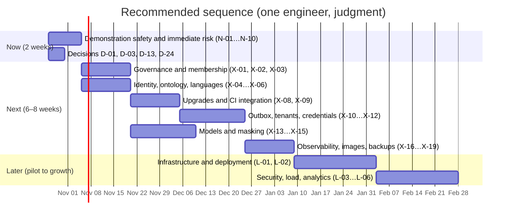

# 15 — Decision register, roadmap and open questions

This file is the working document for the next decisions. Part 1 lists every open decision with its options, a
recommendation, how reversible it is, and when it is needed. Part 2 turns the findings and recommendations into a
sequenced roadmap. Part 3 lists the questions I need you to answer. Part 4 lists the risks that remain after all of
this.

The sizes given are for **one experienced engineer working full time** unless stated, and are judgments [juicio]. With
two engineers, the sequential items shorten, but the decisions do not.

---

## Part 1 — Decision register

**Reversibility:** *Easy* = change in a sprint without data migration; *Medium* = needs a migration or a contract change;
*Hard* = affects stored data semantics, legal obligations or an external dependency.

### 1.1 Scope and governance of the product

| ID | Decision | Options | Recommendation | Reversibility | Needed by |
| --- | --- | --- | --- | --- | --- |
| **D-01** | The horizon of the next milestone | (a) Presentation hardening only, two weeks. (b) Pilot-ready, eight to ten weeks. (c) Both, sequenced. | **(c).** Two weeks of demonstration safety now, then the pilot blockers. | Easy | Now |
| **D-02** | How people join a workspace | (a) Administrator endpoints plus invitation codes. (b) Directory group sync (SCIM, or IdP groups). (c) Manual database edits. | **(a) now; (b) later** for institutions with directory groups. (c) is not acceptable beyond a test. | Medium | Before the pilot (F-02) |
| **D-03** | When a new node or edge becomes accepted | (a) Moderator approves each item. (b) Visible on creation, marked *unreviewed*, moved to *accepted* by a moderator or a quorum of distinct endorsers. (c) Accepted on creation, governed only by proposals. (d) Keep `PENDING` as a hidden state. | **(b).** Visible by default with an explicit review state. (d) hides most content and makes the product feel empty. (c) removes review. | Hard (changes stored semantics and the Relator's filter) | Before the pilot (F-01) |
| **D-13** | Who approves content that an agent created | (a) A designated human steward per workspace. (b) Any moderator. (c) Nobody (today's effective outcome). | **(a) and (b).** Agents never approve their own output; a steward is named per workspace. | Medium | Before the pilot (S-15) |
| **D-12** | How the vocabulary changes | (a) Moderator-only activation (today for classes). (b) Proposal, discussion, quorum of distinct accounts, moderator confirmation. (c) Fully open voting. | **(b).** Quorum counts distinct institutional accounts for vocabulary; event members support but do not decide. | Medium | Before the pilot if the community will propose vocabulary (F-16) |
| **D-11** | Languages of interface and content | (a) Spanish only. (b) Spanish and English. (c) More. Content: monolingual; or tagged per item; or translated. | **(b) for the interface; tag every item with its language (option 2 in `13`) now;** translation only for curated content, later. | Easy (interface); Medium (content tags) | Before the pilot (`13` §10) |
| **D-17** | Timing of framework upgrades | (a) Before the pilot. (b) After the pilot. (c) Piecemeal. | **(a) for Fastify 5 and node-redis 6 (security exposure); (b) for SvelteKit 3 and ESLint.** No major upgrade in the two weeks before a demonstration. | Easy | Now (`10` §5) |
| **D-39** | Scope of the vocabulary: per workspace or shared across the institution | (a) Per workspace (today; full autonomy, no cross-workspace comparison). (b) An institution-wide base vocabulary that workspaces extend. (c) A global vocabulary across institutions. | **Keep (a)** for now, and design the mapping layer that (b) would need before cross-workspace analytics is requested. (c) is not recommended: it couples institutions that chose their own categories. | Hard | Before any cross-workspace analysis (`07` §3) |
| **D-30** | Budget ceiling and who approves cloud spend | A figure per month and per phase; approver named | Set a figure with an alarm before stage 1 of the AWS plan. | Easy | Before cloud (`11` §7) |

### 1.2 Identity, tenancy and guests

| ID | Decision | Options | Recommendation | Reversibility | Needed by |
| --- | --- | --- | --- | --- | --- |
| **D-21** | Identity issuers for several institutions (F-17) | (a) Pattern validation for multi-tenant Entra (issuer matches `login.microsoftonline.com/<tid>/v2.0`, `tid` matches). (b) Per-tenant identity configuration in the router (issuer, JWKS, client identifiers). (c) One broker in front of all providers (Zitadel, ADR-0030). | **(a) for the first Entra institution; (b) as the general design, recorded as an ADR before a second provider is added.** (c) now implemented: Zitadel runs under `--profile idp` (ADR-0030). | Medium | Before a second institution (`08` §4) |
| **D-22** | Guest access | (A) Event codes (exists). (B) Invitation codes, generalised. (C) Email magic links. (D) Institutional IdP guests. (E) Global identity across tenants. (F) Open public accounts. | **A + B + D.** Defer C until a mail provider and retention rules exist. Do not build E or F without a documented requirement and an ADR. | Medium (B, D); Hard (E, F) | Before the pilot if guests are needed (`08` §5) |
| **D-23** | Cross-institution identity (global person) | Build now / defer with a documented trigger / refuse | **Defer,** with the trigger: a documented need, a consent design, a privacy assessment and an ADR. | Hard | When a need appears |
| **D-24** | A local identity provider for development and demonstration | (a) Keycloak with a realm in Compose. (b) Development token only (today). | **(a).** It makes the demonstration honest and tests the real flow. | Easy | Before the demonstration (`12` §6) |

### 1.3 Data, tenancy and operations

| ID | Decision | Options | Recommendation | Reversibility | Needed by |
| --- | --- | --- | --- | --- | --- |
| **D-10** | Database architecture for many institutions | (A) Database per tenant (current). (B) Schema per tenant in one database. (C) Shared tables with row-level security. (D) Cluster per tenant. | **(A)**, with tenants placed on one to three instances through the router, a pooler and a fleet runner. Reconsider the architecture beyond roughly one hundred institutions. | Hard | Before the second institution (`05` §11) |
| **D-14** | Durability of events | (a) Keep fire-and-forget. (b) Transactional outbox with a relay. (c) MemoryDB for the stream store. | **(b) before the pilot** (a Redis outage during a workshop must not lose work). (c) only if (b) proves insufficient. | Medium | Before the pilot (F-12) |
| **D-15** | Erasure of a person's data and their pseudonym | (A) Delete the account row. (B) Anonymise the account and rewrite the pseudonym in every table. (C) Delete contributions. | **(B),** as a policy decided with counsel. The cost of choosing later grows with every row. | Hard | Before the first real user |
| **D-16** | Legal basis, consent and retention per listening source | A record per connector: purpose, basis, consent text, retention, recipients | **Record per connector** before any source is connected; stream retention set from the record. | Hard (legal) | Before the Extractor receives input |
| **D-09** | Apache AGE in the default image | (a) Keep. (b) Remove, and record ADR-0027 as implemented. | **(b).** It is a dependency that buys nothing and prevents managed deployment. | Easy | Now (`05` §13) |
| **D-08** | Graph strategy | (a) Relational CTE plus Python analytics on derived tables (recommended). (b) A graph engine now. (c) AGE now. | **(a).** Graph engines only when the triggers in `07` §8 fire, and always behind an outbox. | Medium | Triggered (`07` §8) |
| **D-25** | Local container runtime | Docker Desktop (licence depends on the organisation) or a free alternative (Podman, Colima) | Confirm the institution's status; use a free runtime if in doubt. | Easy | Before the demonstration (`12` §8) |

### 1.4 AI

| ID | Decision | Options | Recommendation | Reversibility | Needed by |
| --- | --- | --- | --- | --- | --- |
| **D-04** | Jurisdiction and data residency | Latin American region; US; EU; a country-specific arrangement | **Decide with counsel.** Working assumption: a Latin American region (São Paulo is listed for Titan V2 [web]) if the institution is Colombian [supuesto]. | Hard | Before cloud (`11` §4.6) |
| **D-05** | Where the models run | (a) GPU host you control (Ollama or vLLM). (b) Amazon Bedrock under a data processing agreement. (c) Both, behind one adapter. | **(c) with (a) as the default if residency is strict,** otherwise (b). The adapter keeps the choice reversible. | Medium | Before cloud (`06` §9) |
| **D-06** | Embedding model | `nomic-embed-text` (keep); `nomic-embed-text-v2-moe`; `bge-m3`; `qwen3-embedding`; `embeddinggemma`; Titan V2; Cohere Multilingual (`06` §4.1) | **Evaluate the top three on Spanish records;** choose by the evaluation. Working default candidate: `bge-m3` (multilingual, MIT, 1 024 dimensions) pending the result. | Medium to hard (dimension change, re-embedding) | Before the pilot (F-09) |
| **D-07** | Chat model for the Relator and Extractor | `llama3.1:8b` (keep as baseline); Qwen3 8B; a Gemma 4 small variant; a larger model if a GPU allows | **Evaluate the three;** no default until the evaluation. | Easy (a configuration change, if the output contract holds) | Before the pilot |
| **D-18** | Thresholds that gate automatic proposals | For example, `MERGE` precision at or above a set value before any automatic merge proposal | **Set the threshold before the evaluation runs** (`06` §7). | Easy | Before the evaluation |
| **D-19** | Provenance of agent output | (a) Record model, digest, prompt version and input hash on every artefact. (b) Keep the current minimum. | **(a).** It is cheap now and expensive to add later. | Medium | Before the pilot (`06` §8) |

### 1.5 Hosting, delivery and operations

| ID | Decision | Options | Recommendation | Reversibility | Needed by |
| --- | --- | --- | --- | --- | --- |
| **D-26** | Redis-compatible engine | Redis 7 (local today); Redis 8 (AGPL option); Valkey 9; ElastiCache for Valkey | **Valkey** locally and in ElastiCache. Verify client behaviour in the integration suite. | Easy | Now (`10` §2) |
| **D-27** | Node.js line | Node 22 (CI today, maintenance); Node 24 (Active LTS) | **Node 24** in CI and `engines`. Pin with `.nvmrc`. | Easy | Now |
| **D-28** | Compute on AWS | ECS on Fargate; ECS Express Mode for web; EKS; EC2; App Runner (closed to new customers) | **ECS on Fargate;** Express Mode for `web` if its defaults fit. Not App Runner. | Medium | Before cloud (`11` §4.1) |
| **D-29** | Database service on AWS | RDS PostgreSQL Multi-AZ; Aurora PostgreSQL | **RDS PostgreSQL 18 Multi-AZ** for the pilot; Aurora when replicas or failover become the constraint. | Medium | Before cloud (`11` §4.2) |
| **D-31** | Connection pooler | RDS Proxy; PgBouncer on ECS | **PgBouncer** if cost is tight; **RDS Proxy** if fewer moving parts matter more. Test through the pooler. | Easy | Before the second institution (`05` §7) |
| **D-38** | Infrastructure as code | CDK in TypeScript; OpenTofu or Terraform | **CDK in TypeScript** for an AWS-only target and a TypeScript team; OpenTofu if portability or existing Terraform skills outweigh that. | Medium | Before cloud (`11` §4.6) |
| **D-32** | Observability backend | CloudWatch; Grafana Cloud; self-hosted Grafana | **OpenTelemetry from day one;** CloudWatch for the pilot; reassess at growth. | Easy | Before the pilot (F-13) |
| **D-33** | AWS emulator for tests | None; Moto; Floci; a real sandbox account | **None for the application;** Moto for unit-level infrastructure checks; Floci optional for integration. | Easy | Before cloud (`12` §4) |
| **D-34** | Model and image pinning | Tags; digests | **Digests** for every image and model. | Easy | Now (`09` S-12) |

### 1.6 Security and process

| ID | Decision | Options | Recommendation | Reversibility | Needed by |
| --- | --- | --- | --- | --- | --- |
| **D-35** | Worker credentials and signing | Keep HS256 shared secret; asymmetric signing with a narrow token issuer | **Asymmetric.** HS256 only for local development behind an explicit flag. | Medium to hard | Before cloud (`09` S-04) |
| **D-36** | Human review of sensitive paths | Required, or recommended | **Required** for authentication, authorisation, tenancy, retention and AI write paths. | Easy | Now (`14` §3) |
| **D-37** | Branch and pull request workflow | Keep direct commits to `main`; branches with required checks | **Branches with required checks** as soon as a second person joins; until then, the sensitive-path rule applies. | Easy | Before a second contributor |

**Decisions that are not yours alone:** D-04, D-15, D-16 and D-22 involve legal and institutional questions. Name the
person who decides with you (the institution's data protection officer or counsel). D-03 and D-12 are product decisions
that you own. D-06 and D-07 are technical decisions with a product consequence, and should be made with the evaluation in
hand.

---

## Part 2 — Roadmap

Sequencing principle: **first make the existing loops close and the demonstration honest, then the things that expose
the platform to risk (identity, tenancy, models), then deployment.** Each item has an acceptance criterion so that it can
be checked, not argued.

### 2.1 Now — two weeks: demonstration safety and immediate risk

| ID | Item | Closes | Effort | Acceptance criterion |
| --- | --- | --- | --- | --- |
| N-01 | Rotate the `mcp_reader` password; reference the URI from the environment in `opencode.json` | S-02, F-06 | XS | No credential in any tracked file; rotation confirmed by the MCP connecting |
| N-02 | Bind every published port to loopback; change database and Redis passwords; do not publish Ollama | S-05, F-07 | XS | `docker compose ps` shows `127.0.0.1` for every port |
| N-03 | Set `trustProxy` to the trusted hop count; add a test with a spoofed forwarded header | S-01, F-05 | XS | The spoofed header does not change the rate-limit key |
| N-04 | Redact the authorisation code and state from request logs | S-09 | XS | A callback log line shows no code or state |
| N-05 | Add `permissions: contents: read` to CI; add the Extractor to the Python lint and format steps; pin Node 24 | S-13, `03` §8 | XS | CI green on Node 24; Extractor linted |
| N-06 | Remove the dead Cytoscape files and packages; move d3 packages to `dependencies`; patch updates | `10` §4 | S | Build and tests green; no Cytoscape import in the tree |
| N-07 | Remove AGE from the default image and the init script; record ADR-0027 as implemented | F-10, D-09 | S | Image builds from the official PostgreSQL 18 base with pgvector; integration tests green |
| N-08 | Relator recall: iterative scan in a transaction; integration test on a multi-workspace dataset | F-04 | S | Recall at five of at least 0.95 against the exact result on the test dataset |
| N-09 | Demonstration script with a smoke test for scenes 2, 3, 5 and 6 (`12` §5) | — | S | The smoke test runs green against the local stack |
| N-10 | Stakeholder status page generated from the test and roadmap data | F-14 | S | The page's numbers match a command run on the same day |
| N-11 | **Decisions:** D-01, D-03, D-13, D-24 | — | — | Recorded in the register with the decision and the date |

**Total: about two weeks** for one engineer, including the decisions taken in parallel.

### 2.2 Next — six to eight weeks: pilot readiness

| ID | Item | Closes | Effort | Acceptance criterion |
| --- | --- | --- | --- | --- |
| X-01 | Lifecycle for nodes and edges: visible on creation, *unreviewed* state, moderator or quorum acceptance, reject path, tests (D-03) | F-01 | M | Every state in `15` D-03 reachable through the API; tests for each transition and for the maintainer rule |
| X-02 | Membership administration: list, add, change role, remove; CLI parity; audit record | F-02, S-14 | M | An administrator adds and removes a member; a non-administrator cannot; the cross-workspace 404 rule holds |
| X-03 | Agent authority: exclude agent types from approve and reject; the steward approves agent output (D-13) | S-15 | S | A test shows an agent token cannot approve a proposal on its own node |
| X-04 | Identity issuer design implemented for the first provider (D-21a) | F-17, S-07 | S–M | Two-tenant fixture signs in with two tenant issuers (Entra) or one issuer (Google) |
| X-05 | Ontology governance: activate properties; reject from proposed; quorum of distinct accounts; the ontology proposal is votable; the ontology proposal opens a thread (D-12) | F-16, G1–G4 | M | Each route tested; an end-to-end journey in the E2E suite |
| X-06 | Language tag on every content table and in the forms; explicit locale on every sort | `13` §10 Phase I | S | Records carry a language; sorts pass an explicit locale |
| X-07 | Security headers: CSP with nonces, `frame-ancestors`, `nosniff`, referrer policy; Fastify helmet | S-06, F-15 | S | Headers present in a browser test; no CSP violations on the demonstration journeys |
| X-08 | Upgrade Wave 1 (Fastify 5, node-redis 6, pino 10) and Wave 2 (Zod 4, jose 6) | F-08 | M (about three weeks) | All tests green; integration suite green against Valkey; OIDC fixtures green |
| X-09 | CI integration job: PostgreSQL 18 with pgvector, Redis, migrations on an empty database, seed, integration suite | Section 4 of `14` | M | The job fails when a SQL change breaks a repository |
| X-10 | Outbox table written in the change transaction; relay; idempotent publication; replay tool | F-12, D-14 | M (three to four weeks) | A Redis outage during writes loses no event; the relay recovers in order |
| X-11 | Tenant credentials in a secrets store; per-tenant database users; encryption at rest; PgBouncer design and test | F-06, S-03, `05` §7 | M | No plain-text credential in the router; the suite passes through the pooler |
| X-12 | Tenant migration runner (inventory, version record, locks, dry run, report) and a provisioning command | F-11, `05` §5–6 | M (one to two weeks) | Migrate and provision three ephemeral tenants in CI; the report is correct after a failure |
| X-13 | Model evaluation harness and a Spanish dataset (300 to 500 items with labels and adversarial items) | F-09, `06` §7 | M | The harness reports the metrics of `06` §7 for each candidate; the thresholds are recorded before the run |
| X-14 | Model decisions (D-06, D-07) and provenance fields (D-19) | F-09 | S (after X-13) | An ADR records each decision with the evaluation results |
| X-15 | Masking: Spanish patterns; residual-name measurement; stream trimming and retention; masking at the publisher | F-03, S-10, `06` §6 | M | Residual rate reported on the corpus; trimming configured; the gateway contract written |
| X-16 | Observability baseline: OpenTelemetry in the API and workers; metrics for requests, pools, streams, model calls; readiness that includes tenants and the model; dashboards; alarms | F-13 | M | An injected Redis outage produces an alarm within five minutes |
| X-17 | Keycloak service and realm in Compose; the realm imports on start | D-24 | S–M | A browser test signs in through Keycloak against the local stack |
| X-18 | Per-tenant logical dumps and the router dump to encrypted storage; restore drill and measured time | `05` §8 | S | A tenant restored into a scratch database; the time recorded |
| X-19 | API and web images; SBOM; vulnerability scan; digest pinning | S-12, D-34 | M | Images built in CI and scanned; no high-severity finding unaccepted |
| X-20 | Non-code: data protection impact assessment for the AI pipeline; records of processing; erasure policy (D-15); consent texts per source (D-16); AI-use statement | `09` §5, `14` §8 | M (calendar time) | Signed off by the institution's responsible person |

**Total: about six to eight weeks** for one engineer with X-20 running in parallel. Items X-08 and X-10 are the largest.

### 2.3 Later — pilot to growth: deployment and scale

New decisions recorded (2026-10-27, ADR-0033 to ADR-0037): demo topology is a
single host + tunnel (no cloud for MVP); keep Redis Streams with trimming +
outbox; ingestion is a registry-backed gateway with PII masked before enqueue;
workers are always-on containers (Lambda only for stateless glue); Ollama stays
colocated with workers, dedicated GPU node in production.

| ID | Item | Closes | Effort | Acceptance criterion |
| --- | --- | --- | --- | --- |
| L-01 | Infrastructure as code (CDK in TypeScript) for dev, staging and production accounts | D-38, `11` §4.6 | L | A clean environment is created from the code alone |
| L-02 | ECS services, ALB with path routing, CloudFront with the service-worker headers, WAF, ACM, RDS Multi-AZ, ElastiCache for Valkey with TLS and AUTH, secrets, OIDC deployment role | `11` §2 | L | A deployment from `main` to staging; smoke test and E2E pass; `/sw.js` served `no-cache` |
| L-03 | Asymmetric signing for the API and worker credentials; the token issuer for workers | F-06/S-04, D-35 | M–L | A worker cannot mint a token; a stolen worker token expires within its lifetime |
| L-04 | Load tests against the NFR targets on a seeded tenant of realistic size | F-13, `05` §14 | M | Report with p95 values for NFR-01, 02, 03 and the recall result |
| L-05 | Community analytics: Leiden communities and centrality in a nightly batch with provenance (FR-20 foundation) | `07` §5 | M | Derived tables carry algorithm, version and time; a reviewer can see the map |
| L-06 | Consolidator handler and opportunity endpoint (spec 2.6) | FR-20 | M | Opportunities created on the seeded tenant and reviewed in the UI |
| L-07 | Ontology deprecation and migration; synonyms; JSON-LD export | G5, G6, `07` §11 | M | A deprecated class migrates through a reviewed proposal |
| L-08 | Embedding model migration (if D-06 selects a new model) | `05` §4 | M | Staged migration with the old and new columns; recall measured before the switch |
| L-09 | Sessions view and sign-out everywhere | `08` §7 | S | A user ends another session and its refresh family is revoked |
| L-10 | Institution-facing security pack and penetration test by a second party | `14` §7 | M | Test report; findings closed or accepted |
| L-11 | Upgrade Waves 4 and 5 (ESLint and typescript-eslint; SvelteKit 3) | `10` §5 | M | Lint green and gated; E2E green |
| L-12 | Translation of curated content (option 3 in `13`) and Paraglide migration when three locales are live | `13` §3–4 | M–L | A reviewed translation published with provenance |

### 2.4 Triggered — act only when the condition is met

| ID | Trigger | Action | Reference |
| --- | --- | --- | --- |
| T-01 | Subgraph p95 above 300 ms at depth three on one million nodes, after tuning | Evaluate a graph read projection (Neo4j or Neptune), behind the outbox | `07` §8 |
| T-02 | A documented need to link a person across institutions, with consent | Write the ADR; privacy assessment; build the global identity with per-tenant pseudonyms | `08` §5.2, D-23 |
| T-03 | Replica lag or failover time becomes a constraint | Move to Aurora PostgreSQL | `11` §4.2 |
| T-04 | More than about one hundred institutions, or many tiny tenants | Revisit the database architecture (ADR) | `05` §11, D-10 |
| T-05 | Query flexibility becomes a measured bottleneck for clients | A read-only GraphQL facade | ADR-0016 |
| T-06 | Users expect live updates in the graph | Server-sent events, with the guard chain | ADR-0015 |
| T-07 | Event loss remains unacceptable after the outbox | MemoryDB for the stream store | `11` §4.4 |
| T-08 | A requirement needs shortest paths or all paths of bounded length interactively | Graph projection (T-01) | `07` §8 |
| T-09 | The institution requires RDF or SPARQL interchange | An RDF store as an export target, or a projection | `07` §6 |

### 2.5 The sequence in one view

**Overall:** about two weeks plus six to eight weeks to pilot readiness, and the Later items run from there. These
durations assume one engineer and no blocking dependency on external decisions. Legal and institutional decisions (D-04,
D-15, D-16, D-22) are on the critical path and usually take longer than the engineering.

---

## Part 3 — Questions I need you to answer

Grouped by the decision they unlock. Short answers are enough; I will turn them into ADRs.

**Product and scope**

1. Which is the next milestone: a presentation, a pilot with one institution, or both, and by when? (D-01)
2. When a new node is created, should it be visible at once and marked as unreviewed, or hidden until someone accepts it? (D-03)
3. Who should be able to accept content: a named steward per workspace, any moderator, or the community by vote? (D-03, D-13)
4. Who decides vocabulary changes: moderators alone, or the community with a quorum? (D-12)

**People and onboarding**

5. How do people join a workspace in the pilot: invitation codes, the institution's directory, or an administrator adding them? (D-02, D-22)
6. Are guests mostly people from other institutions, participants in events, members of the public, or a mix? (D-22)
7. Which identity provider does the first institution use: Microsoft Entra ID, Google Workspace, or another? (D-21)
8. Should a person's presence in two institutions ever be visible to the community? (D-23)

**Law, data and residency**

9. Which jurisdiction governs the listening data? The author's institutional domain and the development tenant name suggest Colombia; please confirm. (D-04, D-15, D-16)
10. Must the data stay within a region, and must model processing stay on your premises? (D-04, D-05)
11. Who is the institution's data protection contact, and who signs off the impact assessment? (`14` §8)
12. Do any listening sources contain health, disability or other sensitive information, or national identification numbers? (`13` §6, `09` §5)
13. What must happen when a person asks for their data to be erased? (D-15)

**Languages**

14. Which languages must the interface and the content support in the next twelve months? (D-11)
15. Will any content be translated for readers, or is it always read in the language it was written in? (`13` §4)
16. Which variety of Spanish should the interface and the seed follow? [supuesto]

**Money and hosting**

17. What is the monthly budget ceiling for the pilot, and who approves cloud spending? (D-30)
18. Would the institution pay for a GPU, or must the models be managed services? (D-05)
19. Do you already use an AWS account, and is there an AWS Organization in place? (`11` §4.6)
20. Is Docker Desktop licensed for your use, or should we plan with a free runtime? (D-25)

**Team and process**

21. Who else will review changes, even part-time? (`14` §3)
22. Who will be on call for the pilot, and who is the backup? (`14` §8)
23. Where do issues live today, if anywhere outside the repository? (`14` §2)
24. Is an upgrade sprint acceptable before new features? (D-17)

---

## Part 4 — Risks that remain after this plan

| Risk | Likelihood | Impact | Early signal | Mitigation in this plan |
| --- | --- | --- | --- | --- |
| Legal or residency decisions are slower than the engineering | High | High | No answer on D-04 by week four | Start the decisions in Now; build the adapter so the model host can change |
| Model quality for Spanish is worse than hoped | Medium | High | Evaluation below thresholds | Evaluate before choosing; keep human review of every merge suggestion; never auto-accept |
| Governance design takes longer than planned | Medium | High | D-03 unresolved after week two | Make the default "visible and unreviewed", which is the least disruptive |
| A single engineer becomes the bottleneck | High | High | Reviews and operations waiting on one person | Second reviewer; runbooks; restore drill together |
| The demonstration fails on the day | Medium | Medium | Rehearsal failures | The checklist in `12` §7; a recorded fallback |
| A second institution arrives before the tenant tooling exists | Low to medium | High | A request for a date | Make X-11 and X-12 the stop condition for onboarding |
| Costs exceed the budget | Medium | Medium | Alarm at 70% of ceiling | Budget alarm from day one; GPU scheduled; Bedrock for bursts |
| A security incident involving a credential or a worker token | Low | High | Anomalous token use | N-01, N-02, X-11, L-03; rotation procedure written |
| Scope pulls back towards the graph canvas | Medium | Medium | Roadmap items in the design round | Governance items at the top of the board, by rule (`14` §9.3) |
