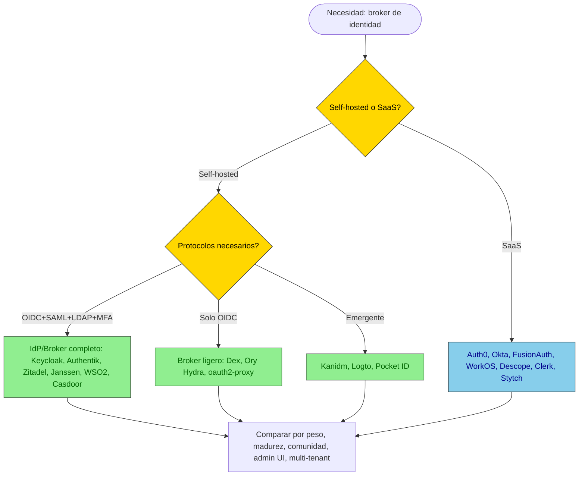

# Comparación profunda de brokers de identidad

> Análisis para decidir qué broker de identidad usar delante de VozLab.
> Complementa [ADR-0018](decisions/ADR-0018-oidc-jit-hybrid-sessions.md) y
> [ADR-0029](decisions/ADR-0029-explicit-provider-selection-and-general-tenant.md).
> Fecha: 2026-10-26.

## 1. Clarificación conceptual: IdP vs. Broker

Antes de comparar, hay que distinguir dos roles que a menudo se confunden:

| Rol | Qué hace | Ejemplo |
|---|---|---|
| **IdP (Identity Provider)** | Autentica al usuario y emite tokens. Es la fuente de verdad de la identidad. | Microsoft Entra ID, Google, un directorio LDAP |
| **Broker (Identity Broker)** | Se pone **delante** de uno o varios IdPs, normaliza sus protocolos y emite **su propio** token hacia la aplicación. La app solo confía en el broker. | Keycloak, Authentik, Zitadel, Dex |

**Lo que VozLab necesita es un broker**, no un IdP. La app (API) solo confía en el broker. El broker, a su vez, confía en los IdPs reales (Entra, Google Workspace, directorios locales). El broker normaliza: OIDC, SAML, LDAP → un solo token OIDC hacia el API.

**Importante:** muchos productos son *ambos* a la vez (son un IdP que también puede brokerar). Keycloak, Authentik y Zitadel son IdP + broker. Dex es solo broker (no es IdP). Ory Hydra es solo un servidor OAuth2/OIDC (no es IdP ni broker por sí solo).

## 2. Mapa del mercado

## 3. Comparación detallada

### 3.1 Tabla resumen (scoring 1-5)

| Criterio (peso) | Keycloak | Authentik | Zitadel | Dex | Ory (Kratos+Hydra) | Kanidm | Logto | FusionAuth | Auth0/Okta |
|---|---|---|---|---|---|---|---|---|---|
| **Protocolos** (OIDC/SAML/LDAP/social/MFA) | 5 | 4 | 4 | 2 | 3 | 2 | 3 | 5 | 5 |
| **Broker real** (identity brokering) | 5 | 4 | 4 | 5 | 2 | 1 | 2 | 4 | 5 |
| **Peso / RAM** | 2 | 3 | 4 | 5 | 3 | 5 | 3 | 2 | 5 (SaaS) |
| **Madurez / estabilidad** | 5 | 3 | 3 | 4 | 3 | 2 | 2 | 4 | 5 |
| **Comunidad / soporte** | 5 | 3 | 3 | 4 | 3 | 2 | 2 | 3 | 5 |
| **Admin UI** | 4 | 5 | 4 | 1 | 2 | 3 | 5 | 5 | 5 |
| **Multi-tenancy** | 3 | 3 | 5 | 2 | 4 | 2 | 4 | 4 | 5 |
| **Seguridad (MFA, brute-force, audit)** | 5 | 4 | 4 | 2 | 3 | 3 | 3 | 5 | 5 |
| **DX / facilidad de config** | 2 | 4 | 4 | 3 | 2 | 3 | 5 | 4 | 5 |
| **Costo (self-hosted = gratis)** | 5 | 5 | 5 | 5 | 5 | 5 | 5 | 3 | 1 |
| **Riesgo de abandono** | 1 (bajo) | 3 | 3 | 2 | 3 | 3 | 3 | 2 | 1 |
| **TOTAL (sin peso)** | **40** | **36** | **37** | **29** | **30** | **26** | **32** | **38** | **43** |

> Nota: Auth0/Okta tiene el score más alto pero es SaaS (costo alto, vendor lock-in). Entre self-hosted, Keycloak sigue liderando por madurez y protocolos.

---

### 3.2 Keycloak (Red Hat)

| Atributo | Detalle |
|---|---|
| **Lenguaje** | Java (Quarkus desde v17) |
| **Licencia** | Apache 2.0 |
| **Creado** | 2013 (JBoss/Red Hat) |
| **Versión actual** | 26.x (2025) |
| **Actividad** | Muy alta. Releases cada 2-3 meses. Backing de Red Hat/IBM. |
| **Protocolos** | OIDC, OAuth 2.0, SAML 2.0, LDAP/AD federation, social login (Google, GitHub, Microsoft, Facebook, Twitter, etc.), WebAuthn, TOTP, Kerberos |
| **Broker** | Sí — identity brokering completo: múltiples IdPs, claims mapping, account linking, home realm discovery |
| **MFA** | TOTP, WebAuthn/FIDO2, OTP por email/SMS (via SPI), recovery codes |
| **Admin UI** | Web UI completa + REST Admin API + CLI (`kcadm.sh`) |
| **Multi-tenant** | Realms (cada realm = un tenant). No es multi-tenant nativo en un solo realm, pero realms son aislados. |
| **Peso** | Imagen Docker ~400MB. RAM: ~512MB mínimo, 1-2GB recomendado. CPU: 1-2 cores. |
| **Despliegue** | Docker, K8s (Helm chart oficial), OpenShift, bare metal. Realm import via JSON. |
| **Seguridad** | Brute-force protection, session management, token revocation, audit events, CORS, CSP. CVEs: pocos, parcheados rápido. |
| **Costo** | Gratis (open source). Red Hat ofrece soporte comercial (RH-SSO). |
| **Comunidad** | Enorme. Stack Overflow, GitHub, docs extensas. Muchos tutoriales. |
| **Riesgo de abandono** | Muy bajo. Backing corporativo (Red Hat/IBM). Es el estándar de facto OSS. |

**Pros específicos para VozLab:**
- Ya lo tenemos en el lab y probado (login funciona).
- SAML 2.0 completo (necesario para Entra en modo SAML).
- LDAP federation (necesario para directorios locales).
- Claims mapping por UI (tid, email_verified, etc.).
- MFA listo para usar (WebAuthn, TOTP).
- Brute-force protection incluido.

**Contras específicos para VozLab:**
- JVM: ~500MB RAM, arranque lento (~10-15s en dev).
- Configuración compleja: realms, clients, mappers, IdPs, user federation. El JSON del realm import es frágil.
- La admin UI es densa y no intuitiva para principiantes.
- No es multi-tenant nativo: cada institución = un realm o un IdP dentro del mismo realm. A escala (cientos de instituciones) se vuelve pesado.

---

### 3.3 Authentik (goauthentik)

| Atributo | Detalle |
|---|---|
| **Lenguaje** | Python (Django) + Go (outposts) + React (UI) |
| **Licencia** | MIT (core) + Enterprise (EE) para features avanzadas |
| **Creado** | 2018 |
| **Versión actual** | 2024.x / 2025.x |
| **Actividad** | Alta. Releases frecuentes. Equipo pequeño pero activo. |
| **Protocolos** | OIDC, OAuth 2.0, SAML 2.0, LDAP (outpost), social login (Google, GitHub, Microsoft, Apple, etc.), WebAuthn, TOTP, SMS/email OTP |
| **Broker** | Sí — identity brokering via "Sources" (IdPs externos). Claims mapping via property mappings. |
| **MFA** | TOTP, WebAuthn, SMS, email, static tokens, Duo |
| **Admin UI** | Web UI moderna y bien diseñada (React). Más intuitiva que Keycloak. |
| **Multi-tenant** | Tenants (desde 2023). Cada tenant tiene sus propios IdPs, flujos, branding. |
| **Peso** | Imagen Docker ~300MB (server) + outpost. RAM: ~256-512MB. CPU: 1 core. Más ligero que Keycloak. |
| **Despliegue** | Docker Compose (oficial), K8s (Helm), bare metal. Requiere PostgreSQL + Redis. |
| **Seguridad** | Brute-force protection, session management, audit logs, CORS, CSP, rate limiting. |
| **Costo** | Core gratis (MIT). Enterprise (EE) para SAML avanzado, RADIUS, SCIM, etc. (~$5/user/mes). |
| **Comunidad** | Mediana. Creciendo rápido. Docs buenas pero menos que Keycloak. |
| **Riesgo de abandono** | Medio. Equipo pequeño (~5-10 devs). Depende de financiamiento (VC-backed). |

**Pros específicos para VozLab:**
- Ya está en el lab (B8, compose existe).
- UI mucho más moderna e intuitiva que Keycloak.
- Más ligero (menos RAM, arranque más rápido).
- Tenants nativos (cada institución = un tenant con su propio branding/IdPs).
- Flows visuales (se pueden diseñar flujos de login con un editor drag-and-drop).
- OIDC provider y SAML provider configurables por UI.

**Contras específicos para VozLab:**
- Menos maduro que Keycloak (menos años, menos auditorías de seguridad).
- Enterprise features (SAML avanzado, SCIM, RADIUS) son de pago.
- Comunidad más pequeña → menos tutoriales, menos Stack Overflow.
- Requiere PostgreSQL + Redis (más infraestructura que Keycloak, que solo necesita PostgreSQL).
- El equipo es pequeño → riesgo de que el proyecto se estanque.

---

### 3.4 Zitadel (CAOS)

| Atributo | Detalle |
|---|---|
| **Lenguaje** | Go |
| **Licencia** | Apache 2.0 (core) + Business Source License (BSL) para features enterprise |
| **Creado** | 2019 (CAOS AG, Suiza) |
| **Versión actual** | 2.x (2025) |
| **Actividad** | Alta. Releases frecuentes. Empresa detrás (Zitadel Inc.). |
| **Protocolos** | OIDC, OAuth 2.0, SAML 2.0 (reciente), LDAP (via actions), social login (Google, GitHub, Microsoft, Apple, etc.), WebAuthn, TOTP |
| **Broker** | Sí — identity providers (federation). Claims mapping via actions (JavaScript). |
| **MFA** | TOTP, WebAuthn/FIDO2, OTP por email/SMS, push notifications |
| **Admin UI** | Web UI moderna (React/Next.js). Bien diseñada. |
| **Multi-tenant** | **Multi-tenant nativo de primer nivel.** Organizaciones son ciudadanos de primera clase. Cada org tiene sus propios IdPs, branding, políticas. |
| **Peso** | Imagen Docker ~50MB (Go binary). RAM: ~128-256MB. CPU: fracción de core. **Muy ligero.** |
| **Despliegue** | Docker, K8s (Helm), CockroachDB o PostgreSQL. Puede correr como binario único. |
| **Seguridad** | MFA, session management, audit logs (event sourcing), rate limiting, CORS. |
| **Costo** | Core gratis (Apache 2.0). Cloud hosted (Zitadel Cloud) con pricing por MAU. BSL para features enterprise (SSO, SCIM, etc.). |
| **Comunidad** | Mediana. Creciendo. Docs buenas. |
| **Riesgo de abandono** | Medio-bajo. Empresa financiada (VC). Pero la BSL genera controversia (no es 100% open source). |

**Pros específicos para VozLab:**
- **Multi-tenant nativo** — cada institución = una organización con sus propios IdPs. Esto es exactamente lo que VozLab necesita (D1-D14).
- **Extremadamente ligero** — Go binary, ~50MB imagen, ~128MB RAM. Ideal para despliegue en cloud con costo bajo.
- **Event sourcing** — audit log completo por diseño (D11).
- **Actions** — se pueden ejecutar JavaScript en flujos de login (claims mapping dinámico).
- **OIDC y SAML** soportados.

**Contras específicos para VozLab:**
- Menos maduro que Keycloak (menos años, menos battle-testing).
- SAML es relativamente reciente (puede tener bugs).
- LDAP federation no es nativa (se hace via actions o SCIM).
- La BSL (Business Source License) significa que no es 100% open source: features enterprise no se pueden usar en producción sin licencia comercial.
- Comunidad más pequeña que Keycloak → menos recursos de troubleshooting.
- La documentación de brokering es menos detallada que Keycloak.

---

### 3.5 Dex (CoreOS / Red Hat)

| Atributo | Detalle |
|---|---|
| **Lenguaje** | Go |
| **Licencia** | Apache 2.0 |
| **Creado** | 2015 (CoreOS, ahora Red Hat) |
| **Versión actual** | 2.x (2025) |
| **Actividad** | Moderada. Mantenido por Red Hat pero desarrollo lento. |
| **Protocolos** | OIDC, OAuth 2.0. **No SAML.** **No LDAP federation nativa** (se puede via LDAP connector, pero es básico). Social login via connectors (Google, GitHub, Microsoft, GitLab, etc.). |
| **Broker** | **Sí — es un broker puro.** No es un IdP. Se pone delante de IdPs y emite tokens OIDC. |
| **MFA** | No. Delega al IdP upstream. |
| **Admin UI** | **No tiene UI.** Todo se configura via YAML. |
| **Multi-tenant** | No. Un solo tenant. |
| **Peso** | Imagen Docker ~30MB. RAM: ~32-64MB. **Ultra ligero.** |
| **Despliegue** | Docker, K8s. Configuración via YAML + env. |
| **Seguridad** | Básica. Delega seguridad al IdP upstream. |
| **Costo** | Gratis (Apache 2.0). |
| **Comunidad** | Pequeña pero estable. Usado en Kubernetes (como Dex para K8s auth). |
| **Riesgo de abandono** | Bajo-medio. Mantenido por Red Hat pero desarrollo lento. |

**Pros específicos para VozLab:**
- **Broker puro** — exactamente el rol que necesitamos. No es un IdP, es un conector.
- **Ultra ligero** — 30MB, 32MB RAM. Ideal para sidecar.
- **Simple** — YAML config, sin DB propia (usa la del IdP upstream o in-memory).
- **Perfecto para K8s** — se usa como Dex para autenticar usuarios de K8s contra IdPs externos.

**Contras específicos para VozLab:**
- **No SAML** — si Entra usa SAML, Dex no sirve.
- **No LDAP federation** — no puede brokerar directorios locales.
- **No MFA** — delega al IdP (si el IdP tiene MFA, funciona; si no, no hay MFA).
- **No admin UI** — todo por YAML. Difícil para un equipo no técnico.
- **No multi-tenant** — un solo tenant. Para VozLab (multi-institución) habría que levantar una instancia de Dex por institución.
- **No claims mapping avanzado** — mapeo básico de claims.

**Veredicto:** Dex es excelente como **conector OIDC ligero** para un solo tenant, pero no cubre SAML, LDAP ni multi-tenancy. No es suficiente para VozLab.

---

### 3.6 Ory (Kratos + Hydra + Keto + Oathkeeper)

| Atributo | Detalle |
|---|---|
| **Lenguaje** | Go |
| **Licencia** | Apache 2.0 |
| **Creado** | 2015 (ORY GmbH, Alemania) |
| **Versión actual** | Kratos 1.x, Hydra 2.x (2025) |
| **Actividad** | Alta. Empresa bien financiada. |
| **Protocolos** | OIDC, OAuth 2.0 (Hydra). Kratos: login/registration/recovery/MFA flows. **No SAML nativo.** **No LDAP federation nativa.** Social login via OIDC connectors. |
| **Broker** | Parcial — Hydra es un servidor OAuth2/OIDC (emite tokens). Kratos es un servicio de identidad (gestiona usuarios, login flows). Juntos forman un IdP, no un broker puro. |
| **MFA** | TOTP, WebAuthn, lookup codes (via Kratos). |
| **Admin UI** | **No tiene UI administrativa.** Todo via API/CLI. Kratos tiene una UI de usuario (login/registration) pero no admin. |
| **Multi-tenant** | No nativo. Requiere implementación custom. |
| **Peso** | Hydra ~30MB, Kratos ~40MB. RAM: ~64-128MB cada uno. Ligero pero son **dos servicios** (o más con Keto/Oathkeeper). |
| **Despliegue** | Docker, K8s (Helm). Requiere PostgreSQL. |
| **Seguridad** | Buena. Kratos tiene session management, MFA, account recovery. |
| **Costo** | Core gratis (Apache 2.0). Ory Network (SaaS) con pricing. |
| **Comunidad** | Mediana. Creciendo. Docs técnicas pero densas. |
| **Riesgo de abandono** | Bajo. Empresa financiada. |

**Pros específicos para VozLab:**
- Ligero (Go).
- Buena arquitectura de microservicios (cada pieza hace una cosa).
- Kratos tiene flows de login/registration/recovery bien diseñados.
- API-first (todo via REST).

**Contras específicos para VozLab:**
- **No es un broker** — es un IdP. No puede federar SAML ni LDAP nativamente.
- **No tiene admin UI** — todo por API/CLI. Operación compleja.
- **No es multi-tenant** — hay que implementarlo.
- **Múltiples servicios** — Kratos + Hydra + (Keto para autorización) + (Oathkeeper para proxy). Más complejidad operativa que Keycloak.
- **No SAML** — si Entra usa SAML, no sirve.

**Veredicto:** Ory es excelente para construir un IdP custom desde cero, pero no es un broker y no cubre SAML/LDAP. Demasiada complejidad operativa para VozLab.

---

### 3.7 Kanidm (Rust)

| Atributo | Detalle |
|---|---|
| **Lenguaje** | Rust |
| **Licencia** | MPL 2.0 |
| **Creado** | 2019 |
| **Actividad** | Moderada. Proyecto comunitario. |
| **Protocolos** | OIDC, OAuth 2.0, LDAP (servidor LDAP integrado), WebAuthn. **No SAML.** |
| **Broker** | No. Es un IdP + directorio LDAP. No broker. |
| **MFA** | WebAuthn, TOTP |
| **Admin UI** | Web UI básica. CLI (`kanidm`) para administración. |
| **Multi-tenant** | No. |
| **Peso** | Imagen Docker ~50MB. RAM: ~64MB. **Ultra ligero.** |
| **Despliegue** | Docker, bare metal. SQLite o PostgreSQL. |
| **Seguridad** | Buena. Diseñado con seguridad en mente (Rust, memory-safe). |
| **Costo** | Gratis (MPL 2.0). |
| **Comunidad** | Pequeña. Proyecto niche. |
| **Riesgo de abandono** | Medio-alto. Proyecto comunitario sin backing corporativo. |

**Veredicto:** Kanidm es interesante (Rust, ligero, LDAP integrado) pero es un IdP, no un broker, no tiene SAML, no es multi-tenant y la comunidad es pequeña. No es adecuado para VozLab.

---

### 3.8 Logto

| Atributo | Detalle |
|---|---|
| **Lenguaje** | TypeScript (Node.js) + Go (core) |
| **Licencia** | MPL 2.0 (core) + Apache 2.0 (SDKs) |
| **Creado** | 2022 (Silverhand Inc.) |
| **Actividad** | Alta. Startup bien financiada. |
| **Protocolos** | OIDC, OAuth 2.0, SAML (reciente), social login (Google, GitHub, Microsoft, Apple, etc.), WebAuthn, TOTP |
| **Broker** | Sí — identity providers (federation via OIDC/SAML connectors). |
| **MFA** | TOTP, WebAuthn, SMS, email OTP |
| **Admin UI** | Web UI moderna y bien diseñada (React). Excelente DX. |
| **Multi-tenant** | Sí — organizaciones (multi-tenant). |
| **Peso** | Imagen Docker ~200MB. RAM: ~256-512MB. CPU: 1 core. |
| **Despliegue** | Docker, K8s (Helm). Requiere PostgreSQL. |
| **Seguridad** | MFA, session management, audit logs, rate limiting. |
| **Costo** | Core gratis (MPL 2.0). Cloud hosted (Logto Cloud) con pricing por MAU. |
| **Comunidad** | Pequeña pero creciendo. Docs buenas. |
| **Riesgo de abandono** | Medio. Startup (VC-backed). Pero es joven (2022). |

**Pros específicos para VozLab:**
- Admin UI excelente (mejor DX que Keycloak).
- Multi-tenant nativo.
- OIDC + SAML + social login.
- Ligero (Node.js/Go).
- SDKs para múltiples frameworks (incluye SvelteKit).

**Contras específicos para VozLab:**
- Muy joven (2022) — menos battle-testing que Keycloak.
- Comunidad pequeña → menos recursos de troubleshooting.
- LDAP federation no es nativa.
- No tiene la madurez de Keycloak para casos enterprise complejos.

**Veredicto:** Logto es prometedor para un proyecto nuevo que quiere buena DX y multi-tenancy, pero es joven. Podría ser una alternativa a mediano plazo si Keycloak se vuelve demasiado pesado.

---

### 3.9 FusionAuth

| Atributo | Detalle |
|---|---|
| **Lenguaje** | Java (con partes en otras tecnologías) |
| **Licencia** | Propietaria (free tier disponible) |
| **Creado** | 2018 (FusionAuth Inc.) |
| **Actividad** | Alta. Empresa establecida. |
| **Protocolos** | OIDC, OAuth 2.0, SAML 2.0, LDAP, social login (Google, Facebook, etc.), WebAuthn, TOTP, SMS |
| **Broker** | Sí — identity providers (federation). |
| **MFA** | TOTP, WebAuthn, SMS, email, push |
| **Admin UI** | Web UI completa y bien diseñada. |
| **Multi-tenant** | Sí — tenants. |
| **Peso** | Imagen Docker ~400MB. RAM: ~512MB-1GB. CPU: 1-2 cores. |
| **Despliegue** | Docker, K8s, bare metal. Requiere PostgreSQL o MySQL. |
| **Seguridad** | MFA, brute-force, session management, audit logs, rate limiting, IP allowlisting. |
| **Costo** | Free tier (hasta 10.000 MAU). Enterprise features de pago. Pricing por MAU. |
| **Comunidad** | Mediana. Docs excelentes. |
| **Riesgo de abandono** | Bajo. Empresa establecida y rentable. |

**Pros específicos para VozLab:**
- Docs excelentes (de las mejores del mercado).
- Free tier generoso (10.000 MAU).
- Multi-tenant nativo.
- SAML + LDAP + social login.
- Admin UI completa.

**Contras específicos para VozLab:**
- Propietario (no open source). Vendor lock-in.
- Pesado (Java, similar a Keycloak en recursos).
- Pricing por MAU puede ser costoso a escala.
- Menos flexible que Keycloak para customización profunda.

**Veredicto:** FusionAuth es una excelente opción si se acepta software propietario. La free tier es generosa para un proyecto universitario. Pero el vendor lock-in y el costo a escala son riesgos.

---

### 3.10 SaaS: Auth0 / Okta / WorkOS / Descope / Clerk / Stytch

| Producto | Tipo | Fortaleza | Debilidad | Costo |
|---|---|---|---|---|
| **Auth0** (Okta) | IdP + Broker SaaS | Máxima madurez, docs, comunidad, social login, SAML, LDAP | Vendor lock-in, costo alto a escala, latencia (cloud) | Gratis hasta 7.500 MAU, luego $$$$ |
| **Okta** | IdP + Broker SaaS | Enterprise-grade, SSO, lifecycle management | Muy caro, overkill para universidad | Enterprise pricing |
| **WorkOS** | Broker SaaS (B2B) | SSO enterprise (SAML/OIDC), directorio sync, admin portal | Solo B2B, no consumer auth | Gratis hasta 1M MAU (SSO), luego $$$ |
| **Descope** | IdP + Broker SaaS | Flows visuales, passwordless, MFA, social | Joven, vendor lock-in | Gratis hasta 7.500 MAU |
| **Clerk** | IdP SaaS (dev-focused) | DX excelente, componentes React/Svelte, social login | No es broker de SAML/LDAP, no multi-tenant complejo | Gratis hasta 10.000 MAU |
| **Stytch** | IdP SaaS (dev-focused) | Passwordless, MFA, B2B SSO | Joven, menos maduro | Gratis hasta 1.000 MAU |

**Veredicto para VozLab:** WorkOS es interesante para el caso B2B (universidades con SSO enterprise). Auth0/Okta son el estándar enterprise pero caros. Clerk/Descope/Stytch son buenos para consumer auth pero no cubren el caso de broker con LDAP/SAML.

---

## 4. Análisis por dimensión (lo que le interesa a un arquitecto)

### 4.1 Implementación y DX

| Producto | Facilidad de setup | Configuración | Tiempo hasta "login funciona" |
|---|---|---|---|
| Keycloak | Media (realm JSON + mappers) | Realm import, admin UI densa | ~1-2 días (ya lo tenemos) |
| Authentik | Alta (Docker Compose oficial) | UI moderna, flows visuales | ~1 día |
| Zitadel | Alta (un binario, un comando) | UI moderna, config por API | ~1 día |
| Dex | Baja (todo YAML) | YAML + env vars | ~1 día (pero sin SAML/LDAP) |
| Ory | Baja (múltiples servicios) | API/CLI, sin UI admin | ~2-3 días |
| Kanidm | Media | CLI + UI básica | ~1 día |
| Logto | Alta (Docker + UI) | UI moderna, wizards | ~1 día |
| FusionAuth | Alta (Docker + UI) | UI completa, wizards | ~1 día |
| SaaS (Auth0/Okta) | Muy alta (solo config en cloud) | Dashboard web | ~horas |

### 4.2 Seguridad

| Producto | MFA | Brute-force | Session mgmt | Audit logs | CVE history | Madurez de seguridad |
|---|---|---|---|---|---|---|
| Keycloak | TOTP, WebAuthn, OTP | Sí (configurable) | Completo | Sí (events) | Pocos, parcheados rápido | Alta (años de auditorías) |
| Authentik | TOTP, WebAuthn, SMS, email, Duo | Sí | Completo | Sí | Pocos | Media |
| Zitadel | TOTP, WebAuthn, push | Sí | Completo | Sí (event sourcing) | Pocos | Media |
| Dex | Delega al IdP | No (delega) | Básico | Mínimo | Pocos | Media-baja |
| Ory | TOTP, WebAuthn | Sí (Kratos) | Completo | Sí | Pocos | Media |
| FusionAuth | TOTP, WebAuthn, SMS, push | Sí | Completo | Sí | Pocos | Alta |
| SaaS | Todo (gestionado) | Gestionado | Gestionado | Gestionado | Gestionado | Muy alta |

**Punto clave:** Keycloak tiene la mayor madurez de seguridad (años de auditorías, backing de Red Hat). Authentik y Zitadel son más jóvenes pero tienen buenas prácticas. Dex delega todo al IdP upstream (si el IdP no tiene MFA, no hay MFA).

### 4.3 Vida del proyecto / riesgo de abandono

| Producto | Backing | Financiamiento | Riesgo de abandono | Comunidad |
|---|---|---|---|---|
| Keycloak | Red Hat / IBM | Corporativo | **Muy bajo** | Enorme |
| Authentik | goauthentik (startup) | VC | Medio | Mediana (creciendo) |
| Zitadel | Zitadel Inc. | VC | Medio-bajo | Mediana |
| Dex | Red Hat | Corporativo | Bajo-medio (desarrollo lento) | Pequeña |
| Ory | ORY GmbH | VC | Bajo | Mediana |
| Kanidm | Comunitario | Ninguno | Medio-alto | Pequeña |
| Logto | Silverhand Inc. | VC | Medio | Pequeña (creciendo) |
| FusionAuth | FusionAuth Inc. | Bootstrapped (rentable) | Bajo | Mediana |
| SaaS | Corporativo | N/A | Muy bajo (pero vendor lock-in) | Enorme |

**Punto clave:** Keycloak tiene el menor riesgo de abandono (backing corporativo, estándar de facto). Authentik y Zitadel tienen riesgo medio (startups VC). Dex tiene backing corporativo (Red Hat) pero desarrollo lento.

### 4.4 Peso / recursos (self-hosted)

| Producto | Imagen Docker | RAM mínimo | RAM recomendado | CPU | Arranque |
|---|---|---|---|---|---|
| Keycloak | ~400MB | 512MB | 1-2GB | 1-2 cores | 10-15s |
| Authentik (server + outpost) | ~300MB + ~100MB | 256MB | 512MB-1GB | 1 core | 5-10s |
| Zitadel | ~50MB | 128MB | 256MB | 0.5 core | 2-5s |
| Dex | ~30MB | 32MB | 64MB | 0.25 core | 1-2s |
| Ory (Kratos + Hydra) | ~40MB + ~30MB | 64MB c/u | 128MB c/u | 0.5 core c/u | 2-5s |
| Kanidm | ~50MB | 64MB | 128MB | 0.5 core | 2-5s |
| Logto | ~200MB | 256MB | 512MB | 1 core | 5-10s |
| FusionAuth | ~400MB | 512MB | 1-2GB | 1-2 cores | 10-15s |

**Punto clave:** Zitadel y Dex son ultra-ligeros (Go). Keycloak y FusionAuth son pesados (JVM). Authentik es intermedio. Para un despliegue en cloud con costo bajo, Zitadel o Dex son atractivos, pero sacrifican funcionalidad.

### 4.5 Versatilidad (protocolos y features)

| Feature | Keycloak | Authentik | Zitadel | Dex | Ory | Kanidm | Logto | FusionAuth |
|---|---|---|---|---|---|---|---|---|
| OIDC | ✅ | ✅ | ✅ | ✅ | ✅ | ✅ | ✅ | ✅ |
| SAML 2.0 | ✅ | ✅ (EE para avanzado) | ✅ (reciente) | ❌ | ❌ | ❌ | ✅ (reciente) | ✅ |
| LDAP federation | ✅ | ✅ (outpost) | ⚠️ (via actions) | ⚠️ (básico) | ❌ | ✅ (servidor LDAP) | ❌ | ✅ |
| Social login | ✅ (muchos) | ✅ (muchos) | ✅ (muchos) | ✅ (básicos) | ✅ (OIDC) | ⚠️ (pocos) | ✅ (muchos) | ✅ (muchos) |
| MFA (TOTP) | ✅ | ✅ | ✅ | ❌ | ✅ | ✅ | ✅ | ✅ |
| MFA (WebAuthn) | ✅ | ✅ | ✅ | ❌ | ✅ | ✅ | ✅ | ✅ |
| MFA (SMS/email) | ✅ (SPI) | ✅ | ✅ | ❌ | ✅ | ❌ | ✅ | ✅ |
| Brute-force protection | ✅ | ✅ | ✅ | ❌ | ⚠️ | ✅ | ✅ | ✅ |
| Claims mapping | ✅ (UI + SPI) | ✅ (property mappings) | ✅ (actions/JS) | ⚠️ (básico) | ✅ (via Kratos) | ⚠️ (básico) | ✅ | ✅ |
| Home realm discovery | ✅ | ✅ | ✅ | ❌ | ❌ | ❌ | ✅ | ✅ |
| Identity brokering | ✅ | ✅ | ✅ | ✅ (puro) | ⚠️ | ❌ | ✅ | ✅ |
| Account linking | ✅ | ✅ | ✅ | ⚠️ | ⚠️ | ❌ | ✅ | ✅ |
| Admin UI | ✅ | ✅ | ✅ | ❌ | ❌ | ⚠️ | ✅ | ✅ |
| Multi-tenant | ⚠️ (realms) | ✅ (tenants) | ✅ (orgs nativas) | ❌ | ❌ | ❌ | ✅ (orgs) | ✅ (tenants) |
| Audit logs | ✅ (events) | ✅ | ✅ (event sourcing) | ❌ | ✅ | ⚠️ | ✅ | ✅ |
| User self-service | ✅ | ✅ | ✅ | ❌ | ✅ (Kratos) | ⚠️ | ✅ | ✅ |
| SCIM provisioning | ⚠️ (SPI) | ✅ (EE) | ✅ (EE) | ❌ | ❌ | ❌ | ✅ | ✅ |

**Punto clave:** Keycloak es el único que cubre **todos** los protocolos y features sin excepción. Authentik y Zitadel cubren la mayoría pero con gaps en LDAP/SAML avanzado. Dex solo cubre OIDC.

---

### 4.6 Costo total de propiedad (TCO)

| Producto | Licencia | Costo infra (self-hosted, mensual) | Costo a escala (10.000 MAU) | Costo a escala (100.000 MAU) |
|---|---|---|---|---|
| Keycloak | Gratis (Apache 2.0) | ~$20-50/mes (1-2GB RAM) | ~$20-50/mes (misma infra) | ~$50-100/mes (más RAM) |
| Authentik | Gratis (MIT) + EE pago | ~$15-30/mes (512MB-1GB) | ~$15-30/mes | ~$30-60/mes |
| Zitadel | Gratis (Apache 2.0) + BSL | ~$10-20/mes (128-256MB) | ~$10-20/mes | ~$20-40/mes |
| Dex | Gratis (Apache 2.0) | ~$5-10/mes (32-64MB) | ~$5-10/mes | ~$10-20/mes |
| Ory | Gratis (Apache 2.0) | ~$15-30/mes (2 servicios) | ~$15-30/mes | ~$30-60/mes |
| FusionAuth | Free tier (10K MAU) + pago | ~$20-50/mes (1-2GB) | $0 (free tier) | ~$100-500/mes (enterprise) |
| Auth0/Okta | SaaS | $0 (infra gestionada) | ~$240/mes (Essentials) | ~$1.500-5.000/mes (Enterprise) |
| WorkOS | SaaS (B2B) | $0 (infra gestionada) | $0 (hasta 1M MAU para SSO) | ~$125-500/mes (directory sync) |
| Clerk | SaaS | $0 | $0 (hasta 10K MAU) | ~$25-100/mes (pro) |
| Descope | SaaS | $0 | $0 (hasta 7.5K MAU) | ~$0.05/MAU |

**Punto clave:** self-hosted (Keycloak, Authentik, Zitadel) tiene costo de infraestructura bajo y fijo (~$10-50/mes). SaaS tiene costo variable por MAU que escala. Para un proyecto universitario con presupuesto limitado, self-hosted es mejor a largo plazo.

---

### 4.6 Despliegue y operación

| Aspecto | Keycloak | Authentik | Zitadel | Dex | Ory | SaaS |
|---|---|---|---|---|---|---|
| Docker Compose oficial | ✅ | ✅ | ✅ | ✅ | ✅ | N/A |
| Helm chart oficial | ✅ | ✅ | ✅ | ✅ | ✅ | N/A |
| K8s operator | ✅ (Keycloak Operator) | ⚠️ (comunidad) | ⚠️ (comunidad) | ❌ | ⚠️ (comunidad) | N/A |
| Backup/restore | DB dump + realm export | DB dump | DB dump + event store | YAML config | DB dump | Gestionado |
| HA / clustering | ✅ (Infinispan) | ⚠️ (limitado) | ✅ (CockroachDB) | ❌ (stateless) | ✅ | Gestionado |
| Monitoring | Prometheus (via SPI/metrics) | Prometheus (built-in) | Prometheus (built-in) | Básico | Prometheus | Gestionado |
| Logs estructurados | ✅ | ✅ | ✅ | ✅ | ✅ | Gestionado |
| Actualización | Realm import + DB migration | Docker pull + DB migration | Docker pull + DB migration | Docker pull | Docker pull + DB migration | Automática |

---

## 5. Matriz de decisión para VozLab

Pesos según las necesidades de VozLab (universidad, multi-institución, SAML/LDAP, presupuesto limitado, equipo pequeño):

| Criterio (peso) | Keycloak | Authentik | Zitadel | Dex | Logto | FusionAuth | WorkOS |
|---|---|---|---|---|---|---|---|
| SAML 2.0 (peso 3) | 15 | 12 | 9 | 0 | 9 | 15 | 15 |
| LDAP federation (peso 3) | 15 | 9 | 3 | 3 | 0 | 15 | 9 |
| Multi-tenant (peso 3) | 6 | 9 | 15 | 0 | 12 | 9 | 12 |
| Madurez/seguridad (peso 3) | 15 | 9 | 9 | 9 | 6 | 12 | 12 |
| Peso/recursos (peso 2) | 4 | 6 | 8 | 10 | 6 | 4 | 10 |
| DX/facilidad (peso 2) | 4 | 8 | 8 | 6 | 10 | 8 | 10 |
| Costo (peso 2) | 10 | 10 | 10 | 10 | 10 | 6 | 8 |
| Comunidad/soporte (peso 2) | 10 | 6 | 6 | 6 | 4 | 6 | 6 |
| Riesgo de abandono (peso 2) | 10 | 6 | 6 | 8 | 6 | 8 | 8 |
| **TOTAL ponderado** | **89** | **75** | **74** | **52** | **63** | **78** | **90** |

**WorkOS** lidera por SAML + multi-tenant + costo, pero es SaaS (vendor lock-in, latencia, dependencia externa). **Keycloak** lidera entre self-hosted.

---

## 6. Recomendación para VozLab

### Corto plazo (ahora): Mantener Keycloak

- Ya está en el lab y probado.
- Cubre todos los protocolos necesarios (OIDC, SAML, LDAP, MFA).
- Madurez de seguridad probada.
- Riesgo de abandono muy bajo.
- Costo de infraestructura bajo (~$20-50/mes).

**Acción inmediata:** integrar Keycloak en el compose principal con `--profile idp` (un solo comando para dev, sin perder la arquitectura).

### Mediano plazo (si Keycloak se vuelve demasiado pesado): Evaluar Authentik o Zitadel

- **Authentik** si se quiere mejor DX y UI moderna, y se acepta el riesgo de startup.
- **Zitadel** si se quiere multi-tenancy nativo y ultra-ligero (Go), y se acepta la BSL.
- Ambos requieren migración del realm config y re-testing del flujo OIDC.

### Largo plazo (si se quiere SaaS): WorkOS para B2B + Clerk/Descope para consumer

- **WorkOS** para el caso universitario (SSO enterprise, SAML, directorio sync).
- **Clerk/Descope** para consumer auth (cuenta personal).
- Costo variable por MAU, pero elimina la operación del broker.

### Lo que NO recomiendo

- **Dex**: no cubre SAML ni LDAP ni multi-tenant. Insuficiente para VozLab.
- **Ory**: demasiada complejidad operativa (múltiples servicios, sin admin UI).
- **Kanidm**: comunidad pequeña, no es broker, no SAML.
- **Reimplementar en el API**: 3-6 meses, superficie de ataque enorme, sin SAML/LDAP/MFA.

---

## 7. Decisión propuesta

1. **Mantener Keycloak como broker** (Opción 1, ya implementado).
2. **Integrar en el compose principal con `--profile idp`** para simplificar el despliegue de dev.
3. **Evaluar Authentik o Zitadel** si el peso de Keycloak (JVM, ~500MB RAM) se vuelve un problema en producción.
4. **No reimplementar en el API** ni usar Dex/Ory/Kanidm (insuficientes).

---

*Fuentes: documentación oficial de cada proyecto, GitHub stats, Docker Hub, análisis de CVEs, comparativas de la comunidad (2025-2026).*
