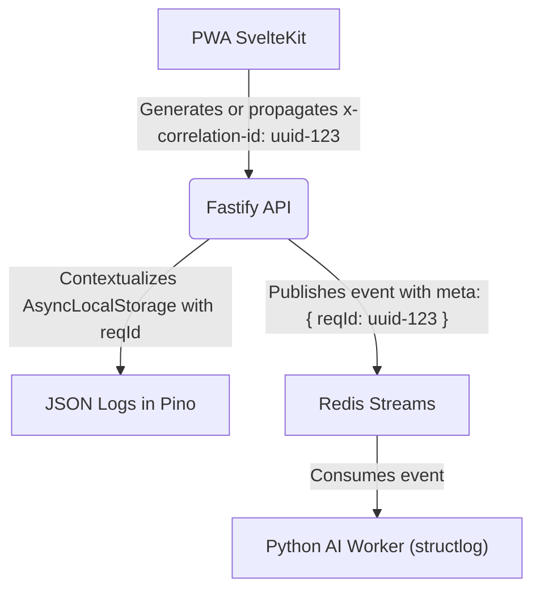

# 02. OBSERVABILITY, MONITORING, AND STRUCTURED LOGGING

## 1. End-to-End Traceability Strategy (Correlation ID)

To correlate events across VozLab's distributed infrastructure (SvelteKit PWA, Fastify API, Redis Streams, and Python Workers), a unique identifier called **Correlation ID (`reqId`)** is propagated.



### 1.1. Propagation in the API (AsyncLocalStorage)

* The Fastify middleware uses `AsyncLocalStorage` to isolate the context of each HTTP request (`reqId`, `tenantId`, `workspaceId`).
* Any log call inside the Use Cases or Repositories automatically attaches these fields without requiring manual parameter passing.

---

## 2. Structured JSON Logging

All record output (*stdout* / *stderr*) is emitted strictly as **structured JSON** to facilitate its ingestion into collectors (Grafana Loki, Datadog, or AWS CloudWatch).

### 2.1. Standard Trace Format

```json
{
  "level": "info",
  "time": "2026-10-11T16:45:00.123Z",
  "reqId": "123e4567-e89b-12d3-a456-426614174000",
  "tenantId": "sabana",
  "workspaceId": "ingenieria",
  "service": "api-fastify",
  "module": "use_case.approve_proposal",
  "msg": "Edit proposal approved successfully",
  "durationMs": 14.2,
  "params": {
    "proposalId": "987f6543-e21b-12d3-a456-426614174000"
  }
}

```

---

## 3. Health Endpoints and Orchestration Probes

The Fastify API exposes the standard patterns for validation in Kubernetes or cloud orchestrators:

1. **`GET /health/live` (Liveness Probe):**
* Responds `200 OK { "status": "alive" }` if the Node.js process responds to events.


2. **`GET /health/ready` (Readiness Probe):**
* Verifies active connectivity against PostgreSQL (AGE/vector) and Redis.
* Responds `200 OK { "status": "ready", "checks": { "database": "up", "redis": "up" } }`. If it fails, it returns `503 Service Unavailable`.


---

## 4. Performance Telemetry and Alerts

* **Cypher / AGE Latency:** Alert for Apache AGE queries that exceed $50\text{ ms}$.
* **Redis Queue Depth:** If `stream:node_created` accumulates more than 100 pending messages, alarms are triggered to scale the AI worker replicas.
