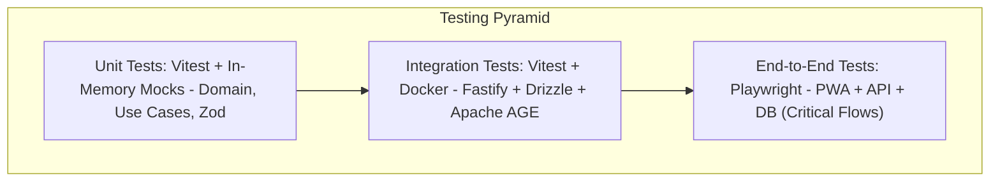

# 03. TEST PLAN, QUALITY, AND QA STRATEGY

## 1. Testing Pyramid and Quality Coverage

VozLab adopts a **Pyramid Quality Assurance** approach to optimize execution speed in CI/CD and guarantee system stability:

---

## 2. Test Levels and Tools

### 2.1. Unit Tests

* **Tool:** **Vitest**.
* **Scope:** Validation of domain entities, pure business rules, Value Objects, and Zod validation schemas.
* **Target Metric:** Code coverage $> 85\%$ in the `domain/` and `application/` layers.

### 2.2. Integration Tests

* **Tool:** **Vitest** running against an ephemeral **PostgreSQL 16+ (Apache AGE + pgvector)** container brought up via Docker.
* **Scope:** Verification of Drizzle ORM queries, graph traversal in Cypher over Apache AGE, atomic multi-table transactions (`UnitOfWork`), and event publishing to Redis Streams.

### 2.3. End-to-End Tests (E2E)

* **Tool:** **Playwright**.
* **Scope:** Automation of critical flows in the client PWA built with SvelteKit 5:
1. Simulated OIDC/SSO login or event QR.
2. Workspace switching between independent tabs.
3. Node creation and rendering in Cytoscape.js.
4. Pull Request flow (creation, debate, and approval/rejection of edit proposals).

---

## 3. Stress Testing and Graph Benchmarking (k6)

To validate compliance with the system's SLAs under concurrent load, a performance test script with **k6** is used:

### 3.1. Target Performance Criteria (SLA)

* **Subgraph Queries (<200 nodes):** Response time $p_{95} < 30\text{ ms}$.
* **HNSW Vector Search (768 dims):** Response time $p_{95} < 20\text{ ms}$.
* **Mutations and Vote Registration:** Response time $p_{95} < 15\text{ ms}$.

### 3.2. Stress Seeding

The command `npm run db:seed:stress` generates a dense subgraph of **10,000 Nodes and 50,000 Edges** in PostgreSQL to verify that the B-Tree, GIN, and HNSW indexes maintain constant latency under high concurrency.

