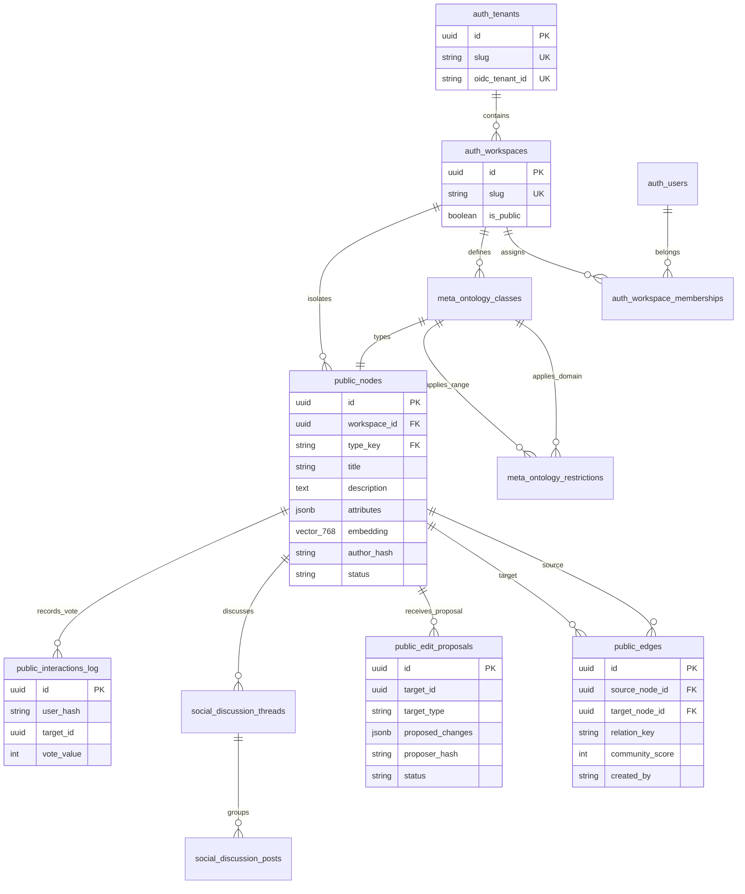
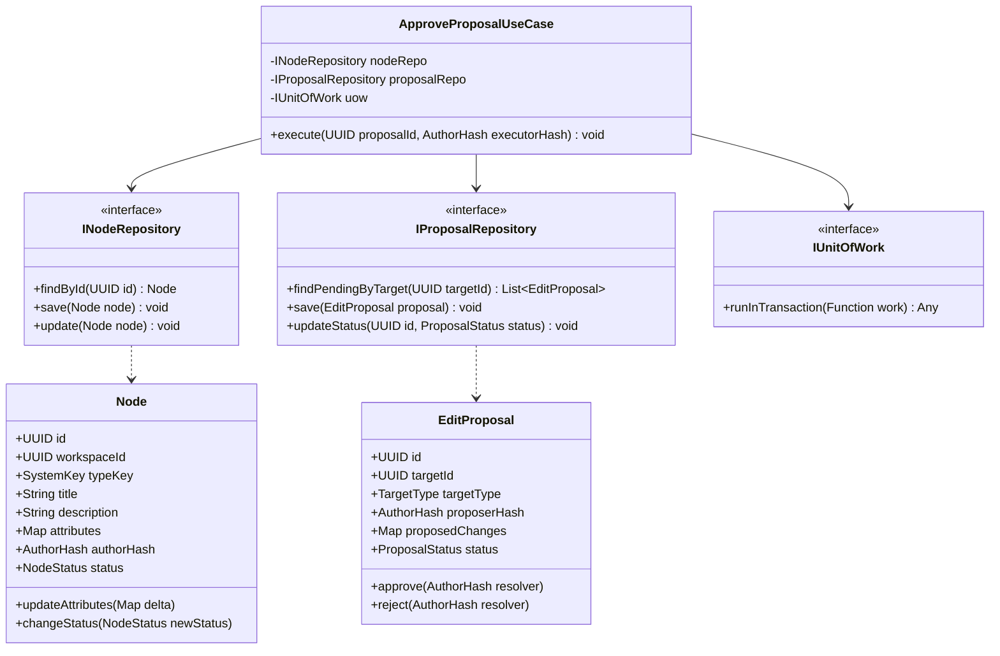
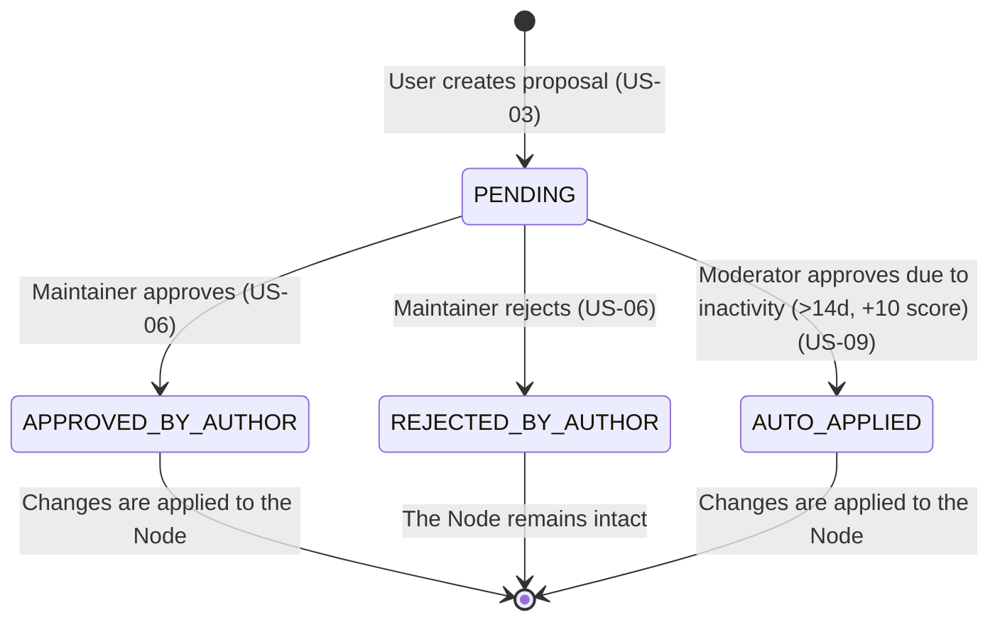
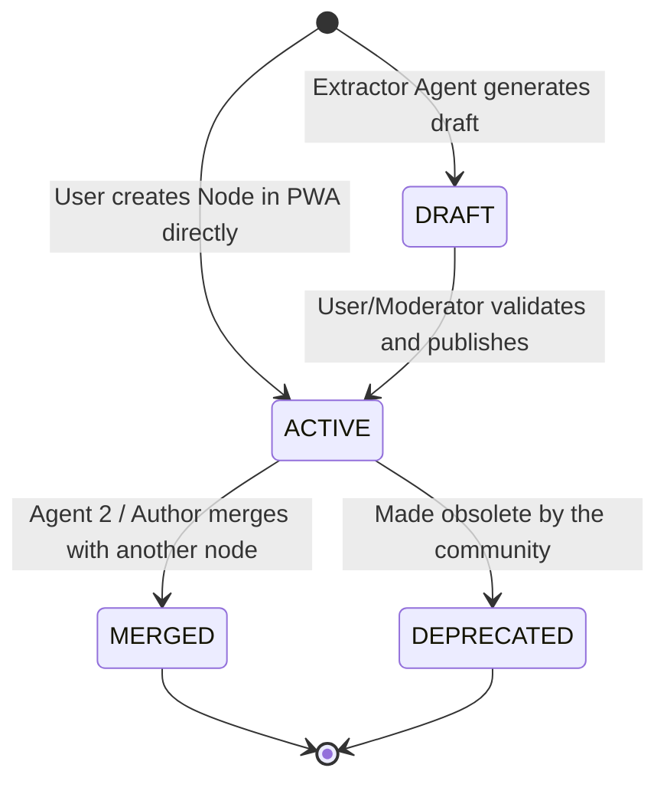
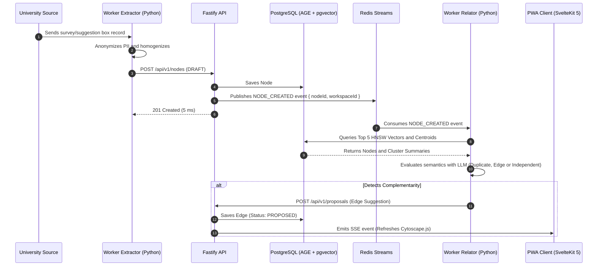

# 03. UML, ARCHITECTURE AND DEPLOYMENT DIAGRAMS

## 1. Structural Data View (Entity-Relationship Diagram - ERD)

The unified data model coexists in **PostgreSQL 16+** structured in four main schemas: `auth` (identity and multi-tenancy), `meta` (dynamic ontology), `public` (graph domain and relationships) and `social` (discussion threads and interactions).

---

## 2. Domain Core Class Diagram (Hexagonal Architecture)

Object-oriented representation of the Domain and Interfaces (Ports) layer, isolated from the HTTP/DB infrastructure in the Fastify API.

---

## 3. State Machine Diagram (Entity Lifecycle)

### 3.1. State of an Edit Proposal (Pull Request)

### 3.2. State of Nodes and AI Ingestion

---

## 4. Sequence Diagram: Ingestion, Evaluation and Real-Time Reaction

Asynchronous flow from Agent 1's atomic ingestion, the emission to Redis Streams, Agent 2's qualitative semantic evaluation and the real-time notification to the PWA.

---

## 5. Deployment and Physical Infrastructure Diagram (Deployment)

Container topology in production on a managed cluster (Kubernetes / Docker Swarm) with multi-tenant isolation and connection to the Ollama engine.

