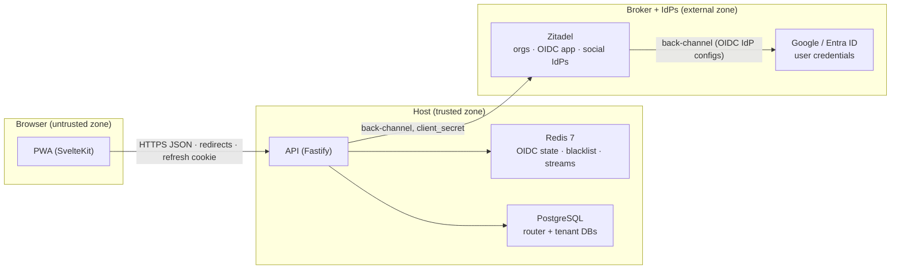

# Authentication and tenancy

VozLab separates three questions:

1. **Who is calling?** — authentication through an institutional OIDC provider
   (FR-01), or an anonymous event code (FR-03).
2. **Which institution's database?** — tenant resolution from the validated
   ID-token claim through the router DB (FR-02).
3. **Which slice of that database?** — workspace isolation from
   `X-Workspace-ID` plus a membership row (FR-05).

## 1. Current auth flow

| Concern | Implementation (2026-10-30) |
| --- | --- |
| Browser login | `GET /api/v1/auth/login?redirect=/path` → 302 to the IdP |
| Callback | `GET /api/v1/auth/callback?code=&state=` → ID-token validation, JIT user upsert, global-user upsert (`global_users`), `OIDC_LOGIN` event, 302 to the PWA (or to `/select-tenant` when the user is linked to N>1 institutions); an invitation token carried in the state is redeemed through the unified path (§6) before tenant selection |
| Tenant selection | `GET /api/v1/auth/resolve-tenants?globalUserId=` + `POST /api/v1/auth/select-tenant {globalUserId, tenantId}` (first login, no session yet); `POST /api/v1/auth/switch-tenant` (authenticated, re-points the session to another linked institution) — every selection writes `TENANT_SELECTED` |
| Access token | HS256 JWT, 15 min default, returned in JSON; the PWA holds it in memory only |
| Refresh token | Opaque `v1.<tenant UUID>.<64 hex>`, 30 d default, `HttpOnly` cookie, rotated on every use |
| Refresh storage | `auth.refresh_tokens` (tenant DB): SHA-256 hash, family id, expiry, revocation timestamp |
| Logout | `POST /api/v1/auth/logout` (Bearer + cookie): blacklist `jti`, revoke the refresh family, clear the cookie |
| Session probe | `GET /api/v1/auth/me` (Bearer, no `X-Workspace-ID`): profile plus workspace memberships |
| Event join | `POST /api/v1/auth/event-join { code, alias? }`: anonymous user + membership + session |
| Dev credentials | `db:mint-token` remains for local development and workers; it is not exposed over HTTP |

The API is a **resource server**, not an identity provider. It never accepts an
IdP access token as a graph credential; it exchanges the authorization code,
validates the ID token, and issues its own short-lived JWT.

### Participants and trust boundaries

| Participant | What it is | What it owns / controls |
|---|---|---|
| **PWA** (`apps/web`, SvelteKit) | The app in the browser | The UI, the in-memory access token, the per-tab workspace selection. It owns **no** secret and no long-lived token. |
| **API** (`apps/api`, Fastify) | The backend / BFF | The `JWT_SECRET`, the OIDC `client_secret`, the OIDC state in Redis, the refresh cookie, the user accounts in the databases. The **only** component that talks to the broker. |
| **Zitadel** (identity broker) | The OIDC broker (self-hosted; ADR-0030) | The organizations (one per institution, resolved from `urn:zitadel:iam:org:id`), the OIDC app, the login policy, the federated social IdPs (Google/Microsoft as generic OIDC IdPs; B9). |
| **External IdP** (Google, Microsoft Entra) | The real identity providers | The user credentials and `email_verified`. The browser never sends them to VozLab. |

**Golden rule:** the PWA never sees an IdP configuration, never holds a broker
token and never knows the `client_secret`. Every broker exchange is
server-side (API ↔ Zitadel). The browser only receives 302 redirects and, at
the end, an `HttpOnly` cookie plus a JSON access token. There are no popups:
the whole flow is full-page navigation (PWA → API → Zitadel → optional social
IdP → back).



Frontiers: **Browser ↔ API** — redirects, `HttpOnly` cookie and Bearer JSON
only; nothing secret ever appears in a URL. **API ↔ Zitadel** — server-side
token exchange + JWKS validation; the browser never observes it.
**Zitadel ↔ social IdPs** — brokered by Zitadel itself; VozLab code is
unaware of Google/Microsoft (ADR-0018 + B9). **API ↔ Redis/PG** — host
internal; the production topology places Caddy in front of all three origins
(ADR-0043).

### Login sequence

```text
PWA            API                         Redis              IdP
 |  GET /auth/login?redirect=/x  |           |                 |
 |----------------------------->|  save state/nonce/verifier (10 min) ->|
 |  302 to authorization URL    |           |                 |
 |<-----------------------------|           |                 |
 |  GET callback?code&state ------------------------------------->|
 |                              |  GETDEL state --------------->|
 |                              |  POST token (code + verifier) ->|
 |                              |  verify ID token via JWKS <----|
 |                              |  upsert user + refresh row     |
 |  302 WEB_ORIGIN/x + Set-Cookie: vozlab_refresh               |
 |<-----------------------------|           |                 |
 |  POST /auth/refresh (cookie) |           |                 |
 |----------------------------->|  rotate hash, issue 15 min JWT |
 |  200 { accessToken, user }   |           |                 |
 |<-----------------------------|           |                 |
```

The access token is never placed in a URL. The refresh cookie is scoped to
`/api/v1/auth`, so graph requests are not exposed to automatic cookie replay.

## 2. Access-token contract

| Claim | Required | Enforced by `AuthGuard` | Meaning |
| --- | --- | --- | --- |
| `sub` | Yes | Yes — missing → `401 ERR_INVALID_TOKEN` | Internal `auth.users.id` UUID. Membership is resolved by this value, so it must be the VozLab user id, not a raw IdP subject. |
| `tid` | Yes in practice | Indirectly — missing → `403` in `tenantGuard` | OIDC tenant identifier matched against `tenants.oidc_tenant_id`. `iss` is not consulted. |
| `jti` | Yes by contract | Only when present | Unique token id / Redis blacklist key. Tokens issued by the auth flow always carry one. |
| `authorHash` | Yes | Yes — must match `^[a-fA-F0-9]{64}$`, else `401 ERR_INVALID_TOKEN` | Opaque pseudonym stored on `auth.users.author_hash`; generated randomly on first account creation. Never derived by the API. |
| `type` | Only for agents | Yes | One of `AGENT_EXTRACTOR`, `AGENT_RELACIONADOR`, `AGENT_CONSOLIDADOR`, `AGENT_EMBEDDER`. Any other value → `401 ERR_INVALID_TOKEN`. Absent = human. |
| `iat`, `exp` | Standard | `exp` verified by `jsonwebtoken` | Expired → `401 ERR_TOKEN_EXPIRED`; default lifetime 15 min. |

The API signs and verifies its own HS256 token with `JWT_SECRET`; the IdP's
asymmetric keys are used only for the ID token (JWKS). The PWA obtains a new
access token with `/auth/refresh` rather than persisting the old one.

## 3. Guard chains

Public auth endpoints have **no** `Authorization` or `X-Workspace-ID`; they are
rate-limited per IP and then handled directly:

| Route | Pre-handlers |
| --- | --- |
| `GET /auth/login`, `GET /auth/callback` | public IP rate limit |
| `POST /auth/refresh`, `POST /auth/event-join` | public IP rate limit |
| `POST /auth/logout` | `authGuard` |
| `GET /auth/me` | `authGuard` → `tenantGuard` |

Every tenant-scoped `/api/v1/*` resource route uses:

```text
Authorization: Bearer <jwt>
  -> authGuard
  -> tenantGuard
  -> tenantWorkspaceGuard
  -> rateLimit
  -> controller / use case
```

| Guard | What it checks | Failure |
| --- | --- | --- |
| `authGuard` | Header shape; HS256 signature/expiry; `jti` blacklist; `sub` and 64-hex `authorHash`; `type` allowlist | `401 ERR_INVALID_TOKEN`, `401 ERR_TOKEN_EXPIRED`, `401 ERR_TOKEN_BLACKLISTED` |
| `tenantGuard` | `tid` present; tenant resolves through the router DB | `403 ERR_UNAUTHORIZED_WORKSPACE_ACCESS`, `403 ERR_TENANT_NOT_PROVISIONED`, `503 ERR_DATABASE_CONNECTION_FAILED` |
| `tenantWorkspaceGuard` | `X-Workspace-ID` present and UUID; membership in the tenant DB (humans only) | `400 ERR_MISSING_WORKSPACE_HEADER`, `400 ERR_INVALID_WORKSPACE_HEADER`, `403 ERR_UNAUTHORIZED_WORKSPACE_ACCESS`, `503 ERR_DATABASE_CONNECTION_FAILED` |
| `rateLimit` | Per-actor and per-workspace fixed windows in Redis | `429 ERR_RATE_LIMIT_EXCEEDED` |

`authGuard` runs first so no unauthenticated request can reach tenant
resolution. `tenantGuard` is extracted from the workspace guard because
`/auth/me` needs a tenant DB but no workspace header. Rate limiting is
fail-open: a Redis outage logs a warning and allows the request. Reads default
to 300 req/min, writes to 30 req/min, and the workspace ceiling is the
per-actor max × `RATE_LIMIT_WORKSPACE_MULTIPLIER` (default 10).

The chain above is the **resource** route chain. Tenant administration,
workspace administration, onboarding and session routes use shorter chains
(`authGuard → tenantGuard → tenantAdminGuard → rateLimit`,
`authGuard → tenantGuard → workspaceAdminGuard → rateLimit`,
`authGuard → tenantGuard → rateLimit`); see §12.3 for the full enforcement
matrix.

## 4. OIDC validation

The adapter (`OidcProviderClient`) uses `jose` with an explicit issuer and JWKS
URL; there is no discovery request.

- Authorization request: `response_type=code`, `scope=openid profile email`
  (configurable), `state` (32 random bytes), `nonce` (16 bytes), PKCE S256.
- State, nonce and verifier are stored in Redis under
  `vozlab:oidc:state:<state>` for 10 minutes and consumed with `GETDEL`, so a
  replayed callback cannot succeed.
- Token exchange: `grant_type=authorization_code` with the verifier and client
  secret; token/userinfo calls have 10 s / 5 s timeouts.
- ID-token checks: signature via JWKS, `iss`, `aud`, `exp` (30 s clock
  tolerance), `nonce`, and `email_verified !== false`.
- Profile claims may be filled from userinfo when the ID token omits email or
  name. A userinfo `sub` mismatch is ignored rather than trusted.
- A transport failure is `503 ERR_OIDC_UNAVAILABLE`; a rejected/malformed token
  is `502 ERR_OIDC_EXCHANGE_FAILED`; an explicitly unverified email is
  `403 ERR_EMAIL_NOT_VERIFIED`.

The validated tenant key is `tid` (Entra ID directory id) or `hd` (Google
Workspace domain); either must match `tenants.oidc_tenant_id`. `iss`-based
tenant resolution is still not implemented.

## 5. Tenant resolution and database pools

1. `authGuard` attaches `req.oidcTenantId = payload.tid`.
2. The callback/login use case has already resolved the validated `tid`/`hd`
   to a router tenant; resource requests use `tenantGuard` →
   `routerDb.findTenantByOidcId(tid)`.
3. `tenantGuard` returns the internal tenant UUID and slug; unknown id → `403
   ERR_TENANT_NOT_PROVISIONED`.
4. `ConnectionPoolManager` resolves `tenant_connections` by that UUID and caches
   a Drizzle pool per `tid`.
5. Repositories receive only the internal `tid`; the OIDC string never reaches
   the tenant DB. Event joins resolve the internal UUID from
   `router.credential_routes` (ADR-0046) instead.

The dev seed provisions `tid = sabana`, tenant UUID
`11111111-1111-4111-8111-111111111111`, workspace UUID
`33333333-3333-4333-8333-333333333333`, the router DB `vozlab_router`, and the
tenant DB `vozlab_tenant_dev`.

A missing `tenant_connections` row is a configuration error (`403`); a
driver/connection failure is infrastructure (`503`). The router client preserves
that distinction.

## 6. JIT accounts and workspace access

- First OIDC login creates `auth.users` (`provider =
  OIDC_INSTITUTIONAL`) plus its `auth.external_identities` row carrying the
  IdP `(issuer, subject)` — the sole identity key — and a random 64-hex
  `author_hash`. The row is needed before a token can carry `sub` and
  `authorHash`.
- **JIT does not grant workspace access.** No `workspace_memberships` row is
  created; protected workspace routes still return `403
  ERR_UNAUTHORIZED_WORKSPACE_ACCESS` until an administrator adds one.
  `GET /auth/me` returns an empty `workspaces` list in that state.
- Returning users are matched by `(issuer, subject)` in
  `external_identities`. Cross-IdP account linking by verified email rides on
  the router vault (`global_users.email_hash`) before any tenant row exists;
  the tenant itself never stores email or the legacy `provider_user_id`
  (DEC-4/DEC-5 D4, ADR-0045). An `ANONYMOUS_EVENT` row has no external
  identity and is never taken over by an institutional login.
- `external_identities` has `UNIQUE(issuer, subject)` so concurrent callbacks
  cannot create duplicate identities (the retired
  `UNIQUE(provider, provider_user_id)` users-level guard moved here);
  `auth.workspace_memberships`
  has `UNIQUE(workspace_id, user_id, role)`, so a user may hold several role
  rows in one workspace and authorization reads the union of the `ACTIVE` ones
  (§12.1).
- Who may grant a membership, and from which surface, is the administration
  contract in §12. It never changes this rule: authentication alone grants no
  workspace.
- Event join is the deliberate exception: the event code authorizes one
  `GUEST` membership in the code's workspace (see §9).
- **Invitations are one mechanism (DEC-9, ADR-0045).** `POST
  /api/v1/workspaces/:id/invitations` writes the tenant `auth.invitations`
  row (72 h, single-use, re-send invalidates; email bound as the peppered
  hash) and then the idempotent `router.credential_routes` row (kind
  `INVITATION`). The OIDC callback redeems it through ONE best-effort path
  before tenant selection: hash → route → that tenant → guards → email-bind
  → atomic accept + JIT user + router link + membership. An unroutable,
  revoked, expired or mismatched link never bricks the login — the callback
  logs and continues without redemption (routing is never authority; an
  admin revoke touches the tenant row and the route simply goes stale).
  There is no separate "global invitation" subsystem: `global_invitations`,
  `POST /api/v1/invitations/global` and their use cases were retired.

## 7. Workspace isolation

Tenant isolation is physical (one database per institution). **Workspace
isolation is logical and must be enforced on every id-addressed operation.**

- Every protected resource request sends `X-Workspace-ID`; a UUID is required
  even if the user belongs to only one workspace.
- The guard checks `auth.workspace_memberships` for `(user_id, workspace_id)`
  inside the tenant DB. `GET /auth/me` is the way the PWA learns the available
  workspace UUIDs; before Batch 1V, clients obtained them out of band.
- A cross-workspace object is reported as **`404 ERR_*_NOT_FOUND`, never
  `403`**, so the API does not reveal that the object exists elsewhere.
- Read paths, writes, subgraph traversal, proposal resolution and discussion
  lookups all filter by `workspaceId`. Edge creation additionally requires both
  endpoints in the request workspace.
- Role checks (`MODERATOR`/`ADMIN`) query the same membership table and never
  trust a client-supplied role.

## 8. Agent identity contract

System agents use the same bearer contract as humans, with `type` added.
`AgentTypeSchema` in `packages/shared-types` is the single allowlist:

| Requirement | Agent behaviour |
| --- | --- |
| `sub`, `tid`, `authorHash` | Required. The three AI agents use the seeded `SYSTEM_AGENT` user so audit trails resolve; the embedder is a utility with its own seeded `SYSTEM_AGENT` user and authors no graph rows, but still needs a valid 64-hex `authorHash`. |
| `type` | Required; `AGENT_EXTRACTOR`, `AGENT_RELACIONADOR`, `AGENT_CONSOLIDADOR` or `AGENT_EMBEDDER`. Unknown values are rejected, never downgraded to human. |
| `jti` | Required by contract; used for revocation when present. |
| `X-Workspace-ID` | **Required**; the agent is scoped to that workspace like any caller. |
| Tenant resolution | `tid` must resolve to a provisioned tenant. |
| Membership | **Skipped** — agents are platform actors and have no `workspace_memberships` row. |
| Refresh | Never issued; `/auth/refresh` rejects a `SYSTEM_AGENT` row. Agents are minted out of band (`db:mint-token` locally; a mounted token file or injected token in deployments — ADR-0021). |
| Roles | No implicit role. Moderator/admin-gated actions reject an agent that lacks the role. |
| Mutation path | Public API only (`POST /api/v1/nodes`, `POST /api/v1/proposals`, …) — never direct DB writes. |
| Pseudonym | Stable `authorHash` minted for the agent user; it appears as the author of agent-created objects. |

There is no separate agent namespace for existing routes: a valid agent token
can call the same endpoints as a human, subject to ontology and role rules.
One route is narrower: `PUT /api/v1/nodes/:id/embedding` additionally requires
`type=AGENT_EMBEDDER` and rejects every other caller with
`403 ERR_AUTHORIZATION_FAILED` (ADR-0020).

## 9. Event-code join (FR-03)

The event credential is a tenant row; the router keeps only a thin directory
([ADR-0046](decisions/ADR-0046-thin-credential-routing-for-events.md),
amending [ADR-0019](decisions/ADR-0019-global-event-codes.md)): the QR is
scanned before the tenant is known, so the hash→tenant mapping must be
global — routing, never authority.

- The QR contains only the raw code (`vle_<24 base64url chars>`); no tenant
  slug or URL prefix. The API stores and looks up only its SHA-256 hash.
- Operators mint and revoke codes with `db:event-code` (see
  [runbook-dev](ops/runbook-dev.md)). Mint writes the tenant EVENT credential
  FIRST, then the idempotent `router.credential_routes` row; revoke deletes
  the route FIRST, then revokes the tenant row. The CLI validates the target
  workspace (`kind='EVENT'`) in the tenant DB before inserting.
- `POST /api/v1/auth/event-join { code, alias? }` resolves
  `credential_routes` (kind EVENT) for the tenant id, then redeems with one
  conditional `UPDATE … RETURNING` on `auth.workspace_join_codes`
  (`purpose='EVENT'`, auto-approve, revocation, expiry and `max_uses` in the
  same statement) **inside** the tenant transaction that creates the user.
  Unknown, revoked, expired, exhausted or wrong-purpose codes all return
  `404 ERR_EVENT_CODE_INVALID` — one answer, no state disclosure.
- A tenant-side failure rolls the claimed use back (the ADR-0019 pre-tx burn
  is retired).
- On success, that one tenant transaction creates the `ANONYMOUS_EVENT` user
  with a random pseudonym and alias, adds the `GUEST` membership (corrected
  per ADR-0046 — ADR-0019 claimed `MEMBER`), and stores the refresh session.
  The response is the same access-token + refresh-cookie session as OIDC
  login.
- Expiry/revocation blocks **new** joins only; existing anonymous users keep
  their refresh sessions and can continue contributing.
- Consumption happens before the tenant transaction, so a tenant DB failure can
  burn one use. This is an accepted trade-off (no distributed transaction).
- Public auth endpoints are rate-limited per IP because there is no tenant or
  workspace context yet.

## 10. Pseudonymity model

### Goal

Give each user a **stable public pseudonym** so that:

- the graph never exposes names, emails or IdP subjects;
- maintainer rights (“only the author approves/rejects”) are enforceable;
- one-vote-per-user is enforceable without storing the voter's identity next to
  the vote.

### Mechanism

- `auth.users.author_hash` is `NOT NULL UNIQUE`, 64 hex characters.
- The value is **opaque**: it is not a hash of the email, `sub`, or any
  institutional identifier. The API never derives it.
- OIDC JIT creation and anonymous event creation call `generateAuthorHash()`
  (32 random bytes hex-encoded). Existing accounts keep their stored pseudonym;
  the repository ignores a new value on update.
- The dev fixtures use deterministic `sha256("dev-<name>")` values so seeds,
  tokens and author rows match without a lookup.
- The value is carried verbatim in the `authorHash` JWT claim. `AuthGuard`
  validates only its shape; `AuthorHash` lowercases it.
- It is copied to every object that records authorship: `nodes.author_hash`,
  `edges.author_hash`, `edit_proposals.proposer_hash` / `resolved_by`,
  `meta.*.proposed_by`, `social.discussion_threads.created_by_hash`,
  `social.discussion_posts.author_hash`, and `interactions_log.user_hash`.

### No salt

There is **no `AUTHOR_HASH_SALT`**, no salt-reading service, no production salt
guard, and no derivation from `sub + salt`. The earlier per-institution salt
model and its “rotation is a data migration” runbook are obsolete.

Because the pseudonym is random and stored per user, there is no global key
whose rotation would re-key everyone. If an individual pseudonym ever had to
change (for example, a privacy request), that would be a coordinated data change
for that user and every row carrying the old value — not a configuration change
or a deployment-wide operation.

### Properties and limits

- The pseudonym is **stable and linkable** across a user's contributions. That
  is intentional: it is how reputation, maintainer rights and vote uniqueness
  work.
- It is pseudonymity, not anonymity. A database administrator with access to
  `auth.users` can map the pseudonym back to the account; the graph and public
  API cannot.
- Vote uniqueness is enforced by `UNIQUE(user_hash, target_id, target_type)` on
  `interactions_log`.
- Maintainer checks compare the caller's `authorHash` with the target's stored
  author. A token cannot forge another author because the JWT is signed.

## 11. Sessions, rotation and revocation

### Refresh-token format and storage

`v1.<tenant UUID>.<64 hex random>` is generated by the API. The tenant UUID is
routing metadata: it tells `/auth/refresh` which physical DB holds the session
row, without a router lookup by user. The 256-bit random part is the credential.
Only `SHA-256(token)` is stored in `auth.refresh_tokens`; a leaked table does not
produce usable credentials.

| Column | Meaning |
| --- | --- |
| `token_hash` | UNIQUE SHA-256 of the opaque token |
| `family_id` | Rotation family; all tokens descended from one login |
| `expires_at` | Absolute expiry (30 d default) |
| `revoked_at` | Set on rotation, logout or reuse detection |
| `user_id` | FK → `auth.users.id` ON DELETE CASCADE |

### Rotation and reuse

1. `/auth/refresh` parses the tenant UUID, resolves it in the router DB, and
   runs one conditional `UPDATE` that revokes the presented row only if it is
   unrevoked and unexpired.
2. On success it inserts a new row with the same `family_id`, returns a new
   access token, and sets the new cookie.
3. If the presented hash exists but is already revoked, the repository treats
   it as theft, revokes every unrevoked row in the family, and returns
   `REUSED` → `401 ERR_REFRESH_TOKEN_INVALID`.
4. An unknown/expired token is `INVALID` → `401 ERR_REFRESH_TOKEN_INVALID`.
5. A user row that disappeared, or a `SYSTEM_AGENT`, is also rejected; agents
   never use browser sessions.

### Cookie policy

| Attribute | Value | Reason |
| --- | --- | --- |
| Name | `vozlab_refresh` | — |
| `HttpOnly` | yes | XSS cannot read the 30-day credential |
| `SameSite` | `Lax` | Blocks cross-site POSTs; allows the top-level OIDC redirect |
| `Secure` | production only | Localhost development is HTTP |
| `Path` | `/api/v1/auth` | Graph requests only use the Bearer token |

The PWA must send `credentials: 'include'` to `/auth/refresh`,
`/auth/event-join` and `/auth/logout`. CORS allows exactly `WEB_ORIGIN` with
credentials; no wildcard origin is used. Restoring a session on page load means
calling `/auth/refresh` and keeping the returned access token in memory.

### Logout and access revocation

- `/auth/logout` writes `vozlab:blacklist:<jti>` with a TTL equal to the access
  token's remaining lifetime, then revokes the refresh family if the cookie is
  present, and clears the cookie.
- If Redis is disconnected, `isBlacklisted` logs a warning and treats the token
  as valid (fail-open). This trades revocation guarantees for availability.
- Rotating `JWT_SECRET` invalidates every outstanding access token immediately;
  it does **not** invalidate refresh tokens (they are opaque DB rows). Revoke
  the family or delete the rows for a full logout-all.
- There is no “log out all devices” endpoint; each refresh family is independent.

## 12. Tenant administration and workspace administration

VozLab has exactly two administration scopes. They answer different questions
— the tenant scope asks "what exists in this institution?", the workspace scope
asks "who belongs to this workspace and what does it look like?" — and
[ADR-0048](decisions/ADR-0048-split-tenant-and-workspace-administration.md)
splits the administration UI into one surface per scope. This section is the
contract for both.

### 12.1 The two roles, exactly

| Role | Column | Values | Default | Notes |
| --- | --- | --- | --- | --- |
| Tenant administrator | `auth.users.system_role` (tenant DB) | `USER`, `ADMIN`, `MODERATOR`, `SYSTEM_AGENT` | `USER` | `varchar(30) NOT NULL`, not DB-constrained (`SystemRoleSchema`). Only `ADMIN` holds the tenant scope; `MODERATOR` grants no administration power and stays inert for administration. |
| Workspace administrator | `auth.workspace_memberships.role` with `status = 'ACTIVE'` | `ADMIN`, `MODERATOR`, `MEMBER`, `GUEST` | `MEMBER` | `varchar(30) NOT NULL`, not DB-constrained (`WorkspaceRoleSchema`). Only `ADMIN` holds the workspace scope. |

`auth.workspace_memberships.status` is `varchar(20) NOT NULL DEFAULT 'ACTIVE'`
and carries `INVITED`, `ACTIVE`, `SUSPENDED` or `REMOVED`; it is not
DB-constrained either. Only `ACTIVE` rows count for authorization and for
`GET /auth/me`; the administration roster of a workspace reads **every**
status, because a suspended member must stay visible to be reactivated or
removed.

**Union rule.** `UNIQUE(workspace_id, user_id, role)`
(`uniq_memberships_workspace_user_role`) lets one user hold several rows in one
workspace — `MEMBER` and `ADMIN`, for example. The administration decision is
the **union of the `ACTIVE` rows**: `ADMIN` in any of them grants the workspace
scope, and removing one role leaves the others. A read that inspects a single
arbitrary row is non-conforming. The role displayed is the strongest of the
active ones (`ADMIN` > `MODERATOR` > `MEMBER` > `GUEST`).

**Scope is the institution.** `system_role` lives in the tenant database, not
in the router: each institution has its own administrators, a global user
linked to two institutions can be `ADMIN` in one and `USER` in the other, and
there is no platform-wide role to hold. `db:grant-tenant-admin` writes that
tenant row, and no API route changes `system_role`
([ADR-0041](decisions/ADR-0041-tenant-and-workspace-administration.md) §9).

### 12.2 The token carries no role

The access token carries `sub`, `tid`, `jti`, `authorHash`, `type` (agents only;
absent for humans — §2) and the standard `iat`/`exp` — no role claim of either
kind (§2). Every guard re-reads
the role from the tenant database on every request, so a demotion takes effect
on the next request, not on the next login, and a token cannot outlive its
permissions.

`GET /auth/me` is how the PWA learns what it may render: it returns
`systemRole` and one entry per workspace carrying the role to display. The rule
is one entry per workspace with its strongest `ACTIVE` role; the `tid` claim
selects the institution, so the same token never spans two of them. As of
2026-11-01 the implementation (`DrizzleUserRepository.listWorkspaces`) returns
one row per `ACTIVE` membership row, so a user holding several roles in one
workspace (e.g. `MEMBER` + `ADMIN`) appears more than once; T2 dedupes to the
strongest role per workspace.

Nothing in the login flow attaches a role to the session: the callback, tenant
selection, the redemption of an invitation and the event join all mint the same
role-less token, and the first `/auth/me` of the session is where the PWA
discovers which surfaces to offer.

### 12.3 Enforcement matrix

| Route family | Guard chain | Required | Failure |
| --- | --- | --- | --- |
| Public auth: `GET /auth/login`, `GET /auth/callback`, `POST /auth/refresh`, `POST /auth/event-join`, `POST /auth/select-tenant`, `GET /auth/resolve-tenants` | public IP rate limit | none | `429`, OIDC and event-join codes (§14) |
| Session: `POST /auth/logout` | `authGuard` | valid access token | `401` |
| Session and tenant: `GET /auth/me` | `authGuard` → `tenantGuard` | valid token and a provisioned tenant | `401 ERR_INVALID_TOKEN`, `403 ERR_UNAUTHORIZED_WORKSPACE_ACCESS` (missing `tid` in `tenantGuard`), `403 ERR_TENANT_NOT_PROVISIONED`, `503` |
| Tenant switch: `POST /auth/switch-tenant` | `authGuard` → `tenantGuard` → `scoped` rate limit | same | `403`, `429` |
| Tenant administration: `GET`/`POST /api/v1/admin/workspaces`, `GET /api/v1/admin/users`, `POST /api/v1/admin/cleanup` | `authGuard` → `tenantGuard` → `tenantAdminGuard` → `rateLimit` | `system_role = 'ADMIN'`, read from the tenant DB | `403 ERR_AUTHORIZATION_FAILED`; no `X-Workspace-ID` is required or consulted |
| Workspace administration: `GET`/`PATCH /api/v1/workspaces/:workspaceId` (profile), `/api/v1/workspaces/:workspaceId/{members,join-codes,join-requests,invitations}`, `DELETE /api/v1/invitations/:invitationId` | `authGuard` → `tenantGuard` → `workspaceAdminGuard` → `rateLimit` | tenant `ADMIN` (bypass), or `ADMIN` in the union of the `ACTIVE` roles of the header workspace | `400 ERR_MISSING_WORKSPACE_HEADER`/`ERR_INVALID_WORKSPACE_HEADER`; `404 ERR_WORKSPACE_NOT_FOUND` when the path names another workspace; `403 ERR_UNAUTHORIZED_WORKSPACE_ACCESS` with no active membership; `403 ERR_AUTHORIZATION_FAILED` when the role is not `ADMIN`. The legacy `POST /api/v1/workspaces/:workspaceId/join-code/rotate` is intentionally unexposed by either surface. |
| Workspace resources: graph, proposals, discussions and data sources | `authGuard` → `tenantGuard` → `tenantWorkspaceGuard` → `rateLimit` | an `ACTIVE` membership of any role (`GUEST` included); agents skip the membership check | `400` header codes, `403 ERR_UNAUTHORIZED_WORKSPACE_ACCESS`; a foreign-workspace object is `404` |
| Onboarding: `GET /api/v1/workspace-discovery`, `GET`/`POST /api/v1/workspace-join-requests` | `authGuard` → `tenantGuard` → `rateLimit` | any valid tenant session | `401`/`403` |

- `tenantAdminGuard` never reads `X-Workspace-ID`: the tenant is the scope.
- `workspaceAdminGuard` requires the header even for a tenant administrator,
  because the header names the workspace the request acts on. For anyone else,
  a path workspace that disagrees with the header is answered `404`.
- Both guards resolve the role from the tenant database; a client-supplied role
  is never read, and neither is the token's `tid` used as a role source.

### 12.4 Surfaces and navigation

| Destination | What it is | Gate in the PWA | API authority |
| --- | --- | --- | --- |
| `/`, `/proposals`, `/discussions` | the workspace's graph and governance | an `ACTIVE` membership exists (`workspace.workspaces.length > 0`) | membership, any role |
| `/admin` | tenant administration | `session.user.systemRole === 'ADMIN'` | tenant administrator |
| `/workspace-admin` | workspace administration | the active workspace's strongest `ACTIVE` role is `ADMIN` (`workspace.isAdmin`) | workspace administrator, or a tenant administrator who entered explicitly (§12.6) |
| `/request-access` | ask to enter a workspace | always visible | only a tenant session |

- The role the workspace selector displays is the **active workspace's role**
  from `/auth/me` — never `systemRole`, never the role of another workspace.
  Switching workspace re-derives it.
- A user holding both roles sees both entries: they are two powers, not one
  page with two tabs.
- A tenant administrator with zero memberships must still reach `/admin`; the
  no-membership gate of the `(app)` layout belongs to the workspace
  destinations, not to the tenant surface.
- Build state (2026-11-01): the membership gate, the `/request-access` entry
  and the `/admin` navigation entry exist. `/admin` still renders the mixed
  page and is still masked by the no-membership card, and `/workspace-admin`
  does not exist yet; the mapping above is the contract those surfaces are
  built against in the [admin-surfaces plan](archive/plans/admin-surfaces/v1.md).

### 12.5 Ownership matrix

| Capability | Tenant administration (`/admin`) | Workspace administration (`/workspace-admin`) |
| --- | --- | --- |
| Workspace existence, including workspaces the caller does not belong to | Owns | — |
| Workspace creation, its `kind`, and its first administrator | Owns | — |
| Tenant user directory and the tenant cleanup sweep | Owns | — |
| Read-only roster of any workspace and the explicit entry into it (§12.6) | Owns | — |
| Workspace profile and settings (`name`, `description`, `isPublic`) | — | Owns |
| Members and roles: add, assign or remove a role, change, suspend, reactivate, remove | — | Owns |
| Join requests: approve, reject | — | Owns |
| Invitations: create, revoke | — | Owns |
| Workspace join codes (`purpose = 'WORKSPACE'`) | — | Owns |
| Event codes (`purpose = 'EVENT'`, for a workspace with `kind = 'EVENT'`) | — | Owns |
| Changing `system_role` | Neither — the ops CLI is the only door (ADR-0041 §9) | — |
| Workspace deletion or archive; moving a member between workspaces | Neither — not built | Neither — not built |

### 12.6 Break-glass and the tenant administrator's API bypass

`workspaceAdminGuard` lets a tenant `ADMIN` through without a membership row in
the target workspace, and lets the path workspace differ from `X-Workspace-ID`
because the screen is tenant-wide (ADR-0041 §2). That is deliberate: an
institution may need its administrator to repair a workspace whose own
administrators are gone.

The split is a **surface** contract, not a reduction of that authority:

- `/admin` reads the roster of any workspace **read-only** — the workspace row,
  its members and its pending join requests — and offers no member, role,
  invitation, join-code or event-code control, from T5 on. As of 2026-11-01
  the mixed `/admin` page still ships those controls; §12.4 records the
  build state.
- To write, the administrator enters the workspace administration surface
  explicitly, with the target workspace named by the entry rather than by the
  per-tab selector. The selector and its `sessionStorage` value are not
  mutated by the entry.
- Event codes are managed by the workspace administrator of the
  `kind = 'EVENT'` workspace. The operator CLI (`db:event-code`) remains for
  operations and for a tenant whose workspace cannot be reached through the
  API (§9).

### 12.7 Authorization beyond the guards

| Action | Rule | Failure |
| --- | --- | --- |
| Approve / reject a proposal | Caller's `authorHash` equals the target node/edge/class author | `403 ERR_AUTHORIZATION_FAILED` |
| Auto-apply a proposal | `MODERATOR`/`ADMIN` membership + score ≥ 10 + age ≥ 14 days | `403`, `422 ERR_UNMET_AUTO_APPLY_CRITERIA` |
| Delete node / edge / post | Caller is the author | `403 ERR_AUTHORIZATION_FAILED` |
| Close a thread | Caller is the creator | `403 ERR_AUTHORIZATION_FAILED` |
| Activate an ontology class | `MODERATOR`/`ADMIN` membership | `403 ERR_AUTHORIZATION_FAILED` |
| Vote | Any authenticated caller scoped to the workspace; one vote per target | `409 ERR_DUPLICATE_INTERACTION` |
| Any object from another workspace | Treated as missing | `404 ERR_*_NOT_FOUND` |

## 13. Configuration

| Variable | Required | Notes |
| --- | --- | --- |
| `JWT_SECRET` | Yes | ≥ 32 chars; signs/verifies VozLab access tokens (HS256) |
| `JWT_EXPIRES_IN` | No | Access lifetime, default `15m` |
| `JWT_REFRESH_EXPIRES_IN` | No | Refresh lifetime, default `30d` |
| `OIDC_CLIENT_ID`, `OIDC_CLIENT_SECRET` | Yes | Client credentials at the IdP |
| `OIDC_REDIRECT_URI` | Yes | Must be exactly `.../api/v1/auth/callback` |
| `OIDC_ISSUER`, `OIDC_JWKS_URL` | Yes | Explicit validation inputs; no discovery |
| `OIDC_AUTH_URL`, `OIDC_TOKEN_URL`, `OIDC_USERINFO_URL` | Yes | Provider endpoints |
| `OIDC_SCOPES` | No | Default `openid profile email` |
| `WEB_ORIGIN` | Yes | CORS allowlist and post-login redirect base |

## 14. Error codes

JSON auth endpoints use the standard error envelope. `/auth/callback` is a
browser redirect: failures go to `${WEB_ORIGIN}/auth/callback?error=<CODE>` and
the PWA renders them. `/auth/login` returns JSON only if it cannot build the
redirect URL.

| Code | Status | When |
| --- | --- | --- |
| `ERR_INVALID_TOKEN` | 401 | Missing/malformed Bearer, bad signature, missing `sub`/`authorHash`, invalid `authorHash`, unknown agent `type` |
| `ERR_TOKEN_EXPIRED` | 401 | `exp` in the past |
| `ERR_TOKEN_BLACKLISTED` | 401 | `jti` present and revoked |
| `ERR_REFRESH_TOKEN_INVALID` | 401 | Malformed/unknown/expired/reused refresh token, missing tenant, vanished user or agent session |
| `ERR_INVALID_OIDC_STATE` | 400 | Missing/expired/replayed `state` |
| `ERR_OIDC_EXCHANGE_FAILED` | 502 | Token endpoint rejection or invalid/mismatched ID token |
| `ERR_OIDC_UNAVAILABLE` | 503 | IdP transport failure or timeout |
| `ERR_EMAIL_NOT_VERIFIED` | 403 | IdP explicitly reports `email_verified: false` |
| `ERR_ACCOUNT_LINK_CONFLICT` | 409 | Verified email belongs to an `ANONYMOUS_EVENT` account, or a concurrent upsert conflict |
| `ERR_EVENT_CODE_INVALID` | 404 | Event code unknown, revoked, expired, at capacity or not of the EVENT purpose ([ADR-0046](decisions/ADR-0046-thin-credential-routing-for-events.md)) |
| `ERR_MISSING_WORKSPACE_HEADER` | 400 | No `X-Workspace-ID` on a resource route |
| `ERR_INVALID_WORKSPACE_HEADER` | 400 | Header is not a valid UUID |
| `ERR_UNAUTHORIZED_WORKSPACE_ACCESS` | 403 | No membership, or missing `tid` in `tenantGuard` |
| `ERR_WORKSPACE_NOT_FOUND` | 404 | The workspace does not exist, or the path names another workspace than `X-Workspace-ID` on workspace administration |
| `ERR_TENANT_NOT_PROVISIONED` | 403 | `tid` absent from the router DB, or no connection row |
| `ERR_AUTHORIZATION_FAILED` | 403 | Authenticated but not the author/moderator for this action |
| `ERR_RATE_LIMIT_EXCEEDED` | 429 | Either Redis bucket is over its cap, including public auth endpoints per IP |
| `ERR_REDIS_CONNECTION_FAILED` | 503 | The OIDC state store cannot read/write; blacklist and rate limiter fail open instead |
| `ERR_DATABASE_CONNECTION_FAILED` | 503 | Router/tenant driver or connection failure |

The full catalogue is in [errors.md](errors.md). See
[architecture.md](architecture.md) for the pool/topology details and
[api-reference.md](api-reference.md) for the endpoint list.
