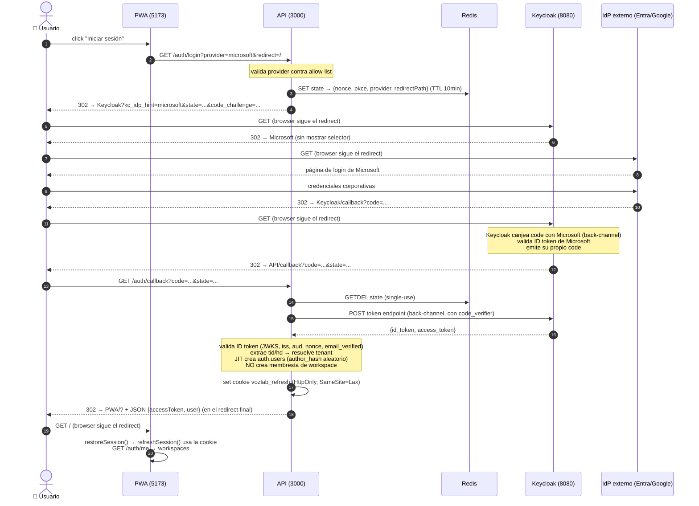
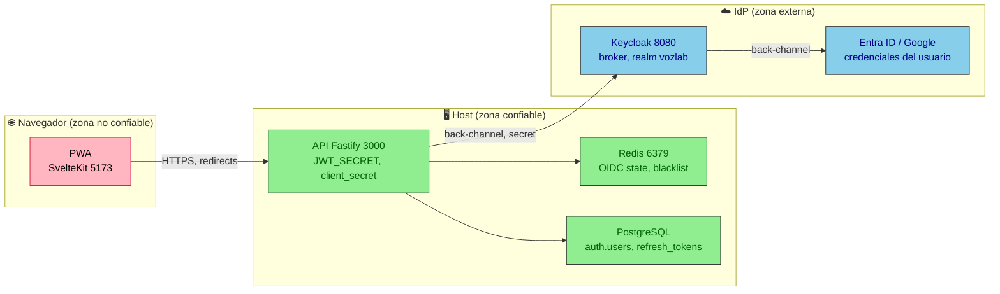

# Flujo de autenticación OIDC — VozLab

> Documento de diseño para entender cómo se comunican la PWA, el API, Keycloak y el
> IdP externo (Entra ID / Google Workspace / directorio local). Complementa
> [ADR-0018](decisions/ADR-0018-oidc-jit-hybrid-sessions.md) y
> [ADR-0029](decisions/ADR-0029-explicit-provider-selection-and-general-tenant.md).

## 1. Los cuatro participantes y quién es dueño de qué

| Participante | Qué es | Qué posee / controla |
|---|---|---|
| **PWA** (`apps/web`, SvelteKit, puerto 5173) | La aplicación en el navegador | La UI, el estado en memoria (access token), el `sessionStorage` del workspace. **No** posee secretos ni tokens de larga vida. |
| **API** (`apps/api`, Fastify, puerto 3000) | El backend / BFF | El `JWT_SECRET`, el `client_secret` de Keycloak, el estado OIDC en Redis, la cookie de refresh, la cuenta de usuario en la DB. **Único** que habla con Keycloak. |
| **Keycloak** (broker, puerto 8080) | El broker de identidad | La lista de IdPs, el realm `vozlab`, el cliente `vozlab-api`, el intercambio back-channel con cada IdP, la emisión del código OIDC hacia el API. |
| **IdP externo** (Entra ID, Google Workspace, directorio LDAP/SAML) | El proveedor de identidad real | Las credenciales del usuario, el `tid`/`hd`, la verificación de email. |

**Regla de oro:** la PWA nunca ve una URL de IdP, nunca maneja un token de Keycloak y nunca conoce el `client_secret`. Todo el intercambio con Keycloak ocurre **server-side** (API ↔ Keycloak). La PWA solo recibe redirects HTTP (302) y, al final, una cookie HttpOnly + un JSON con el access token.

### Sobre las "ventanas" / pantallas que ve el usuario

No hay **popups ni ventanas emergentes** en este flujo. Todo son **navegaciones de página completa** (el navegador cambia de URL):

1. La PWA redirige al API (`window.location.href = ...`).
2. El API responde `302` → el navegador va a Keycloak.
3. Keycloak responde `302` → el navegador va al IdP (Microsoft/Google).
4. El IdP responde `302` → el navegador vuelve a Keycloak.
5. Keycloak responde `302` → el navegador vuelve al API.
6. El API responde `302` → el navegador vuelve a la PWA.

El usuario ve pantallas de login (Keycloak, Microsoft, Google) como páginas normales, no como popups. La PWA no controla esas pantallas; Keycloak y el IdP las renderizan.

## 2. Diagrama de secuencia — flujo completo (happy path)



### 3. Qué se envía en cada paso (y quién lo escribe)

| Paso | Quién escribe / envía | Qué contiene | Por qué |
|---|---|---|---|
| 1 → 2 | PWA (JS) | `GET /auth/login?provider=...&redirect=/` | La PWA solo pide iniciar el flujo. No conoce IdP URLs. |
| 2 → Redis | API | `{state, nonce, pkce_verifier, provider, redirectPath}` con TTL 10 min | El estado vive en el servidor para ser single-use y no manipulable por el browser. |
| 2 → Browser | API | `302` a Keycloak con `state`, `code_challenge` (PKCE), `kc_idp_hint` | El API construye la URL de Keycloak. El browser solo sigue el redirect. |
| 3 → 4 | Keycloak | `302` al IdP elegido (sin mostrar selector) | Keycloak resuelve el hint y redirige. |
| 4 → IdP | Browser | Credenciales del usuario (password, MFA) | El usuario se autentica directamente con su IdP. Ni la PWA ni el API ven la contraseña. |
| 5 → 6 | IdP | `302` a Keycloak con `code` del IdP | El IdP devuelve un código de un solo uso a Keycloak. |
| 6 → 6 (back) | Keycloak | Intercambia `code` por tokens del IdP (server-to-server) | Keycloak valida el token del IdP y emite su propio `code` para el API. |
| 7 → 8 | Keycloak | `302` al API con `code` (de Keycloak) + `state` | Keycloak devuelve su propio código, no el del IdP. |
| 8 → Redis | API | `GETDEL state` (consume y borra) | Single-use: un segundo callback con el mismo state falla. |
| 8 → Keycloak | API | `POST token endpoint` con `code` + `code_verifier` (back-channel) | El API canjea el código de Keycloak. El browser nunca ve el code_verifier. |
| 8 → DB | API | JIT crea `auth.users` con `author_hash` aleatorio | La cuenta se crea en el backend, no en el frontend. |
| 8 → Browser | API | `Set-Cookie: vozlab_refresh` (HttpOnly) + `302` a la PWA | La cookie no es legible por JS. El access token se entrega en el redirect final. |
| 9 → 10 | PWA | `restoreSession()` → `POST /auth/refresh` (usa cookie) → `GET /auth/me` | La PWA restaura la sesión desde la cookie HttpOnly, no desde localStorage. |

### 4. Por qué el API (y no la PWA) coordina todo

| Razón | Detalle |
|---|---|
| **Secreto de Keycloak** | El `client_secret` vive solo en el API. Si la PWA lo tuviera, XSS lo roba. |
| **Tokens de Keycloak** | El intercambio de código ocurre server-side (API ↔ Keycloak). El browser solo transporta redirects, nunca tokens. |
| **Refresh cookie** | Es `HttpOnly` → JS no la lee. Solo el API la setea y la consume. |
| **JIT account** | La creación de `auth.users` y la resolución de tenant ocurren en el API, no en el frontend. |
| **PKCE + state** | Guardados en Redis (server-side), single-use. En el browser serían vulnerables a XSS. |
| **Resource server** | El API valida su propio JWT (clave local). No acepta tokens de Keycloak en cada request. |

### 5. Qué pasaría si la PWA hiciera todo directamente (y por qué no)

```
PWA → Keycloak (directo) → IdP → Keycloak → PWA (token de Keycloak en memoria)
PWA → API (envía token de Keycloak)
```

Problemas:
- El token de Keycloak vive en el navegador → expuesto a XSS.
- El API tendría que validar tokens de Keycloak en cada request (dependencia de JWKS, latencia).
- No hay detección de reuso del refresh (requiere server-side state).
- El JIT account y la resolución de tenant se duplican o se saltan.
- El `client_secret` (si se usa) se expone en el bundle.

El diseño actual (API inicia, API intercambia, API emite sesión) es el patrón **BFF + confidential client**: la PWA delega toda la autenticación al API y solo recibe una sesión de VozLab (access JWT en memoria + refresh cookie HttpOnly).

## 6. Diagrama de componentes y fronteras de confianza



**Fronteras:**
- **Browser ↔ API**: solo redirects HTTP y cookies HttpOnly. Nunca tokens ni secretos en la URL.
- **API ↔ Keycloak**: back-channel (server-to-server) con `client_secret`. El browser nunca ve esta comunicación.
- **Keycloak ↔ IdP**: back-channel. Keycloak canjea el código del IdP y valida su token.
- **API ↔ Redis/PG**: interno al host. Estado de sesión y cuentas de usuario.

## 7. Resumen de quién hace qué

| Acción | Quién | Por qué no otro |
|---|---|---|
| Renderizar botones de login | PWA | Es UI; el API no renderiza HTML |
| Validar `provider` (allow-list) | API | El API es la autoridad; la PWA no se fía de sí misma |
| Generar `state`, `nonce`, PKCE | API | Deben ser CSPRNG server-side, single-use en Redis |
| Guardar estado OIDC | Redis | Single-use, TTL, atómico (GETDEL) |
| Mostrar selector de IdP (si no hay hint) | Keycloak | Es el broker; posee la lista de IdPs |
| Redirigir al IdP | Keycloak | Posee las URLs y configuración de cada IdP |
| Canjear código del IdP | Keycloak (back-channel) | Keycloak valida el token del IdP |
| Validar ID token de Keycloak | API (JWKS) | El API es el resource server; verifica el issuer |
| Resolver tenant (`tid`/`hd`) | API | Consulta `router.tenants` |
| JIT crear `auth.users` | API | La DB es del API, no del frontend |
| Setear cookie de refresh | API | HttpOnly, solo el servidor puede setearla |
| Emitir access JWT | API | Solo el API firma con `JWT_SECRET` |
| Restaurar sesión en page load | PWA | Llama a `/auth/refresh` (usa la cookie) y `/auth/me` |

---

*Relacionado: [ADR-0018](decisions/ADR-0018-oidc-jit-hybrid-sessions.md), [ADR-0029](decisions/ADR-0029-explicit-provider-selection-and-general-tenant.md), [ADR-0013](decisions/ADR-0013-random-opaque-pseudonym.md)*