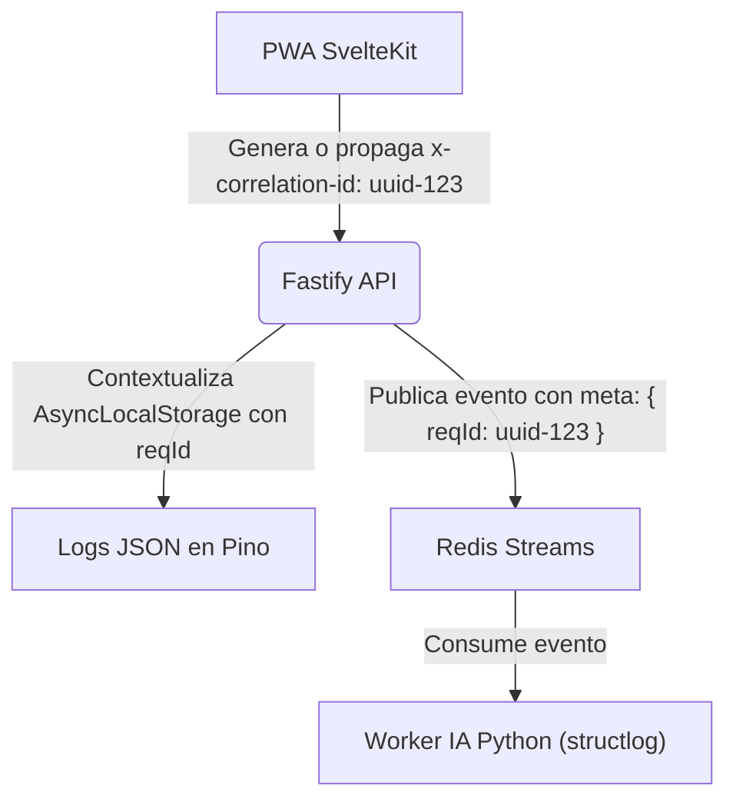

# 02. OBSERVABILIDAD, MONITOREO Y LOGGING ESTRUCTURADO

## 1. Estrategia de Trazabilidad End-to-End (Correlation ID)

Para correlacionar eventos a través de la infraestructura distribuida de VozLab (PWA SvelteKit, API Fastify, Redis Streams y Workers de Python), se propaga un identificador único denominado **Correlation ID (`reqId`)**.



### 1.1. Propagación en la API (AsyncLocalStorage)

* El middleware de Fastify utiliza `AsyncLocalStorage` para aislar el contexto de cada petición HTTP (`reqId`, `tenantId`, `workspaceId`).
* Cualquier llamada a log dentro de los Casos de Uso o Repositorios adjunta automáticamente estos campos sin requerir paso manual de parámetros.

---

## 2. Logging Estructurado JSON

Toda la salida de registros (*stdout* / *stderr*) se emite estrictamente en **JSON estructurado** para facilitar su ingesta en recolectores (Grafana Loki, Datadog o AWS CloudWatch).

### 2.1. Formato Estándar de Traza

```json
{
  "level": "info",
  "time": "2026-10-11T16:45:00.123Z",
  "reqId": "123e4567-e89b-12d3-a456-426614174000",
  "tenantId": "sabana",
  "workspaceId": "ingenieria",
  "service": "api-fastify",
  "module": "use_case.approve_proposal",
  "msg": "Edit proposal approved successfully",
  "durationMs": 14.2,
  "params": {
    "proposalId": "987f6543-e21b-12d3-a456-426614174000"
  }
}

```

---

## 3. Endpoints de Salud y Probes de Orquestación

La API Fastify expone los patrones estándar para validación en Kubernetes u orquestadores cloud:

1. **`GET /health/live` (Liveness Probe):**
* Responde `200 OK { "status": "alive" }` si el proceso Node.js responde eventos.


2. **`GET /health/ready` (Readiness Probe):**
* Verifica conectividad activa contra PostgreSQL (AGE/vector) y Redis.
* Responde `200 OK { "status": "ready", "checks": { "database": "up", "redis": "up" } }`. Si falla, retorna `503 Service Unavailable`.


---

## 4. Telemetría de Rendimiento y Alertas

* **Latencia de Cypher / AGE:** Alerta para consultas a Apache AGE que superen los $50\text{ ms}$.
* **Profundidad de Colas en Redis:** Si `stream:node_created` acumula más de 100 mensajes pendientes, se activan alarmas para escalar réplicas de los workers de IA.
