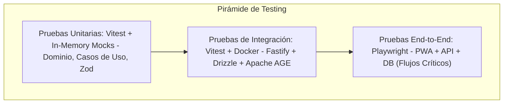

# 03. PLAN DE PRUEBAS, CALIDAD Y ESTRATEGIA DE QA

## 1. Pirámide de Pruebas y Cobertura de Calidad

VozLab adopta un enfoque de **Aseguramiento de Calidad en Pirámide** para optimizar la velocidad de ejecución en CI/CD y garantizar la estabilidad del sistema:

---

## 2. Niveles de Pruebas y Herramientas

### 2.1. Pruebas Unitarias (Unit Tests)

* **Herramienta:** **Vitest**.
* **Alcance:** Validación de entidades del dominio, reglas de negocio puras, Value Objects y esquemas de validación Zod.
* **Métrica Objetivo:** Cobertura de código $> 85\%$ en las capas `domain/` y `application/`.

### 2.2. Pruebas de Integración (Integration Tests)

* **Herramienta:** **Vitest** ejecutando contra un contenedor efímero de **PostgreSQL 16+ (Apache AGE + pgvector)** levantado mediante Docker.
* **Alcance:** Verificación de consultas Drizzle ORM, navegación de grafos en Cypher sobre Apache AGE, transacciones atómicas multitabla (`UnitOfWork`) y publicación de eventos en Redis Streams.

### 2.3. Pruebas End-to-End (E2E)

* **Herramienta:** **Playwright**.
* **Alcance:** Automatización de flujos críticos en la PWA cliente compilada en SvelteKit 5:
1. Inicio de sesión simulado OIDC/SSO o QR de evento.
2. Conmutación de Workspaces entre pestañas independientes.
3. Creación de nodos y renderizado en Cytoscape.js.
4. Flujo de Pull Request (creación, debate y aprobación/rechazo de propuestas de edición).

---

## 3. Pruebas de Estrés y Benchmarking de Grafos (k6)

Para validar el cumplimiento de los SLAs del sistema bajo carga concurrente, se utiliza un script de pruebas de rendimiento con **k6**:

### 3.1. Criterios de Rendimiento Objetivo (SLA)

* **Consultas de Subgrafos (<200 nodos):** Tiempo de respuesta $p_{95} < 30\text{ ms}$.
* **Búsqueda Vectorial HNSW (768 dims):** Tiempo de respuesta $p_{95} < 20\text{ ms}$.
* **Mutaciones y Registro de Votos:** Tiempo de respuesta $p_{95} < 15\text{ ms}$.

### 3.2. Seeding de Estrés

El comando `npm run db:seed:stress` genera un subgrafo denso de **10,000 Nodos y 50,000 Aristas** en PostgreSQL para comprobar que los índices B-Tree, GIN y HNSW mantengan la latencia constante bajo alta concurrencia.

