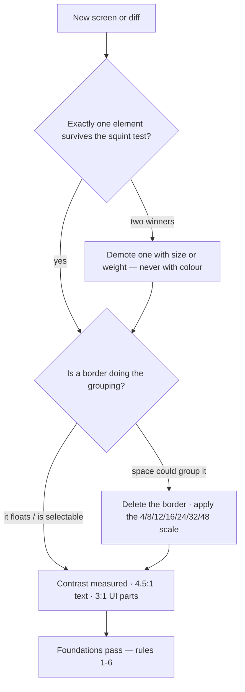

# M01 — Visual foundations

The one module everything else reduces to. A screen works when a person can
answer, without reading: *where am I, what is the primary thing here, what
can I do, what should I ignore*. Every style school (M11) is a particular
answer to the four tools below.

> Interactive diagram: [`diagrams/m01-squint.html`](../diagrams/m01-squint.html) — open it and press Live.

## The concept

**Visual hierarchy** is the order in which elements are seen. It is built
from exactly four tools, and the tools are ranked by strength:

1. **Position** — the eye starts top-left (in LTR) and moves in an F or a
   zigzag; what sits higher and earlier is read first. This is why a page
   title is an `h1` at the top and why a primary button goes right of the
   secondary one: not tradition, reading order.
2. **Size** — the largest thing on the screen wins. One winner per screen.
   Two "largest things" means the hierarchy is broken.
3. **Weight and contrast** — bold text, a filled surface, a saturated
   colour. Strongest per-glance, cheapest to overuse. The failure mode of
   junior frontend is exactly this: everything bold, everything coloured,
   so nothing stands out. The professional version is the opposite: keep
   almost everything quiet so the one loud thing is actually loud.
4. **Space (proximity)** — near things belong together; far things do not.
   This is the Gestalt **law of proximity**, and it does the work of a
   border for free. The related law is **common region**: an element
   inside a tinted or bordered area reads as grouped, even with no label.

The second Gestalt set you must know: **similarity** (things that look
alike are read as the same kind — which is why every destructive button in
an app must share one shape, not just the first one), and **continuity**
(aligned columns are followed as lines — the reason a table without
vertical borders still reads).

**The map at a glance:**

## The reasoning

**Why hierarchy before aesthetics.** A user of a tool like VozLab is not
browsing; they are mid-task with a goal and a clock. Every second spent
locating the primary action is a second of cognitive load charged to the
product. The professional measure is not "does it look nice" but "can a
new person answer the four questions in under two seconds." Squint at the
screen (or blur the screenshot): what survives the blur is the real
hierarchy. Whatever a junior design cannot survive is decoration.

**Why spacing beats borders.** A `1px` border says "these two things are
different groups." A 24px gap says the same and costs nothing visually.
When a screen needs many borders, the layout has failed, not the borders.
The standard rhythm is a **spacing scale** — a geometric-ish series
(4/8/12/16/24/32/48) — and the rule is *the smaller the relation, the
smaller the gap*: a label sits 4–8px from its field (they belong), a field
sits 16–24px from the next field (same group, different item), one section
sits 32–48px from the next (different group). VozLab's `--gap: 24px` and
`--pad: 24px` are exactly this discipline written once.

**Why contrast has a legal floor.** Text that fails contrast is not a
taste problem, it is an accessibility failure (WCAG 1.4.3): 4.5:1 for body
text, 3:1 for large text (≥24px or ≥18.66px bold) and for UI parts like
input edges and icons (1.4.11). A grey placeholder at 2.9:1 is a bug, and
the cheaper model will not see it — the checklist will.

## Decision rules

When reviewing any screen or diff, in order:

1. **One winner.** Exactly one element survives the squint test per screen.
   If two compete, demote one with size or weight, not colour.
2. **Position carries meaning.** Primary actions top and right of
   secondary; the object of the screen (the node, the proposal) before its
   metadata. A screen that needs a caption to explain where to look is a
   layout problem.
3. **Loudness is rationed.** At most one filled/primary surface per view;
   semantic colour (red/green) appears only where the decision is, never as
   chrome. If everything is bold, the author did not decide.
4. **Group by space first, border second.** A bordered box must justify the
   border (it floats, it is a card in a grid, it is selectable). Otherwise
   use the spacing scale; no in-between values.
5. **Related things are near.** Label to field ≤ 8px; field to field ≤ 16px;
   section to section ≥ 24px. Proximity is documentation.
6. **Contrast is measured, not eyeballed.** Every text/surface pair meets
   4.5:1 (body), 3:1 (large/UI); check with a tool in CI, not by eye.

## VozLab today

`app.css` already encodes rule 4 (`--gap`, `--pad`, `--row-height` are one
scale) and rule 3 (the comment in the tokens says the hue appears at full
strength on small marks only, and the tints do the areas). `docs/design-system.md`
documents the accent ladder. The gap to watch is rule 1: on the exploration
canvas, the graph itself and the floating panels compete — the canvas is
the winner, so panels must stay quiet (surface + hairline, no filled
control inside them until the user selects something). That is a decision
for D1.

## Exercise

Take one screenshot each of `/` (the canvas), `/proposals` and the login.
For each, write three lines: what survives the blur (the winner); where the
second-loudest element competes with it; which grouping is done with
borders that space could do. No code.

*Handoff to the cheap model:* run the squint test mechanically —
`blur(8px)` the screenshots in any tool, and report which elements are
still distinguishable and at what sizes; compare against the checklist.

## Decide

**D1. The canvas vs its panels.** On the exploration screen, what is the
single winner — the graph, or the inspector? Options: the graph always wins
(panels are quiet until focus), or focus moves the crown (selecting a node
makes the inspector the winner by elevation). Both are legitimate; the
choice changes M04 and M05.
