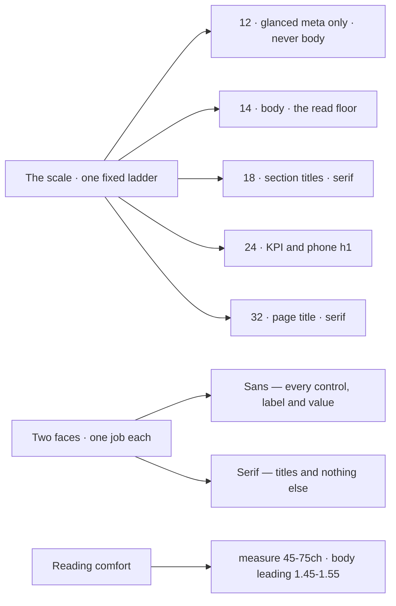

# M02 — Typography and voice

Typography is 95% of what a user reads of your product, and the part they
feel without naming. A tool with mediocre type reads as unreliable before
the first feature is tested. This module is the vocabulary to say *why* this
font at this size is right, and when it is not.

> Interactive diagram: [`diagrams/m02-scale.html`](../diagrams/m02-scale.html) — open it and press Live.

## The concept

**Type scale.** A fixed list of sizes, not arbitrary ones. The professional
default for dense interfaces is a small, modular scale — a base body size
(14px or 16px) multiplied by steps around 1.2–1.25 (so 14 → 16.8 → 20 →
24). Landing pages can afford 1.5+ steps for drama; tools cannot, because a
scale with big jumps leaves no room for the intermediate roles a UI needs
(meta, label, button, body, section, title, KPI).

**Line length and height.** Readable prose is 45–75 characters per line
(the measure; VozLab sets `--container-measure: 56ch`), with line-height
around 1.5 for body and 1.15–1.3 for titles. Below 45ch the eye races;
above 75ch it loses the return. Long-form documents break these rules
deliberately (see editorial in M11); UIs never should.

**Pairing.** Two families maximum, three is chaos, and the pairing must be
justified by role, not by novelty. The classic role split: a **display**
face for voice (titles, brand) and a **workhorse** sans for every
interface job (labels, controls, data). One family with two weights is also
a complete answer, and it is the cheap way to consistency.

**Numerals and mono.** Data read by professionals is set in
`tabular-nums` (monospaced figures) so columns align without a grid trick,
and identifiers/code/streams go in a monospace face. A tool that mixes
proportional figures in a table looks broken to the people who read tables
all day.

**Optical sizes.** Small type needs more spacing and less contrast; large
type needs the opposite. This is why a 12px label at the same weight as a
32px title looks wrong even though the CSS is "correct."

**The map at a glance:**

## The reasoning

**Why body is 14–16px and not 12.** Below ~13px, reading speed drops and
error rates rise, and the browser cannot save you (subpixel rendering,
zooming, dyslexia). 12px is acceptable only for meta that is glanced, never
read (timestamps in a dense table). The professional floor for anything
meant to be read twice is 13–14px.

**Why one filled button and one serif per screen are typography decisions,
not decoration.** A face carries a voice. IBM Plex Serif at 32px says
"document, institution, something to be cited"; the same words in Plex Sans
say "settings panel." A knowledge product for a university has a real
voice problem to solve: it must feel like scholarship (serif, document)
while operating like a tool (dense, sans). Putting the serif only in titles
solves both at once: the voice appears exactly once per screen, and every
interface job stays in the face designed for interface jobs. That is the
reason your `app.css` comment states the rule as fixed. The failure mode of
the same idea done badly is the "academic theme": serif everywhere, 12px
body, and a wall of text that cannot be scanned.

**Why system/vendor-stored fonts and a fallback stack matter.** Loading a
webfont costs render-blocking time; `font-display: swap` trades a flash of
fallback for never blocking text. VozLab vendors the woff2 files because
the PWA must render with its own faces offline — that is an architecture
decision (M07) expressed in typography.

**Weights are the hierarchy of a dense UI.** At 14px, the difference
between a value and its label is often weight (400 vs 600) — because size
has no room and colour is rationed (M01 rule 3). So a UI needs the full
weight ladder of its face (400/500/600/700) loaded, not just one file.

## Decision rules

1. **One scale, no one-off sizes.** Every `font-size` in the app comes from
   the token scale. A new size is a design decision logged in
   `decisions.md`, not a prop.
2. **Body ≥14px for anything read; ≥13px allowed for glanced meta.** No
   12px paragraphs anywhere, ever.
3. **Measure 45–75ch for prose.** Long-form panes (a node's content, a
   discussion) get `max-width` in ch, not a percentage.
4. **Line-height: body 1.45–1.55, titles 1.1–1.3.** A title with body
   leading looks loose and weak.
5. **Two faces, each with a named job.** The rule is written in the system,
   and violations are review comments: "this is UI text, it is not a title."
6. **`tabular-nums` on every numeric column; mono on every identifier.**
7. **Weight, not size, is the default hierarchy lever in dense views.**
   Before adding a size to the scale, ask if a weight solves it.

## VozLab today

The scale exists in tokens: 12/14/18/24/32 with explicit line-heights, one
sans (400–700) and one serif (600/700) reserved for `h1`/`h2`, body 14px at
20px leading (1.43), titles with `--tracking-tight`, `text-wrap: pretty` on
paragraphs. This is a correct professional system. The two honest critiques
to decide on: (a) `--text-small: 12px` is below the read floor — it is fine
*if* its only jobs are glanced meta (pills, timestamps); worth auditing that
no body copy uses it. (b) there is no mono face in the `@theme` — node IDs,
slugs, tokens and stream keys are currently set in the sans. For a graph
tool whose users read IDs, that is a visible gap (D2).

## Exercise

1. Grep every `text-small`/12px usage in components and label each "glanced
   meta" or "meant to be read." Any read usage is a defect to fix.
2. Pick the proposals list and add a `font-variant-numeric: tabular-nums`
   to its counts/dates; screenshot before/after of the column alignment.
3. *Handoff to the cheap model:* "Add a `--font-mono` token (IBM Plex Mono,
   vendored the same way as the others) and apply it to node IDs and slugs
   in the inspector; produce the checklist mapping M02 rules 1 and 6 to the
   diff."

## Decide

**D2. Do identifiers and data get a mono face?** Options: yes, vendor Plex
Mono and use it for IDs/dates/metrics (more tool-like, one more font
payload); or no, keep sans with `tabular-nums` only (lighter, less crisp on
mixed strings like slugs).

**D3. Is the 12px role allowed to exist at all?** Options: keep it as the
glanced-meta size with an explicit "never body" rule in the system (status
quo, enforced by the audit); or raise the floor to 13px and adjust
`--text-small`.
