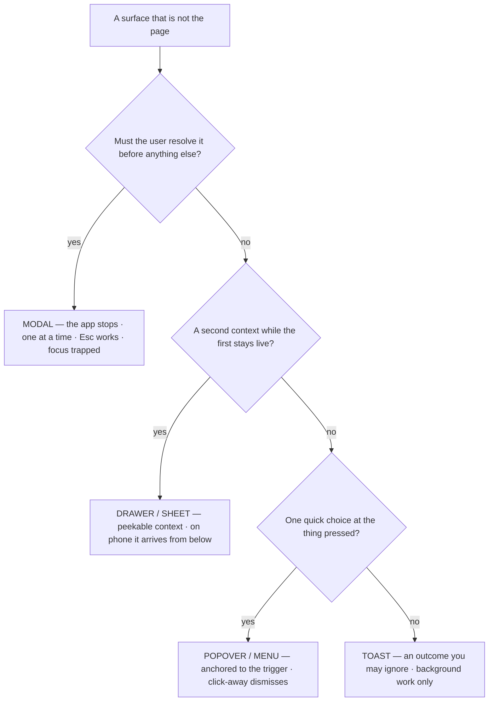

# M04 — Layout and grids

Layout is the argument that a screen has an order. The professional toolkit
is small — a grid, a few canonical region patterns, and a fixed menu of
overlay kinds — and most "it looks off" complaints are one of a handful of
recurring layout failures.

> Interactive diagram: [`diagrams/m04-ladder.html`](../diagrams/m04-ladder.html) — open it and press Live.

## The concept

**The 12-column grid and where it applies.** Content areas (lists, forms,
dashboards) sit on an implicit 12-column grid so spans can halve and
third without magic numbers. Full-bleed tools (a canvas) do not use it
inside the work area — they use **regions** instead (see below). The grid's
real job is alignment discipline: two blocks sharing an edge is a decision
the user can feel even if they never see a column.

**Region patterns.** The shapes that carry 95% of app screens:

- **Sidebar + content** (Notion, Slack, every admin): persistent navigation
  left, one or two content columns. Good for a fixed workspace with many
  destinations; bad when the sidebar steals width from a wide work object.
- **Rail + panel(s) + canvas** (Figma, Linear's issue view): the rail is
  icon-only navigation (≈48–64px), the canvas owns the middle, an inspector
  docks right (≈320–420px). This is the pattern for *object-centric* tools —
  VozLab's graph is exactly an object-centric work surface.
- **List + detail (split pane)** (Mail, Linear list→issue): master left
  (~360–480px), detail right, the divider either fixed or user-draggable.
  The moment a user selects a row, the right side answers it; no navigation
  happens.
- **Single centered column** (docs, settings, auth): one column ≤720px,
  everything else chrome. Correct for forms and reading; a dashboard must
  never force it.
- **Top-nav + wide content** (marketing sites, old ERPs): navigation as
  horizontal tabs at top. Fine when destinations are few and stable; it
  scales worse than a sidebar past ~6 tabs and wastes vertical space.

**Overlays are a strict hierarchy.** Modal = *the app stops, you must
resolve this* (a decision with consequences: approve/merge). Drawer/sheet =
*a second context while the first stays visible* (an inspector you can
peek at, a mobile sub-page). Popover/menu = *one quick choice from the
thing you pressed*. Toast/snackbar = *an outcome you may ignore*. The
professional rules: never stack modals; a modal must be escapable (Esc,
backdrop) unless the decision is truly mandatory; on mobile a "drawer"
becomes a full-screen sheet with a back affordance. Every one of these is a
different contract with the user's attention — using a modal where a
popover fits is the most common layout violence in junior frontend.

**Responsive is content-driven, not breakpoint-driven.** You ask: at what
width does *this* layout stop working — the table loses columns, the split
pane gives each side less than its minimum usable width, the measure
exceeds 75ch? Those numbers become *your* breakpoints, chosen from the
content's failure points, not from a device list. The modern toolkit: CSS
Grid `minmax()`/`auto-fit` for card grids, `clamp()` for scales that adapt
themselves, and a container-query for a panel that adapts to its parent
(the inspector at 320px vs 500px) rather than the window.

**Fixed dimensions that earn their keep.** A toolbar height, a sidebar
width, a row height: fixing them (your `--sidebar-width: 230px`,
`--row-height: 45px`) prevents the single most nauseating failure in tools —
**layout shift when data arrives**. Content-driven sizing is only for
content that is itself variable (a paragraph); chrome is fixed by policy.

**The map at a glance:**

## The reasoning

**Why the rail+canvas+inspector fits VozLab specifically.** The user's
object is a node or an edge; the work is looking at relationships and
editing/validating one object at a time. Sidebar-navigation would compete
with the canvas for width and would frame the app as "a place with pages"
instead of "a place with a work surface." Linear, Figma and GitHub Projects
landed on the rail pattern for the same reason; the pattern *is* the
argument that this is a tool.

**Why "no stacked modals" is structural, not aesthetic.** Two modals mean
the user has lost track of which decision is active; focus trapping (M10)
gets ambiguous; Esc closes the wrong thing. If a second modal appears
needed, one of the two is actually a drawer, a step in a wizard, or a
confirmation that should be inline.

**Why dense ≠ cramped.** Density is information per area *without* losing
the whitespace that groups it (M01 rule 4). The Bloomberg paradox: the
densest professional UIs have perfect internal alignment and generous
grouping *gaps* — they are cramped nowhere. Cramping is small gaps between
unrelated things; that is what people mean when they say a dense UI "feels
cheap."

## Decision rules

1. **Pick the region pattern per screen and write it down.** Every screen
   belongs to one of the patterns above; a screen that mixes two (sidebar +
   centred column + wide table) without a reason is a layout argument the
   designer lost.
2. **The overlay ladder is legal code.** Modal only for mandatory
   decisions; drawer/sheet for context; popover for quick choice; toast for
   outcome. Max one modal open per view; Esc always works.
3. **Breakpoints come from this app's content, listed with their reason**
   (e.g. "inspector <340px → collapses to sheet"). No device names.
4. **Chrome has fixed dimensions from tokens** (toolbar, sidebar, row,
   control height); content has fluid dimensions with max-measure. Nothing
   in between.
5. **Minimum usable widths:** a split pane's sides each ≥320px (or it
   stacks); a form column ≥280px; a tap target ≥44px on coarse pointers
   (your `pointer: coarse` rule already does this — M10 owns the a11y side).
6. **No horizontal scroll except inside designated panes** (a table, the
   canvas). The page itself never scrolls sideways.

## VozLab today

The shell already chose rail/sidebar (230px) + content, and the graph area
has floating panels — so the *pattern question* is live and undecided: is
the exploration screen a **sidebar+content** app that contains a canvas, or
a **rail+canvas+inspector** tool whose sidebar hides when the canvas works?
The current 230px full sidebar on every screen is the former; the canvas
needs to argue the latter (D6). Overlay kinds: `ModalDialog`, `Drawer`,
`Sheet`, `OverlayPanel`, `FloatingPanel` all exist in `lib/components` —
which is great raw material and exactly why rule 2 needs a written mapping:
today nothing states which of the five is the drawer and which is the modal
(D7).

## Exercise

1. Draw the region pattern of each route in `(app)` as a 30-second wireframe
   (boxes, no content). Flag every screen that mixes patterns or has two
   competing side regions.
2. Resize the browser and write down the actual widths where each screen
   breaks. Compare against the breakpoints in the code — the gap between the
   two lists is the responsive debt (rule 3).
3. *Handoff to the cheap model:* "Audit the five overlay components:
   for each, state which ladder rung it is (modal/drawer/popover/toast),
   whether it traps focus, whether Esc closes it, and whether any screen
   stacks two modals; produce the mapping table rule 2 requires. No code
   changes."

## Decide

**D6. The shell's identity.** Options: (a) keep the fixed sidebar on all
screens — the app is a workspace with pages, the canvas is one page; (b) go
rail+canvas+inspector for the exploration screen specifically, where the
sidebar collapses to a 56px icon rail when the canvas is active — the app
is a tool with a work surface; (c) collapsible everywhere (user decides).
(b) is the Figma/Linear answer for graph tools and probably the honest one;
it costs a layout state to design (what does the rail show when collapsed —
tooltips? a peek?).

**D7. Overlay policy.** Write the one-line contract for each of the five
overlay components into `design-system.md` and keep only the rungs that are
actually needed (five components for four rungs smells like one too many).
