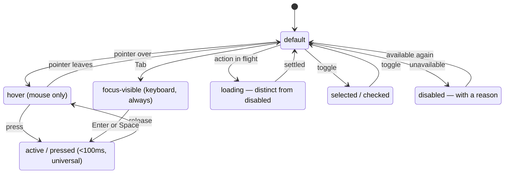

# M05 — Component anatomy

A component is not a visual; it is a small contract with a user. The
professional way to look at buttons, fields, pills and tables is anatomical:
every control has a fixed set of parts and a fixed set of states, and a UI
that is "off" almost always violates one of them. This module gives you the
checklist that makes that violation visible — to you, and to a model
reviewing a diff.

> Interactive diagram: [`diagrams/m05-states.html`](../diagrams/m05-states.html) — open it and press Live.

## The concept

**The parts of a control.** Label (what it is), value/affordance (what it
shows or does), state (what it tells you about availability), hit area
(what you can actually press). The hit area is not the ink: a 14px icon
inside a 32px box has a 32px hit area (and on touch must have ≥44px —
M10). The classic anatomy bug is the *label that is not associated* (a
`
` styled like a label): sighted users fine, screen readers and
tap-targets broken.

**The seven states of an interactive element.** default, hover, focus (the
*keyboard* focus — `:focus-visible`, distinct from hover on purpose),
active/pressed, disabled, loading, and selected/checked. A component that
silently merges two of these (no focus ring because "hover covers it")
fails. A disabled control that looks identical to a loading one teaches the
user nothing.

**The size ladder and why one control height exists.** Your `--control-height:
32px` is the dense-tool answer (Material calls its sizes 36/40/48; Linear
runs 28–32). The point is not the number, the point is the policy: **every
button, field and select in a row shares one height and one radius.** When
the geometry is per-screen, alignment across screens dies — a filter row
with a 30px select and a 34px button looks broken even though no single
component is. The exception is the mobile tap floor (44px), which is a
different device's rule, not a per-screen whim (and your `app.css` encodes
exactly that exception, via `pointer: coarse`).

**Variants: three ranks, and only one filled.** Primary (the one filled
button — the affirmative action of a view), secondary (bordered: the
legitimate alternative), quiet/ghost (text-only: everything that is not a
decision but a shortcut). Destructive is not a fourth rank — it is the
primary or secondary rank wearing the semantic red *of the decision point*
(M03), and this is where most UI kits go wrong: a red filled button in a
toolbar cheapens every other red. The reason there is exactly one filled
button per view is M01 rule 3: the filled surface is the loudest type, and
two of them is no winner at all.

**Pills, badges, status.** A status token is a shape contract: same radius,
same height, same padding, background+ink as a *pair* from the token system
(your `--color-pill-*` pairs are exactly that), and the meaning rides on
text + colour together (M03 rule 4). A pill with only a coloured dot and no
text is a puzzle. A pill whose background is the brand hue is a hierarchy
error — the brand hue means *act* (M03).

**Tables and lists — the tool's bread.** Rules that professionals hold: the
column that identifies the row (name, title) is sticky or first and is the
row's link; numerals right-aligned with `tabular-nums` (M02 rule 6); labels
left; row height constant; header contrast is allowed to be lower than
body (it is meta, 4.5:1 still applies); zebra stripes *or* row hover *or*
hairlines — never all three, that is a grid wall; the empty state is a
designed moment (what this list would contain, plus the action that creates
the first item), not a shrug.

**Forms.** Label above the field (your `field-label` utility), never a
placeholder as a label (it disappears when the user types, so they forget
what the field was). Error text below the field, in the semantic red, and
it *describes the fix*, not the crime ("Use at least 12 characters", not
"Invalid"). Required marked with a asterisk or word, once stated. Submit
disables itself while in flight — but the *reason* for the disable is
visible (a spinner in the button), or the user thinks the app froze (M06).

**The map at a glance:**

## The reasoning

**Why so few ranks.** Every additional button variant multiplies the
decisions a reviewer can no longer enforce. Three ranks with hard rules is
a system; twelve variants is a buffet — the codebase drifts because "which
one do I use" has no answer. The one-filled rule has a second effect: it
forces the product question "*what is the primary action of this view?*" to
be answered per screen, which is exactly the design work that gets skipped.

**Why focus is separate from hover.** They answer different questions.
Hover answers "is this pressable" (mouse only); focus answers "is this
where the keyboard is" (every user, always). A UI whose only hover is a
colour change with a 120ms transition (yours does) and whose focus is the
2px accent ring (yours does) has both channels — that is the anatomy, not
decoration.

## Decision rules

1. **One geometry for controls** (height, radius, padding) from tokens; per
   screen overrides are review blockers. The coarse-pointer 44px floor is
   the only sanctioned difference.
2. **Three button ranks, one filled per view.** A view with two filled
   buttons must justify which is secondary instead.
3. **Seven states audited per interactive component**, with focus-visible
   distinct from hover and loading distinct from disabled.
4. **A label is a real `<label>` bound to the field** (or `aria-labelledby`
   for composite widgets). A placeholder is never the only label.
5. **Status = background+ink pair from tokens + text.** Dots alone, hue
   alone, or brand-coloured pills are blockers.
6. **Every list/table defines its empty, loading, and error states** before
   shipping the happy path. The skeleton (your `skeleton` utility: flat,
   same-size, no shimmer) is the loading answer; it must match the final
   layout exactly so nothing shifts (M01 rule 4, M06).

## VozLab today

Strong: one `--control-height`, the three ranks exist as `btn`/
`btn-primary`/`btn-secondary`/`btn-quiet`, pill pairs are tokenised, the
skeleton is deliberately flat and layout-stable, focus ring is the accent,
touch floor handled at the base layer. This module mostly gives names to
what exists. The audits worth running: rule 3 across the 52 components (a
grep for `:hover` without `:focus-visible` siblings, disabled-vs-loading),
rule 5 in the governance UI (proposal status pills vs the `PENDING` marks
on the canvas — is the same status wearing the same pair in both places?),
and rule 4 in older dialogs (`NodeCreateDialog`, `EdgeCreateDialog`) — the
course bets at least one placeholder-as-label exists.

## Exercise

1. Run the rule-5 cross-check: the status of a proposal appears as a pill
   in the list and as a mark on the canvas — are the tokens identical? If
   not, that is the first real drift to fix.
2. Pick one dialog and audit all seven states for its two controls; list
   which states are undocumented in the code (often `active` and `loading`).
3. *Handoff to the cheap model:* "Audit `.svelte` files for: buttons
   without a `btn` rank class, inputs without a bound `<label>`, and pills
   with literal colours; report file:line per rule 1–6. No changes."

## Decide

**D8. Loading inside controls.** When a primary button triggers a call, do
we (a) swap its label for a spinner in place (width stays fixed — the
Linear/Stripe answer), (b) disable + keep label, or (c) show the view's
skeleton instead? (a) needs a `btn` rule for minimum width so the swap does
not shift the row.
