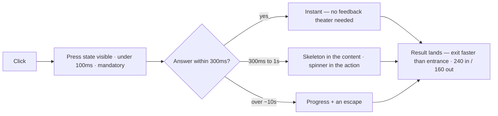

# M06 — Interaction and motion

Motion is information about time and causality, not decoration. In a tool,
every animation answers one of three questions: *did the system hear me*,
*what changed and where*, *is it working or hung*. The module's job is to
make that the standard, and to give the numbers (durations, easings) that
separate "it feels right" from "it feels floaty."

> Interactive diagram: [`diagrams/m06-budget.html`](../diagrams/m06-budget.html) — open it and press Live.

## The concept

**Response budget.** Human perception: <100ms feels instantaneous (the
press must *always* respond visually — the `active` state is not optional);
<300ms feels like the system thought briefly; beyond ~1s, attention drifts
and the user needs to be told *what is happening*; beyond ~10s, they need
progress and an escape. Interaction design is scheduling against these
numbers, not hoping the API is fast.

**Feedback channels, in order of cost.** (1) Immediate visual response to
the input itself (button press state, focus ring) — free, mandatory.
(2) Skeletons in place of the incoming content — shows shape and holds the
layout (your `skeleton` utility; deliberately flat and shimmer-less: a
shimmer says "watch me," a skeleton says "here is where it will be").
(3) Optimistic UI — apply the change instantly, reconcile on the server's
answer, revert with an apology if it fails. (4) Progress for genuinely
long work (a queue, an extraction). (5) Toast/snackbar for the outcome of
background work the user already left. Using (5) for something that should
have been (2) is the classic sloppy app: "Saved ✔" popups everywhere
because nothing changed in place.

**Optimistic updates — the tool's superpower.** In a knowledge graph, the
user approving a proposal or tagging a node should see the graph *already*
changed, with the pill/edge in a "syncing" tone; the server confirms
silently. It fails well only with three parts: every mutation has a
predictable local effect, failures revert visibly (the item returns with a
reason, not vanishing), and conflicting truth never forks — the server's
version wins on reconcile. The professional line: **navigation and reads
are never optimistic** (you cannot fake "what is there"); **writes that
almost always succeed are**. Approval-with-consequences (a merge that
rewires edges) is a *decision*, and decisions should not be optimistic —
they should show the work and confirm. That is a policy question for D9.

**Timing numbers.** Micro (press, hover): 80–150ms. State transitions
(menus, panels, the `120ms ease` on your buttons): 120–200ms. Entrances of
larger surfaces (modal, drawer): 200–300ms, *and exits faster than
entrances* (enter 240 / exit 160 is the canonical pair — an exit that
lingers feels laggy). Anything >400ms is either a page transition or a
story. Easing: `ease-out` for things arriving (fast start, settle),
`ease-in` only for things leaving; linear is a tell of amateur motion;
springs are the premium version of ease-out (butter, but heavier to
implement — fine via CSS `cubic-bezier` for a tool).

**Motion grammar.** Transform + opacity only (they run on the compositor;
animating `width`/`top`/`box-shadow` janks). Move things from *where they
belong*: a panel from its edge, a dialog from the click point's direction,
a toast from the corner. The inverse is what "unprofessional" actually
means: a change without a trace — the row vanished but nothing showed it
moved; the count changed but the eye cannot find which number moved. This
is the **continuity principle**: the user's spatial model of the app must
survive every update.

**Interruptibility.** Everything animated must be beatable: a new click
interrupts a running transition without queueing; a fast typist must never
wait for a close animation. And everything obeys `prefers-reduced-motion`
(motion becomes a crossfade or nothing) — this is both accessibility
(WCAG 2.3.3) and the respect rule: the animation serves the user, not the
portfolio.

**The map at a glance:**

## The reasoning

**Why skeletons and not spinners in content areas.** A spinner says "time
passes here"; a skeleton says "this is the shape of what you'll read." The
second one gives the eye a head start on the layout (and prevents the
jump — CLS, M10). The spinner stays legitimate for actions with no content
shape: a button in flight (D8), an unknown-length job.

**Why the pressed state matters more than the hover.** Hover is a mouse
privilege; `active` is the universal acknowledgment. A tool without a
visible pressed state leaves touch users (the PWA!) wondering whether the
tap registered at all. The budget is <100ms *visual*, even if the data
takes 900ms — the two are decoupled by design.

**Why optimistic UI fails in bad implementations.** Not because it's
risky per se — because without a *reconcile policy* (server truth wins,
the local guess is marked), it forks reality, and a graph tool whose canvas
and database disagree loses the only thing a knowledge product sells:
trust. The rule of thumb is severity, not probability: *revertable*
changes may be optimistic; *irreversible* ones (a merge, a delete) must be
confirmed, even when they succeed 99% of the time.

## Decision rules

1. **Every input gets a visual response within 100ms** — press/focus state
   first, data second. No click may be silent.
2. **Content areas load with shape (skeleton), actions load with motion
   (spinner in place).** Never both, never a blank screen with a spinner.
3. **Optimistic policy is written per mutation:** which writes apply ahead
   of the server, which wait, and how a failed optimistic write apologises.
   (This is D9, decided and logged.)
4. **Durations from the ladder** (120 micro / 200 panel / enter≥exit),
   easings `ease-out` in / `ease-in` out, transforms + opacity only.
5. **Every change leaves a trace:** moved/added/removed rows animate their
   in/out; a value that changed is briefly marked (background pulse) so the
   eye finds it in a dense screen.
6. **`prefers-reduced-motion` collapses all of it** to instant or
   crossfade, tested once per release.

## VozLab today

The primitives exist and are good: 120ms `ease` transitions on controls,
flat no-shimmer skeletons sized to the real layout, a focus ring, a real
pressed hover chain, and an `OfflineBanner`/`UpdatePrompt`/`InstallPrompt`
set for the PWA's long-tail states. The missing pieces are the *policy*:
(1) there is no stated optimistic rule for governance actions — approving
a proposal today presumably waits for the server and then the list
refreshes, which is safe but slow; whether the canvas should react before
the answer is D9; (2) traces on change — when a node updates after an
approve, nothing marks *which* thing on the canvas moved (rule 5); (3) the
`active` pressed state is absent from the `btn` utilities (hover + focus
yes, press no) — a one-token gap worth closing.

## Exercise

1. Record the proposals approve flow (phone or browser devtools throttle
   "Slow 3G"). Time: press→visual response, response→content settled. Flag
   every silence >300ms with no skeleton or progress (rule 1/2).
2. List every mutation the app offers (approve, reject, edit node, create
   edge, delete, vote) and mark each optimistic / confirmed / forbidden —
   that table *is* D9's ballot.
3. *Handoff to the cheap model:* "Add an `active` state to the `btn`
   utilities (slightly darker surface, 1px translate-y on press) and audit
   that every interactive element with a `:hover` rule also has
   `:focus-visible`; produce the rule-1..6 checklist with the file:line
   evidence."

## Decide

**D9. The optimistic boundary.** Options: (a) none optimistic — every write
waits and shows the shape of its result (safest, slowest); (b) low-severity
writes optimistic (vote, tag, edit field), irreversible ones confirmed with
a working state (the Linear/Figma middle ground — likely ours); (c)
everything optimistic including merges (fastest, needs a solid reconcile).
This decision belongs to the *product*, not to frontend — the user asked
for functionality and trust, not speed theatre.
