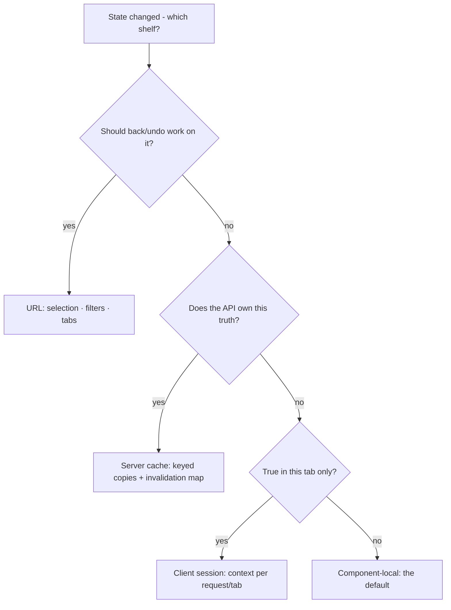

# M07 — Frontend architecture (SvelteKit)

"Scalable frontend" is mostly a folder question: where does logic live so
that changing a screen does not change three others, and so a new person
(or a cheap model) can find the one place a thing happens. VozLab's web is
SvelteKit 5 + runes + Tailwind 4, so this module states the SvelteKit
answer and how our tree maps to it.

> Interactive diagram: [`diagrams/m07-shelves.html`](../diagrams/m07-shelves.html) — open it and press Live.

## The concept

**The route is the unit of the page.** In SvelteKit, `routes/(app)/proposals/+page.svelte`
is a page; the `+` files around it are its contract with the server:
`+page.server.ts` (load on the server only — DB, secrets, form actions),
`+page.ts` (load on both — the API), `+layout.svelte` (the persistent
chrome: our shell), `+layout.server.ts` (data shared by every child, like
the session's workspace list). The groups `(app)`/`(auth)` exist precisely
to put different shells around different families of pages without changing
URLs. The professional rule this enables: **a page is a function of its
load data, not a scavenger of global state.**

**Server-first rendering, client for interaction.** SvelteKit renders the
shell on the server (SSR) — the user gets pixels and a usable URL before
JS boots; then hydration makes it live. The choice per *screen*: content
pages (lists, detail, settings) want SSR (fast first paint, shareable
URLs, works without JS); the graph canvas wants client-side (it needs a
DOM, a viewport, pointer events — no server can render it usefully). Our
`auth/restore` doc comment already states exactly this split ("the server
renders the shell; the `(app)` layout restores the session on mount") —
because a token that lives only in memory (M09) cannot exist at SSR time.
That is an architecture decision with a security cause: one of the many
places where knowing *why* prevents "fixing" it wrongly.

**State: the four shelves.** Everything in a frontend lives on one of four
shelves, and most spaghetti is things kept on the wrong shelf:

1. **URL state** — anything a user would bookmark, share, or hit back for:
   which node is selected, the filter values, the page, the open tab.
   SvelteKit gives `URLSearchParams` + `$app/state` (or `page.url`); the
   professional test: *does pressing back undo this?* If yes, it belongs in
   the URL.
2. **Server cache** — data the API owns: nodes, proposals, tenants. It is
   *read-only copies* with an invalidation story (M08), never "edited"
   locally.
3. **Client session state** — things true in this tab, this device: the
   panel layout you left open, the locale, the draft of a form, the
   access token (M09). Runes ($state/$derived) in a class instance handed
   down by context — exactly our `SessionState`/`WorkspaceState` pattern,
   created per request on the server and per tab in the browser, never a
   module singleton (the comment in `session.svelte.ts` says so, and that
   one line prevents an entire class of cross-user leaks under SSR).
4. **Component-local state** — the open/closed of this dropdown. Default
   here; promote only when a second component needs it.

**Derived, not duplicated.** A value computed from other state (`isAuthenticated
= $derived(accessToken !== null)`) must not also be stored as state.
Duplication is the root of every "it shows the old count" bug: two sources,
one truth. Runes make this enforceable in review: if a `$state` is
assignable from another `$state`, it should be a `$derived`.

**Components: containers vs content.** The pattern the tree already hints
at: `ExplorationView` (reads state, wires callbacks, composes) vs
`ZoomControls` (takes props, emits events, knows nothing about the graph).
A component that imports the API client is a container; a component that
receives data and callbacks is content. Content components are the ones a
cheap model can safely rewrite — no knowledge needed but its props. That
is not just hygiene, it is the delegation strategy: keep containers few and
hand-written, make content many and delegable.

**Form actions vs client fetches.** SvelteKit's `+page.server.ts` `actions`
handle forms with progressive enhancement (works before JS, no fetch code,
errors come back typed). Client-side `fetch` from the API client is for
optimistic flows, canvas interactions, and anything that must not
re-navigate. Both are legitimate; the smell is using them at random — the
decision rule is: *navigation-shaped submits* (login, join workspace) use
actions or the same page-state they already do; *in-place mutations*
(approve, tag) use the client. Our auth pages already sit on this line
correctly.

**The map:**

## The reasoning

**Why "per request on the server, per tab in the browser" matters.** A
module-level singleton state under SSR leaks one user's session into
another's render (the classic Svelte footgun, and the reason Svelte 5
deprecated module stores for app state). The context-provision pattern the
code uses — an instance created in `+layout.server.ts` load or in a per-tab
factory — is the fix. A reviewer (or model) that doesn't know the reason
will "simplify" it back into the bug; so the reason is now in this file.

**Why the URL shelf is the one teams under-use.** A canvas whose selected
node is not in the URL cannot be shared ("look at this node" becomes a
screenshot), breaks back-button, and loses state on refresh — which then
forces accidental complexity (saving UI state to localStorage, syncing it
back, double sources). Putting selection/filters in the URL deletes that
whole problem class. Cost: the URL must be treated as an API (typed
parsers, `beforeNavigate` for drafts). For a knowledge tool where
"link to this node" is a *feature*, this is the highest-value architecture
decision in the module (D10).

**Why containers/content split pays even without a second developer.**
Testability (content components are pure), reviewability (a diff inside
content touches one screen; inside container, every screen), and
delegation (the cheap-model handoff works because the component's whole
world is its props). The 52 components we have should be classifiable in
five minutes; if a file is both (imports the client *and* renders pixels
of the graph *and* owns the dialog state), that file is where bugs breed.

## Decision rules

1. **Every piece of state names its shelf** (URL / server cache / client /
   local) — and state that spans shelves has one owner and explicit sync.
2. **Session/workspace state is provided via context, instantiated per
   request/per tab.** A module-level `$state` singleton is a blocker.
3. **`$derived` wherever a value is computable.** Review asks: "could this
   `$state` be derived?"
4. **Containers import `ApiClient`; content components receive props.**
   A component doing both is split before new features land on it.
5. **URL carries what back should undo.** Selections, filters, tabs, page
   numbers — with typed parse/serialise helpers, not string concat.
6. **SSR by default; opt a screen out with a stated reason** (canvas,
   camera, map) — never "because data loading was annoying."

## VozLab today

The architecture is genuinely good where it counts: the context-per-tab
session, the documented server-shell/client-restore split, `(app)`/`(auth)`
groups, an API client layer separate from components, a dev engines
comparison page isolated under `lib/dev`. The open fronts: D10 (URL state —
is the selected node shareable today? check `panels.svelte.ts`,
`workspace.svelte.ts`, and the exploration route — my read is that panel
state is client-side, which means selection probably dies on refresh);
and the container/content census of the 52 components (D11), which is the
map that makes all future delegation safe.

## Exercise

1. Open a node in the canvas and refresh the page. Does the selection
   survive? Does back? Write what *would* survive with rule 5 applied.
2. Classify all 52 components as container / content / mixed in a table.
   "Mixed" is the actionable column.
3. *Handoff to the cheap model:* "For the exploration route, produce a
   state inventory: for each `$state` in `lib/state/*.svelte.ts` and the
   route, which shelf it is on, who writes it, who reads it, what happens
   on reload. Do not change code." — the inventory becomes the input for
   D10.

## Decide

**D10. URL as state policy.** (a) Encode node/edge selection + canvas
viewport + active panel in the URL (deep links become a product feature;
cost: parser + back semantics); (b) keep selection client-only (cheaper;
refresh loses context; sharing stays a screenshot); (c) minimal — selection
only. For a knowledge graph, (a) is what makes the tool networkable; it is
also the most implementation-expensive of the whole course so far.

**D11. Mixed components.** Do we schedule the container/content split as
refactor work units, or only apply it when a component is next touched?
