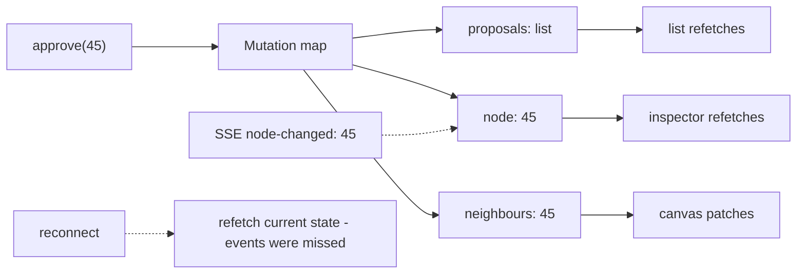

# M08 — Feeding the frontend (API and data)

How the UI gets its data — and what happens when the answer is slow, stale,
or wrong. This is where "it looks fine in dev" meets production. The
vocabulary here (transport, cache, invalidation, reconciliation) is what
lets you review an architecture instead of a vibe.

> Interactive diagram: [`diagrams/m08-map.html`](../diagrams/m08-map.html) — open it and press Live.

## The concept

**Transports, ranked by push.**

- **Request/response (REST):** the client asks, the server answers. Default
  for everything a user triggers. Simple, cacheable, debuggable.
- **Polling:** fake push — ask every N seconds. Legitimate for late-stage
  freshness (a governance queue that may lag a minute is fine on a 30s
  poll); illegitimate as an architecture for things users watch live (the
  canvas refreshing every 5s is a machine-gun of duplicate requests and a
  visible flicker).
- **SSE (Server-Sent Events):** the server pushes over one long-lived HTTP
  GET. The right shape for *one-way, event-shaped* updates: "proposal #45
  was approved," "extraction finished," node counts. Cheap: plain HTTP,
  auto-reconnect built in (`EventSource` resubscribes with a `Last-Event-ID`),
  works through most proxies, scales with a pub/sub backend (we already run
  Redis Streams — the API's SSE endpoint is a fan-out subscriber). Cost:
  one-directional, and each client holds a connection (fine at our scale).
- **WebSockets:** bidirectional, raw frames. Earned when the client pushes
  *continuously* (multiplayer cursors, live co-editing of a canvas). At our
  scale it is overkill: reconnection logic, heartbeats, and auth per-frame
  are yours to write. SSE covers "the graph changed elsewhere" — which is
  the actual requirement a knowledge tool has.
- **Server Actions / form posts:** mutation-shaped requests (M07's actions
  shelf).

The decision question is always freshness vs cost: *how wrong may this
screen be, for how long?* That answer picks the transport, not preference.

**Client vs server state — the fork that causes most data bugs.** Server
state (nodes, proposals) is a *cache of someone else's truth*. The
professional move is to treat it as such: one owner (a query layer with
keys), loading/error/stale as *states of the data*, not flags sprinkled in
components, and one invalidation story per mutation. Hand-rolled fetch-in-
`onMount` sets this up implicitly and then every screen invents its own
retry. Two mainstream answers: TanStack Query (framework-agnostic cache
with keys + invalidation + optimistic hooks — the Svelte community's
default) or a deliberate hand-rolled store with the same three ideas. The
course position: whichever, the *concepts* are mandatory — keying, staleness,
invalidation, retries with backoff — and they fit our Svelte 5 runes model
because the cache itself is client session state (M08 shelf 2 lives inside
shelf 3 machinery).

**Invalidation, three tiers.** (1) *Targeted:* approve a proposal →
invalidate `proposals` + `node(id)` + the canvas's edges around it. Correct
and cheapest if you can enumerate effects — which needs a *mutation map*:
each mutation lists the queries it dirties. Writing that map is the design
work (and the thing a review can check: "does approve invalidate the
neighbour list?"). (2) *Time-based (staleTime):* refetch after T; fine for
slow-changing (tenant list), wrong for watched (the canvas). (3) *Nuclear:*
refetch everything on focus/reconnect. Useful as a safety net, not as the
mechanism. With SSE (push), the server *tells* you what changed and you
invalidate exactly that — the tiers become one disciplined tier.

**The failure states are data states.** Every query has: loading, success
(with fresh/stale marking), empty, error (401 → auth flow, 403 → "you may
ask access" — note our `request-access` route already exists), 5xx/network
→ retryable with backoff, offline (the PWA: serve cache, mark stale,
banner — `OfflineBanner` is shelf-3 UI for a transport condition). The UI
rule (M05 rule 6) is that these are designed moments, not console.logs.

**Pagination, search, and the "resolve" problem.** Lists: cursor pagination
over offset (offset skips/duplicates when rows move — graph lists move).
Search: debounced input (250–300ms), minimum query length, *cancel the
outstanding request* (AbortController — otherwise a slow old query lands
after the fast new one and you show the wrong results: the race the cheap
model will never see). Deep problem specific to our graph: the API is
multi-tenant and workspace-scoped (`X-Workspace-ID` header, 404-on-mismatch
by design) — the client must treat *workspace* as part of every cache key.
A cache keyed `node:45` across workspace switches is a data leak between
tenant contexts. (This is D12 and it is the most dangerous decision in the
module.)

**The agent-vs-user split.** Our workers hit the API with agent tokens; the
browser with user JWTs. The frontend never needs agent credentials — and if
a design ever suggests the browser calls a worker's endpoint, that is a
boundary violation worth stopping (M09 owns the credential side).

**The map:**

## The reasoning

**Why SSE beats polling for the canvas.** The exploration surface is the
thing the user *watches*. A 5s poll means the average change waits 2.5s,
the server serves N clients × 12 req/min of mostly-no-change, and the
client must diff every response to decide whether to flicker. One SSE
subscription with event payloads `{node 45 updated}` gives sub-second
update, O(1) server cost per client, and invalidation for free (the event
*names* the dirty key). It is the textbook match for a Redis-Streams
backend. The honest costs: a connection budget (browsers cap ~6/domain —
one subscription is fine), proxies timing out idle GETs (heartbeat comment
frames solve it), and reconnect logic that must *re-fetch current state on
reconnect* because events were missed while down — the one line everyone
forgets, and the reason an SSE feature ships with a `visibilitychange` +
reconnect resync (without it, a backgrounded tab returns showing last
night's graph).

**Why the mutation map beats "just refetch."** "Refetch everything after a
mutation" is correct until the app has twelve screens; then it is a storm
that reloads panels the user is reading. The map is a one-line-per-mutation
contract that turns a review question into a checklist — and it is exactly
the artifact a cheap model can maintain.

## Decision rules

1. **Freshness contract per surface:** every screen states how stale it may
   be (canvas: seconds via push; proposals list: seconds-to-minute; admin:
   on-mount is fine). The contract picks the transport.
2. **One cache owner for server state** with keyed entries, and **workspace
   id inside every key** (D12). No component caches an API response in
   local `$state` without going through it.
3. **A mutation map exists in writing:** each mutation → the keys it
   invalidates. A new mutation without a map entry is a review blocker.
4. **Push is SSE** (not websockets, not polling) until a real bidirectional
   need exists; reconnect resyncs by refetching current state.
5. **Every list is cursor-paginated; every search is debounced +
   cancellable (AbortController) + minimum-length.**
6. **Failure = designed UI** for all of: loading, empty, 401/403,
   5xx-retryable, offline-stale. A query has no happy-path-only consumer.

## VozLab today

The transport layer is clean and typed (`lib/api/*` per domain, one
`client.ts` with `credentials: 'include'`, `auth: 'none' | bearer`, the
workspace header policy). The errors are typed (`isApiError`,
`ERROR_CODES`). The session dance (refresh-lock across tabs, restore with
four outcomes) is better than most production apps. What the course sees
missing: an *invalidation story* — the API client is request/response; each
component fetches as it mounts, so cache keys and the mutation map likely
do not exist yet (verify in the inventory, then D12/D13); no push channel
for the canvas (spec says SSE unbuilt — it is the obvious next
infrastructure decision); offline exists as banner + shell but not as a
data policy (what serves cached nodes, what marks stale — PWA phase 3.6).
The danger to name now: the workspace-switch flow re-fetches, but if any
state survives a switch without re-keying, it is cross-tenant display —
test it explicitly (exercise 2).

## Exercise

1. Produce the freshness table: every route in `(app)`, what it shows, how
   stale it may be, what transport it *should* use. Three columns, honest
   answers.
2. Workspace-switch audit: switch tenant with a node selected and a panel
   open; on return, does any data from the previous workspace appear (even
   briefly)? That flicker is D12's evidence.
3. *Handoff to the cheap model:* "Trace every `client.request` call site in
   `lib/components` + routes into a table: endpoint, trigger (mount /
   interaction / timer), where the result is stored. Do not change code." —
   the table is the raw input for the cache/invalidation design.

## Decide

**D12. Cache keys and the workspace.** Do we adopt a keyed query layer with
`(workspace, key)` tuples and a single owner, as architecture policy (the
course's bet: yes, and it makes the later SSE work cheap)? Or continue with
component-local fetches and accept the drift until the PWA offline phase
forces the same layer anyway?

**D13. Push channel for the canvas.** (a) SSE subscription (the API pushes
graph events) — requires the backend endpoint + the reconnect resync rule;
(b) polling at 15–30s only while the canvas is visible (cheapest to ship,
freshness worse); (c) manual refresh + optimistic local state only (no
multiplayer at all). For a single-user-per-workspace pilot, (c) is honest;
for a university where three people edit one graph, (a) is the feature.
