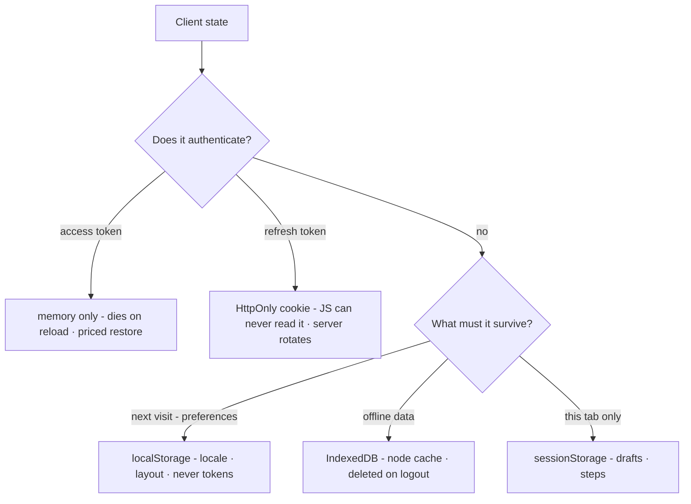

# M09 — Storage and security in the browser

The concepts you listed — sessions, tokens, cookies — are one subject:
*where does state that identifies the user live, and who can read it*. The
answer decides both the security posture and several UX behaviours (what
survives a refresh, what survives closing the tab, what works offline).
This module gives the vocabulary to read our own auth flow and defend it.

> Interactive diagram: [`diagrams/reload-journey.html`](../diagrams/reload-journey.html) — open it and press Live.

## The concept

**The storage menu, with its real trade-offs.**

- **Cookies:** small (~4KB), sent *automatically* with every request to
  their scope (path/domain), controlled by flags: `HttpOnly` (JS cannot
  read — immune to XSS theft), `Secure` (HTTPS only), `SameSite`
  (`Lax`/`Strict`/`None` — whether they travel on cross-site requests, the
  CSRF lever), `Path`, `Expires`. A refresh token belongs here: the server
  sets it, the browser carries it, no script ever touches it.
- **`localStorage`:** string key/value, per-origin, survives everything,
  readable by *any* JS on the origin. Fine for preferences (locale, theme,
  panel layout). **Wrong for anything that authenticates** — an XSS gets it
  at leisure, it persists, and it's sent nowhere so the server can't
  validate the carrier.
- **`sessionStorage`:** same readability, dies with the tab. For
  draft/step state only; the tab-death is a feature, the JS-readable part
  is the same risk.
- **IndexedDB:** a real client database (async, structured, MBs). The right
  home for PWA offline data (cached nodes, queued mutations). It has no
  magic security — same-origin, JS-readable, treat as localStorage-shaped
  risk for *sensitive* content: store the graph, never the session.
- **Memory:** variables in the JS process. Dies on reload — which is
  precisely why our access token lives only here (read on).
- **The URL:** not storage, but anything in a query string is history,
  referrer, shoulder-surf, and log fodder. Tokens and PII never ride in
  URLs; IDs do.

**Two-token architecture (what we already run).** OIDC login → the API
issues (a) a short-lived **access token** (HS256 JWT, minutes) returned in
a JSON body and held **in memory**, sent as `Authorization: Bearer` by the
client; (b) a long-lived **refresh token** as an opaque `HttpOnly; Secure;
SameSite` cookie scoped to `/api/v1/auth`. On reload, `restore.ts` calls
`POST /auth/refresh` — the cookie trades for a fresh access token — then
`GET /auth/me`. The refresh is *rotated* (a new cookie replaces the old),
and a `refresh-lock.ts` coordinates tabs so two simultaneous refreshes
don't present the already-rotated cookie twice and read as theft.

**Why this shape is the professional answer.** The threat is XSS: any
injected script can read anything JS can see. The architecture makes the
script's two prizes impossible: the refresh token is `HttpOnly` (JS cannot
read it), the access token is *not in storage at all* (it evaporates on
reload, and it expires minutes later anyway). The cost is exactly one
mechanical consequence: **reload loses the access token**, so every session
must be restorable via the cookie — the `restore.ts` flow is the *paid
price* of the security choice. A reviewer who doesn't know this will
"optimise" the restore away by putting the JWT in `localStorage`, trading a
non-problem (one extra call on reload) for a real one (a stealable,
persisted bearer credential). That is why this whole module exists.

**CSRF, honestly.** Cookies are sent automatically, so a malicious site can
make the browser hit `/auth/refresh` or any cookie-consuming POST. The
defences: `SameSite=Lax/Strict` (the cookie doesn't ride cross-site POSTs),
and for a Bearer-authenticated API, *the attack mostly cannot exist*: an
attacker site cannot attach an in-memory token, so a forged request carries
nothing but the auth cookie — which our API only accepts on
`/api/v1/auth/*`. Check: the only cookie-authenticated endpoints are the
ones that need no user intent (refresh/logout), and they verify the cookie
scope. This is the kind of sentence a security review wants written down —
now it is.

**PWA adds storage questions.** The service worker caches app shell and
(can) cache API responses. Rules: the shell is cacheable forever with a
version; *authenticated data is never in a plain HTTP cache* — offline
data lives in IndexedDB written by the app logic, so it can be cleared on
logout (and must be: multi-user devices are real in a university lab).
"Logout must delete the tenant's local data" is a product rule, not an
implementation detail (D14).

**The rest of the perimeter, one line each.** CSP (limits what injected
script can *do* — no inline-script escape, restricts sources; our vendored
fonts already fit it). `X-Frame-Options`/`frame-ancestors` (clickjacking).
Trusted Types / sanitising `RichText` before it renders HTML (our
`RichText.svelte.ts` is an XSS surface — it must sanitise, and M05's
"never innerHTML from unvetted strings" rule). Dependency hygiene (the
`pnpm audit`/Copilot gate in CI). Logging discipline: tokens and PII never
in logs or telemetry. And the standing rule: the client is a *presenter* —
every permission the UI hides (moderator actions, agent routes) the API
must re-check; "it's hidden in the UI" is not a control (the `db:mint-token`
agent routes are the reminder).

**The map:**

## The reasoning

**Why short access tokens beat long ones.** The token's exposure window is
its life. A 5-minute bearer means a stolen one is a bad afternoon for the
thief and a revoked-cookie refresh is a non-event for the user. The
architecture lets *UX* keep the session (the cookie) while *security* keeps
the credential brief — decoupling the two is the insight.

**Why opaque refresh tokens, not JWTs.** A refresh token needs *revocation*
(theft detection, logout-all). Opaque + server-side storage gives exactly
that; a self-contained JWT refresh token is a revocation problem you solve
with a denylist anyway — so be opaque from the start. (Our docs say opaque;
now you know why.)

**Why the refresh lock exists.** Rotation means the old cookie is
single-use. Two tabs refreshing at once → tab B presents the consumed token
→ the server reads it as theft and kills the family → user logged out "at
random." The lock (a Web Lock / single-flight through storage) makes refresh
a *singleton across tabs*. This is the canonical hard bug of rotating
refresh cookies, and we already have the fix; the course exists so we keep
it deliberately.

## Decision rules

1. **Nothing that authenticates is ever in JS-readable storage** — access
   token in memory, refresh in `HttpOnly; Secure; SameSite=Lax|Strict`
   cookie, path-scoped to the auth routes.
2. **Reload restore is the priced design** (`cookie → POST refresh → me`);
   any proposal to cache a token in storage to avoid one call is rejected
   on this rule.
3. **Cookie endpoints are minimum in number**; mutation endpoints use
   Bearer. CSRF surface = cookie-authenticated surface; it is listed and
   reviewed.
4. **Rotation + single-flight refresh across tabs** stays; any new
   cookie-consuming route must state how it behaves with two tabs.
5. **Offline user data lives in IndexedDB, encrypted-at-rest only if the
   device is shared, and is deleted on logout and on workspace switch**
   (D14). Preferences in `localStorage` are the only sanctioned persistent
   client state.
6. **Every HTML-ish render path sanitises** (`RichText` reviewed against a
   stored-XSS test: a node whose content holds `` must render
   as text); the API validates at write time *and* the client sanitises at
   read time (defence in depth — M03's "belt" logic applied to input).
7. **UI hiding ≠ authorisation** — every gated control corresponds to a
   server-side check; a review can pair them.

## VozLab today

This module is, unusually, mostly *documentation of existing excellence*:
memory-only access token, opaque `HttpOnly` rotated refresh cookie scoped
to `/api/v1/auth`, `credentials: 'include'` only where needed, cross-tab
refresh lock, four-state restore with a *failed ≠ unauthenticated*
distinction (a detail most apps get wrong — a network error must not log
you out). The gaps to audit are the new-shelf ones: IndexedDB/offline data
and its logout deletion (PWA 3.6 is unbuilt — D14 decides the rule before
it gets built), `RichText` sanitisation proof (exercise 2), CSP (not seen
in the API's security headers — check; `Helmet`-style baseline or explicit
policy in `app.html`/server), and `dev-sign-in.ts` must stay strictly
dev-gated (a real auth bypass if it leaks to prod — verify its guard).

## Exercise

1. Read `client.ts` + `refresh-lock.ts` + `restore.ts` end-to-end and
   write, in your own words, the reload journey: *user refreshes on
   proposals/45* → every call, header, cookie, and outcome. Then compare
   against [`diagrams/reload-journey.html`](../diagrams/reload-journey.html),
   which draws exactly that flow from the source at a pinned commit. This
   is the single best "do I actually understand it" test of the course.
2. Stored-XSS probe on dev: create a node titled
   `` through the API, view it in the
   inspector, the canvas label, the proposals list, and the discussion. Any
   popup = a sanitizer gap (rule 6) with an exact reproduction.
3. *Handoff to the cheap model:* "Audit which `localStorage`/`sessionStorage`
   keys the app uses (grep all call sites), classify each as preference /
   state / (forbidden) credential, and check none survives logout;
   file:line per finding, no changes."

## Decide

**D14. Offline data lifecycle.** Before PWA 3.6 is built: what does logout
delete (IndexedDB node cache, queued mutations, drafts — all? per-workspace
keys?), and what survives (locale, theme, panel layout)? Write the rule now
so the feature is built against it, not retrofitted.
