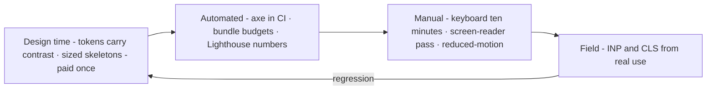

# M10 — Accessibility and performance

The professional floor under "usable" and "fast." Both are not features you
add at the end; they are constraints you design with, and both have
measurable definitions — which is exactly what makes them reviewable by a
model and defensible to a university client (public institutions in
practice *require* WCAG conformance; for VozLab this is a market fact, not
a nicety).

> Interactive diagram: [`diagrams/m10-floor.html`](../diagrams/m10-floor.html) — open it and press Live.

## Part A — Accessibility (a11y)

**The four principles (POUR):** Perceivable, Operable, Understandable,
Robust — the structure of WCAG, which is the legal grammar of this field.
You need the handful of success criteria that catch real bugs, not the
whole spec:

- **1.1.1 Non-text content:** every icon-only button gets an accessible
  name (`aria-label`, or visually-hidden text); decorative images get
  `alt=""` so the screen reader skips them instead of narrating file names.
- **1.4.3 / 1.4.11:** text contrast 4.5:1, UI parts 3:1 (M03 — measured,
  not eyeballed).
- **1.4.4 Resize text:** 200% zoom without loss; unitless/rems help; fixed
  pixel heights on text containers fail it.
- **2.1.1 Keyboard:** everything reachable and operable with keys —
  including the canvas (a graph that mouse-only is an app half the users
  can't run: selection by Tab/arrows, approve by Enter). **2.1.2:** no
  keyboard trap — except inside a modal, where the trap is *required* and
  Esc must exit (2.1.2 + the M04 modal contract).
- **2.4.3 Label/name:** the accessible name states purpose ("Approve
  proposal 45"), not kind ("Button"). Icon menus and the `aria-label` of
  each control on the canvas are where this is won.
- **2.4.7 Focus visible** + **2.4.11 focus not obscured:** the ring (we
  have it) and sticky headers must not hide the focused element.
- **2.5.8 Target size (min):** 24×24 CSS px everywhere, 44×44 on touch
  (our coarse-pointer floor). The small controls on a dense canvas are the
  usual fail.
- **3.x Predictable and readable:** consistent navigation, error
  identification *in text* (not colour alone — M03), labels visible before
  and during input.
- **4.1.2 Name, Role, Value:** custom widgets (our pills-as-buttons,
  dialogs, the split panels) must expose real semantics — a `
`
  is a black hole for assistive tech; a `<button>` or proper `role`+`aria-*`
  is not. **4.1.3 Status messages:** async outcomes ("Proposal approved")
  reach the screen reader via a live region (`role="status"`), or the
  toast is a silent animation for half the users.

**The keyboard model of a tool app.** Tab order follows visual order (rule:
if you reorder visually, audit the DOM order — `tabindex` positive values
are a smell); modals trap and return focus to the opener; skip links jump
the nav; the graph has a keyboard equivalent for its core verbs
(select/move/zoom/approve). A cheap way to *feel* the standard: use the app
for ten minutes with the mouse parked.

**Screen readers are not a myth to test against:** VoiceOver (macOS/iOS)
and NVDA (free, Windows) + a five-minute pass per key screen catches most
of the field. The automated half (axe-core via Playwright — `@axe-core/playwright`
or the `accessibility-scan` skill in this repo) covers contrast, names,
structure; the manual half is yours.

## Part B — Performance

**The metrics that define "fast" to Google and to users (Core Web Vitals):**

- **LCP** (Largest Contentful Paint ≤2.5s): how long until the biggest
  thing is visible. SSR + a rendered shell (we have it) is the structural
  win; fonts are the usual thief (hence `font-display: swap`, vendored,
  subset woff2 — all ours).
- **CLS** (Cumulative Layout Shift ≤0.1): things moving under the user.
  The densest app of all (ours) is the biggest CLS risk: skeletons sized to
  the real value (our `skeleton` is exactly this), image dimensions always
  set, content never jumps when a list "finishes loading into a taller
  box."
- **INP** (Interaction to Next Paint ≤200ms): the new one — how long a
  click/fade takes to even *respond*, across the whole visit. A graph
  canvas that freezes 400ms on a pan fails INP while Lighthouse looks fine
  (it's a field metric; the devtools Performance panel and a traced
  interaction are how you see it).

**The budgets that make these hold.** JS weight is the expensive one: a
route-level budget for the app (e.g. shell ≤ 80KB gz, canvas route pays
for sigma/cytoscape lazily — **code-split per route** is SvelteKit's free
default via dynamic `import()` and `// component lazy` patterns; the graph
libraries must not be in the login bundle). Images: modern formats, sized
to the slot. The service worker: *cache the shell, version the app,
never cache authenticated HTML* (M09's rule, stated again).

**Perceived vs actual speed.** The tricks that are not tricks: instant
press state (M06), skeletons before data, optimistic UI (M06/D9), and
*preloading the obvious next step* — SvelteKit does `data-sveltekit-prefetch`
on links automatically on hover/viewport; wiring it on the nav rail and
proposal rows makes the app feel instant with zero cleverness.

**Measure in the pipeline, not by feel.** Lighthouse CI budgets in GitHub
Actions (we have CI — a perf gate with a number beats a perf opinion);
`vite-plugin-visualizer` or the build output sizes when a bundle jumps;
`Performance` traces when the canvas feels heavy. The number is the memory.

**The map:**

## Decision rules

1. **No keyboard regressions:** every interactive thing is Tab-reachable
   with a visible focus state; the modal contract holds (trap + Esc +
   return focus); canvas core verbs have key equivalents.
2. **Names and roles exist where the visual is not the DOM:** icon-only →
   `aria-label`; custom widget → real semantics or `role`+`aria-*`; async
   outcome → live region. Automated axe in CI; a manual screen-reader pass
   per major screen before release.
3. **Contrast measured at token level** (M03 rule 3) — a11y debt is paid
   once in the system, not per component.
4. **Targets:** ≥24px always, ≥44px touch (ours at the base layer).
5. **CLS by construction:** skeletons match final geometry (ours rule),
   no unsized media, no layout-affecting late insertion in content columns.
6. **Bundle per route, heavy libs lazy:** auth and admin never pay for the
   graph engine; verified with a build-size budget in CI.
7. **A perf number gates the merge** (Lighthouse CI or a bundle-size check)
   with an agreed threshold — an opinion-free tripwire.

## VozLab today

The base layer is ahead of most teams: focus-visible ring, touch floor via
`pointer: coarse`, sized skeletons, vendored fonts with swap, SSR shell.
The known open field is the **canvas a11y**: an SVG graph (SvgGraphCanvas)
with pointer-only interaction is invisible to keyboard and screen reader
until nodes are exposed as focusable elements with names — the single most
legitimate criticism of any graph tool, and the one that matters for a
public university (D15). Perf open fields: sigma/cytoscale bundles lazy per
route (verify `engines` + exploration don't load into the login chunk),
axe in CI (not currently — the skills exist: `accessibility-scan`), and the
Lighthouse budget.

## Exercise

1. Ten minutes, mouse-parked: log in → select a node → approve a proposal.
   Write every place you were stranded. That list is the backlog (it will
   contain: canvas selection, drag, and probably the floating panels).
2. `pnpm --filter @vozlab/web test:e2e` — add one Playwright + axe-core
   test per screen of `(app)`; run it and report failures only as a list.
3. *Handoff to the cheap model:* "Grep for click handlers on non-button
   elements (`
` on divs), icon-only buttons
   without aria-label, and conditionally-rendered dialogs without focus
   management. File:line table per rule 1–2. No changes."

## Decide

**D15. Canvas accessibility scope.** (a) Full keyboard operation of the
graph (select via arrows/search, Enter opens inspector, Ctrl+A approve) —
significant work, makes the core loop usable by assistive tech; (b) a
parallel accessible path: the graph *list view* (GraphListView already
exists) is declared the a11y-complete surface and the canvas is the
enhancement — honest, much cheaper, WCAG-acceptable if the list is real
parity; (c) defer and note the conformance gap for the university contract.
(b) is the pragmatic professional answer — the choice should be made
knowing the cost of (a) is mostly *designing* the keyboard model, not
typing it.
