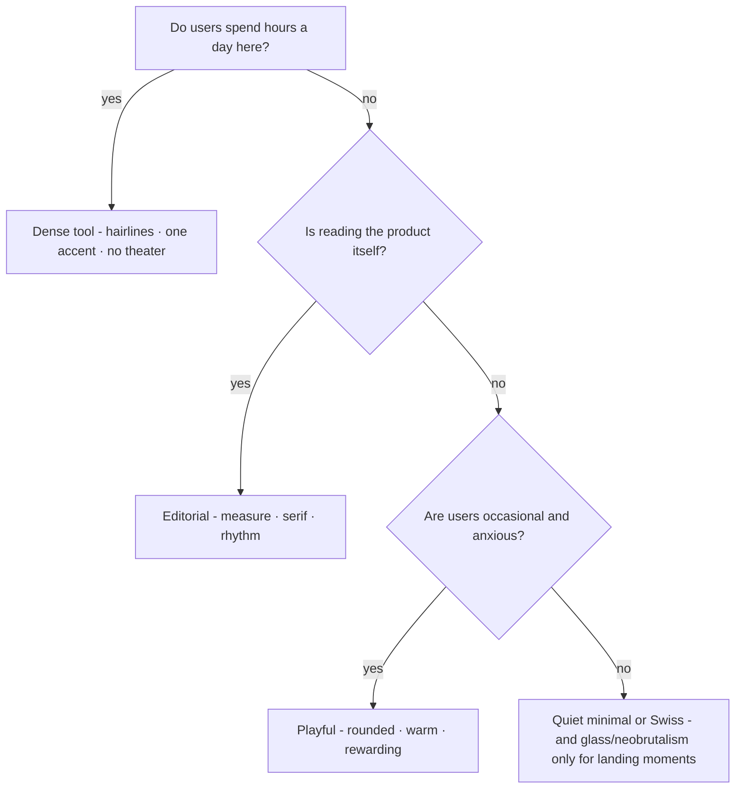

# M11 — The styles of the trade

The seven schools you actually see in professional products, their reasons,
their failure modes, and the test for whether one fits *your* app. This is
the module that converts "me gusta / no me gusta" into "this is a dense
tool style and our users are operators." Everything you read earlier gets
used here as evidence.

> Interactive diagram: [`diagrams/m11-stance.html`](../diagrams/m11-stance.html) — open it and press Live.

## The concept: style = positions on five axes

A style is not a mood board; it is a stance on five decisions you already
own:

| Axis | Question | Poles |
| --- | --- | --- |
| Typography | one neutral face or a voiced pair | neutral sans ↔ display serif |
| Colour | who is allowed to be loud | mono + one accent ↔ multi-hue |
| Density | information or air | 12px rows ↔ 24px padding |
| Depth | how layers separate | hairline ↔ shadow ↔ glass ↔ none |
| Motion | is time animated | none ↔ spring |

Each school below is a row through that table. None is "correct"; each is
correct *for a job*, and the job is defined by the user's work, their time
per day, and what the product must make them feel.

## The schools

**1. Dense Dashboard / Tool.** Linear, Retool, Bloomberg, the Grafana
family, *VozLab's own tendency*. 13–14px sans, `tabular-nums`, hairline
borders over shadows, one accent reserved for actions, motion only for
state changes. Reason: the operator reads all day; every pixel of air is
information displaced; alignment and hierarchy carry meaning, decoration
costs attention. Fails when: users are occasional and anxious (a hospital
 intake screen should not be a terminal) or the product sells aspiration
 (a landing page in this style reads as "unfinished"). Criterio test: *does
 the user spend hours here?* If yes, density is respect.

**2. Quiet Minimal.** Vercel, Stripe's dashboard, Notion's UI. Near-mono:
black/white/grey + one restrained hue, generous space, geometric sans,
almost no shadow, tiny radii or none. Reason: the interface recedes so the
*content or the numbers* are the product; trust through restraint. Fails
when: the app has no content of its own to show (a settings page in
minimal style is a void) or the audience needs warmth (education, health —
pure minimal reads as cold and "nothing here is for me"). It is also the
easiest style for AI to produce — which means it is the one that most
reads as "generic" when executed without typographic care.

**3. Editorial.** Medium, Substack, The New York Times app, documentation
sites with voice. Reading measure (~65ch), serif or high-contrast display,
large type steps, drop rules, rhythm from column widths. Reason: the
product *is* text; typographic craft signals "this was written, not
generated." Fails when: it's applied to *work* surfaces (forms, tables,
dashboards) — an editorial dashboard is a slow dashboard. Where VozLab uses
it surgically: the serif titles say "knowledge/document" to a university
while the tool stays a tool (M02). That hybrid — tool body, editorial voice
— is a known and defensible position; it is effectively what the accent
ladder + Plex serif does.

**4. Swiss / Typographic.** GitHub Next's experiments, many agency and
portfolio sites, the Dieter Rams line. Strict grid, huge type-scale jumps,
hierarchies from size and weight *instead of* colour, minimal chrome.
Reason: authority and clarity without ornament; the layout argument is
made in the open, which also makes bad spacing impossible to hide. Fails
when: content density grows (a 32px title eats a phone screen) or teams
without layout discipline produce "big text app" instead.

**5. Glassmorphism / Aurora.** Apple's visionOS-flavoured landings, the
current wave of AI product pages: blurred translucent panels over
gradient meshes, saturated backdrops, floating depth. Reason: signals new,
premium, alive; the blur reads as *spatial layering* cheaply. Fails when:
applied to working surfaces — blur destroys contrast (1.4.3/1.4.11), text
over moving gradients flickers, performance pays on every scroll, and the
"readability" of a knowledge product is exactly what it taxes. Honest use
in a tool: one marketing page, or a *single* transient overlay (a command
palette), never a content panel.

**6. Neobrutalism.** Figma's Config pages, Gumroad's current look, the
PostHog line. Hard black borders, offset flat shadows, saturated fills,
deliberately "raw" structure. Reason: personality, memorability,
anti-corporate energy; the thick border *is* a strong affordance (targets
unmissable). Fails when: used for daily-use UI — the loudness that wins a
landing page taxes six hours of reading; contrast management is real work
(yellow on white), and the style ages into a trend visibly.

**7. Playful / Rounded.** Duolingo, Slack's surfaces, Notion's
illustrations, consumer finance. Large radii, character/mascot, bright
multi-hue, heavy motion and micro-rewards. Reason: lowers anxiety and
raises return visits for non-experts; emotion *is* the retention mechanic.
Fails when: the audience is experts (they read it as toy) or the product's
stakes are serious (a research tool that celebrates you for citing sources
insults the researcher). For a university governance product: a *touch*
(warm copy, one illustration in the empty state) is defensible; the full
style is not — the users are faculty and librarians operating a record.

**The map:**

## How to choose: the three questions

1. **Who is here, how long?** Hours/day → density and restraint (1/2/4).
   Minutes, occasional → warmth and guidance (7, or 3 for reading).
2. **What must they feel to act?** Trust in data → quiet minimal / tool.
   Pride of ownership (a university's own graph) → a voiced hybrid (tool +
   editorial serif — where we are). Excitement to return → playful.
3. **What is the product's actual object?** Text → editorial. Numbers →
   dense tool. The self → swiss/display. A spatial/graph object → the
   object carries the visual interest; the chrome must be quieter than any
   of these (the canvas is the style — M01's one winner, at app scale).

**Mixing rules.** One school per *surface type*, not per screen: the app
chrome stays in the chosen school; a landing/marketing page may go one
notch louder; an empty state may borrow warmth from school 7 without the
toolbar following. What kills a mix is two schools competing for the same
decision: glass panels + dense tool rows in one view, or neobrutalist
borders next to minimal hairlines. The review sentence: "which school is
this surface from, and does the element above it answer to the same one?"

## VozLab's position, stated

Dense tool (1) for all working surfaces, an editorial voice (3) reserved
for titles and documents — the serif already does this — quiet minimal (2)
as the fallback grammar for auth/settings, and *zero* of 5/6/7 except one
deliberate human moment (empty states, maybe the first-run guide). That is
a coherent, defensible stance for an institutional knowledge tool, and
every element that arrives later can be judged against it. D16 is yours:
sign it, or ask me to argue an alternative.

## Exercise

1. Take one screen of the app and identify, element by element, which
   school it belongs to. Any element answering to a school outside the
   stance (a glass panel, a saturated decorative badge) is a drift finding.
2. Pick one screen and mock it in the *second* most-fitting school (e.g.
   the canvas in full Quiet Minimal: no serif anywhere). Five-minute
   argument either way. This is the gym for "taste with reasons."
3. *Handoff to the cheap model:* "List every component that introduces a
   visual pattern not covered by `design-system.md` (radii, shadows, colour
   uses outside the ladder); classify drift by school. No changes."

## Decide

**D16. The stance.** Sign the position above as the product's style
statement (one line in `decisions.md`, quoted by every future review), or
open a specific fight (serif titles? density level? the accent?) — but with
the school argument, not the eye.
