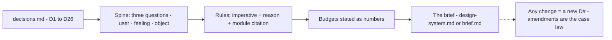

# M12 — Workshop: writing the brief of VozLab

The course's deliverable is not knowledge, it is a document: **the design
brief of VozLab** — the rules this app follows, stated with reasons, so
that any change (by you, me, or a cheap model) is either *consistent with
the brief* or *a proposed amendment to it*. This module is the procedure to
produce it from the decisions made in M01–M11 and M13–M16.

> Interactive diagram: [`diagrams/m12-brief.html`](../diagrams/m12-brief.html) — open it and press Live.

## The concept

A design brief for a product surface sits between the spec (`docs/spec/web-pwa.md`,
what the app does) and the design system (`docs/design-system.md`, what
exists in code). It holds the *judgments*: who the user is, what the
surface must make them feel, which schools apply where, the density and
loudness budgets, the optimistic/transport/security stances that UI must
honour. It is small — one page — because a brief you don't reread is a
brief that decays into archaeology.

## The procedure

1. **Collect the decisions.** `decisions.md` is the raw material. A
   decision that got made but not written is not a decision — it is a vibe
   the next contributor will overwrite.
2. **Answer the three questions of M11 for the product, once:** who is
   here and how long; what they must feel; what the object is. One
   paragraph each. This is the brief's spine — everything else is a
   corollary.
3. **Write the rules in imperative + reason:** "The canvas is the winner of
   the exploration screen; panels stay quiet until focus (M01 rule 1)."
   Every rule cites the module it came from — citations are what make the
   brief teachable to a model and defensible to a reviewer.
4. **State the budgets as numbers:** control height, the one filled button,
   series colours ≤ n, durations 120/200, route bundle ≤ X KB, contrast
   floors, motion off under `prefers-reduced-motion`. Numbers are the
   difference between a brief and a mood.
5. **The amendment process:** changing a rule = a new `D#` entry with the
   reason and the old rule struck through. This is what gives the course
   its endgame: six months from now, `decisions.md` is the repo's frontend
   case law, and a model can be told "implement to the brief" instead of
   "make it nicer."

**The map:**



## The template

Paste into `docs/design-system.md` as its opening section, or keep as
`docs/frontend-criteria/brief.md` and link it:

```markdown
# Design brief — VozLab web

## The user and the surface
<who spends what kind of day here, and what the tool must let them trust>

## The stance (M11)
<the school(s), one line, with the mixing rule>

## Rules

### Foundations (M01)
- One winner per screen: <the object of the screen>. <what stays quiet>
- Group by space before borders; spacing scale: 4/8/12/16/24/32/48.

### Typography (M02)
- Scale: 12 (glanced meta only) / 14 / 18 / 24 / 32. Body 14px.
- Serif: titles only. Mono: <decision D2>. Tabular numerals in every column.

### Colour (M03)
- Roles only; one accent + ladder; semantic trio at decision points.
- Canvas series palette: separate, ≤ <D5 number>, hue never alone.

### Layout (M04)
- Region per screen family: <shell decision D6>.
- Overlay ladder: modal = mandatory decision / drawer = context /
  popover = quick choice / toast = outcome. One modal max, Esc always.

### Components (M05)
- One control height; three ranks, one filled per view; seven states.

### Mobile (M13)
- <thumb-zone policy; safe-area pass; the phone's job on the canvas (D19).>

### Interaction cost (M14)
- Top-5 task budgets; button order (D20); undo > constrain > confirm;
  approve cost target (D21).

### Attention and feedback (M15)
- Feedback at the site of the action; error-copy standard (D22);
  governance queue design (D23).

### Rendering (M16)
- <canvas strategy and node-count ceiling (D24); long-task budget.>

### Interaction (M06)
- <100ms press response; skeletons in content, spinners in actions;
  optimistic boundary per D9.>

### Data and architecture (M07–M08)
- URL carries <D10 decision>. Cache keys carry the workspace (D12).
- Push channel: D13 answer.

### Security (M09)
- Memory access token / HttpOnly rotating refresh — reload restore is
  the priced design. Logout deletes <D14>.

### Accessibility and performance (M10)
- Keyboard: <canvas decision D15>. axe in CI; budget: <number>.

## Amendments
Every change to a rule above enters as a new D# in decisions.md.
```

## Exercise

1. Run M12 after M01–M11 and M13–M16: the brief writes itself from
   `decisions.md`; the
   work is the three-paragraph spine — do that part personally, it is the
   product, not the pixels.
2. Hand the brief + one module to the cheap model with the README's
   handoff template and one *real* small change; that is the graduation
   test of the whole course: the delegation now runs with judgement
   upstream and a checklist downstream.

## Decide

**D17. Where the brief lives.** Inside `docs/design-system.md` (one
normative doc, code still wins) or beside it as `brief.md` (separates
*decisions* from *description*). Either is fine; the point is that the
decision doc and the token doc reference each other and neither contradicts
the code silently.
