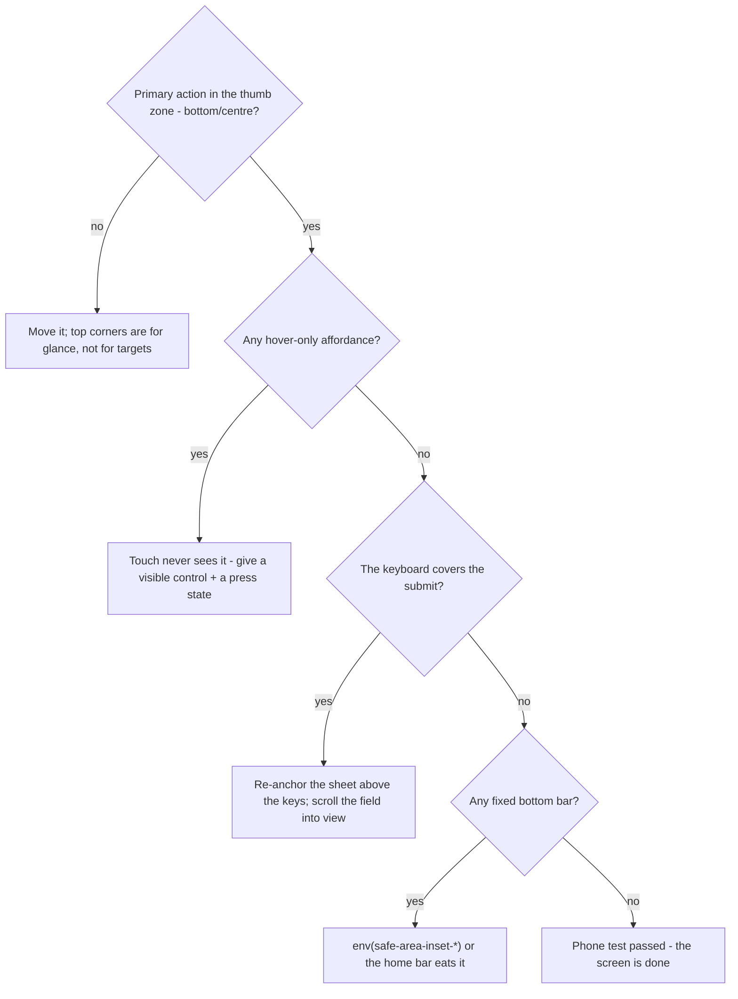

# M13 — Mobile and responsive ergonomics

Responsive is not "the layout shrinks." A phone is a different body: one
thumb, a keyboard that eats half the screen, a browser whose chrome changes
size, and a user standing up. This module is the ergonomics of touch —
what is bad on mobile, what genuinely helps, and the rules that keep a
desktop tool honest on a 390px screen.

> Interactive diagram: [`diagrams/m13-phone.html`](../diagrams/m13-phone.html) — open it and press Live.

## The concept

**Mobile-first as the base, not the afterthought.** The professional
construction: the *base* styles are the phone layout and the media queries
*add* columns (min-width). The inverse — desktop styles with `max-width`
overrides — means every new rule starts as a patch. VozLab's
`lib/layout/media.svelte.ts` already states exactly this ("the base styles
are the ones of a phone and the breakpoints add the columns"), with two
documented transforms: navigation is a drawer below `md`, the inspector a
sheet below `xl`. That is the whole architecture decision, and it is the
right one.

**The viewport that actually moves.** On a phone the visible area changes
as the URL bar shrinks, the keyboard opens, and the toolbars animate. So:
`svh`/`lvh`/`dvh` instead of `100vh` (the app already uses `dvh` — the
comment in `AppShell.svelte` names the reason), and `env(safe-area-inset-*)`
padding for the notch, the home indicator, and the status bar of an
installed PWA. A bottom button without safe-area padding sits under the
iOS home bar — the single most common mobile bug, and grep shows we do not
use `env(` anywhere yet (D18).

**Thumb geography.** Studies of one-handed reach (and every platform's own
guidance) agree: the **bottom half and the centre** of the phone are
comfortable; the **top corners** (farthest from the thumb, opposite the
grip hand) are the hardest zone and they change with handedness you cannot
detect. Consequences that are rules, not opinions: the primary action of a
screen belongs at the bottom or the centre; destructive actions belong
*away* from the easy path (an "Accept" and a "Delete" adjacent in the
natural thumb arc is a mis-tap waiting to happen); a top-right hamburger on
a 6.7" phone is an ergonomics failure dressed as minimalism. Bottom
navigation works for a reason (Instagram, iOS, Android) — it is the thumb
zone made of menu. Top bars are for *glanceable* state (where am I), not
for *targets* (what must I press).

**Touch has no hover, and that changes the feedback contract.** Every
hover-only affordance — "show actions on hover", tooltips that carry
meaning, menus that open on hover — is *invisible on touch*. The mobile
acknowledgment channel is the **pressed state** (M05's missing `active` —
on a phone it is the *only* feedback under 100ms, so it stops being polish
and becomes a requirement). Also: a tap on a target that is 44px but whose
neighbours are 4px away is still a mis-tap — the **buffer zone** between
targets matters as much as the size (iOS spacing guidance is ~8px of clear
space, more for dense lists).

**The keyboard is a guest that rearranges the room.** When it opens it
covers 40–50% of the screen. The rules it forces: the focused field
scrolls *above* the keyboard; the primary submit button is reachable
without dismissing it (bottom sheets that re-anchor, not full-screen
modals whose button goes behind the keys); **`inputmode` and `autocomplete`
set on every field** (a URL field showing the letters keyboard, or a
password field with autocorrect on, is a small daily insult repeated for
years); no `autofocus` on narrow screens (it fires the keyboard over
content the user hasn't seen yet).

**Gestures are accelerators, never the only path.** Swipe-to-action,
long-press, pull-to-refresh: each hides its affordance, so each needs a
visible button equivalent for discovery (and for accessibility — M10). The
platform conventions you inherit whether you declare them or not: iOS
right-edge back swipe, Android hardware/gesture back, web — **back must
never lose data** in a PWA (drafts saved or popstate-guarded, because
there is no "are you sure" native dialog to lean on).

**Phone ≠ small desktop.** The decision rule at the feature level: on a
phone, one screen carries **one winner** (M01 applied per device) and
complex surfaces either get a dedicated mobile job or are declared
view-and-approve, not author. A graph canvas can be pan/zoom/select/
approve on a phone; asking it to *create* edges there is the burdo
interaction the user feels without being able to name it.

**The map:**

## The reasoning

**Why safe-area and thumb-zone failures are the ones users feel.** Contrast
two mistakes: an unaligned column on a settings page (the designer sees it,
the user never does) versus a Delete button one thumb-reach from an Accept
(mis-taps, daily, silently eroding trust in the whole app). Mobile defects
are felt *by the hand*, and the hand does not forgive twice. This is why
rules 2–3 below are measurable and enforced in the phone test, not
"discussed."

**Why mobile-first pays economically.** Every rule of M01–M06 (one winner,
sized skeletons, one filled button) is *tested* by the phone: if the layout
works at 390px with one thumb, the desktop version inherits the hierarchy.
The reverse never happens — a desktop-first app does not shrink into good
mobile design; it shrinks into a small bad desktop design.

## Decision rules

1. **Mobile-first construction, written and enforced:** base styles are the
   phone; queries only *add* columns. A `max-width:` media override in new
   component CSS is a review question.
2. **The viewport is dynamic:** `dvh/svh/lvh` never `vh`; `env(safe-area-inset-*)`
   padding on the shell, bottom sheets, and any fixed bottom bar.
3. **Geography has a policy:** primary actions in the bottom/centre thumb
   zone on phones; destructive actions separated from the primary tap-path
   by distance or rank; top bars are glanceable state, not targets.
4. **Touch feedback = press state:** every interactive element has a visible
   pressed state (no hover-only affordance exists); targets ≥44px with
   ≥8px clear space between neighbours.
5. **Every field declares `inputmode`, `autocomplete`, and capitalisation**
   — the correct keyboard is part of the component, not an enhancement.
6. **Gestures are accelerators:** every swipe/long-press has a visible
   equivalent; back never loses data.
7. **The phone test is part of the definition of done** for every screen:
   real device or 390×844 + coarse pointer, run through the screen's main
   task once. "Works on desktop" is not done.

## VozLab today

The bones are right and *documented*: mobile-first with drawer-nav and
sheet-inspector, `dvh` chosen with a stated reason, touch 44px floor in the
base layer. The honest gaps: no safe-area handling anywhere (rule 2 — the
PWA will eat this bug on notched iPhones the day it installs, D18); no
pressed state on the buttons (M05 rule/D8 — on touch this is rule 4's
violation); `inputmode`/`autocomplete` appear in only ~5 sites across 37
components (rule 5 debt); the graph canvas's touch model (pinch-zoom? tap
target of a node vs its 12px label?) is untested against rule 7; and the
approve-from-phone flow — the killer governance feature (a moderator
clears the queue on a bus) — is blocked by nothing architectural, only by
the click budget (M14) and the thumb geography of the sheet.

## Exercise

1. Walk the three core tasks on a phone (or 390px + touch emulation):
   *approve a pending proposal*, *find a node and read its content*,
   *create a node*. Log every mis-tap risk, every hover-only affordance,
   every fixed control under a safe area. That log is the rule-3/4 audit.
2. Grep all `hover:` classes in components and mark those where the hover
   *reveals* something (an action that appears only on hover) — each is a
   touch-invisible affordance (rule 4).
3. *Handoff to the cheap model:* "For every input/textarea in
   `lib/components`, add the correct `inputmode`/`autocomplete`/
   `autocapitalize` (table: field → attributes → reason) and report which
   submit buttons sit inside fixed containers without safe-area padding.
   Checklist per rules 2, 3, 5."

## Decide

**D18. Safe-area and thumb geography pass.** Adopt rules 2–3 as the shell's
next work unit (padding via `env()`, primary actions to the bottom on
phone, destructive separation)? Small diff, big felt difference.

**D19. Canvas on touch: what is the phone's job?** Options: (a) phone is
view-and-approve (select, read, approve — creation is desktop); (b) full
parity including edge creation on touch; (c) view-only today, approve
later. (a) matches M14's approve-from-phone win and keeps the canvas
honest; (b) is the ambitious answer and needs pinch/tap-target work first.
