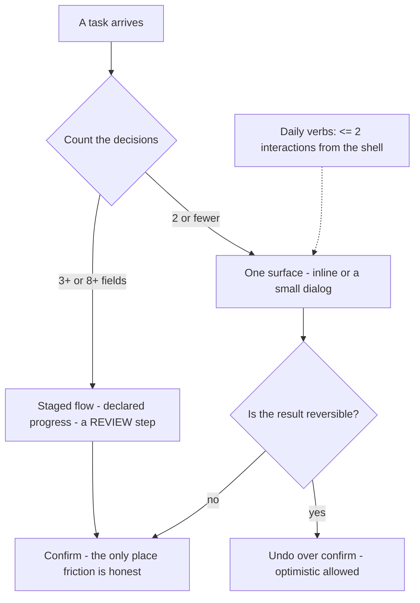

# M14 — Interaction cost: clicks, steps, forms, flow

"Burdo" in Spanish is exactly the right word for what this module removes:
the feeling that the app demands more than it gives. Interaction cost is a
measurable quantity — clicks, distance, steps, decisions, reading — and
there is a professional budget for it. This is the module that turns "cuántos
clicks debería tener" into a rule a review can enforce.

> Interactive diagram: [`diagrams/m14-budget.html`](../diagrams/m14-budget.html) — open it and press Live.

## The concept

**The laws with the names.** They are old, true, and the vocabulary of
every UX review:

- **Fitts's law**: time to hit a target ≈ log₂(distance/size + 1). Bigger
  and closer wins; screen edges are infinite targets (capture). Practical
  consequences: the approve button *next to the selected item* beats the
  same button in a sidebar by real seconds repeated hundreds of times;
  a 32px control in a 45px row is a Fitts tax; menus adjacent to their
  trigger are free, distant ones cost.
- **Hick's law**: decision time grows with the number of visible options —
  log of it. The design lever is not "fewer features," it is *fewer
  simultaneous visible decisions*: grouping, chunking, progressive
  disclosure. A menu of 12 items is ~3 slow choices; the same 12 under 4
  groups is one fast choice plus two.
- **Miller (7±2)** in its applied form: a nav, a toolbar, a settings page
  with more than ~7 visible units is asking the user to *read a list*
  instead of *recognising a place*. Recognition over recall everywhere.

**The cost budget per task.** Professionals measure *time to complete the
top 5 tasks* — and every redesign has to make them faster, never slower.
The structural form: **the 80/20 rule of actions** — the handful of verbs
users run all day (approve, search a node, open discussion, edit) must be
reachable in **≤2 interactions from the shell**, on every device. "From
the shell" means: no modal maze, no settings-page detour, no scroll to
find the button.

**Steps, wizards, and progressive disclosure.** The counting rules: ≤2
decisions → one surface (inline or a small dialog); 3+ *distinct*
decisions or ≥8 fields → a wizard or a two-stage flow **with a review
step** (never make the user discover a typo after submit); and when a flow
is long, the length is *declared* ("3 steps", progress indicator) because
a known wait is tolerated and an open-ended one is not. Progressive
disclosure is the counter-tool to Hick: the advanced fields exist but
arrive only when relevant ("Add condition ▾"), so the first screen of a
form asks the *minimum* — the psychological contract is "this is quick,"
and you earn the rest. **Every optional field taxes every required one**:
the form-length rule is "justify each field per submission" — if you
cannot say who uses it, delete it.

**Modals are an interruption with a cost.** A modal stops the app and
demands attention: its price is the user's *entire context*. Inline
editing and optimistic updates (M06/D9) retire most modals; a dialog is
paid for only when the decision genuinely blocks (deleting, approving a
merge). The professional reflex: when you see yourself designing a modal,
first ask whether an inline affordance at the *site of the action* would
cost fewer clicks and less attention.

**Undo beats confirm; confirm only for irreversible.** Every confirm dialog
is a tax on the 99% routine cases to insure the 1% disaster. The
professional hierarchy: (1) make it reversible and say so ("Approved ·
Undo" — M06's toast with its remedy); (2) constrain the input so the error
is impossible (disable future dates, validate as they type); (3) confirm
when it is truly irreversible (M06's severity line — a merge, a delete).
This is Nielsen's error-prevention + user-freedom heuristics in mechanical
form (M15 names the family).

**Button order is a single convention, decided once.** The trade: Windows
tradition (primary right), macOS (primary left), web forms (primary first,
left, reading order — the affirmative *is* next to the label being read),
mobile bottom sheets (affirmative on top of the pair for thumb + the
read-down order). There is no universally right answer — there is a
disaster in *mixing* them in one product (muscle memory is per-app, and an
app that puts "Guardar" right here and left there trains nothing). The
rule is: pick one, write it in the brief, enforce it in review; destructive
actions leave the convention entirely — separated by space or rank, never
in the habitual tap path (M13 rule 3).

**Forms, the complete checklist** (each item's *why* is one failed-user
story): single column on phones (two columns split the visual field and
double the scan); labels above, visible always (M05); related fields
grouped by space (M01 rule 4); validation on blur, not on every keystroke
(nothing is wrong *yet* while typing) and never only on submit; errors in
a summary above with anchor links *and* inline at the field; autofill and
inputmode allowed (rule M13-5 — fighting autocomplete is fighting the
user); Enter submits the nearest form, Escape cancels a dialog; the submit
button is disabled with a *reason shown*, or stays enabled and the errors
tell (silent disabled is the cruelest pattern in web forms); a long form
shows progress; success returns the user to where the object lives (don't
dump them at the root).

**Shortcuts are the second gear.** For power users (the librarian who
approves 40 proposals before lunch): keyboard accelerators and a command
palette (Cmd/Ctrl+K) — the classic accelerator pair (Nielsen #7: add
accelerators for experts, invisible to novices). Batch operations when a
list action repeats: select three, approve three. This turns a 2-click
budget into a 1-click budget without touching the design.

**The map:**

## The reasoning

**Why budgets, not vibes.** "Fewer clicks" is a mood; "approve is ≤2
interactions from shell, measured on a phone" is a number a model can test
and a reviewer can defend when someone wants to add a third step. The
budget is also the *argument for deletion*: when a proposed feature adds a
step to a top task, the cost table is the evidence that decides, before
any code.

**Why the review step in long flows is non-negotiable.** Users skim;
recall-after-submit is a memory test they fail silently. A review step is
recognition (the values are *on screen* to confirm), it cuts support
tickets, and it costs one deliberate extra click in a flow that already
declared itself long — a fair trade the other direction never is.

## Decision rules

1. **Top-5 tasks have a measured cost** (interactions + rough seconds,
   phone and desktop). A change that raises a cost needs a D# justification.
2. **80/20 actions reachable in ≤2 interactions from the shell**; no modal
   maze, no detour screens for daily verbs.
3. **Step budget per flow:** ≤2 decisions inline/one dialog; ≥3 decisions or
   ≥8 fields → staged flow with declared progress and a review step.
4. **Every form field is justified per submission**; optional fields
   disclosed progressively; single column on phone.
5. **Validation on blur; errors summary + inline; submit state always
   explained** (disabled-with-reason or enabled-with-errors — never silent).
6. **Reversibility ladder before confirmation:** undo > constrain > confirm;
   confirm dialogs only for irreversible actions.
7. **One button-order convention across the product** (D20); destructive
   never in the affirmative's habitual path; pairs always the same order.
8. **Accelerators for repeated actions** (palette, keys, batch approve) —
   expert speed without novice clutter.

## VozLab today

The governance flows are the lab. Statically: proposals list → detail →
approve reads as ~3 interactions from the shell (dialog + confirm? —
`ProposalDetail` + `ModalDialog` exist; the audit in the exercise will
count exactly), and the approve action lives in the detail view, not at
the list row — a Fitts case for a row-level approve that would cut the
moderator's whole queue cost (rule 2/8). The dialogs (`NodeCreateDialog`,
`EdgeCreateDialog`) carry real fields — whether they cross the ≥8-field /
3-decision line (rule 3) is an exercise answer, not a guess. `VoteButtons`
next to content is the pattern *already right*: action at the site of the
object. The button-order convention: nothing in `design-system.md` states
it yet — D20 is a one-paragraph decision with app-wide effect, and exactly
the kind of rule a cheap model can then enforce mechanically in every diff.

## Exercise

1. Build the cost table: the 5 most important tasks (approve proposal,
   create node, create edge, discuss, search) — count interactions and
   seconds on desktop + phone. The cells that exceed rule 2 are the
   backlog, with their fix named (inline approve, palette, wizard split).
2. Audit every `ModalDialog` use against rule 6: does each confirm an
   irreversible act, or is it a habit? Each habit becomes an inline or
   optimistic flow.
3. *Handoff to the cheap model:* "Table: every dialog and form component →
   field count, decision count, current validation timing, submit-disabled
   behaviour → and mark which of the four rules (3, 4, 5, 6) each violates.
   No changes." — the table feeds D21 and the first implementation wave.

## Decide

**D20. Button-order convention.** (a) affirmative left on desktop dialogs,
affirmative first (top) on mobile sheets; (b) affirmative right on desktop,
bottom on mobile; (c) adopt whatever the majority of the current code does
and standardise the rest. The course recommends (a) with the destructive
always last — read order is the most defensible for a new product.

**D21. The approve cost cut.** Row-level quick-approve in the proposals
list (one interaction from shell, dialog or optimistic), moving the
moderator's cost from ~3 steps to 1–2 — or keep review-before-approve as a
deliberate friction for governance (a merge *is* consequential, M06/D9)?
Both are coherent positions; the choice states what the product thinks an
approval deserves.
