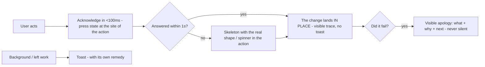

# M15 — Attention, fatigue, and the feedback contract

The user's attention is a budget they spend without noticing, and visual
fatigue is what the bill feels like. This module is the cluster you named
without a group: centrality (where things should be for the eye),
separation, tiredness from colour and density, micro-feedback that makes
the app feel like it *answers* rather than *endures*, and the classic set
of judgment heuristics every UX review is actually built from.

> Interactive diagram: [`diagrams/m15-ack.html`](../diagrams/m15-ack.html) — open it and press Live.

## The concept

**The eye is on the object, not on the chrome.** Central attention: while
working, the user's fovea is on the thing they are doing — the node they
selected, the field they typed in. Every confirmation of *that* action
must appear **at the site of the action**, not in a corner. A "Saved"
toast in the bottom-right, when the user is looking at the inspector's
centre, is a message the user does not read — they re-scan the whole
screen looking for the evidence the toast promised. The toast is only
correct for outcomes the user already *left* (background work).

**The blindness set.** Four failure modes the literature names, all of them
engineering constraints, not trivia:

- **Change blindness**: changes the eye didn't witness are not seen. A row
  that silently disappears from a queue, a count that updates off-screen —
  the user cannot find the difference, so they distrust the whole screen.
  The remedy is M06's trace rule: anything that moves, animates its in/out
  or gets marked (the pulse is *at* the change, never a global "refreshed").
- **Inattentional blindness**: looking at one thing makes other things
  literally invisible (the famous gorilla). Two UI consequences: a modal
  overlay *erases* the change behind it when it closes; and a status that
  only updates off-centre (a count in a header) will be missed exactly when
  the user is busy — which is when it matters.
- **Banner blindness**: users have learned to skip decoration-shaped
  regions; an important warning styled like an ad is skipped like an ad.
  Meaning cannot live in the banner band styled generically.
- **F/Z scanning**: on content screens, the eye samples a fast path —
  top-left, then down the left edge, occasional long saccades. Key info in
  the F's path; supporting info can live off it; *nothing critical lives
  in the unscanned margins*.

**Cognitive load, the three kinds.** Intrinsic (the task's real difficulty
— the graph's ontology, yours to teach, not delete), **extraneous**
(everything the UI adds: hunting for controls, decoding icons, translating
"403" into Spanish — *the whole job of design is deleting this one*),
germane (the thinking the user *should* do). A screen that feels "cansado"
(tiring) after 20 minutes is almost always extraneous load leaking from
somewhere a rule catches: unlabeled iconography (recognition-over-recall
violation), inconsistent button placement (re-decoding per screen), hidden
state, too-thin hierarchy (M01's two winners).

**Visual fatigue has physical and perceptual sources.** Physically: text
below ~13px for sustained reading, contrast grazing the 4.5 floor under
bright ambient light, and small hit targets (the hand gets tired before
the eye does). Perceptually: **sustained saturation is exhausting** —
this is the deep reason quiet chrome works (M03's one-accent rule and
M11's tool stance are not style preferences; they are the only palette a
worker can look at for 5 hours). Loud areas must be *brief and few*: the
filled button, the pill on the decision. Rhythm helps too: the eye rests
on grouping (M01's proximity), on a constant row rhythm (`--row-height`),
and on predictable placement. A dense UI that does not fatigue is dense
*with structure*, not dense with noise (M04's "dense ≠ cramped").

**Vigilance decrement — why governance queues are special.** Humans are
bad at sustained monitoring: after 20–30 minutes of review work, detection
of anomalies drops and approvals drift rubber-stamp. A product whose core
loop *is* reviewing pending changes must design against it: risk-ordered
queues (hardest, most consequential first, while attention is fresh),
diff-first presentation (the change visible without opening anything —
your `ProposalDelta` is exactly this idea), clear one-status-per-item
(pill + mark), and batching low-risk items so scarce attention goes to
high-risk ones. Rubber-stamp drift is a *product* problem with UI
controls; the university's graph quality depends on it (D23).

**Nielsen's 10 heuristics — the review grammar.** Every professional UX
audit you will ever read is these ten with synonyms. Learn them as a
checklist and you have the language to *acuse* a screen without knowing
the framework:

1. **Visibility of system status** — always know what's happening (M06).
2. **Speak the user's language** — words of their domain, not `tid`,
   `403`, "agent token" (copy is a design surface).
3. **User control and freedom** — exits, undo, escape hatches ("emergency
   exit" from every state); trapped users lose trust (M14's undo ladder).
4. **Consistency and standards** — the same verb always looks and sits the
   same (M05/M14; platform conventions followed, not reinvented).
5. **Error prevention** — constraints and defaults *before* the message
   (M14 rule 6).
6. **Recognition rather than recall** — the answer visible, not remembered
   (groups, recent items, labels not bare icons, wizard review steps).
7. **Flexibility and efficiency** — accelerators for the expert, simple
   path for the novice (M14 rule 8; same design, two gears).
8. **Aesthetic and minimalist design** — every extra element *dilutes* the
   relevant ones (the element budget; the reason hierarchy beats
   decoration — M01).
9. **Help with errors: identify, diagnose, fix** — the message is the
   design of the recovery, not the report of the crime.
10. **Help and documentation** — searchable, task-focused micro-help; the
    best is not needed, the second best is contextual.

**Error copy is a component with anatomy.** What happened (in the user's
words) + why if knowable + **what to do next** + the escape. Never blame
("Contraseña inválida" → "No reconocemos esa combinación; probá con el
email de tu institución"). Never leak codes; never "Something went wrong"
without a next step. A 500 on approve must say the proposal *was not*
approved (ambiguity in a governance queue is a data-quality bug). Tie to
M08: the typed `ERROR_CODES` exist server-side — the product question is
whether each maps to a human sentence per screen (D22).

**Micro-feedback as conversation.** The feeling of "responde" that you
described is the aggregate of acknowledgments: press state (<100ms,
M06/M13), hover as *recognition signal* ("I am a target"), focus as
"I hear the keyboard", transitions that trace cause (button → panel it
opened), skeleton = "working", disabled-with-reason = "not now, because",
badge/silent count update = "new here" only if the change carries a trace.
Each channel individually is trivial; missing them together is what reads
*burdo* — the app behaving like a wall instead of a conversation. (And the
inverse failure: feedback for everything is M01's loudness budget —
acknowledge the input, celebrate nothing routine.)

**The map:**

## Decision rules

1. **Confirmation appears where the action was**; toasts only for outcomes
   of left/background work. A review can ask "where is the user's eye when
   this fires?"
2. **Nothing changes silently**: animated in/out or a local mark (trace
   rule) for every add/remove/update in visible regions.
3. **Loud is rationed per session**: fills and saturated areas are brief
   and few; chrome is quiet (M03 rule 2 applied over *time*, not just
   space).
4. **Governance attention design**: queue ordered by risk or consequence,
   diff visible without extra opening, batching path for low-risk items,
   rubber-stamp friction *only* for the consequential ones (D23).
5. **Error copy = what + why + next**, in the user's language, no codes,
   no blame; ambiguity forbidden (state what did/didn't happen).
6. **Recognition over recall everywhere**: labels beat bare icons, state
   stays visible (counts, filters), multi-step flows show where they are
   and what they said (review steps).
7. **Heuristic pass per release**: a 15-minute Nielsen-10 pass on the 3
   core screens, findings logged as issues — the audit grammar that
   replaces "se ve raro".

## VozLab today

The material for the conversation already exists — 120ms transitions,
sized skeletons, focus rings, pills, the `ProposalDelta` diff-first idea,
typed errors. What is *undecided* is the two things this module owns: the
copy standard (do the 401/403/500/merge-failure cases have human sentences
per screen? verify against `packages/shared-types` ERROR_CODES → the only
audit that makes rule 5 real, D22) and the governance attention design
(rule 4 — queue ordering, batch approve for low-risk proposals, where
`VoteButtons`/`InspectorProposals` sit in the flow; D23). Canvas
change-traces are already M06's finding (rule 2 violation: remote updates
arrive silently); this module names *why* it matters — change blindness
makes the user distrust the canvas they can't verify at a glance.

## Exercise

1. Copy audit: list every API error code reachable in the UI, and the
   sentence the user actually sees. Mark the leaks (codes, silence, blame,
   ambiguity). This one table usually produces the cheapest quality jump
   in the whole course.
2. Rubber-stamp test: run 20 approvals in dev and time yourself; then
   note which proposals you *didn't really read*. What feature of the
   queue made that possible? Propose the rule-4 fix.
3. *Handoff to the cheap model:* "Heuristic pass (Nielsen 10) on the three
   core screens (canvas, proposals, node detail): table heuristic →
   finding → file:line. No changes." — you grade the table; the model
   learns the grammar with your eyes on the output.

## Decide

**D22. Error-copy standard.** Do we invest a work unit in mapping every
reachable ERROR_CODE to a per-screen human sentence (+ the ambiguity
clause: what did/didn't happen)? Recommended: yes, before the pilot —
governance trust is exactly what these messages carry.

**D23. Governance attention design.** (a) risk-ordered queue + batch
low-risk approve + diff-first everywhere; (b) status quo chronological
queue (simpler; rubber-stamp drift accepted); (c) order by age (fairness —
oldest first). (a) is the answer that treats reviewer fatigue as a design
material; it needs the API to sort by whatever "risk" means — a small
backend ask.
