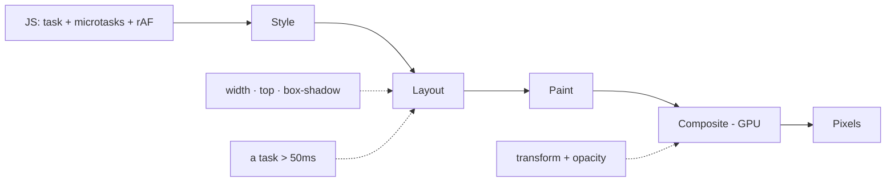

# M16 — The render loop and the browser under the UI

The performance module you asked for by ear: "loop de render", React
re-renders, why a canvas stutters. These are the mechanisms *beneath* every
rule in M06 and M10 — the reason the rules are the numbers they are. Most
of it transfers between frameworks and products; knowing it is what lets
you say "that animation will jank" before the code exists.

> Interactive diagram: [`diagrams/event-loop.html`](../diagrams/event-loop.html) — open it and press Live.

## The concept

**The frame budget.** A 60Hz screen gives you **16.7ms** per frame; a 120Hz
phone, 8.3ms (and phones throttle harder than laptops — mobile is a
4×-slower CPU for the same JS). Per frame the browser runs a pipeline:
**JS → style → layout → paint → composite**. Your job is to keep work out
of the expensive stages. The pipeline stages that cost the most: layout
(re-measuring geometry, and it's *synchronous* when JS reads it) and paint
(rasterising pixels). The cheapest stage is composite — the GPU moving and
fading *already-painted* layers. This is the machine-level reason behind
M06's rule (animate transform and opacity *only*): a transform animation
never re-lays-out or re-paints; a `width` or `top` animation does both,
every frame, on the main thread.

**Layout thrashing (forced synchronous layout).** The classic silent
killer: code that *writes* a style and then *reads* a geometry property
(`offsetHeight`, `getBoundingClientRect`) in the same task makes the
browser run layout *immediately* to answer — and if a loop alternates
read/write over 500 nodes, that's 500 layouts per frame. The fix is a
pattern, not a library: batch all reads, then all writes; or read once per
frame in `requestAnimationFrame`. The devtools Performance panel shows it
as a purple "Layout" bar with a warning triangle, and a flame chart with
repeated purple slices inside a rAF is the signature of this one bug —
the most common cause of "why does panning my graph lag" before any real
rendering strategy is involved.

**Two loops you must not confuse.** The **event loop** runs tasks
(callbacks, I/O, timers) with **microtasks** (promises) draining first —
which is why `.then` chains can starve rendering, and why a long task
(>50ms) *blocks input* (INP, M10: the click can't respond because the
thread is busy). The **render loop** is `requestAnimationFrame`: the
browser's "paint the next frame in N ms" notice, aligned to the display —
the correct place to put per-frame drawing and to batch reads/writes.
Animations driven by `setTimeout` are off-beat and look worse at equal
cost; the modern third option, `requestAnimationFrame` + CSS transitions
delegated to the compositor, is usually the cheapest of all. (The full
turn-by-turn map of both loops, with mermaid diagrams, is
[M18](m18-event-loop-memory.md).)

**SVG vs canvas vs WebGL — the rendering strategy, and why VozLab has both
engines.** (This is the module the `lib/dev/engines` comparison page
deserves to be understood through.)

- **SVG = DOM.** Every node/edge/label is an element; the browser's whole
  machinery (style, layout, events, hit-testing) applies per element.
  Strengths: crisp text, easy events (click a node!), accessibility hooks.
  Costs: style/layout/paint scale with *element count* — a 2000-element
  graph re-lays-out the world on zoom if labels change font; hit-testing is
  free but heavy past a few hundred.
- **Canvas 2D = retained pixels you draw.** One element; you redraw every
  frame yourself in a rAF loop. Text is hand-drawn (costly), events are
  yours (coordinate math), a11y is yours (invisible to DOM — M10's canvas
  problem, and one more reason the keyboard path must exist). Costs scale
  with *what you draw per frame*, so the professional toolkit is **culling**
  (draw only what's in the viewport — usually 20× fewer), **LOD**
  (level-of-detail: labels above a zoom threshold only — text rendering is
  the expensive part), and dirty-rect/full redraws only when state changed.
- **WebGL (sigma, deck.gl) = the GPU.** Geometry uploaded to buffers;
  redraws are cheap enough that *full redraw every frame* is normal for
  10k+ nodes. Labels still hurt (that's why sigma draws nodes here and
  text elsewhere or LOD'd); the cost moved from CPU to shader setup and
  upload, plus the awkwardness of events/a11y (coordinate math again).

The decision this encodes for any data-heavy surface: **where does the
cost scale — element count, draw-per-frame, or upload-per-frame** — and
which one can you afford. A university graph of 500–2000 visible nodes
with rich labels is precisely the zone where SVG and Canvas trade blows,
and why "which engine" is a measured decision, not a preference (D24).

**Virtualised lists.** The same law applied to the boring UI: render only
the rows in view ± overscan; a 10,000-row table with 30 live DOM rows costs
what 30 rows cost. `jsdom`-heavy lists (every row with a button + a pill +
an image) are the number-one non-canvas source of "the whole app feels
slow to type in" on long pages.

**React's model vs Svelte's — and the transferable lesson.** You heard the
React lore; here is the honest comparison, because the *lesson* survives
both.

- **React**: a state change re-runs the component *function* (render
  phase = build a new virtual DOM), then reconciliation diffs it and
  commits minimal DOM mutations. Costs: re-render *cascades* down children
  unless props are referentially stable or memo'd; `useMemo/useCallback/
  memo` are a **manual cache** the team must maintain — which is why
  "unnecessary re-renders" is React's signature perf conversation, and why
  "colocate state, split components, derive don't store" became its
  folklore. Keys are its diffing contract (index-as-key = the whole list
  remounts on insert — a bug that looks like state corruption).
- **Svelte 5 (ours)**: the component function runs once; `$state` is a
  signal, writes mark *readers* (precise dependency graph), `$derived` is
  lazy, and `$effect` runs after the DOM update. No VDOM, no cascade:
  updating one of 2000 rows touches that row's text node, full stop. The
  failure modes migrate instead of disappear: an effect that reads and
  writes state it shouldn't (re-run storms), `$derived` that isn't actually
  cheap (lazy ≠ cached; a derived over a 2000-array recomputes on every
  write), and **$props destructuring that breaks reactivity** (the rune
  contract).
- **The transferable lesson** (this is the long-term value): performance
  follows the **invalidation graph**, not the framework's marketing. Write
  the *narrowest* state that changes; derive instead of storing; push the
  fast-changing bits *down* into leaves and the slow-changing bits *up*
  into props/context (React: "state colocation"; Svelte: same move, fewer
  tears); never re-do expensive computation for a dependency that didn't
  change (memoisation, in whatever form the framework gives you); and the
  per-frame rules (reads batched, rAF, compositor-only animation) are
  *identical everywhere*, because they're the browser's rules.

**Where the rest lives.** Web Workers (and OffscreenCanvas) move heavy
non-DOM work — parsing big uploads, embeddings preview, diffing — off the
main thread; `content-visibility: auto` lets the browser skip
rendering work off-screen; `contain: layout paint` fences a subtree from
re-layouting the page. None needed today; all known so the next "it's
janky" has three named suspects instead of a mood.

**The map:**

## Decision rules

1. **Animate transform + opacity only** (M06-4, now with the reason); any
   other animated property in a diff gets a comment why the re-layout is
   worth it.
2. **No geometry reads interleaved with writes** in loops (rAF +
   batch reads-then-writes); the Performance trace is the review evidence
   when a canvas change lands.
3. **Canvas/graph: a stated rendering strategy** — culling to the viewport,
   label LOD threshold, redraw-on-change vs per-frame — and the engine
   choice is *measured* at the expected node counts, not argued (D24).
4. **Lists over ~100 rows virtualise**; dense rows keep DOM light (fewer
   nested components per row than feels nice).
5. **A long task >50ms is a bug to split** (chunks, `scheduler.yield()`,
   workers for parse/analyse); typing and clicking must never wait behind
   computation.
6. **Measure before optimising**: performance marks on the interactions
   users complain about; flame chart over folklore. INP is the field
   metric that catches main-thread blocking; CLS catches the layout
   side (M10).

## VozLab today

The assets are unusually good for teaching this module: `SvgGraphCanvas`
vs `SigmaPanel` already exist side by side, the `lib/dev/engines`
comparison page is a *measured* harness, and `painter.ts`/`elements.ts`
show the SVG strategy (elements per node, labels as DOM). What the course
can't see is whether the pan/zoom loop batches DOM writes (rule 2 — no
trace exists yet; the exercise produces one) and whether the SVG path has
a node-count cliff where sigma wins (rule 3 — the comparison page's whole
purpose). M13's phone point connects here too: a 1000-node SVG on a
throttled phone is where the strategy decision actually bites, not on the
laptop where both engines feel fine.

## Exercise

1. DevTools Performance: record 5 seconds of panning + zooming on a busy
   graph (and see the whole turn animated in
   [`diagrams/event-loop.html`](../diagrams/event-loop.html)). Report:
   total scripting/layout/paint per frame; any purple
   "Layout (forced)" slices with a triangle; frames over 16.7ms. That trace
   is the first *measurement* you've ever owned — and the evidence that
   makes rule 2 a habit.
2. On the dev engines page, count nodes where SVG and sigma differ
   perceptibly on a 4× CPU-throttled emulation (or an old phone). Write the
   cliff as a sentence: "SVG holds at N visible nodes; above it sigma."
3. *Handoff to the cheap model:* "Read `lib/graph/svg/painter.ts` and the
   canvas component: inventory where geometry is read (getBoundingClientRect/
   offset*/client*) relative to writes and rAF; report any interleaved
   read/write loops (rule 2) and whether viewport culling/label LOD exist
   (rule 3). No changes."

## Decide

**D24. The rendering strategy of the canvas.** (a) keep SVG, add culling +
label LOD + batched writes, and set a node-count ceiling the product
honours (beyond it, switch engine automatically); (b) commit to sigma/WebGL
as primary and keep SVG only for <N node graphs; (c) measure first via the
dev engines page and decide with the data. The course recommends (a) —
SVG's DOM events and text are real gifts at 500–2000 nodes; the cliff just
has to be *known and enforced*, not feared.
