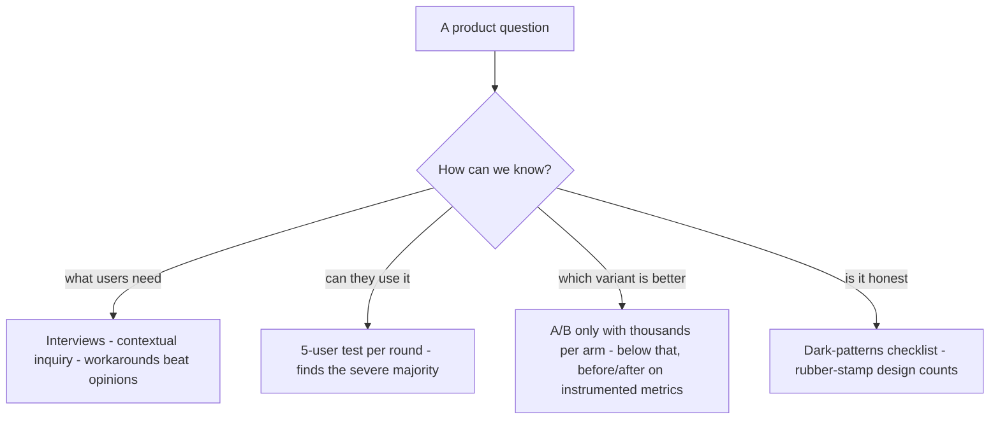

# M17 — The long view: research, measurement, ethics, and systems at scale

The literacy module. Nothing here decides a VozLab pull request today;
everything here is what you will need the day the product has real users,
a second product, or a design team. It is the map of the *rest of the
profession* so that the next concept you overhear ("usability testing",
"dark patterns", "design tokens at scale") lands somewhere instead of
panicking you.

> Interactive diagram: [`diagrams/m17-router.html`](../diagrams/m17-router.html) — open it and press Live.

## The concept areas

### 1. Finding out what users need (research)

- **Generative vs evaluative.** Research before you build (what do they
  actually do?) vs research after (can they use what you built?). Both are
  methods, not opinions, and most product failures are skipping the first
  and mis-trusting the second.
- **The 5-user rule (Nielsen):** a moderated usability test with ~5 users
  per round finds the large majority (~75–85%) of the severe usability
  problems on one flow. This is the most cost-effective fact in the whole
  profession: a full hour with five real professors beats a month of
  internal debate. Structure: recruit from the actual role, give them a
  *task* not a tour ("approve the pending merge you think is riskiest"),
  think-aloud, stay quiet, count where they struggle. Three rounds a year
  keeps a product honest.
- **Interviews and contextual inquiry**: ask for stories, not opinions
  ("show me the last time you tagged a node") — stated preferences are
  terrible predictors; observed workarounds (their spreadsheet next to your
  app) are gold. Diary studies and field observation for longer cycles.
- **What NOT to do**: surveys as strategy (they quantify what you already
  suspect), "would you use X?" questions (everyone says yes), feature
  requests treated as specifications (the request is the symptom, the
  underlying work is the requirement).

### 2. Knowing if it works (measurement)

- **Task metrics before sentiment**: completion rate, time-on-task, error
  rate, and *first-click accuracy* on your 5 core tasks — instrumented
  quietly with events you already have. They beat any usability score for
  finding a broken flow.
- **SUS** (10-question, 2 users per minute to administer) and **UMUX-Lite**
  (2 questions): validated, tiny questionnaires — a defensible baseline
  ("SUS 71") to compare releases, not a vibes score.
- **A/B tests, honestly**: statistically, you need roughly thousands of
  users per arm for a small conversion shift — for a pilot with 30
  moderators, A/B is *not your tool*, and pretending otherwise is
  numerology. At small scale, run *before/after* on your own instrumented
  metrics (approve-time dropped 40% after D23) and pair with five
  usability sessions. Big-tech habits copied without big-tech sample
  sizes is its own dark pattern of reasoning.
- **Analytics ethics**: product analytics (anonymised, aggregate) is fine;
  session replay that records what a user types into fields is a privacy
  incident waiting — mask inputs or don't do it.

### 3. Dark patterns — the list of "cosas malas", named

The industry has a vocabulary for interfaces that work against the user;
knowing the names is what makes them visible in your own drafts and
auditable by a model:

- **Confirmshaming** ("No thanks, I prefer to stay confused?") — guilt as
  a click driver.
- **Roach motel** — easy in, hard out (subscribe in one click, cancel by
  phone). Corollary for us: *any flow that asks for an account must make
  leaving it equally obvious*.
- **Hidden costs / drip pricing** — the price that appears at step 4.
- **Forced continuity** — the free trial that becomes a paid trap without a
  heads-up (regulation, like the FTC's click-to-cancel guidance, now
  bans some of these).
- **Nagging & interruptive interstitials** — banners, popups, rate-us modals
  that monetise attention the user didn't give.
- **Misdirection & visual hierarchy abuse** — pre-checked boxes, the
  "decline" link at 10px grey, destructive primary in the habit path
  (M13's thumb point, but malicious).
- **Bait, fake urgency/scarcity** ("2 seats left", countdown timers that
  reset), **breadcrumbing** (fake progress), **sneak into basket**.
- The governance-specific cousin, worth naming because it's *our* product:
  **rubber-stamp design** — an approval UI engineered so approvals are
  frictionless and reviews are effortful is a dark pattern for a
  knowledge system: it manufactures fake consensus. (M15's D23 is
  literally the honest version of the same fact.)

The positive mirror-image: **honest defaults, visible cost, exits as easy
as entries, undo over confirm, no manufactured urgency.** This list belongs
in the brief as a *never* section, reviewed per feature.

### 4. Design systems at scale (when there is more than one surface)

- **Token tiers** (primitive → semantic → component): ours already has
  three (`brand-50…950` → roles → utilities), which is why dark mode or a
  second brand would be a *mapping exercise*, not a rewrite (M03).
- **Versioning and deprecation**: once other teams consume your components,
  removing a prop is a breaking change — you need semver on the UI layer,
  a deprecation policy (old path warns N releases), and a changelog written
  for *consumers*, not committers. Nothing about this feels needed until
  the first internal team complains, then it's retrofitted painfully.
- **Contribution and governance**: how a screen's one-off becomes a system
  component — intake (is it a pattern or a one-off?), design review
  (briefs, M11), API review (props as public surface), and the "principle
  of least surface" (a component with 14 props is a bug report generator).
- **Docs as code**: component docs live beside code, examples are runnable,
  and the *Do/Don't pairs* per component — the format every mature system
  (Carbon, Material, Polaris) converged on because reviewers apply them.
- **Multi-brand theming**: one component tree, N token maps — the payoff of
  the role discipline; a university tenant wanting its own palette is a
  token file, not a frontend project (relevant one day to a multi-tenant
  knowledge platform — note the *seed* of this argument in your own
  architecture).

### 5. Internationalisation, honestly (we ship i18n already)

- Plurals are not one rule: English has 2 plural forms, Spanish 2 with
  gendered strings, Arabic 6, Japanese none — use ICU `plural`/`select`
  messages, not string concatenation ("1 node" + "s").
- German compounds and Spanish length: UI strings can grow +30% from
  English — layouts built on *content-sized* boxes break; fixed-height
  buttons with localised text overflow (the M05 geometry rules are also
  i18n insurance).
- RTL is a *layout* conversation (logical properties: `margin-inline-start`
  instead of `margin-left`; mirrored icons for directional actions) —
  retrofit is a rewrite; the cheap move is writing logical CSS from the
  start even if RTL never ships.
- Dates, numbers, names (a librarian's name is not "first last"), timezone
  storage in UTC + display in the user's zone, and `Intl` (not hand-rolled
  formats) — `Intl.DateTimeFormat`, `Intl.ListFormat`, `Intl.PluralRules`.
- Pseudo-locale testing (ŀēvv̈ël ßtr̈ïngs) — run it once per language pair;
  it finds the hardcoded strings and the overflow bugs mechanically.

### 6. The process wrappers you'll keep hearing

- **Double diamond** (discover → define → develop → deliver): the shape of
  diverge-then-converge per phase; most "we skipped steps" pain is skipping
  the first *converge*, not the design phase.
- **Design sprint** (GV, 5 days): compressed generative research +
  prototype + test, for questions too expensive to answer by building.
- **Jobs To Be Done**: the unit of analysis is the progress the user is
  trying to make ("when a candidate node appears, I want to decide quickly
  so my graph stays trustworthy"), which turns feature debates into
  evidence questions.
- **Progressive elaboration**: brief → flow map → wireframe → visual →
  prototype → test — each artifact cheap to change, each answering a
  different question; the discipline is *not* skipping to pixels because
  they feel like progress.
- **Design ops**: the plumbing (cadence, rituals, Figma↔code sync, the
  brief/decision docs like the ones this course produces) — invisible until
  a team of 3+ designers exists, then the only thing that keeps the system
  alive.

**The map:**

## How to use this module

Not as rules but as **the index**: when a problem appears, name it here —
"this needs a 5-user test", "this is a hidden-cost pattern", "this breaks
in pseudo-locale", "this needs a deprecation policy" — and the named thing
becomes a decision or an issue instead of a vague worry. The brief (M12)
gets one *ethics* paragraph (the never-list) and one *measurement*
paragraph (what we instrument and why), both drawn from here.

## Exercise

1. Write the dark-patterns *never list* for VozLab in five lines — with the
   rubber-stamp clause included; it is our most specific version of the
   general problem.
2. Instrument one core task (approve) end-to-end in dev: count interactions
   (M14), time it, and define the one metric a pilot report would show.
   You now have a before-number for every "is it better?" debate.
3. Run a 5-user test plan on paper: recruit, task, success definition,
   think-aloud script. No users needed to write it; the first two real
   sessions you run will follow it.

## Decide

**D25. Pilot measurement.** Before the first external users: instrument
the core-task metrics (approve time + interactions, search success, empty
runs) and adopt one short questionnaire (SUS or UMUX-Lite) as the release
baseline? The course recommends yes — 30 users without a baseline is 30
anecdotes; 30 users with before/after numbers is a case study the
university can fund.
