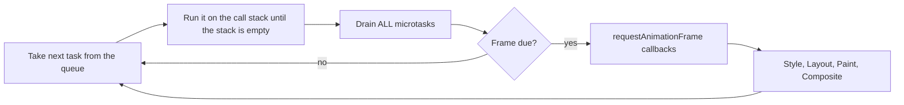
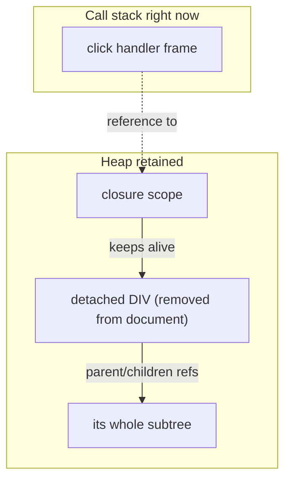
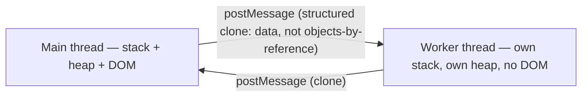

# M18 — The JavaScript runtime: the event loop and memory

M16 explained *when* the browser paints. This module explains the space
your code actually lives in: one call stack, one heap, two kinds of queue,
and a render slot that only opens between them. You asked how JS "va
procesando las cosas" and what the different "espacios de memoria" are and
how they interact — this is that map, framework-independent (the React lore
about "unnecessary renders" is only half of it; the other half — *why the
thread freezes* and *why memory grows* — is here).

> Interactive diagram: [`diagrams/event-loop.html`](../diagrams/event-loop.html) — open it and press Live.

## The concept

**One stack, one heap.** Every JS context (a tab, a worker) has a **call
stack** — the chain of functions currently running, frame on frame, each
frame holding that call's local variables — and a **heap**, the open
storage where objects live. The stack is fast, disciplined and *theater of
the present*: when a frame pops, its locals are gone. The heap is the
*retained past*: an object survives only as long as something still points
at it. Everything hard about frontend memory is a consequence of that
split: a leaked object is not "memory that wasn't freed," it is *a
reference you forgot you kept*.

**The event loop, one turn at a time.** Nothing in JS runs "in parallel"
on the main thread; the loop just takes turns:

- **Macrotasks** (tasks): one each per turn — a click handler, a timer
  callback, an I/O event, a script load. The queue of them is the work the
  *next* turns will do.
- **Microtasks**: the promise continuation queue, drained **completely**
  after each task — including promises you queued *while draining*. This is
  why `async/await` code feels instantaneous between `await`s: it's the
  same task continuing. It is also the **starvation failure mode**: a loop
  that keeps queueing microtasks never lets the browser reach the next
  task — timers freeze, input freezes, the page is technically alive and
  unusable.
- **rAF + the render pipeline** run only after microtasks, and only when a
  frame is due — this is the exact seam M16's budget lives on: the render
  steps *cannot* start until your task and all its microtasks finish. A
  200ms function on click means the button's visual answer waits 200ms,
  the pressed state never appears, and INP (M10) records a fail — that is
  the machine-level reason for M06's <100ms press-response rule.

**Scopes and closures — the stack's ghost.** When a function with a
captured environment survives its call (as a callback, an event listener,
a promise), it keeps its scope alive on the heap: a closure is a reference
pattern, not a place. The professional consequence: a listener attached to
a component's DOM node, captured over the component's props, keeps *all
those objects* alive after the node is removed — the classic **detached
DOM** leak:

Nothing is "stuck in memory" because of the DOM; it is stuck because a
living reference still reaches it. Mark-and-sweep GC follows exactly that
reachability graph — so every leak question is the same question: *who
still references this?* (Listeners, `setInterval` callbacks, growing
module-level `Map` caches, observers never disconnected, setTimeout over a
dead component.)

**The escape hatches from the single thread.** When work legitimately does
not fit a frame: (1) **chunk it** — split the loop across turns with
`scheduler.yield()` (where supported) or `setTimeout(…, 0)`, so input and
rendering interleave between pieces; (2) **idle it** — `requestIdleCallback`
for work that may wait (analytics, prefetch); (3) **move it off-thread** —
a **Web Worker** has its *own stack and its own heap* and no DOM at all;
the boundary is `postMessage`, which **structurally clones** the value
(serialisable data only — functions, DOM nodes and class identity do not
cross; `SharedArrayBuffer` is the deliberate exception, with its own
security requirements):

That clone boundary is why "the worker computes embeddings preview and
sends back numbers" is cheap architecture, and "the worker manages the
DOM" is impossible.

**Node is a different loop — and SvelteKit puts you in both.** The server
that renders your SSR shell is Node: an event loop with the same idea
(one thread, non-blocking I/O) but different phases and no render pipeline
at all. The frontend-relevant consequence is a *memory* rule, not a loop
rule: per-request allocations are freed when the request's references die,
but a module-level mutable in Node outlives every request — it becomes a
**cross-user state leak** (and a scaling ceiling). This is the machine
reason M07 rule 2 ("instantiated per request/per tab, never a module
singleton") is not style but containment; `session.svelte.ts`'s comment is
enforcing a runtime guarantee.

## The reasoning

**Why this literacy pays even when you never tune a loop.** Three
recurring product conversations end in the concepts above: *"why does it
freeze while the graph loads?"* (a long task — one turn over 50ms starves
everything; the fix is always chunking, workers, or less work, never
"make it async"), *"why does the tab eat 2GB after an hour?"* (retained
references — listeners and caches), and *"why do my toast's numbers never
update / why did the user get logged into someone else's tenant?"* (the
per-request module-state rule). Knowing the map turns these from
witch-hunts into named suspects with named tools (the Performance flame
chart's task bars, the Memory panel's heap snapshots with a **retainer
path** — the literal answer to *who still references this*).

**Why async is not the solution to slow.** A common junior move: wrap the
heavy loop in a promise "to make it non-blocking." `await`ing a 200ms
function does not release the thread; it queues its continuation as a
microtask *behind* everything already in the queue. The thread is not the
problem; the task's *length* is. Async reorders work; only chunking or
workers shrink the turn.

## Decision rules

1. **No single task over ~50ms** on the interaction path (hydration,
   search, approve, canvas paint) — measured, not felt; chunk or worker
   what exceeds it (rule-of-M18 for M16's frame budget).
2. **Every `addEventListener` / `setInterval` / observer has its declared
   twin removal** in the component's teardown (`$effect` cleanup in Svelte;
   `onMount` return; a review can grep pairs).
3. **No growing module-level cache without a bound** (max entries or TTL) —
   a `Map` that only grows is a scheduled leak.
4. **Server code holds no per-user mutable module state**; session/request
   data travels by context, never by import-side effects.
5. **Worker use is for data, not DOM**: anything crossing the boundary is
   serialisable; if the design needs DOM-shaped output in a worker, the
   design is wrong (rendering stays M16's strategy).
6. **Microtask hygiene**: no recursive promise chain that never yields a
   task boundary — a loop over many awaits that must stay interruptible
   re-yields with a macrotask every chunk.

## VozLab today

The client runs one main thread that does two heavy things: hydration of
the `(app)` layout (restore + workspace + first data) and SVG graph
painting (`lib/graph/svg/painter.ts` — M16's rule 2 is the same seam).
The Node server renders our shells and proxies auth; the per-request
context discipline (M07) is in place, so rule 4 holds by construction.
The gaps worth a look (exercise 3): listeners in the canvas/inspector
worlds (rule 2 pairs — `SvgGraphCanvas`/`ExplorationCanvas` attach
pointer and resize handlers; whether every one disconnects on unmount is
exactly the kind of thing no test catches), and any module-level cache in
`lib/api` or `lib/state` without a bound (rule 3).

## Exercise

1. Close the module and **redraw mermaid (1) from memory**. Where you
   hesitated — microtasks-before-frame? all of them? — is the exact hole
   the rest of the course's perf rules assume you don't have.
2. DevTools → Memory → take two heap snapshots ten minutes apart while
   navigating the app normally, and compare: click any grown object and
   read its **retainer path**. Find the one thing holding it. This five-
   minute drill is the entire leak-hunting skill in embryo.
3. *Handoff to the cheap model:* "grep `addEventListener`, `setInterval`,
   `requestAnimationFrame`, `new IntersectionObserver` /
   `MutationObserver` / `ResizeObserver` across `apps/web/src/lib` and
   routes; table each call site → its removal counterpart (file:line or
   MISSING) → the object it captures. No changes. Same for module-level
   `Map`/`Set` caches: bound or unbounded."

## Decide

**D26. Long-task discipline for canvas paint + hydration.** (a) inline
chunking (`scheduler.yield`/`setTimeout` splits) wherever a task is over
budget; (b) a worker for heavy computation (graph layout math, diffing
big payloads) behind a serialisable protocol; (c) first measure: a
Performance trace of the two flows (M16 exercise 1's method), and fix only
tasks the trace proves are over 50ms. Recommendation: **(c) then (a)** —
workers (b) are an architecture decision and should be adopted against
data, not against vocabulary; chunking is the repair that costs no new
structure.
