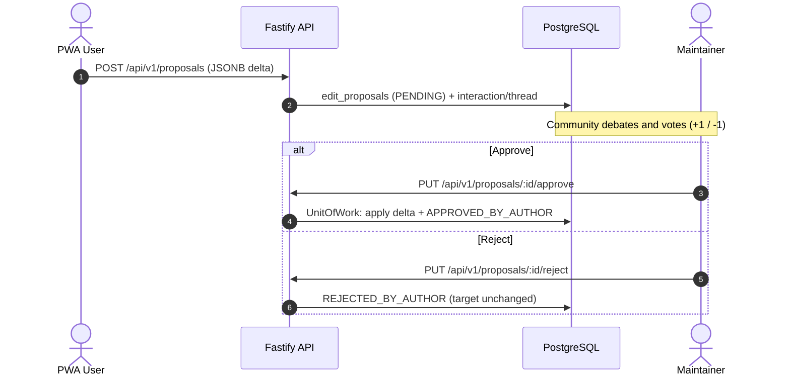

# Requirements

Normative functional (FR) and non-functional (NFR) requirements, the actors they
serve, and the user stories that describe them. The **implementation status** of
every requirement is tracked in the matrix at [docs/README.md](README.md); this
page states *what the system must do*, not what is built. Architecture decisions
are in [docs/decisions/](decisions/); unbuilt components are specified in
[docs/spec/](spec/).

> Status legend (matrix): **Implemented** · **Partial** · **Deferred** ·
> **Unverified**. A requirement can be normative even when its status is
> Deferred.

## 1. Actors

| Actor | Description | Scope | Identity |
| --- | --- | --- | --- |
| **Institutional Administrator** | Manages the institution's workspaces and members. | Tenant | OIDC subject (real identity), admin role |
| **PWA User (common/ally)** | Student, staff or external ally who creates nodes, argues, proposes edits and votes. | Workspace | Opaque pseudonym (`author_hash`) |
| **Maintainer / Author** | Creator of a node, edge or ontology proposal; owns merge/reject rights on it. | Object | Same pseudonym as the creator |
| **Committee / Moderator / Champions** | Elevated role that can unblock proposals and run co-creation workshops. | Workspace / tenant | Pseudonym + moderator/admin role |
| **Agent 1 — Extractor** | Atomic multi-source ingestion worker. | System service | Bot JWT (`AGENT_EXTRACTOR`) |
| **Agent 2 — Relator** | Event-driven semantic evaluator of new nodes. | System service | Bot JWT (`AGENT_RELACIONADOR`) |
| **Relator verdict** | An LLM verdict (`MERGE`/`EDGE`/`INDEPENDENT`) about a new node. | Workspace | Recorded by the Relator; only `EDGE` is applied |
| **Agent 3 — Consolidator** | Scheduled synthesis of dense clusters into opportunities. | System service | Bot JWT (`AGENT_CONSOLIDADOR`) |
| **Embedding utility worker** | Dedicated consumer that turns `NODE_CREATED` into a 768-dimensional vector (not an LLM agent). | System service | Bot JWT (`AGENT_EMBEDDER`, ADR-0020) |

The identity model, guard chain and pseudonym rules are in
[auth-and-tenancy.md](auth-and-tenancy.md).

## 2. Functional requirements

### 2.1 Identity, authentication and multi-tenancy

- **FR-01 — Delegated OIDC/SSO authentication.** The system must authenticate
  institutional users exclusively through external identity providers
  (Microsoft Entra ID / Azure AD, Google Workspace) using OpenID Connect. No
  local passwords are stored. *(Implemented: authorization code + PKCE,
  JWKS/issuer/audience/nonce validation, JIT user upsert; see
  [ADR-0018](decisions/ADR-0018-oidc-jit-hybrid-sessions.md). `db:mint-token`
  remains a local development tool.)*
- **FR-02 — Tenant isolation by OIDC claim.** The backend must determine the
  user's tenant from the signed JWT (`tid`; the docs also allow `iss` as a
  fallback) and validate it against the tenant registry. The registry lives in
  `public.tenants` in the router DB; the internal tenant UUID (`tid`) drives
  physical routing. *(Implemented with the validated `tid` (Entra) or `hd`
  (Google Workspace) claim on login and on every resource request. `iss`-only
  resolution remains unbuilt.)*
- **FR-03 — Anonymous access via event QR code.** The system must allow
  ephemeral sessions for in-person events through an `event_code`, assigning a
  random pseudonym and a signed device token. After the event, new anonymous
  users are blocked, while existing users keep access to follow up on their
  contributions. *(Implemented: global `router.event_codes` registry, atomic
  expiry/capacity/revocation, anonymous user + membership + rotating session.
  The QR scanner UI is part of the PWA.)*
- **FR-04 — Multi-workspace management in a clean URL.** The PWA must keep the
  public URL clean (`app.vozlab.io/`) and keep the workspace context
  (`workspace_id`) isolated in each tab's `sessionStorage`. *(Partial: the
  SvelteKit 5 PWA scaffold exists (roadmap 3.1); the clean URLs and the
  per-tab `sessionStorage` workspace are 3.2 and 3.3.)*
- **FR-05 — Stateless zero-trust validation.** Every request must carry
  `X-Workspace-ID`, and the API must validate membership and permissions on that
  workspace on every request. *(Implemented.)*

### 2.2 Knowledge graph and metamodel

- **FR-06 — Dynamic node creation.** Nodes (Problems, Ideas, Resources) are
  created with a form built dynamically from the active ontology's
  `datatype_properties`. *(Implemented: the API validates `typeKey` against the
  active class. The **attributes** are stored as JSONB and are not validated
  by the API — the client that builds the form validates them against the
  ontology. `GET /api/v1/ontology` exposes the active `datatype_properties`
  that drive the form.)*
- **FR-07 — Maintainer/author assignment.** Every node, edge and ontology
  proposal records its creator's `author_hash`, granting non-waivable maintainer
  rights over that object. *(Implemented.)*
- **FR-08 — Directed edge creation.** Two existing nodes can be connected by a
  typed relationship (`object_properties`), validating domain and range against
  the active ontology. *(Implemented.)*
- **FR-09 — Collaborative dynamic metamodel.** Users can propose new node
  types, edge types and attributes, stored in `meta.*` with `PROPOSED` status
  and usable as local drafts before approval. *(Implemented for classes,
  datatype properties and object properties.)*

### 2.3 Collaborative governance (pull-request flow)

- **FR-10 — Polymorphic edit proposals.** Any authenticated user may propose
  corrections or additions to nodes, edges or ontology classes. The suggestion
  is stored in `public.edit_proposals` as a JSONB delta with `PENDING` status.
  *(Implemented.)*
- **FR-11 — Social linking.** Each edit proposal should open or be linked to a
  thread in `social.discussion_threads` so the community can debate and cast
  informative votes. *(Partial: threads and posts are implemented as separate
  resources; automatic proposal→thread linking is not.)*
- **FR-12 — Maintainer approval/rejection (merge).** The maintainer of the
  object has the exclusive power to approve (`APPROVED_BY_AUTHOR`) or reject
  (`REJECTED_BY_AUTHOR`) a proposal. Approval applies the delta atomically in a
  `UnitOfWork` transaction. *(Implemented.)*
- **FR-13 — Moderator-supervised unlocking.** If a proposal reaches
  `community_score >= +10` and the maintainer stays inactive for more than 14
  days, a moderator/committee member may apply it (`AUTO_APPLIED`).
  *(Implemented as an explicit auto-apply endpoint; the 14-day threshold is
  enforced by the use case.)*

### 2.4 Interaction and co-creation

- **FR-14 — Immutable interaction log.** Every support, rating, comment or
  validation action is recorded in `public.interactions_log`, enforcing one
  active vote per user and target (`unique_user_target_vote`).
  *(Implemented.)*
- **FR-15 — Atomic score update.** Denormalized counters (`upvotes`,
  `downvotes`, `community_score`) update atomically with O(1) latency.
  *(Implemented synchronously; Redis-buffered CQRS is deferred —
  [ADR-0005](decisions/ADR-0005-synchronous-vote-scoring.md).)*
- **FR-16 — Comments and threaded discussions.** Normalized, hierarchical
  threads in `social.discussion_posts`, supporting direct replies and granular
  voting per comment. *(Implemented.)*

### 2.5 AI pipeline (three agents)

- **FR-17 — Agent 1, atomized multi-source ingestion.** The Extractor must
  connect institutional listening channels (surveys, suggestion boxes, meeting
  minutes), homogenize non-confidential records one by one, and create node/edge
  drafts by calling the API. *(Partial: the worker exists — it consumes
  `stream:source_raw`, masks the PII locally, extracts a draft and creates a
  `PENDING` node. **Nothing publishes `stream:source_raw` yet**: the ingestion
  gateway is missing. Contract in [spec/extractor.md](spec/extractor.md).)*
- **FR-18 — Vector embedding generation.** The API must emit a
  `NODE_CREATED` event so the system asynchronously computes the 768-dimensional
  `nomic-embed-text` vector and indexes it in `public.nodes.embedding`
  (pgvector). *(Implemented: [ADR-0020](decisions/ADR-0020-dedicated-embedding-pipeline.md)
  — a dedicated embedder consumes `NODE_CREATED`, calls Ollama and writes the
  vector through the agent-only `PUT /api/v1/nodes/:id/embedding` route. The
  worker is not in Compose/CI yet and pre-existing nodes are not backfilled.)*
- **FR-19 — Agent 2, non-deterministic relationship evaluator.** The Relator
  must compare a new node against the closest active nodes and clusters returned
  by pgvector, and decide whether it merges, needs an edge, or stays
  independent. *(Implemented: the worker exists
  ([ADR-0022](decisions/ADR-0022-relator-neighbour-lookup.md),
  [ADR-0023](decisions/ADR-0023-relator-edge-and-merge-semantics.md)). It reads
  the top-5 neighbours through the API, asks the local LLM and creates `PENDING`
  edges; a `MERGE` verdict is submitted as a merge proposal
  ([ADR-0026](decisions/ADR-0026-merge-contract.md)) that the community
  reviews — the API applies the merge when the proposal is approved.)*
- **FR-20 — Agent 3, opportunity consolidator.** The Consolidator must run
  scheduled analysis of subgraph density and community interactions and publish
  a "Consolidated Improvement Opportunity" for co-creation. *(Worker and
  opportunity endpoint not built; contract in
  [spec/consolidator.md](spec/consolidator.md).)*

## 3. Non-functional requirements

### 3.1 Performance and scale

- **NFR-01 — Subgraph query latency.** Subgraph queries for the PWA (< 200
  nodes) must serve p95 < 30 ms. *(Unverified: the endpoint and indexes exist,
  but no load test measures it.)*
- **NFR-02 — HNSW vector search.** Cosine similarity over 100,000 vectors must
  serve p95 < 20 ms with an HNSW index. *(Partial: vectors are produced and
  the planner uses `idx_nodes_embedding_hnsw` for
  `ORDER BY embedding <=> $1`; the 100k-vector p95 is not measured.)*
- **NFR-03 — HTTP response times.** Mutations (votes, node creation) must serve
  p95 < 15 ms by delegating heavy work to asynchronous workers via Redis
  Streams. *(Unverified.)*
- **NFR-04 — Cursor-based pagination.** All lists must use keyset pagination
  with O(1) performance regardless of volume. *(Implemented.)*

### 3.2 Security and privacy

- **NFR-05 — Zero password storage.** The system must not store or process
  passwords. *(Implemented: delegated identity only.)*
- **NFR-06 — PII anonymization at ingestion.** The Extractor must filter and
  anonymize personally identifiable information before records enter the
  system. *(Partial: the worker masks identifiers locally, before any text
  reaches the model. The name detection is heuristic, and the ingestion
  producer does not exist yet.)*
- **NFR-07 — Pseudonymous traceability.** A user's visible identity in the
  graph is always an opaque `author_hash`, never their name, email or subject
  identifier. The pseudonym is generated randomly per user, stored on
  `auth.users.author_hash`, carried in the JWT and copied to graph rows; the API
  never derives it from identity and there is no salt.
  *(Implemented; see [ADR-0013](decisions/ADR-0013-random-opaque-pseudonym.md).)*
- **NFR-08 — Anti-abuse protection.** Redis-backed rate limiting uses a
  per-actor bucket (pseudonym when authenticated, IP otherwise) plus a coarse
  per-workspace ceiling (`RATE_LIMIT_WORKSPACE_MULTIPLIER`, default 10).
  Reads: 300 req/min per actor; writes: 30 req/min per actor; either bucket over
  its cap rejects the request. *(Implemented.)*

### 3.3 Availability and maintainability

- **NFR-09 — Service availability.** API and PWA must offer 99.9% availability
  during institutional operating hours. *(Unverified; no metrics/tracing or SLA
  monitoring yet.)*
- **NFR-10 — AI-decoupled resilience.** If Ollama or embeddings are offline,
  the API and PWA must keep operating; AI tasks accumulate in Redis Streams and
  are processed when the service returns. *(Partial: publication is
  fire-and-forget with no outbox/retry. The embedder keeps entries pending
  while Ollama is down and recovers them with `XAUTOCLAIM`, but a Redis outage
  still drops events.)*
- **NFR-11 — Strict hexagonal architecture.** Domain, use cases and
  infrastructure must stay decoupled through ports and adapters so databases or
  AI adapters can be swapped without touching business logic.
  *(Implemented; rules in [conventions.md](conventions.md).)*

## 4. User stories

### US-00 — Workspace provisioning and configuration (Tenant Admin)
As an institutional administrator I create and configure a workspace with its
parameters and initial administrators, so faculties or projects keep separate
contexts. Acceptance: session belongs to the active `tid`; `auth.workspaces`
row created with the base ontology; the URL stays clean and the workspace
appears in the PWA selector. *(Admin endpoints not built.)*

### US-01 — Create a node in the graph (PWA User)
As an authenticated user I draft an initiative or report by picking an active
ontology type, so a problem, idea or resource becomes visible. Acceptance: form
fields come from `meta.datatype_properties`; the API stores the node with
`workspace_id` and the creator's `author_hash` (maintainer); `NODE_CREATED` is
published; the PWA updates the subgraph without reload. *(API implemented;
PWA pending. API default status is `PENDING`.)*

### US-02 — Propose a new ontology type or attribute (PWA User)
As a user I suggest a type, edge or attribute that does not exist, so the
platform's expressiveness grows with the debate. Acceptance: stored in `meta.*`
as `PROPOSED`; usable as a local draft; a discussion thread is opened.
*(API implemented for proposals; automatic thread opening is not.)*

### US-03 — Propose an edit on existing content (PWA User)
As a user I propose a correction or addition to someone else's node or edge, so
I improve it without overwriting their work. Acceptance: immutable
`edit_proposals` row with a JSONB delta and `PENDING` status; the maintainer is
notified; the proposal can be debated and voted. *(API implemented; automatic
thread linking and notifications are not.)*

### US-04 — Gamified interaction and co-creation (PWA User)
As a user I support, comment on, rate or complement others' content, so the
community organically prioritizes the best initiatives. Acceptance: immutable
`interactions_log` entry; counters updated atomically in the same transaction;
one active vote per user and target. *(API implemented.)*

### US-05 — Multi-tab workspace navigation (PWA User)
As a user I switch workspace in one tab without affecting other tabs, so I can
work on several projects in parallel. Acceptance: the selection updates
`sessionStorage` for that tab only; subsequent requests send that tab's
`X-Workspace-ID`; the graph re-renders independently. *(PWA pending.)*

### US-06 — Review, merge or reject proposals (Maintainer)
As the maintainer of an object I evaluate edit proposals on my content, so I
accept improvements or reject distortions. Acceptance: approval applies the
delta and sets `APPROVED_BY_AUTHOR` in one transaction
(`PUT /api/v1/proposals/:id/approve`); rejection leaves the object intact and
sets `REJECTED_BY_AUTHOR` (`PUT /api/v1/proposals/:id/reject`); `resolved_by`
and `resolved_at` are recorded. *(Implemented.)*

### US-07 — Atomic ingestion of listening sources (Extractor)
As the Extractor I consume atomic records from surveys, suggestion boxes and
minutes, so key ideas enter the graph homogenized and PII-free. Acceptance:
record-by-record processing with PII filtering; calls
`POST /api/v1/nodes` as a bot; the API validates the workspace ontology and
stores the node as `PENDING`. *(Worker pending; identity contract in
[auth-and-tenancy.md](auth-and-tenancy.md).)*

### US-08 — Semantic evaluation and connection suggestions (Relator)
As the Relator I compare a new node with the closest active nodes and centroids,
so I decide whether it merges, needs an edge, or adds a nuance. Acceptance:
consumes `stream:node_created`; reads the top-5 closest vectors from pgvector
(scoped to the workspace, ignoring deleted/inactive rows); an LLM evaluates
semantics; it proposes a merge or a `PENDING` edge through the API, or leaves
the node independent. *(Worker pending; depends on embeddings, FR-18.)*

### US-09 — Consolidation of improvement opportunities (Consolidator)
As the Consolidator I periodically analyze dense subgraphs and interactions, so
scattered findings become a Consolidated Improvement Opportunity with aggregated
evidence. Acceptance: periodic job; LLM synthesis; publication in the PWA for
community enrichment. *(Worker and publication endpoint pending.)*

## 5. Key flows

### Collaborative edit (governance)

### Ingestion and evaluation (planned)

1. Extractor normalizes one record, masks PII, and `POST /api/v1/nodes` as
   `AGENT_EXTRACTOR`.
2. API validates the ontology, stores the node as `PENDING`, publishes
   `NODE_CREATED` → `stream:node_created`.
3. The dedicated embedder (ADR-0020) computes and stores the vector through the
   agent-only write endpoint.
4. Relator consumes the event, reads the top-5 nearest active nodes through the
   API, asks the LLM, and proposes an edge through the API (a merge verdict is
   recorded, not applied — no merge contract yet).
5. Consolidator runs on a schedule and drafts opportunities; publication in the
   PWA closes the loop.

Steps 3 and 4 work today: `NODE_CREATED` is published, the embedder computes
the vector, the API stores it and the Relator proposes a `PENDING` edge. A
`MERGE` verdict is logged but not applied, and step 5 (Consolidator) has no
implementation yet.

## 6. Traceability

| Requirement | Stories | Code (current) | Tables |
| --- | --- | --- | --- |
| FR-01, FR-02 | US-00, US-05 | `AuthController.ts`, `OidcProviderClient.ts`, `TenantGuard.ts`, `TenantWorkspaceGuard.ts` | router `public.tenants`; tenant `auth.users`, `auth.refresh_tokens` |
| FR-03 | — | `JoinEventUseCase.ts`, `RouterDatabaseClient.ts` | router `public.event_codes`; tenant `auth.users` (`ANONYMOUS_EVENT`), `auth.workspace_memberships` |
| FR-05 | US-01..06 | `TenantWorkspaceGuard.ts` | `auth.workspace_memberships` |
| FR-06, FR-07 | US-01 | `CreateNodeUseCase.ts` | `public.nodes`, `meta.*` |
| FR-08 | US-01 | `CreateEdgeUseCase.ts` | `public.edges`, `meta.object_properties` |
| FR-09 | US-02 | `CreateOntology*UseCase.ts`, `ApproveProposalUseCase.ts` | `meta.*` |
| FR-10, FR-12 | US-03, US-06 | `CreateProposalUseCase.ts`, `Approve/RejectProposalUseCase.ts` | `public.edit_proposals` |
| FR-11 | US-03, US-04 | `discussions` vertical | `social.discussion_threads`, `discussion_posts` |
| FR-13 | US-06 | `AutoApplyProposalUseCase.ts` | `public.edit_proposals` |
| FR-14, FR-15 | US-04 | `CastVoteUseCase.ts` | `public.interactions_log`, counters |
| FR-16 | US-04 | `discussions` vertical | `social.discussion_posts` |
| FR-17 | US-07 | `apps/worker-extractor`; `ResolveSourceUseCase.ts`; ADR-0024, ADR-0025 | `meta.data_sources` |
| FR-18 | US-01, US-08 | `CreateNodeUseCase.ts` (publishes), `SetNodeEmbeddingUseCase.ts`, ADR-0020, `apps/worker-embedder` | `public.nodes.embedding` |
| FR-19 | US-08 | `apps/worker-relacionador`; `GetNodeNeighborsUseCase.ts`; ADR-0022, ADR-0023, ADR-0026 | `public.edges`, `edit_proposals` |
| FR-20 | US-09 | *(planned)* `apps/worker-consolidador`; `packages/worker-shared` (runtime) | `public.nodes`, `social.*` |
