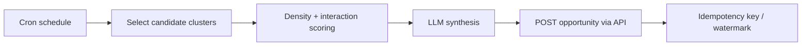

# Consolidator Worker (`worker-consolidador`)

> **Not implemented (Phase 2).** `apps/worker-consolidador/` is an empty
> scaffold. There is no scheduler, package, Dockerfile or API endpoint for
> opportunities. This page records the intended design and open decisions.

The Consolidator is Agent 3: a scheduled, idempotent worker that finds dense
clusters of related nodes and high-interaction discussions, synthesizes them
into a **Consolidated Improvement Opportunity**, and publishes it through the
Fastify API. It never writes to PostgreSQL directly.

## Inputs

| Input | Source | Purpose |
| --- | --- | --- |
| Nodes and edges | Tenant DB (`public.nodes`, `public.edges`) | Detect dense subgraphs; ignore `deleted_at IS NOT NULL` and inactive statuses. |
| Votes | `public.interactions_log` | Measure community support. |
| Discussions | `social.discussion_threads`, `social.discussion_posts` | Add qualitative evidence and participation signal. |
| Ontology | `meta.ontology_classes`, properties | Label the opportunity and its evidence consistently. |

The current read path for bounded subgraphs is a SQL recursive CTE, not the AGE
adapter (AGE graph mirroring is not implemented). The Consolidator may use SQL
or, once available, Cypher over `vozlab_graph`; it must apply the same workspace
and soft-delete filters.

## Flow

1. **Schedule.** Run on a cron-like interval (batch, not per-event).
2. **Select.** Find clusters above a density/interaction threshold, scoped to
   one workspace. Skip clusters already consolidated at the same watermark.
3. **Synthesize.** Ask Ollama for a title, problem statement, affected actors,
   evidence links and a proposed opportunity, using only retrieved node/post
   ids as citations.
4. **Publish.** Submit the opportunity to the API as a system agent.
5. **Record progress.** Persist the processed cluster/watermark so a re-run is
   idempotent. No such state table exists yet.

## Output contract (proposed)

`POST /api/v1/opportunities` does **not** exist, and the opportunity model is
undefined. A minimal payload would carry `workspaceId` (from the header),
`title`, `summary`, `evidence` (node/thread ids), `clusterKey`, and an
idempotency key.

Until the endpoint and table exist, the worker has no legal write path. Do not
insert into graph tables or reuse edit proposals as a substitute.

## Identity and tenancy

- Agent JWT: `type: "AGENT_CONSOLIDADOR"`, `sub`, `tid`, `jti`, `authorHash`.
- Required headers: `Authorization: Bearer <jwt>`, `X-Workspace-ID`,
  `x-correlation-id`.
- One run processes one workspace at a time; cross-workspace aggregation is
  forbidden.
- Read-only DB credentials; all writes go through the API.

## Idempotency and resilience

- The same cluster + watermark must not produce a second opportunity.
- A failed LLM/API call must leave the watermark unchanged and retry next run.
- Partial output must never be published; validate the LLM JSON and evidence
  ids first.
- Bound runtime and concurrency; a slow Ollama call should not overlap runs.
- Emit a run summary log with counts and `reqId`/run id.

## Open design questions

- Cluster definition and scoring: connected component vs. density/community
  detection; which interactions qualify (upvotes, comments, participants,
  recency).
- Opportunity data model, lifecycle/governance, API route, DTO and pagination.
- Idempotency key and watermark storage; evidence citation format in the PWA.
- Schedule cadence, per-tenant fairness, LLM prompt/model and cost limits.

## Phase 2 acceptance criteria

- [ ] Runs on a schedule and is idempotent per cluster/watermark.
- [ ] Uses workspace-scoped, soft-delete-aware queries for nodes, edges and
  interactions.
- [ ] Synthesizes an opportunity with verifiable evidence ids.
- [ ] Publishes through the API only; no direct DB writes.
- [ ] Handles Ollama/API failures without losing the run state.

## Related

- [relator.md](relator.md) — relationship evaluation.
- [architecture.md](../architecture.md) — Agent 3 topology.
- [domain-model.md](../domain-model.md) — graph and interaction tables.
- [requirements.md](../requirements.md) — FR-20 and NFRs.
