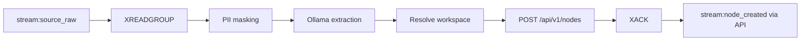

# Extractor Worker (`worker-extractor`)

> **Implemented (milestone 2.3), with one documented gap.** The worker lives in
> `apps/worker-extractor/`: it consumes `stream:source_raw` with its own group
> `extractor`, masks the PII locally, asks the local LLM for a draft node and
> creates it through the API. The **producer** of `stream:source_raw` — the
> ingestion gateway — does not exist yet: records are published by an external
> connector or by hand. The worker also resolves the source *before* the
> extraction, so an unknown source is dead-lettered without paying for an LLM
> call.

The Extractor is Agent 1: it turns heterogeneous institutional records
(surveys, suggestion boxes, meeting minutes, open comments) into draft nodes
through the Fastify API. It never writes to PostgreSQL directly.

## Responsibilities

- Consume raw records from Redis Streams (webhook/batch ingestion).
- Mask PII **before** any text leaves the worker for Ollama (NFR-06).
- Call a local LLM to extract a title, description, attributes and ontology key.
- Resolve the target workspace through the API-owned source registry.
- Create nodes with `POST /api/v1/nodes` as a system agent.
- Acknowledge the stream entry only after the API call succeeds.

## Current status

| Component | Status |
| --- | --- |
| Worker process / Python package | **Implemented** (`apps/worker-extractor`) |
| `stream:source_raw` consumer | Implemented (group `extractor`) |
| `stream:source_raw` producer (ingestion gateway) | **Missing**: nothing publishes records yet; a connector or an operator does |
| PII sanitizer | **Implemented** (rule-based, local; heuristic on personal names) |
| Ollama extraction | Implemented (strict JSON, validated) |
| `meta.data_sources` registry + resolution route | **Implemented** (registry + agent-only route, ADR-0025); no management route yet |
| Batch node endpoint | Does not exist, and will not: one node per request ([ADR-0024](../decisions/ADR-0024-no-batch-node-endpoint.md)) |
| Root-entity cache / dedup | Best-effort title guard only; the real dedup is Phase 2 |
| API `POST /api/v1/nodes` | Implemented and usable |

## Input: `RawSourceRecord`

The envelope is defined in `@vozlab/shared-types` as
`RawSourceRecordSchema`. The planned queue is `stream:source_raw`.

| Wire field | Type | Notes |
| --- | --- | --- |
| `sourceId` | string | External source identifier. |
| `connectorType` | enum | `MINUTES`, `SURVEY`, `INBOX`, `OPEN_COMMENT`. |
| `channelName` | string | Human-readable channel label; copied into attributes. |
| `rawContent` | string | Original non-confidential text. |

There is **no `workspaceId`** in the envelope. The API owns the mapping from
`sourceId` to workspace (`meta.data_sources`); workers never choose a workspace
from untrusted payload data. The resolution route
`GET /api/v1/ingestion/resolve-source` exists and is agent-only
([ADR-0025](../decisions/ADR-0025-source-resolution-route.md)); it takes no
`X-Workspace-ID` header, because the workspace is its answer.

> **Naming mismatch:** the canonical Zod contract is **camelCase**
> (`sourceId`, `connectorType`, `channelName`, `rawContent`). The Python
> examples in the old module docs use snake_case. On the wire, camelCase wins:
> use Pydantic aliases (`Field(alias="sourceId")`) or explicitly convert. Do not
> assume the queue stores snake_case.

Connector behavior profiles are `BATCH` (surveys, large comment sets) and
`STREAM` (minutes, live channels). One worker codebase handles all connector
types.

## Processing pipeline



1. **Consume.** `XREADGROUP` with a consumer group; do not `XACK` before the
   node has been accepted by the API. Unacknowledged entries stay in the PEL.
2. **Sanitize.** Replace names, emails, national IDs and similar identifiers
   with `[MASKED]`. Masking must happen locally, before the Ollama request.
   The implementation is rule-based: emails, phone numbers, long digit runs
   and id-like groups are masked reliably; personal names are detected
   heuristically (two or more capitalised words that are not institutional
   terms), so a name that looks like a common noun survives. Over-masking
   costs a little context, under-masking would leak personal data.
3. **Extract.** Ask the LLM for strict structured output: `title`,
   `description`, `attributes`, `typeKey`. The default ontology key is
   `Problem`; `typeKey` must exist and be `ACTIVE` in the target workspace or
   the API returns `422 ERR_VALIDATION_FAILED` (FR-06). A title the model did
   not produce falls back to the masked text; a `typeKey` the workspace does
   not have falls back to the default class.
4. **Resolve workspace.** Obtain the target workspace and authorization
   context from the API registry. The payload does not carry it. The worker
   resolves the source **before** the extraction, so an unknown source is
   dead-lettered without an LLM call.
5. **Publish.** Call `POST /api/v1/nodes`; the node is born `PENDING`.
6. **Acknowledge.** `XACK` only after a `201` response. Retry transient API or
   Ollama failures with backoff.

The Redis root-entity cache and semantic dedup are Phase 2 enhancements, not
part of the ingestion contract. They may reuse UUIDs for known faculties or
actors, but must not become a second source of truth.

## Output contract

`POST /api/v1/nodes` body:

```json
{
  "typeKey": "Problem",
  "title": "Short extracted title",
  "description": "Neutral synthesis of the record",
  "attributes": { "source_channel": "meeting-minutes" }
}
```

Required headers:

| Header | Value |
| --- | --- |
| `Authorization` | `Bearer <agent JWT>` |
| `X-Workspace-ID` | Target workspace UUID |
| `x-correlation-id` | Trace id, propagated from the stream entry |
| `content-type` | `application/json` |

Agent JWT claims: `sub` (seeded system-agent user), `tid` (must resolve in the
router DB), `jti`, `authorHash`, and `type: "AGENT_EXTRACTOR"`. Agents skip
workspace membership checks but are still workspace-scoped by the header.
There is no API key and no author salt.

### Batch ingestion is not available

`BatchCreateNodeSchema` exists as a contract only: `{ nodes: [1..1000] }`.
There is no batch route, and that is a decision: the rate limiter counts
requests, so a bulk route would bypass the per-actor write budget
([ADR-0024](../decisions/ADR-0024-no-batch-node-endpoint.md)). The worker
posts one node per request and respects the write limit (30 writes/minute per
actor by default; agents are actors too).

## Minimal Python shape

```python
from pydantic import BaseModel, ConfigDict, Field

class RawSourceRecord(BaseModel):
    model_config = ConfigDict(populate_by_name=True)
    source_id: str = Field(alias="sourceId")
    connector_type: str = Field(alias="connectorType")
    channel_name: str = Field(alias="channelName")
    raw_content: str = Field(alias="rawContent")

class ExtractedNodePayload(BaseModel):
    model_config = ConfigDict(populate_by_name=True)
    type_key: str = Field(default="Problem", alias="typeKey")
    title: str
    description: str
    attributes: dict
```

Send `payload.model_dump(by_alias=True)` so the API receives `typeKey`.

## Resilience and open questions

- Use a consumer group and `XAUTOCLAIM`/`XCLAIM` to recover entries from dead
  consumers; bound retries and define a dead-letter policy (none exists).
- Define an idempotency key so a retry after a timed-out `201` does not create a
  duplicate node. No server-side idempotency key exists today.
- Decide whether an AWS API Gateway + Lambda ingestion front door is adopted.
  It is an **open option**, not a decision; Redis Streams is the current plan.
- Production agent credential issuance/rotation beyond an injected or mounted
  token remains open. The dev minting path and runtime token providers are
  defined in [ADR-0021](../decisions/ADR-0021-python-worker-runtime.md).
- Confirm the final `attributes` vocabulary per node type with the ontology.

## Phase 2 acceptance criteria

- [ ] Reads `stream:source_raw` with `XREADGROUP` and `XACK`s only on success.
- [ ] Masks PII before every Ollama call.
- [ ] Returns a validated `ExtractedNodePayload` (default `Problem`).
- [ ] Sends agent JWT, `X-Workspace-ID` and `x-correlation-id`.
- [ ] Creates nodes only through the API, never with direct SQL.
- [ ] Recovers pending entries and retries without duplicating nodes.

## Related

- [architecture.md](../architecture.md) — agent topology.
- [domain-model.md](../domain-model.md) — node/ontology shapes.
- [auth-and-tenancy.md](../auth-and-tenancy.md) — agent identity and workspace
  isolation.
- [api-reference.md](../api-reference.md) — `POST /api/v1/nodes` and errors.
- [relator.md](relator.md) — downstream consumer of `stream:node_created`.
- [ADR-0021](../decisions/ADR-0021-python-worker-runtime.md) — shared Python
  runtime and consumer-group conventions.
- [ADR-0025](../decisions/ADR-0025-source-resolution-route.md) — the
  resolution route the worker calls.
- [ADR-0024](../decisions/ADR-0024-no-batch-node-endpoint.md) — why ingestion
  stays one node per request.
