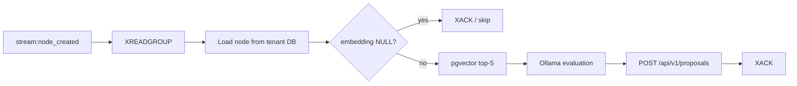

# Relator Worker (`worker-relacionador`)

> **Not implemented (Phase 2).** `apps/worker-relacionador/` is an empty
> scaffold: no Python package, source, Dockerfile or tests. This page defines
> the intended behavior; nothing here runs today.

The Relator is Agent 2: when a node is created, it finds semantically close
nodes in the same workspace, asks a local LLM whether the new node should be
merged, related or kept independent, and submits a **proposal** through the
API. It never creates edges or mutates nodes directly.

## Responsibilities

- Consume `stream:node_created` with a Redis consumer group.
- Read the new node and run a pgvector cosine search (`<=>`) scoped to its
  workspace, top 5 neighbors.
- Evaluate the candidate relationship with Ollama.
- Submit an `EDGE_PROPOSAL`, merge proposal, or no action via
  `POST /api/v1/proposals`.
- Acknowledge only after the API accepts the proposal; recover the PEL on
  failure.

## Trigger event

The API publishes `NODE_CREATED` after the node transaction commits; the
publisher maps it to **`stream:node_created`** (not `node:created`).

| Field | Meaning |
| --- | --- |
| `reqId` | Correlation id from the originating request. |
| `nodeId` | New node UUID. |
| `workspaceId` | Workspace scope for the search. |
| `typeKey` | Ontology key, e.g. `Problem`. |
| `title` | Node title (context only). |

The event is intentionally small. The worker loads description, status and
embedding from the tenant database, then uses the tenant DB **read-only** for
the vector query.

## Current blockers

| Dependency | Status |
| --- | --- |
| `stream:node_created` producer | Implemented |
| Consumer / consumer group | Not implemented |
| Embedding computation (FR-18) | **Missing**: nothing writes `nodes.embedding`; the column stays `NULL` |
| HNSW index | Present on `public.nodes.embedding` |
| Proposal API for new edges | Partial: `POST /api/v1/proposals` is edit-only today |
| Active cluster centroids | Not modelled; not part of the Phase 2 scope below |

Because no embedding is produced, the vector query currently returns zero rows.
A Relator implementation must either wait for the embedding worker/step or
explicitly skip nodes with `embedding IS NULL`. FR-18 is **Partial**, not done.

## Evaluation flow



### 1. Vector search

Use cosine distance (`<=>`) with a strict workspace filter. The HNSW index
`idx_nodes_embedding_hnsw` uses `vector_cosine_ops`.

```sql
SELECT id, title, description,
       1 - (embedding <=> $1::vector) AS similarity
FROM public.nodes
WHERE workspace_id = $2
  AND id <> $3
  AND embedding IS NOT NULL
  AND deleted_at IS NULL
  AND status IN ('ACTIVE', 'PENDING')
ORDER BY embedding <=> $1::vector
LIMIT 5;
```

`deleted_at IS NULL` and a status allow-list are mandatory. Without them the
worker proposes relationships to soft-deleted, rejected, merged or deprecated
nodes. Whether `PENDING` nodes are eligible is an open product decision; at
minimum exclude `REJECTED`, `MERGED` and `DEPRECATED`.

The query must stay workspace-scoped even though the event is trusted. Cross-
workspace neighbors are a data leak, not a ranking detail.

### 2. LLM evaluation

Send the new node plus the five neighbors (titles, descriptions, similarity) to
Ollama. Require strict JSON:

```json
{
  "action": "MERGE | EDGE | INDEPENDENT",
  "target_id": "uuid or null",
  "relation_key": "RELATES_TO or null",
  "reason": "short explanation"
}
```

Reject malformed or hallucinated targets before calling the API: `target_id`
must be one of the retrieved neighbor ids. `relation_key` must exist in the
workspace ontology; `RELATES_TO` is seeded from `Problem` to `Idea`.

### 3. Action dispatch

| LLM action | Intended effect |
| --- | --- |
| `EDGE` | Create a `PENDING` edge proposal between the two nodes. |
| `MERGE` | Propose that the new node be merged into the target. |
| `INDEPENDENT` | No write; optionally record the evaluation for tuning. |

Always use `POST /api/v1/proposals`; never insert into `public.edges`,
`public.nodes` or `public.edit_proposals`. The API applies governance, ontology
validation, workspace checks and the `PENDING` state.

> **API gap:** the current `CreateProposalSchema` is an *edit* proposal:
> `targetId` must identify an existing node/edge/ontology class and
> `proposedChanges` is a delta. It cannot express "create a new edge A→B" or a
> merge target without extending the contract. Phase 2 must decide between
> adding an edge-creation proposal type or using `POST /api/v1/edges` (which
> already creates a `PENDING` edge). The Relator must not work around this with
> direct DB writes.

### 4. Agent identity

Mint/issue an agent JWT with `type: "AGENT_RELACIONADOR"`, `sub`, `tid`, `jti`
and `authorHash`. Every proposal request carries:

```http
Authorization: Bearer <agent JWT>
X-Workspace-ID: <workspace uuid>
x-correlation-id: <reqId from the stream event>
Content-Type: application/json
```

## PEL, retries and idempotency

- Read with `XREADGROUP`; `XACK` only after a `2xx` from the API.
- On a crash, entries remain in the Pending Entries List. Recover them with
  `XAUTOCLAIM` (or `XCLAIM`) after an idle threshold; they are **not** assigned
  automatically just because a consumer restarted.
- Retry transient DB/Ollama/API failures with capped exponential backoff.
  Leave the entry pending when Ollama is down; the API must stay available
  (NFR-10).
- Bound attempts and define a dead-letter stream or quarantine key. Neither
  exists today.
- Deduplicate retries: the same `nodeId` + `targetId` + action must not create
  duplicate proposals after a timed-out response. No server-side idempotency
  key exists yet.

Keep the LLM context bounded (top 5, short descriptions) to control latency and
cost. The old target was under ~1.2 s per node, excluding queueing.

## Phase 2 acceptance criteria

- [ ] Consumes `stream:node_created` with a consumer group and recovers the PEL.
- [ ] Runs `<=>` search filtered by `workspace_id`, `deleted_at IS NULL`,
  status allow-list and `embedding IS NOT NULL`; limit 5.
- [ ] Skips or queues nodes without an embedding instead of failing.
- [ ] Validates LLM JSON and target ids.
- [ ] Submits only through `POST /api/v1/proposals`; no direct writes.
- [ ] Carries agent JWT, `X-Workspace-ID` and `x-correlation-id`.
- [ ] `XACK`s only after success and deduplicates retries.

## Related

- [extractor.md](extractor.md) — upstream node producer.
- [consolidator.md](consolidator.md) — downstream cluster synthesis.
- [architecture.md](../architecture.md) — event flow.
- [api-reference.md](../api-reference.md) — proposal contract.
- [auth-and-tenancy.md](../auth-and-tenancy.md) — agent identity.
