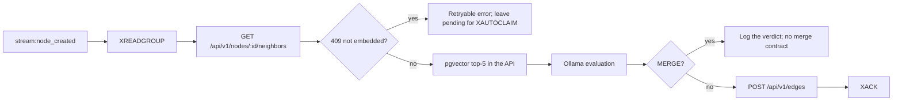

# Relator Worker (`worker-relacionador`)

> **Implemented (milestone 2.5), with two documented deviations.** The worker
> lives in `apps/worker-relacionador/` and runs against the shared runtime
> (`packages/worker-shared`, ADR-0021). It reads its neighbours through the
> API instead of the tenant database ([ADR-0022](../decisions/ADR-0022-relator-neighbour-lookup.md))
> and creates `PENDING` edges through `POST /api/v1/edges` instead of the
> proposal API ([ADR-0023](../decisions/ADR-0023-relator-edge-and-merge-semantics.md)).
> A `MERGE` verdict is submitted as a **merge proposal**
> ([ADR-0026](../decisions/ADR-0026-merge-contract.md)), so it is reviewed by
> the community instead of being applied by the bot.
> The worker runs in the `workers` Compose profile and its tests are a CI job
> (milestone 2.7).

The Relator is Agent 2: when a node is created, it finds semantically close
nodes in the same workspace, asks a local LLM whether the new node should be
merged, related or kept independent, and submits a **proposal** through the
API. It never creates edges or mutates nodes directly.

## Responsibilities

- Consume `stream:node_created` with a Redis consumer group.
- Read the new node and run a pgvector cosine search (`<=>`) scoped to its
  workspace, top 5 neighbors.
- Evaluate the candidate relationship with Ollama.
- Submit an `EDGE_PROPOSAL`, merge proposal, or no action via
  `POST /api/v1/proposals`.
- Acknowledge only after the API accepts the proposal; recover the PEL on
  failure.

## Trigger event

The API publishes `NODE_CREATED` after the node transaction commits; the
publisher maps it to **`stream:node_created`** (not `node:created`).

| Field | Meaning |
| --- | --- |
| `reqId` | Correlation id from the originating request. |
| `nodeId` | New node UUID. |
| `workspaceId` | Workspace scope for the search. |
| `typeKey` | Ontology key, e.g. `Problem`. |
| `title` | Node title (context only). |

The event is intentionally small. The worker asks the API for the node and
its neighbours (`GET /api/v1/nodes/:id/neighbors`); the API owns the tenant
database and the vector query (ADR-0022).

## Current blockers

| Dependency | Status |
| --- | --- |
| `stream:node_created` producer | Implemented |
| Consumer runtime (groups, `XAUTOCLAIM`, DLQ) | Implemented in `packages/worker-shared`; the Relator uses group `relator` |
| Embedding computation (FR-18) | **Implemented**: the dedicated embedder stores the vector through `PUT /api/v1/nodes/:id/embedding`; nodes created before it ran keep a `NULL` embedding |
| Neighbour lookup | **Implemented**: `GET /api/v1/nodes/:id/neighbors` (ADR-0022) |
| HNSW index | Present on `public.nodes.embedding` and used by the planner for `ORDER BY embedding <=> $1` |
| Edge proposal | **Implemented**: `POST /api/v1/edges` creates a `PENDING` edge (ADR-0023) |
| Merge proposal | **Implemented**: `POST /api/v1/proposals` with `kind: "MERGE"` (ADR-0026); the API applies the merge when the proposal is approved |
| Active cluster centroids | Not modelled; not part of the Phase 2 scope below |

ADR-0020 requires the Relator to **leave the entry pending and retry** when
the vector is not ready. The API makes that explicit: the neighbour lookup
answers `409 ERR_NODE_NOT_EMBEDDED`, the worker treats it as retryable and
the entry stays in the PEL until the embedder has written the vector. After
the bounded attempts the shared runtime moves it to `stream:node_created:dead`
for inspection.

## Evaluation flow



The vector search itself runs inside the API (ADR-0022): the worker never
opens a tenant database connection, so the workspace, soft-delete and status
filters exist in exactly one place.

### 1. Vector search

The search runs **inside the API** (ADR-0022). The worker calls
`GET /api/v1/nodes/:id/neighbors?limit=5`; the API loads the source node, uses
its own vector as the query and returns the closest nodes of the workspace.

Under the hood it is cosine distance (`<=>`) with a strict workspace filter;
the HNSW index `idx_nodes_embedding_hnsw` uses `vector_cosine_ops`.

```sql
SELECT id, title, description,
       1 - (embedding <=> $1::vector) AS similarity
FROM public.nodes
WHERE workspace_id = $2
  AND id <> $3
  AND embedding IS NOT NULL
  AND deleted_at IS NULL
  AND status IN ('ACTIVE', 'PENDING')
ORDER BY embedding <=> $1::vector
LIMIT 5;
```

`deleted_at IS NULL` and a status allow-list are mandatory. Without them the
worker proposes relationships to soft-deleted, rejected, merged or deprecated
nodes. `PENDING` nodes are eligible (a freshly created node is `PENDING`);
`REJECTED`, `MERGED` and `DEPRECATED` are not.

The query stays workspace-scoped even though the event is trusted. Cross-
workspace neighbours are a data leak, not a ranking detail.

### 2. LLM evaluation

Send the new node plus the neighbours (titles, descriptions, similarity) to
Ollama with `format: "json"`. Require strict JSON:

```json
{
  "action": "MERGE | EDGE | INDEPENDENT",
  "targetId": "uuid or null",
  "reason": "short explanation"
}
```

Reject malformed or hallucinated targets before calling the API: `targetId`
must be one of the retrieved neighbour ids. A hallucinated target is a
retryable model failure (the entry stays pending and ends in the dead-letter
stream), never a write.

### 3. Action dispatch

| LLM action | Effect |
| --- | --- |
| `EDGE` | Create a `PENDING` edge through `POST /api/v1/edges` (ADR-0023). The `relationKey` is taken from the workspace ontology: an active object property whose domain matches the source class and whose range matches the target class (or the reverse for a symmetric property). No match → no edge. |
| `MERGE` | Submit a merge proposal through `POST /api/v1/proposals` with `kind: "MERGE"`, the new node as `targetId` and the neighbour as `proposedChanges.mergeIntoNodeId` (ADR-0026). The API applies the merge only when the proposal is approved; a `409` answer means a merge proposal is already pending for that node. |
| `INDEPENDENT` | No write; the verdict is logged. |

The worker never inserts into `public.edges`, `public.nodes` or
`public.edit_proposals`. The API applies governance, ontology validation,
workspace checks and the `PENDING` state.

> **API note:** the proposal contract is a union on `kind` (`EDIT` | `MERGE`,
> ADR-0026). `EDIT` is an attribute delta applied to the target; `MERGE` names
> the surviving node and is applied by the API when the proposal is approved
> (the duplicate becomes `MERGED`, the survivor adopts what it can and the
> duplicate's edges are re-pointed). The Relator must not work around this
> with direct DB writes.

### 4. Agent identity

Mint/issue an agent JWT with `type: "AGENT_RELACIONADOR"`, `sub`, `tid`, `jti`
and `authorHash`. Every proposal request carries:

```http
Authorization: Bearer <agent JWT>
X-Workspace-ID: <workspace uuid>
x-correlation-id: <reqId from the stream event>
Content-Type: application/json
```

## PEL, retries and idempotency

- Read with `XREADGROUP`; `XACK` only after a `2xx` from the API.
- On a crash, entries remain in the Pending Entries List. Recover them with
  `XAUTOCLAIM` (or `XCLAIM`) after an idle threshold; they are **not** assigned
  automatically just because a consumer restarted.
- Retry transient DB/Ollama/API failures with capped exponential backoff.
  Leave the entry pending when Ollama is down; the API must stay available
  (NFR-10).
- Bound attempts and use the shared dead-letter stream
  (`stream:node_created:dead` by default). The runtime implements this; the
  Relator handler selects the retryable/permanent classification.
- Deduplicate retries: the same `nodeId` + `targetId` + action must not create
  duplicate edges after a timed-out response. The worker checks the existing
  edges of the workspace before creating one — a best-effort guard, because
  there is no server-side idempotency key yet. The `POST` itself is never
  retried at the HTTP level, because a POST is not idempotent.

Keep the LLM context bounded (top 5, short descriptions) to control latency and
cost. The old target was under ~1.2 s per node, excluding queueing.

## Phase 2 acceptance criteria

- [x] Consumes `stream:node_created` with a consumer group and recovers the PEL.
      The group name must differ from the embedder's (`relator` vs
      `embedder`) so both workers see every event.
- [x] Runs the `<=>` search filtered by `workspace_id`, `deleted_at IS NULL`,
  status allow-list and `embedding IS NOT NULL`; limit 5 — inside the API
  (ADR-0022).
- [x] Queues/retries nodes without an embedding (leaves them pending); never
  acknowledges and silently skips them.
- [x] Validates LLM JSON and target ids.
- [x] Submits only through the public API (`GET /neighbors`, `GET /ontology`,
  `GET /edges`, `POST /edges`, `POST /proposals`); no direct writes.
- [x] Carries agent JWT, `X-Workspace-ID` and `x-correlation-id`.
- [x] `XACK`s only after success and deduplicates retries.
- [x] Submits a merge as a `MERGE` proposal (ADR-0026); the API applies it
      when the community approves it.

## Related

- [extractor.md](extractor.md) — upstream node producer.
- [consolidator.md](consolidator.md) — downstream cluster synthesis.
- [architecture.md](../architecture.md) — event flow.
- [api-reference.md](../api-reference.md) — proposal contract.
- [auth-and-tenancy.md](../auth-and-tenancy.md) — agent identity.
- [ADR-0020](../decisions/ADR-0020-dedicated-embedding-pipeline.md) — embedding
  handoff and write-back.
- [ADR-0021](../decisions/ADR-0021-python-worker-runtime.md) — shared consumer
  runtime.
- [ADR-0022](../decisions/ADR-0022-relator-neighbour-lookup.md) — why the
  vector search lives in the API.
- [ADR-0023](../decisions/ADR-0023-relator-edge-and-merge-semantics.md) — edge
  proposals and the deferred merge.
- [ADR-0026](../decisions/ADR-0026-merge-contract.md) — the merge contract the
  `MERGE` verdict now submits.
