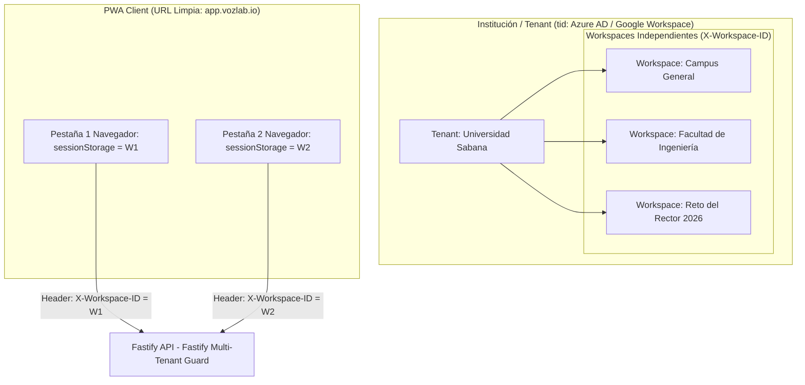
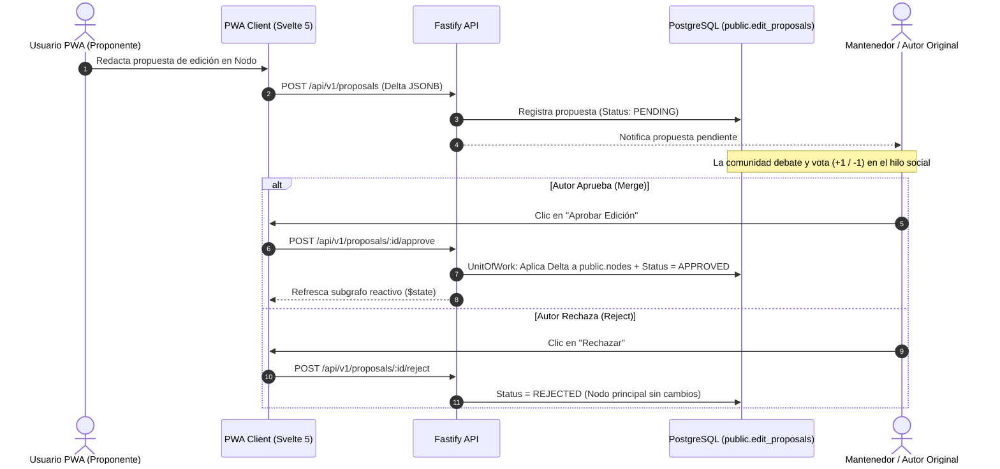
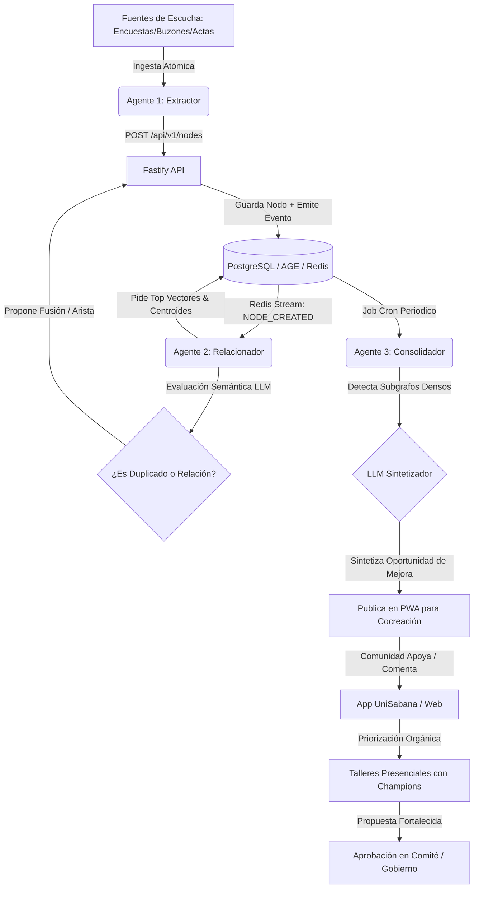

# 02. ESPECIFICACIÓN DE CASOS DE USO Y ACTORES

## 1. Mapeo de Actores del Sistema y Modelo de Identidad

| Actor | Descripción | Nivel de Acceso y Contexto | Tipo de Identidad |
| --- | --- | --- | --- |
| **Administrador Institucional (Tenant Admin)** | Administrador de la Universidad/Institución. Gestiona los Workspaces del Tenant (`tid`) y miembros. | Global del Tenant (`tid`). | Nombre/Correo autenticado vía OIDC/SSO (Azure AD / Google). |
| **Usuario PWA (Común / Aliado)** | Estudiante, docente, administrativo o aliado externo. Crea nodos, argumenta, propone ediciones y participa en discusiones. | Específico por Workspace (`X-Workspace-ID`). | Pseudónima (`author_hash` derivado de la sesión SSO o token anónimo). |
| **Mantenedor / Autor** | Usuario que creó un Nodo, Arista o Propuesta de Ontología específico. Actúa como dueño/responsable del "Pull Request". | Ámbito del objeto en el Workspace. | Pseudónima (`author_hash` coincidente con el creador del objeto). |
| **Comité / Moderador / Champions** | Rol institucional supervisado y Champions institucionales para destrabar propuestas o participar en talleres de cocreación. | Específico por Workspace / Tenant. | Pseudónima con privilegios elevados (`ROLE_ADMIN` / `ROLE_MODERATOR`). |
| **Agente 1: Extractor (IA)** | Servicio de ingesta atómica multi-fuente que lee canales universitarios y crea borradores de Nodos vía API. | Servicio de Sistema (`apps/worker-extractor`). | Bot de Sistema (`AGENT_EXTRACTOR`). |
| **Agente 2: Relacionador (IA)** | Servicio event-driven que evalúa cualitativamente la relación de nuevos nodos contra clusters y nodos cercanos. | Servicio de Sistema (`apps/worker-relacionador`). | Bot de Sistema (`AGENT_RELACIONADOR`). |
| **Agente 3: Consolidador (IA)** | Servicio scheduled/cron que analiza clusters densos y redacta Oportunidades de Mejora Consolidadas. | Servicio de Sistema (`apps/worker-consolidador`). | Bot de Sistema (`AGENT_CONSOLIDADOR`). |

---

## 2. Definición de Contextos y Jerarquía Multi-Tenant

1. **Aislamiento por Tenant (`tid` / OIDC Claim):**
* Cada institución cliente tiene una instancia provisionada cuyo Tenant ID (`tid`) se extrae de la delegación OIDC/SSO. No existen contraseñas locales.

2. **Navegación por Workspaces (URL Limpia + Multi-Tab):**
* Un Tenant contiene múltiples Workspaces. La PWA mantiene la URL limpia (`app.vozlab.io/`) y almacena el `workspace_id` en el **`sessionStorage` independiente por pestaña**.
* Cada petición HTTP adjunta el header `X-Workspace-ID`. Fastify valida permisos de forma *stateless* e inmutable en cada consulta.

---

## 3. Historias de Usuario por Actor

### 3.1. Administrador Institucional (Tenant Admin)

#### US-00: Provisión y Configuración de Workspaces

* **Como** Administrador Institucional,
* **Quiero** crear y configurar un espacio de trabajo (Workspace) asignando sus parámetros y administradores iniciales,
* **Para** organizar el trabajo colaborativo de una facultad o proyecto sin mezclar contextos de datos.
* **Criterios de Aceptación:**
    1. Se verifica que la sesión del usuario pertenezca al Tenant ID (`tid`) activo.
    2. Crea un registro en `auth.workspaces` y le asigna la ontología base en `meta.*`.
    3. No modifica la URL pública; el nuevo workspace queda disponible en el selector de la PWA.

---

### 3.2. Usuario PWA (Común / Aliado)

#### US-01: Creación de un Nodo en el Grafo (Idea, Problema, Recurso)

* **Como** Usuario PWA autenticado en un Workspace activo,
* **Quiero** redactar una nueva iniciativa o reporte seleccionando un tipo de la ontología activa,
* **Para** visibilizar un problema o solución en el grafo institucional.
* **Criterios de Aceptación:**
    1. El formulario de la PWA solicita dinámicamente los atributos definidos en `meta.datatype_properties` para la clase elegida.
    2. Al guardar, la API Fastify registra el Nodo en `public.nodes` asignando `(tenant_id, workspace_id)` y el `author_hash` del creador (otorgándole el rol de **Mantenedor** sobre este elemento).
    3. Se emite el evento `NODE_CREATED` a Redis Streams para activar la indexación vectorial y la evaluación del Agente 2.
    4. La PWA actualiza el subgrafo mediante Svelte 5 Runes (`$state`) sin recargar la página.

#### US-02: Propuesta de un Nuevo Tipo Ontológico o Atributo

* **Como** Usuario PWA,
* **Quiero** sugerir un nuevo tipo de Nodo, Arista o Atributo que no existe en el catálogo ontológico actual,
* **Para** expandir la capacidad expresiva de la plataforma según las necesidades del debate.
* **Criterios de Aceptación:**
    1. La propuesta se guarda en `meta.*` con estado `PROPOSED`.
    2. El usuario creador puede utilizar la propuesta inmediatamente en modo borrador local dentro de su Workspace.
    3. Se abre automáticamente un hilo de discusión en `social.discussion_threads`.

#### US-03: Propuesta de Edición sobre Contenido Existente (Pull Request)

* **Como** Usuario PWA,
* **Quiero** proponer una corrección, complemento o mejora de redacción sobre un Nodo o Arista ajeno,
* **Para** elevar la precisión de la información sin sobrescribir destructivamente el trabajo de otro.
* **Criterios de Aceptación:**
    1. Se genera un registro inmutable en `public.edit_proposals` con los cambios en formato delta (`proposed_changes JSONB`) y estado `PENDING`.
    2. Se notifica al Mantenedor/Autor del objeto original.
    3. La propuesta se vincula al hilo de discusión para recibir votos informativos de la comunidad.

#### US-04: Interacción Gamificada y Cocreación

* **Como** Usuario PWA,
* **Quiero** apoyar, comentar, calificar o complementar oportunidades y propuestas de otros usuarios,
* **Para** filtrar contenido relevante y ayudar a priorizar orgánicamente las mejores iniciativas.
* **Criterios de Aceptación:**
    1. Cada acción registra una entrada inmutable en `public.interactions_log`.
    2. La base de datos ejecuta una transacción en `UnitOfWork` que actualiza los contadores denormalizados (`upvotes`, `downvotes`, `community_score`) en $\mathcal{O}(1)$.
    3. El sistema valida la restricción de un único voto activo por usuario y objetivo (`unique_user_target_vote`).

#### US-05: Navegación y Conmutación Multi-Pestaña

* **Como** Usuario PWA,
* **Quiero** cambiar de espacio de trabajo desde el selector del panel lateral en una pestaña sin afectar el contexto de otras pestañas abiertas,
* **Para** trabajar de forma paralela en múltiples proyectos o facultades sin interferencias.
* **Criterios de Aceptación:**
    1. La selección actualiza el `workspace_id` en el `sessionStorage` exclusivo de la pestaña ($0\text{ ms}$).
    2. Las peticiones subsequentes envían el header `X-Workspace-ID` correspondiente a esa pestaña.
    3. Cytoscape.js descarga y renderiza el nuevo subgrafo de forma independiente.

---

### 3.3. Mantenedor / Autor del Objeto

#### US-06: Revisión, Fusión o Rechazo de Propuestas (Merge / Reject)

* **Como** Mantenedor/Autor de un Nodo, Arista o Elemento Ontológico,
* **Quiero** evaluar las propuestas de edición que otros usuarios han realizado sobre mi contenido,
* **Para** aceptar las mejoras que sumen valor o rechazar las que distorsionen la idea original.
* **Criterios de Aceptación:**
    1. **Aceptación (Merge):** En un bloque atómico `UnitOfWork`, la API aplica los cambios del delta al objeto principal y marca la propuesta como `APPROVED_BY_AUTHOR`.
    2. **Rechazo (Reject):** El objeto principal permanece intacto y la propuesta cambia a `REJECTED_BY_AUTHOR`.
    3. Se registra el auditor de la acción (`resolved_by`, `resolved_at`).

---

### 3.4. Agente 1: Extractor (Ingesta Multi-Fuente Atomizada)

#### US-07: Ingesta Atómica de Fuentes de Escucha Heterogéneas

* **Como** Agente Extractor (Worker asíncrono en Python),
* **Quiero** consumir registros atómicos de encuestas, buzones, actas y comentarios universitarios no confidenciales,
* **Para** homogeneizar su formato, extraer ideas clave e ingresarlos como borradores de Nodos/Aristas en la API.
* **Criterios de Aceptación:**
    1. Procesa los mensajes **registro por registro** filtrando cualquier dato de identificación personal (PII).
    2. Invoca la API Fastify (`POST /api/v1/nodes`) autenticado como bot de sistema.
    3. La API guarda los nodos en estado `DRAFT` o `ACTIVE` garantizando que pasen por todas las validaciones de la ontología del Workspace.

---

### 3.5. Agente 2: Relacionador (Evaluación Semántica Cualitativa)

#### US-08: Evaluación Semántica No-Determinista y Sugerencia de Conexiones

* **Como** Agente Relacionador (Worker asíncrono en Python),
* **Quiero** evaluar los nuevos nodos contrastándolos con los Nodos y Centroides de Clusters Activos más cercanos,
* **Para** determinar cualitativamente si el nodo debe fusionarse, conectarse mediante una arista o mantenerse independiente por aportar un nuevo matiz.
* **Criterios de Aceptación:**
    1. Escucha eventos `NODE_CREATED` en Redis Streams y pide a la base de datos los top 5 vectores y centroides más cercanos (`pgvector`).
    2. Un modelo LLM analiza el contexto semántico (no solo la distancia matemática).
    3. Si es duplicado exacto, crea una propuesta de fusión (`MERGED_INTO`). Si es complementario, crea una Arista en estado `PROPOSED`. Si aporta un matiz relevante, confirma el nodo como independiente.

---

### 3.6. Agente 3: Consolidador (Síntesis y Oportunidades)

#### US-09: Consolidación Macroscópica y Publicación de Oportunidades de Mejora

* **Como** Agente Consolidador (Worker scheduled en Python),
* **Quiero** analizar la densidad de subgrafos e interacciones comunitarias en la base de datos,
* **Para** sintetizar múltiples hallazgos dispersos en una **Oportunidad de Mejora Consolidada** con evidencia agregada.
* **Criterios de Aceptación:**
1. Ejecuta un job periódico que consulta clusters con alta interacción comunitaria en PostgreSQL/AGE.
2. Sintetiza la evidencia agregada utilizando un LLM y redacta la Oportunidad de Mejora.
3. Publica la Oportunidad en la PWA para iniciar el ciclo de enriquecimiento y cocreación con la comunidad y los Champions institucionales.

---

## 4. Diagramas de Flujo de Procesos Clave

### 4.1. Flujo de Edición Colaborativa (Pull Request sobre Grafo)

### 4.2. Flujo Completo de Ingesta, Evaluación y Cocreación

