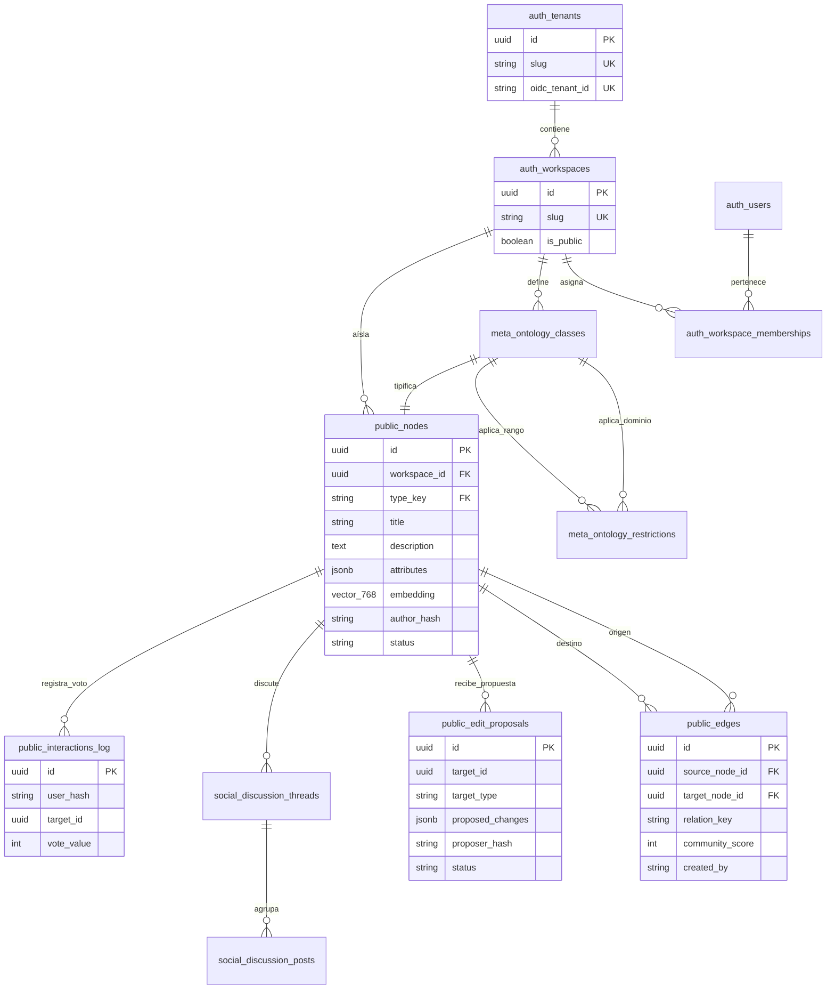
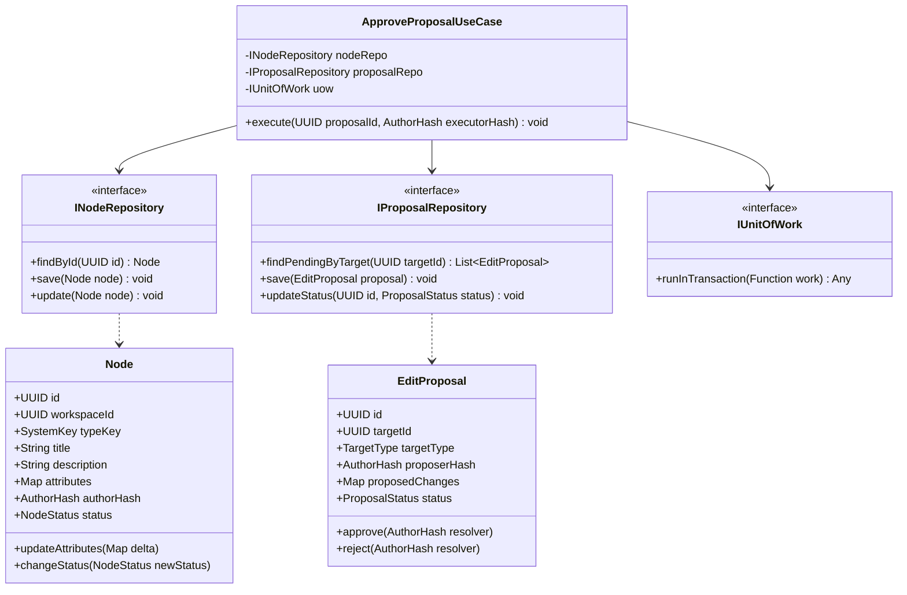
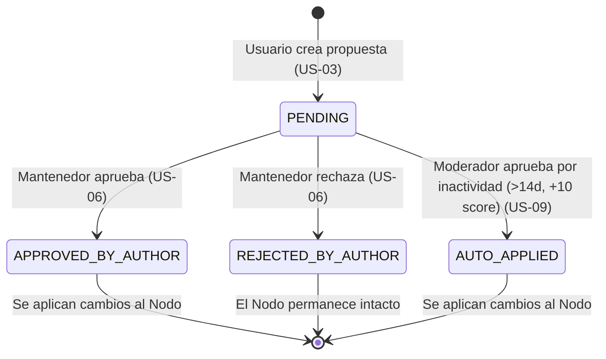
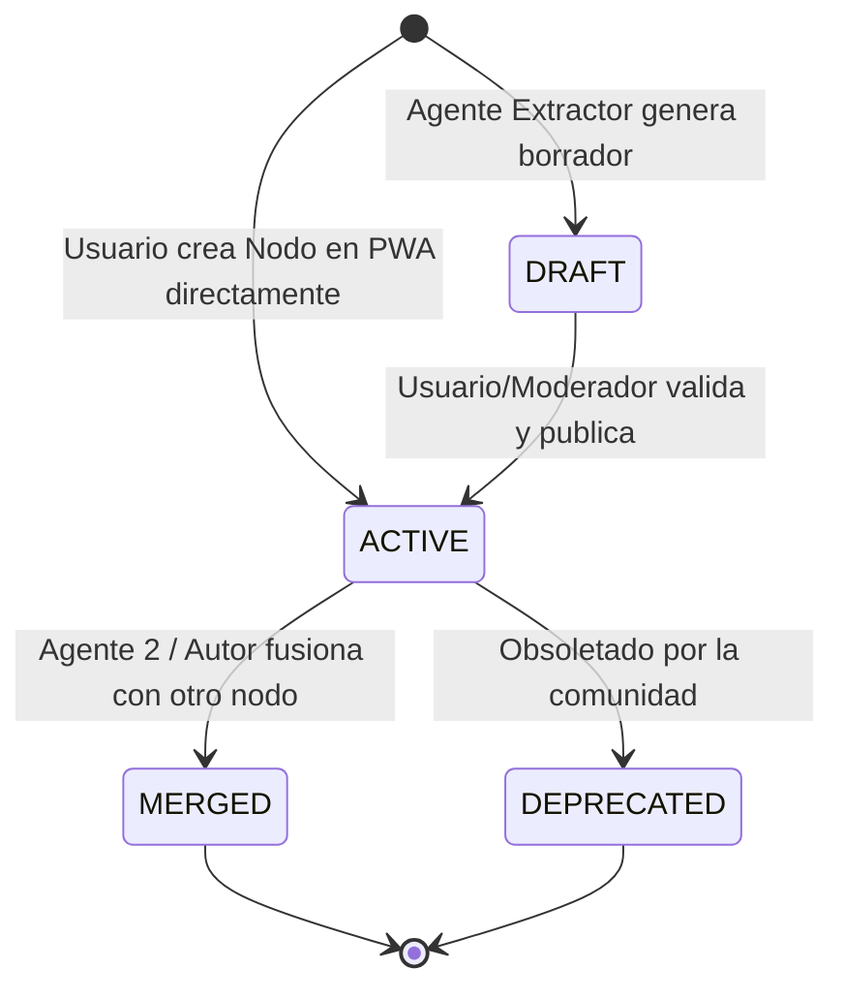
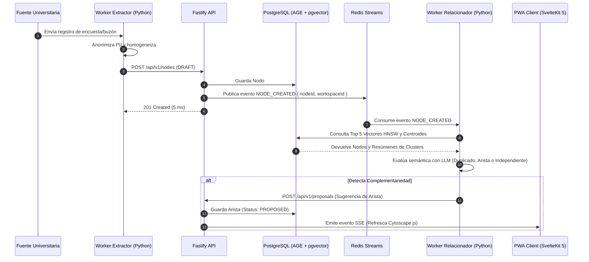

# 03. DIAGRAMAS UML, ARQUITECTURA Y DESPLIEGUE

## 1. Visión Estructural de Datos (Entity-Relationship Diagram - ERD)

El modelo de datos unificado convive en **PostgreSQL 16+** estructurado en cuatro esquemas principales: `auth` (identidad y multi-tenancy), `meta` (ontología dinámica), `public` (dominio del grafo y relaciones) y `social` (hilos de discusión e interacciones).

---

## 2. Diagrama de Clases del Domain Core (Arquitectura Hexagonal)

Representación orientada a objetos de la capa de Dominio e Interfaces (Puertos) aisladas de la infraestructura HTTP/DB en la API Fastify.

---

## 3. Diagrama de Máquina de Estados (Ciclo de Vida de Entidades)

### 3.1. Estado de una Propuesta de Edición (Pull Request)

### 3.2. Estado de Nodos e Ingesta de la IA

---

## 4. Diagrama de Secuencia: Ingesta, Evaluación y Reacción en Tiempo Real

Flujo asíncrono desde la ingesta atómica del Agente 1, la emisión a Redis Streams, la evaluación semántica cualitativa del Agente 2 y la notificación en tiempo real a la PWA.

---

## 5. Diagrama de Despliegue e Infraestructura Física (Deployment)

Topología de contenedores en producción sobre cluster gestionado (Kubernetes / Docker Swarm) con aislamiento multi-tenant y conexión al motor Ollama.

