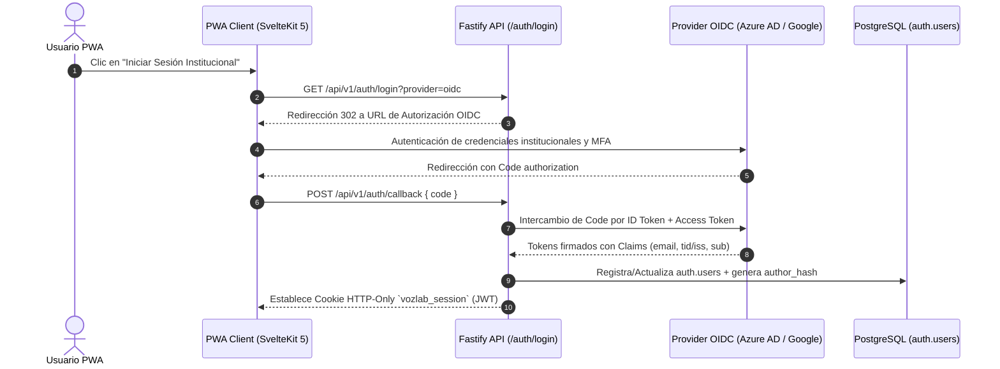
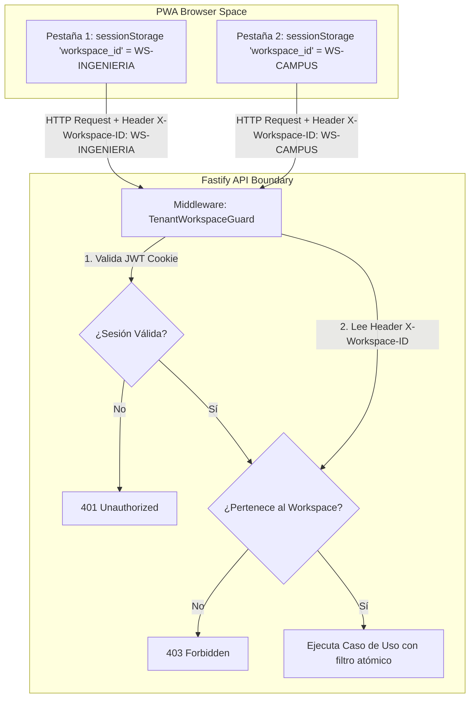
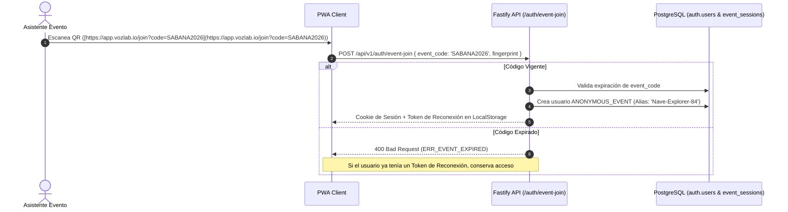

# 04. AUTENTICACIÓN, IDENTIDAD Y MULTI-TENANCY

## 1. Estrategia de Autenticación Delegada (Zero-Local Password)

VozLab elimina por completo el almacenamiento local de contraseñas, hashes de claves o factores de autenticación (MFA) dentro de sus bases de datos. Todo el flujo de identidad se delega en **Proveedores de Identidad (IdPs) externos** autorizados por la institución.



### 1.1. Mapeo Estricto por Claim `tid` / `iss`

1. **Extracción Criptográfica:** Durante la recepción del *ID Token* firmado por el IdP, la API extrae las *claims* institucionales:
* `tid`: Tenant ID exclusivo de Azure AD (Microsoft Entra ID).
* `iss`: Issuer URL de Google Workspace o IdP SAML 2.0.


2. **Validación contra Tabla de Tenants:** La API consulta `auth.tenants` buscando una coincidencia activa sobre `oidc_tenant_id`.
3. **Control de Acceso:**
* **Tenant Válido:** Se genera la sesión JWT interna de VozLab.
* **Tenant No Provisionado:** La petición se rechaza con HTTP `403 Forbidden` (`ERR_TENANT_NOT_PROVISIONED`). No existe auto-aprovisionamiento público no supervisado.


---

## 2. Gestión de Contexto Multi-Tenant y Workspaces (URL Limpia)

### 2.1. Navegación en la PWA (`app.vozlab.io`)

La aplicación no expone identificadores de Tenant o Workspace en la barra de direcciones del navegador. Esto garantiza URLs institucionales limpias (`https://app.vozlab.io/`, `https://app.vozlab.io/discussions`).



### 2.2. Aislamiento por Pestaña

* **`sessionStorage` Exclusivo:** El `workspace_id` seleccionado se guarda en el `sessionStorage` de cada pestaña.
* **Header `X-Workspace-ID`:** Toda petición HTTP REST/SSE enviada por el cliente adjunta este header.
* **Validación Stateless:** Fastify verifica en cada petición que el `user_id` de la sesión JWT tenga una membresía activa en `auth.workspace_memberships` para dicho `workspace_id`.

---

## 3. Acceso Anónimo y Eventos Presenciales (QR Code)

Para talleres de cocreación y eventos presenciales donde los asistentes no deben crear cuentas institucionales previas:



### 3.1. Seudónimos Persistentes

* **Generación de Alias:** El backend asigna un seudónimo aleatorio (ej. `Nave-Explorer-84`) y calcula el `author_hash` público.
* **Token de Reconexión (Device Fingerprint):** Se guarda un token firmado en el `LocalStorage` del navegador.
* **Expiración:** Vencida la ventana del evento (`expires_at`), el código impide la creación de **nuevas** cuentas anónimas, pero los usuarios anónimos ya registrados pueden reconectarse indefinidamente para seguir el impacto de sus aportes.

---

## 4. Estrategia de Aislamiento de Datos en PostgreSQL

Para garantizar el aislamiento de datos multi-tenant en una infraestructura compartida:

```sql
-- Ejemplo de consulta inmutable en Drizzle / postgres.js con aislamiento doble
SELECT 
    n.id, n.title, n.type_key, n.attributes
FROM public.nodes n
WHERE n.tenant_id = $1         -- Extraído directamente de la Cookie JWT
  AND n.workspace_id = $2      -- Extraído del Header X-Workspace-ID
  AND n.status = 'ACTIVE';

```

> [!CAUTION]
> **Prohibición de Consultas Globales:** Todo repositorio Drizzle o consulta Cypher en Apache AGE debe incluir en su cláusula `WHERE` los parámetros `tenant_id` y `workspace_id`. Queda estrictamente prohibida cualquier consulta de lectura o escritura que no especifique ambos filtros.

---

## 5. Invalidación y Revocación de Sesiones (Token Blacklist en Redis)

Cuando un administrador suspende a un usuario o este cierra sesión explicitamente (*Logout*):

1. **Emisión de Logout:** La API invalida la Cookie HTTP-Only.
2. **Blacklist en Redis:** La API registra el ID del token JWT (`jti`) en una lista negra en memoria Redis con un tiempo de vida (TTL) equivalente a la expiración máxima del JWT (24 horas).
3. **Middleware Check:** El middleware `AuthGuard` de Fastify consulta la existencia del `jti` en Redis mediante una operación `EXISTS` en $\mathcal{O}(1)$ antes de autorizar cualquier mutación en el sistema.

