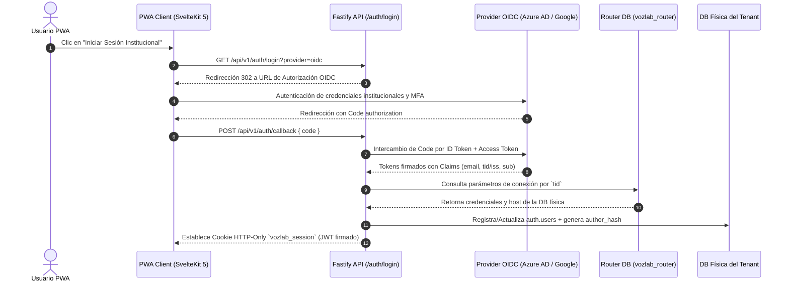
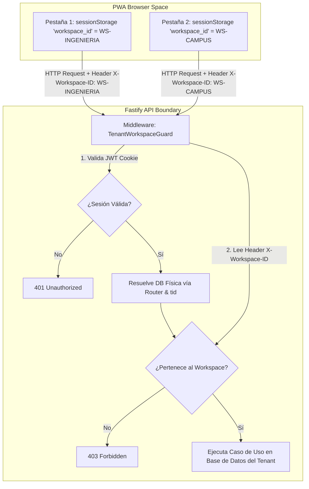
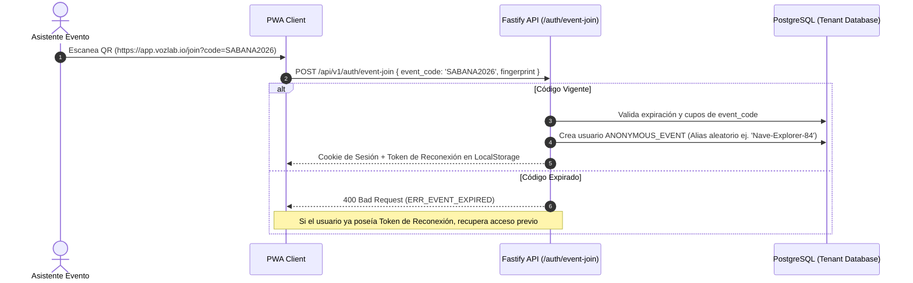

# 04. AUTENTICACIÓN, IDENTIDAD Y MULTI-TENANCY (BD FÍSICA AISLADA)

## 1. Estrategia de Autenticación Delegada (Zero-Local Password) y Aislamiento Multi-Tenant (BD Física Independiente)

VozLab elimina por completo el almacenamiento local de contraseñas, hashes de claves o factores de autenticación (MFA) dentro de sus bases de datos institucionales. Todo el flujo de identidad se delega en **Proveedores de Identidad (IdPs) externos** autorizados por cada organización.

La plataforma garantiza soberanía absoluta de datos mediante **bases de datos PostgreSQL físicas e independientes por institución**, administradas a través de un sistema central de enrutamiento dinámico basado en la base de datos gestora global (`vozlab_router`).

### 1.1. Mapeo Estricto por Claim `tid` / `iss` y Router Global

1. **Extracción Criptográfica de Claims:** Durante la recepción y validación del *ID Token* firmado por el IdP institucional, la API extrae las *claims* de pertenencia:
* `tid`: Tenant ID exclusivo de Azure AD (Microsoft Entra ID).
* `iss`: Issuer URL de Google Workspace o IdP SAML 2.0 alternativo.

2. **Consulta a la Base de Datos Gestora (`vozlab_router`):** La API consulta la tabla central `auth.tenants` (con caché en memoria Redis para evitar latencias) buscando el registro asociado a ese `tid` o `iss`.
3. **Resolución de Conexión Dinámica y Pool Dedicado:** El router retorna los parámetros de conexión física exclusivos de esa institución (`host`, `port`, `dbname`, credenciales encriptadas). La API abre o reutiliza un pool de conexiones dedicado de Drizzle ORM dirigido únicamente hacia la base de datos física del Tenant.

### 1.2. Control de Acceso y Rechazo de Provisión No Supervisada

* **Tenant Válido:** Si el `tid` existe en `vozlab_router`, la sesión JWT interna de VozLab se emite con los privilegios correspondientes.
* **Tenant No Provisionado:** La petición se rechaza de inmediato con código HTTP `403 Forbidden` (`ERR_TENANT_NOT_PROVISIONED`). No existe auto-aprovisionamiento público no supervisado para salvaguardar el perímetro institucional.

---

## 2. Gestión de Contexto Multi-Tenant y Workspaces (URL Limpia)

### 2.1. Navegación en la PWA (`app.vozlab.io`)

La interfaz de usuario no expone identificadores de Tenant o Workspace en la barra de direcciones del navegador, garantizando URLs limpias y profesionales (`[https://app.vozlab.io/](https://app.vozlab.io/)`, `[https://app.vozlab.io/discussions](https://app.vozlab.io/discussions)`).

### 2.2. Aislamiento por Pestaña (`sessionStorage`)

* **`sessionStorage` Exclusivo:** El `workspace_id` activo se almacena en el `sessionStorage` de cada pestaña de manera independiente, permitiendo que un usuario mantenga múltiples workspaces abiertos simultáneamente en distintas pestañas sin colisiones de estado.
* **Header `X-Workspace-ID`:** Toda petición HTTP REST o SSE enviada por el cliente adjunta este header de forma obligatoria.
* **Validación de Membresía:** El middleware de Fastify verifica en cada llamada que el usuario autenticado posea una membresía activa en `auth.workspace_memberships` dentro de la base de datos física del tenant para el `workspace_id` suministrado.

---

## 3. Acceso Anónimo y Eventos Presenciales (QR Code)

Para talleres de cocreación, hackathons o eventos presenciales masivos donde los asistentes externos no poseen cuentas institucionales previas:

### 3.1. Seudónimos Persistentes y Control de Huella

* **Generación de Alias:** El sistema asigna un seudónimo aleatorio inofensivo (ej. `Nave-Explorer-84`) y calcula un `author_hash` criptográfico seguro.
* **Token de Reconexión (Device Fingerprint):** Se almacena un token firmado en el `LocalStorage` del navegador del asistente.
* **Expiración Controlada:** Vencida la ventana temporal del evento (`expires_at`), el código impide la creación de **nuevas** cuentas anónimas, pero permite a los usuarios anónimos registrados reconectarse de forma persistente para seguir la evolución e impacto de sus aportes en el grafo.

---

## 4. Estrategia de Mitigación de Concurrencia de Conexiones (Thundering Herd)

Dado que la arquitectura implementa bases de datos físicas independientes por tenant, se implementa una estrategia defensiva en el backend para evitar la saturación por apertura desmedida de sockets:

1. **Connection Pool Cache Manager:** En el proceso de Node.js / Fastify se mantiene una caché en memoria de pools activos de Drizzle ORM agrupados por `tenant_id`.
2. **Reutilización de Conexiones:** Las conexiones permanecen abiertas en un pool optimizado y se reutilizan de manera eficiente ante peticiones subsecuentes del mismo tenant.
3. **Cierre por Inactividad (TTL):** Los pools inactivos durante más de 30 minutos liberan sus recursos de red de forma automática para evitar fugas de memoria o saturación de descriptores de archivos en el sistema operativo.

---

## 5. Invalidación y Revocación de Sesiones (Token Blacklist en Redis)

Ante eventos de suspensión de cuentas o cierre explícito de sesión (*Logout*):

1. **Invalidez de Cookie:** La API borra inmediatamente la cookie HTTP-Only del cliente.
2. **Blacklist en Redis Central:** Se registra el identificador único del token JWT (`jti`) en una lista negra alojada en Redis con un tiempo de vida (TTL) equivalente a la vigencia restante del token.
3. **Verificación Instantánea:** El middleware `AuthGuard` de Fastify evalúa la existencia del `jti` en Redis mediante una operación atómica `EXISTS` en $\mathcal{O}(1)$ antes de autorizar cualquier mutación en el sistema.

