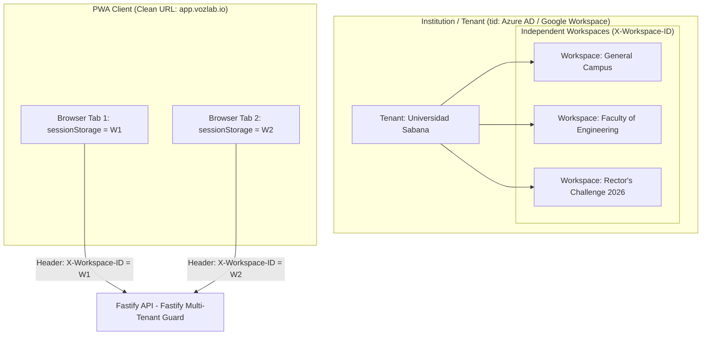
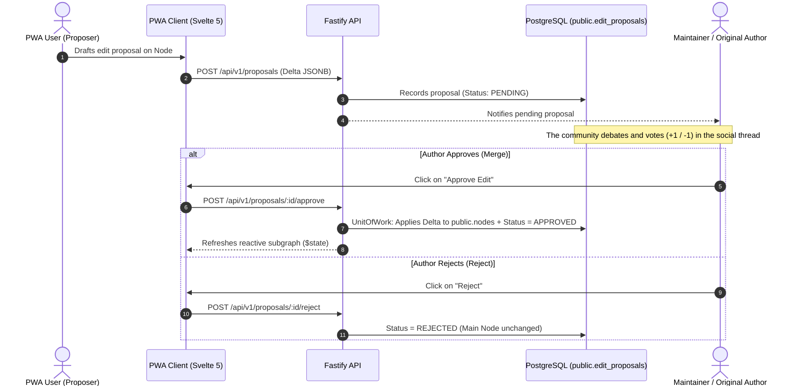
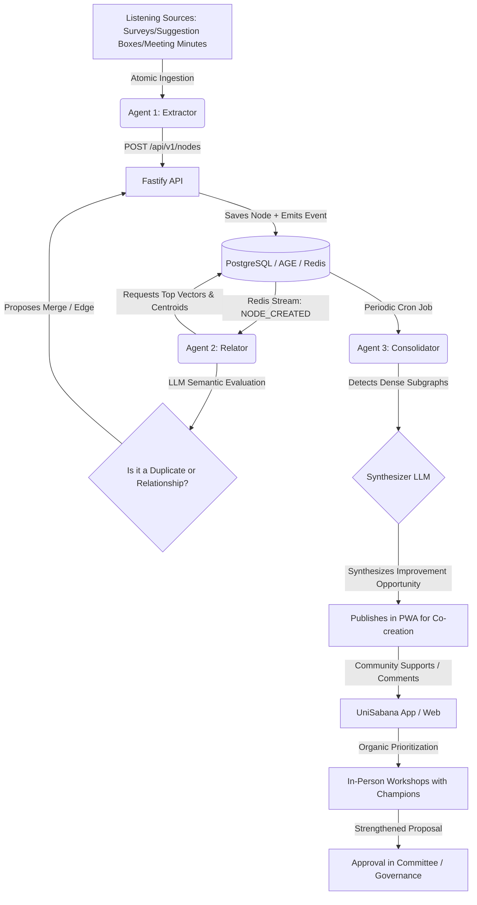

# 02. USE CASES AND ACTORS SPECIFICATION

## 1. System Actors Mapping and Identity Model

| Actor | Description | Access Level and Context | Identity Type |
| --- | --- | --- | --- |
| **Institutional Administrator (Tenant Admin)** | Administrator of the University/Institution. Manages the Tenant's Workspaces (`tid`) and members. | Tenant-global (`tid`). | Name/Email authenticated via OIDC/SSO (Azure AD / Google). |
| **PWA User (Common / Ally)** | Student, teacher, administrative staff or external ally. Creates nodes, argues, proposes edits and participates in discussions. | Workspace-specific (`X-Workspace-ID`). | Pseudonymous (`author_hash` derived from the SSO session or anonymous token). |
| **Maintainer / Author** | User who created a specific Node, Edge or Ontology Proposal. Acts as the owner/person responsible for the "Pull Request". | Object scope within the Workspace. | Pseudonymous (`author_hash` matching the object's creator). |
| **Committee / Moderator / Champions** | Supervised institutional role and institutional Champions to unblock proposals or participate in co-creation workshops. | Workspace / Tenant-specific. | Pseudonymous with elevated privileges (`ROLE_ADMIN` / `ROLE_MODERATOR`). |
| **Agent 1: Extractor (AI)** | Multi-source atomic ingestion service that reads university channels and creates Node drafts via API. | System Service (`apps/worker-extractor`). | System Bot (`AGENT_EXTRACTOR`). |
| **Agent 2: Relator (AI)** | Event-driven service that qualitatively evaluates the relationship of new nodes against nearby clusters and nodes. | System Service (`apps/worker-relacionador`). | System Bot (`AGENT_RELACIONADOR`). |
| **Agent 3: Consolidator (AI)** | Scheduled/cron service that analyzes dense clusters and drafts Consolidated Improvement Opportunities. | System Service (`apps/worker-consolidador`). | System Bot (`AGENT_CONSOLIDADOR`). |

---

## 2. Context Definition and Multi-Tenant Hierarchy

1. **Tenant Isolation (`tid` / OIDC Claim):**
* Each client institution has a provisioned instance whose Tenant ID (`tid`) is extracted from the OIDC/SSO delegation. No local passwords exist.

2. **Workspace Navigation (Clean URL + Multi-Tab):**
* A Tenant contains multiple Workspaces. The PWA keeps the clean URL (`app.vozlab.io/`) and stores the `workspace_id` in the **per-tab independent `sessionStorage`**.
* Each HTTP request attaches the `X-Workspace-ID` header. Fastify validates permissions in a *stateless* and immutable manner on every query.

---

## 3. User Stories by Actor

### 3.1. Institutional Administrator (Tenant Admin)

#### US-00: Workspace Provisioning and Configuration

* **As** an Institutional Administrator,
* **I want** to create and configure a workspace (Workspace) by assigning its parameters and initial administrators,
* **So that** I can organize the collaborative work of a faculty or project without mixing data contexts.
* **Acceptance Criteria:**
    1. It is verified that the user's session belongs to the active Tenant ID (`tid`).
    2. Creates a record in `auth.workspaces` and assigns it the base ontology in `meta.*`.
    3. It does not modify the public URL; the new workspace becomes available in the PWA selector.

---

### 3.2. PWA User (Common / Ally)

#### US-01: Creation of a Node in the Graph (Idea, Problem, Resource)

* **As** a PWA User authenticated in an active Workspace,
* **I want** to draft a new initiative or report by selecting a type from the active ontology,
* **So that** I can make a problem or solution visible in the institutional graph.
* **Acceptance Criteria:**
    1. The PWA form dynamically requests the attributes defined in `meta.datatype_properties` for the chosen class.
    2. On saving, the Fastify API records the Node in `public.nodes`, assigning `(tenant_id, workspace_id)` and the creator's `author_hash` (granting them the role of **Maintainer** over this element).
    3. The `NODE_CREATED` event is emitted to Redis Streams to trigger vector indexing and Agent 2's evaluation.
    4. The PWA updates the subgraph through Svelte 5 Runes (`$state`) without reloading the page.

#### US-02: Proposal of a New Ontological Type or Attribute

* **As** a PWA User,
* **I want** to suggest a new type of Node, Edge or Attribute that does not exist in the current ontological catalog,
* **So that** I can expand the expressive capacity of the platform according to the needs of the debate.
* **Acceptance Criteria:**
    1. The proposal is stored in `meta.*` with `PROPOSED` status.
    2. The creating user can use the proposal immediately in local draft mode within their Workspace.
    3. A discussion thread is automatically opened in `social.discussion_threads`.

#### US-03: Edit Proposal on Existing Content (Pull Request)

* **As** a PWA User,
* **I want** to propose a correction, addition or wording improvement on a Node or Edge belonging to someone else,
* **So that** I can raise the precision of the information without destructively overwriting someone else's work.
* **Acceptance Criteria:**
    1. An immutable record is generated in `public.edit_proposals` with the changes in delta format (`proposed_changes JSONB`) and `PENDING` status.
    2. The Maintainer/Author of the original object is notified.
    3. The proposal is linked to the discussion thread to receive informative votes from the community.

#### US-04: Gamified Interaction and Co-creation

* **As** a PWA User,
* **I want** to support, comment on, rate or complement opportunities and proposals from other users,
* **So that** I can filter relevant content and help organically prioritize the best initiatives.
* **Acceptance Criteria:**
    1. Each action records an immutable entry in `public.interactions_log`.
    2. The database executes a transaction in `UnitOfWork` that updates the denormalized counters (`upvotes`, `downvotes`, `community_score`) in $\mathcal{O}(1)$.
    3. The system validates the restriction of a single active vote per user and target (`unique_user_target_vote`).

#### US-05: Multi-Tab Navigation and Switching

* **As** a PWA User,
* **I want** to switch workspaces from the sidebar selector in one tab without affecting the context of other open tabs,
* **So that** I can work in parallel on multiple projects or faculties without interference.
* **Acceptance Criteria:**
    1. The selection updates the `workspace_id` in the tab-exclusive `sessionStorage` ($0\text{ ms}$).
    2. Subsequent requests send the `X-Workspace-ID` header corresponding to that tab.
    3. Cytoscape.js downloads and renders the new subgraph independently.

---

### 3.3. Maintainer / Object Author

#### US-06: Review, Merge or Rejection of Proposals (Merge / Reject)

* **As** the Maintainer/Author of a Node, Edge or Ontological Element,
* **I want** to evaluate the edit proposals that other users have made on my content,
* **So that** I can accept the improvements that add value or reject those that distort the original idea.
* **Acceptance Criteria:**
    1. **Acceptance (Merge):** In an atomic `UnitOfWork` block, the API applies the delta changes to the main object and marks the proposal as `APPROVED_BY_AUTHOR`.
    2. **Rejection (Reject):** The main object remains intact and the proposal changes to `REJECTED_BY_AUTHOR`.
    3. The auditor of the action is recorded (`resolved_by`, `resolved_at`).

---

### 3.4. Agent 1: Extractor (Atomized Multi-Source Ingestion)

#### US-07: Atomic Ingestion of Heterogeneous Listening Sources

* **As** the Extractor Agent (asynchronous Worker in Python),
* **I want** to consume atomic records from surveys, suggestion boxes, meeting minutes and non-confidential university comments,
* **So that** I can homogenize their format, extract key ideas and enter them as Node/Edge drafts into the API.
* **Acceptance Criteria:**
    1. It processes messages **record by record**, filtering any personally identifiable information (PII).
    2. It invokes the Fastify API (`POST /api/v1/nodes`) authenticated as a system bot.
    3. The API saves the nodes in `DRAFT` or `ACTIVE` status, guaranteeing that they pass through all the Workspace ontology validations.

---

### 3.5. Agent 2: Relator (Qualitative Semantic Evaluation)

#### US-08: Non-Deterministic Semantic Evaluation and Connection Suggestion

* **As** the Relator Agent (asynchronous Worker in Python),
* **I want** to evaluate new nodes by contrasting them against the closest Active Clusters' Nodes and Centroids,
* **So that** I can qualitatively determine whether the node should be merged, connected through an edge, or kept independent because it contributes a new nuance.
* **Acceptance Criteria:**
    1. It listens for `NODE_CREATED` events in Redis Streams and requests from the database the top 5 closest vectors and centroids (`pgvector`).
    2. An LLM model analyzes the semantic context (not only the mathematical distance).
    3. If it is an exact duplicate, it creates a merge proposal (`MERGED_INTO`). If it is complementary, it creates an Edge in `PROPOSED` status. If it contributes a relevant nuance, it confirms the node as independent.

---

### 3.6. Agent 3: Consolidator (Synthesis and Opportunities)

#### US-09: Macroscopic Consolidation and Publication of Improvement Opportunities

* **As** the Consolidator Agent (scheduled Worker in Python),
* **I want** to analyze the density of subgraphs and community interactions in the database,
* **So that** I can synthesize multiple scattered findings into a **Consolidated Improvement Opportunity** with aggregated evidence.
* **Acceptance Criteria:**
1. It runs a periodic job that queries clusters with high community interaction in PostgreSQL/AGE.
2. It synthesizes the aggregated evidence using an LLM and drafts the Improvement Opportunity.
3. It publishes the Opportunity in the PWA to start the enrichment and co-creation cycle with the community and the institutional Champions.

---

## 4. Flow Diagrams of Key Processes

### 4.1. Collaborative Editing Flow (Pull Request on the Graph)

### 4.2. Complete Ingestion, Evaluation and Co-creation Flow

