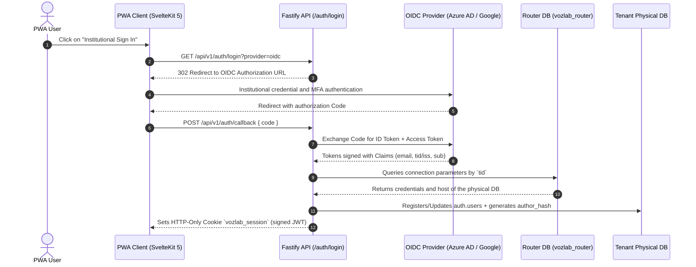
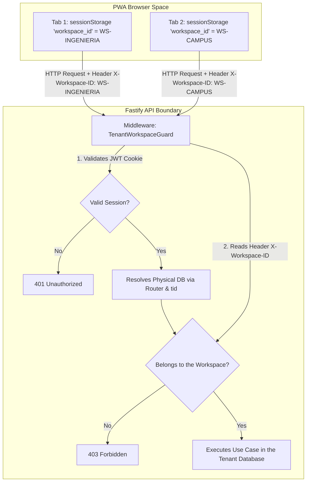
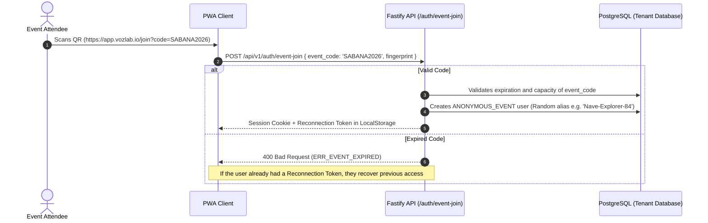

# 04. AUTHENTICATION, IDENTITY AND MULTI-TENANCY (ISOLATED PHYSICAL DB)

## 1. Delegated Authentication Strategy (Zero-Local Password) and Multi-Tenant Isolation (Independent Physical DB)

VozLab completely eliminates the local storage of passwords, key hashes or authentication factors (MFA) within its institutional databases. The entire identity flow is delegated to **external Identity Providers (IdPs)** authorized by each organization.

The platform guarantees absolute data sovereignty through **physical, independent PostgreSQL databases per institution**, administered via a central dynamic routing system based on the global manager database (`vozlab_router`).

### 1.1. Strict Mapping by `tid` / `iss` Claim and Global Router

1. **Cryptographic Claim Extraction:** During the reception and validation of the *ID Token* signed by the institutional IdP, the API extracts the membership *claims*:
* `tid`: Tenant ID exclusive to Azure AD (Microsoft Entra ID).
* `iss`: Issuer URL of Google Workspace or an alternative SAML 2.0 IdP.

2. **Query to the Manager Database (`vozlab_router`):** The API queries the central `public.tenants` table (with Redis in-memory cache to avoid latencies), looking for the record associated with that `tid` or `iss`. *(Note: `tenants` lives in the `public` schema of the dedicated routing database `vozlab_router`; it does not require its own `auth` schema because that database is single-purpose.)*
3. **Dynamic Connection Resolution and Dedicated Pool:** The router returns the physical connection parameters exclusive to that institution (`host`, `port`, `dbname`, encrypted credentials). The API opens or reuses a dedicated Drizzle ORM connection pool aimed solely at the Tenant's physical database.

### 1.2. Access Control and Rejection of Unsupervised Provisioning

* **Valid Tenant:** If the `tid` exists in `vozlab_router`, VozLab's internal JWT session is issued with the corresponding privileges.
* **Non-Provisioned Tenant:** The request is rejected immediately with HTTP code `403 Forbidden` (`ERR_TENANT_NOT_PROVISIONED`). There is no unsupervised public self-provisioning in order to safeguard the institutional perimeter.

---

## 2. Multi-Tenant Context and Workspaces Management (Clean URL)

### 2.1. Navigation in the PWA (`app.vozlab.io`)

The user interface does not expose Tenant or Workspace identifiers in the browser address bar, guaranteeing clean and professional URLs (`[https://app.vozlab.io/](https://app.vozlab.io/)`, `[https://app.vozlab.io/discussions](https://app.vozlab.io/discussions)`).

### 2.2. Per-Tab Isolation (`sessionStorage`)

* **Exclusive `sessionStorage`:** The active `workspace_id` is stored in the `sessionStorage` of each tab independently, allowing a user to keep multiple workspaces open simultaneously in different tabs without state collisions.
* **`X-Workspace-ID` Header:** Every HTTP REST or SSE request sent by the client attaches this header mandatorily.
* **Membership Validation:** The Fastify middleware verifies on every call that the authenticated user holds an active membership in `auth.workspace_memberships` within the tenant's physical database for the supplied `workspace_id`.

---

## 3. Anonymous Access and In-Person Events (QR Code)

For co-creation workshops, hackathons or massive in-person events where external attendees do not have prior institutional accounts:

### 3.1. Persistent Pseudonyms and Fingerprint Control

* **Alias Generation:** The system assigns an inoffensive random pseudonym (e.g. `Nave-Explorer-84`) and computes a secure cryptographic `author_hash`.
* **Reconnection Token (Device Fingerprint):** A signed token is stored in the attendee's browser `LocalStorage`.
* **Controlled Expiration:** Once the event's time window has expired (`expires_at`), the code prevents the creation of **new** anonymous accounts, but allows registered anonymous users to reconnect persistently to follow the evolution and impact of their contributions in the graph.

---

## 4. Connection Concurrency Mitigation Strategy (Thundering Herd)

Since the architecture implements independent physical databases per tenant, a defensive strategy is implemented in the backend to avoid saturation from unrestrained socket opening:

1. **Connection Pool Cache Manager:** In the Node.js / Fastify process, an in-memory cache of active Drizzle ORM pools grouped by `tenant_id` is maintained.
2. **Connection Reuse:** Connections remain open in an optimized pool and are efficiently reused on subsequent requests from the same tenant.
3. **Idle Closure (TTL):** Pools inactive for more than 30 minutes automatically release their network resources to avoid memory leaks or saturation of file descriptors in the operating system.

---

## 5. Session Invalidation and Revocation (Token Blacklist in Redis)

In the event of account suspension or explicit session closure (*Logout*):

1. **Cookie Invalidation:** The API immediately deletes the client's HTTP-Only cookie.
2. **Central Redis Blacklist:** The unique identifier of the JWT token (`jti`) is recorded in a blacklist hosted in Redis with a time to live (TTL) equivalent to the token's remaining validity.
3. **Instant Verification:** Fastify's `AuthGuard` middleware evaluates the existence of the `jti` in Redis through an atomic `EXISTS` operation in $\mathcal{O}(1)$ before authorizing any mutation in the system.
