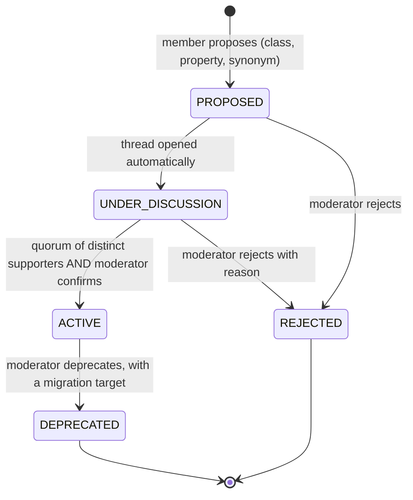

# 07 — Graph and ontology

Your vision is a knowledge base built on an ontology that **grows through community input**, with nodes and
edges that support higher-level analysis, internal and external. This file answers three questions: what graph
capability exists today, whether a graph database is needed, and what has to change for the ontology to grow
through governance rather than through the database.

## 1. The judgment

1. **Do not add a graph database now.** PostgreSQL is the system of record and the bounded recursive query serves the
   product's current reads. The decision record (ADR-0004, ADR-0027) is correct, and its trigger is a sound test.
2. **The ontology's governance is the real gap, and it comes before any engine choice.** Properties cannot be
   activated, ontology changes cannot be voted on, nothing versions or migrates a class, and each workspace has its
   own vocabulary. A graph engine would store exactly the same unfinished model faster. [repo][juicio]
3. **Graph analytics can start in Python on derived tables.** Community detection, centrality and similar algorithms
   belong in a scheduled batch job (the Consolidator's natural home) that writes results with their provenance.
4. **A graph engine becomes a read projection, not a second source of truth, and only after events are reliable.**
   That requires an outbox (F-12). Without it, a projection silently diverges from the database.

## 2. The graph as built

| Element | Implementation | Notes |
| --- | --- | --- |
| Node | `public.nodes`: id, workspace, `type_key` (a class), title, description, JSONB attributes, embedding, status, score, author pseudonym, soft delete | Typed by an ontology class of the same workspace. |
| Edge | `public.edges`: source, target, `relation_key` (an object property), JSONB attributes, status, score, author pseudonym, soft delete | Directed. Domain and range validated only when the relation key resolves to a property (FR-08 partial: unknown keys are accepted). |
| Class | `meta.ontology_classes`: system key, locale maps for names and descriptions, parent key (logical), status | Per workspace. |
| Datatype property | `meta.datatype_properties`: key, datatype (`string`, `number`, `boolean`, `date`, `enum`), required flag, domain class | Drives the node form. Only active properties reach the form. |
| Object property | `meta.object_properties`: key, domain class, range class, directional and symmetric flags | Drives the relation picker. Only active properties are returned. |
| Score | Counter on nodes, edges, proposals and posts, updated synchronously | ADR-0005. |
| Traversal | Recursive CTE, ranked by strength then recency (ADR-0027) | Measured on synthetic data only. |

**Scale and shape today.** The seeded demo has 24 nodes and 35 relations in three clusters, with two bridges.
The synthetic performance figures in ADR-0027 used 50 000 nodes and 200 000 relations. No real institutional graph
exists yet. [repo] ROADMAP 3.8; ADR-0027

## 3. The ontology: what it is, and what it is not

- **It is a per-workspace vocabulary.** Every class and property row carries a `workspace_id`. Two workspaces in the
  same institution have separate ontologies, so "Problem" in one is not the same object as "Problem" in another,
  and no mapping exists between them. Cross-workspace analysis is therefore impossible without a mapping layer.
  This is probably right for autonomy, and it must be a deliberate decision (D-39 in `15`).
- **It is not formal.** There are no OWL axioms, no SHACL shapes, no subclass reasoning (the `parent_class_key` is
  logical, not interpreted), and no cardinality rules. Validation is domain and range on relations and
  required-field checks in the form. That is adequate for a community tool. It is not an ontology in the formal sense.
- **Its lifecycle is partly built.** Classes: `PROPOSED → ACTIVE` through a moderator route. Properties: `PROPOSED`
  and nothing else. [repo] `domain-model.md` §5

## 4. Ontology governance: the gaps that block community growth (F-16)

| # | Gap | Effect on "grows through community input" |
| --- | --- | --- |
| G1 | Properties cannot be activated; no route exists. | A community can propose a relation type or an attribute, and it never becomes usable. The vocabulary cannot grow beyond classes. **Blocking.** |
| G2 | Ontology proposals are not votable. Votes target nodes, edges, edit proposals and posts only. | Community input on the vocabulary is limited to discussion threads, which are not linked to the proposal (FR-11 partial). |
| G3 | Only moderators and admins activate classes. | Reasonable as a default; the rule for distinct supporters and quorum is missing. |
| G4 | No rejection route from `PROPOSED`. The transition exists in the domain only. | Rejected ideas stay in limbo. |
| G5 | No deprecation, merge or rename of classes or properties. | Synonyms accumulate ("Problem", "Problema", "Issue"). The graph fragments. |
| G6 | No versioning and no migration of nodes when a class changes or is deprecated. | Historical data becomes unreadable under a changed vocabulary. |
| G7 | Property `system_key` is not unique. `findObjectProperty` returns the first match. | Ambiguity at the moment of relation creation. |
| G8 | Locale completeness does not appear to be checked on activation (judgment from the use case; confirm with a test). | A class can be activated with one language only, and the interface falls back. |
| G9 | Ontology events are published (`ontology_class_proposed`, `ontology_class_activated`, `ontology_property_proposed`), but no consumer reads them and there is no event for deprecation or migration. | Downstream processes (embedding refresh, Relator rules, reports) cannot react to a change in the vocabulary. |

**Proposed ontology lifecycle (judgment, to decide as D-12):**

Design principles behind it:

- **Count distinct people, not votes.** Votes are one per user per target, which is right, but one person can
  hold several accounts if they joined by several event codes. Quorum should count distinct institutional accounts
  for vocabulary decisions, with anonymous event members able to support but not to decide. [juicio]
- **Every activation is an event, and something consumes it.** Activation already publishes an event; the gap is
  the absence of consumers and of deprecation and migration events (G9). Embedding refresh, the Relator's rules and
  the reports can then react to a change in the vocabulary.
- **Deprecation requires a migration target.** Nodes and edges that use a deprecated key are re-typed by a proposal
  (so the change is reviewed) rather than by a silent script.
- **Locale completeness is a precondition of activation** (G8).

## 5. Analytics and what each analysis needs

| Analysis | Why it matters | Where to compute | Frequency | Output |
| --- | --- | --- | --- | --- |
| k-hop neighbourhood, paths up to three hops | The explorer and the walk | SQL recursive query (today) | On request | None; live read |
| Shortest path between two nodes | "How does this idea connect to that problem?" | SQL with a bounded search (feasible), or a graph engine if frequent | On request | None |
| Community detection (Leiden or Louvain) | Finds the clusters the Consolidator needs | Python batch on the exported workspace subgraph | Nightly or on demand | `analytics.community_membership` with algorithm version and timestamp |
| Centrality (PageRank, degree) | Identifies hubs and under-linked ideas | Python batch | Nightly | `analytics.node_centrality` |
| Duplicate candidates | Feeds the Relator and the merge review | Embedding similarity plus shared neighbours | On node creation (already) | Edge or proposal, as today |
| Coverage gaps (problems without ideas) | Shows the community where to work | SQL aggregation | Nightly | Materialised view with refresh time |
| Temporal change (how a cluster evolved) | Reporting for stakeholders | Snapshots of community membership | Weekly | Snapshot table |

**Rule for derived tables:** every row carries `computed_at`, the `algorithm` and its version, and the input
snapshot identifier. A derived table is never edited by hand and never treated as truth. It is regenerated.

**Library choices (verify licences before adoption):** the Python ecosystem has mature implementations of these
algorithms (for example igraph, NetworkX and graspologic). Some graph libraries carry copyleft licences, so the
choice must be checked against your distribution model, not assumed. [juicio]

## 6. Graph database options compared

The table compares the options that a serious reviewer would consider for this product. Verdicts assume the
triggers in section 8 have not fired.

| Option | Model and query language | Licence and hosting (as found) | Fit for VozLab | Verdict |
| --- | --- | --- | --- | --- |
| **PostgreSQL recursive CTE (current)** | Relational; SQL | PostgreSQL licence; available from every provider | Good for bounded traversal with indexes; the product's current reads. ADR-0027 measured it. | **Keep.** |
| Apache AGE on PostgreSQL | Property graph; openCypher | Apache 2.0 [web, verify]; not offered by Amazon RDS (community issue #998) | Would give Cypher inside the same database, but ties the graph to an extension that managed PostgreSQL does not provide. ADR-0027 found no evidence it beats the CTE for this shape. | **Not now.** Remove from the default image (`05` §13). |
| Neo4j | Property graph; Cypher; Graph Data Science library for community and centrality algorithms | Community edition GPLv3 for a single instance; Enterprise is commercial; AuraDB Professional from about US$0.09 per GB-hour on the vendor's page [web] | Mature, expressive, strong analytics, good tooling. Needs a projection from PostgreSQL. | **Best candidate for a projection** when a trigger fires. Review licence obligations for your distribution model. |
| Amazon Neptune (Database and Analytics) | Database: openCypher, Gremlin, SPARQL. Analytics: in-memory algorithms and vector similarity [web] | AWS-managed; I/O-optimised rate about US$0.217 per NCU-hour in US East per a secondary source [web]; serverless does not scale to zero [web] | Strongest if you are committed to AWS and need RDF interoperability. Analytics is a good match for batch algorithms. Needs a projection. | **Candidate** if AWS is the platform and interoperability with RDF becomes a requirement. |
| Kùzu (embedded) | Property graph; openCypher | MIT licence, but **archived on 10 October 2025** after its acquisition by Apple; forks exist (LadybugDB, Bighorn) [web] | Would have been a clean embedded option. Its maintenance has ended under its original name. | **Do not adopt.** |
| RDF stores (Oxigraph, Apache Jena Fuseki, GraphDB, Stardog) | RDF; SPARQL; SHACL for validation | Varies; Oxigraph and Jena are open source (verify) | Excellent for ontology interchange and formal validation. Poor fit for transactional writes at this scale. | **Use as an export format** (JSON-LD or Turtle), not as the store. |
| SurrealDB | Multi-model (document, graph, vector) | Source-available licence (verify) | Interesting consolidation of graph and vector, but a second database engine changes the whole data layer. The team's skills library covers it, which is not the same as the product needing it. | **Not now.** Revisit only in a deliberate re-architecture. |
| Memgraph, FalkorDB, TigerGraph, ArangoDB | Various | Various | Not evaluated in depth for this review. | Not recommended without a trigger. |

## 7. What a projection needs before any external graph engine

A graph engine that receives changes from PostgreSQL is a **projection**. It is only trustworthy if the
projection cannot silently fall behind. Today it could: publication is fire-and-forget (F-12).

| Requirement | Design |
| --- | --- |
| Atomic change capture | An `outbox` table in the tenant database, written in the same transaction as the change. |
| Reliable relay | A relay reads the outbox in order and publishes; rows are marked after publication. Retries are safe. |
| Idempotent consumer | The projection applies each change at most once, keyed by the outbox id. |
| Reconciliation | A periodic job compares counts and a checksum per workspace between PostgreSQL and the projection. |
| Backfill | A tool replays a workspace from the source of truth. Required for any new projection. |
| Schema version | Each event carries a version so that consumers can be upgraded independently. |
| Rebuild | The projection can be dropped and rebuilt from PostgreSQL in a documented time. |

Estimated effort for the outbox and relay alone: about three to four weeks, including tests [juicio]. It also
fixes F-12, which is valuable regardless of any graph engine.

## 8. The triggers that would change the answer

Use these as decision criteria, not as hopes. Any one of them justifies reopening the question.

1. The subgraph query at depth three, on 1 million nodes and 3 million relations, has a p95 above 300 ms **after**
   the CTE has been tuned (ADR-0027 trigger, to be run as a load test).
2. A product requirement needs shortest paths or all paths of bounded length **interactively** across relation
   types, and the bounded SQL cannot express or serve it.
3. Cross-institution analytics is required. This needs a new governance model first (ADR-0002 forbids it today).
4. Community detection or centrality must be interactive rather than nightly.
5. Institutions require RDF or SPARQL interchange of the ontology, which would also make an RDF store relevant.

## 9. Growth from community input: what the platform should do first

In order, and each step is small:

1. Close G1 (activate properties) and G4 (reject from proposed), with tests.
2. Make ontology proposals votable with the distinct-supporter rule (G2, G3).
3. Link every ontology proposal to a discussion thread automatically (FR-11).
4. Enforce locale completeness on activation (G8) and make `system_key` unique per workspace for properties (G7).
5. Add deprecation and migration targets (G5, G6), and add deprecation events and a first consumer for the
   existing ontology events (G9).
6. Export the ontology as JSON-LD (classes and properties mapped to schema.org or SKOS terms where they exist).
   This answers "external processes" without changing the store.
7. Build the outbox (section 7) before any projection.
8. Run the first community-detection batch and show its output to the community as a draft "map", labelled as
   algorithmic and reviewable. This is the most visible way to demonstrate the value of the graph, and it needs no
   new database.

## 10. What to measure to know the ontology is growing well

| Measure | Healthy sign | Warning sign |
| --- | --- | --- |
| Proposals per active member per month | Steady, from many distinct members | One or two members produce most proposals |
| Share of proposals activated | Moderate; decisions are real | Near 0 (nothing gets through) or near 100 (no review) |
| Time from proposal to decision | Days, with a clear reason | Weeks, or no decision |
| Synonym clusters per class | Low and falling after merges | Rising |
| Nodes typed with deprecated keys | Falling to zero after migration | Persistent |
| Edges per node, by relation type | A few types dominate and others grow | One relation type for everything (the vocabulary is not used) |

## 11. Interoperability for external processes

Your requirement includes "higher-level processes, internal or external". The store does not need to change for
that. Three export formats cover most of it:

| Format | Use | Notes |
| --- | --- | --- |
| JSON-LD (per workspace) | Interchange with other systems; semantic web tooling | Map classes and relations to existing vocabularies where a match exists. Keep the internal keys as the source. |
| GraphML or Parquet | Analysis in notebooks and BI tools | Nodes and edges tables with the derived metrics. |
| CSV per entity | Reporting for stakeholders | The simplest and most used. |

Exports are also a data-portability obligation in many jurisdictions and a product feature for institutions
(`05` §8). Authorise exports by role, log them, and exclude personal data by design.
